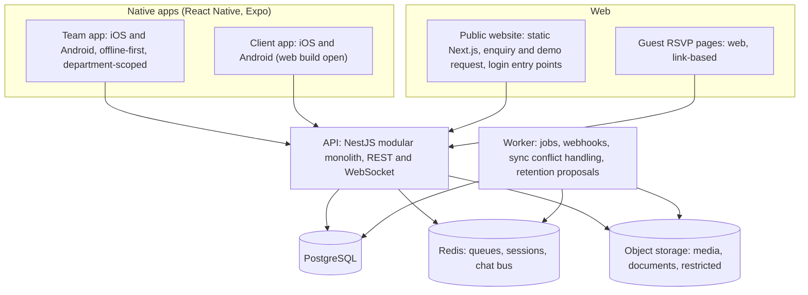
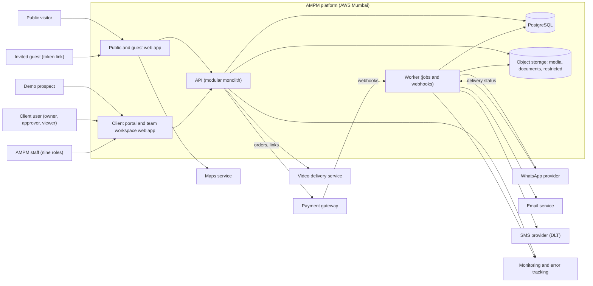
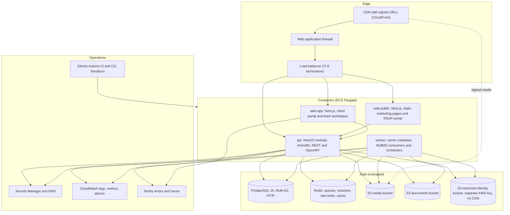
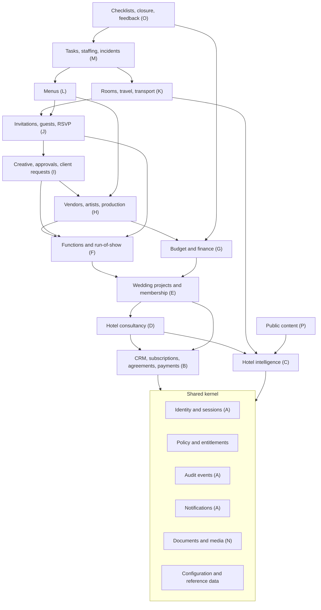
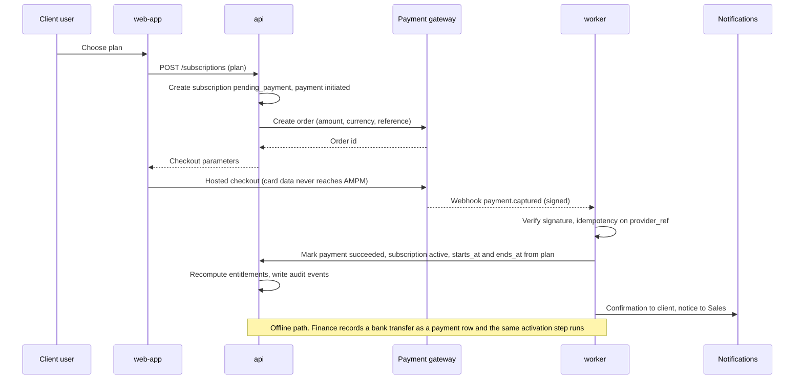
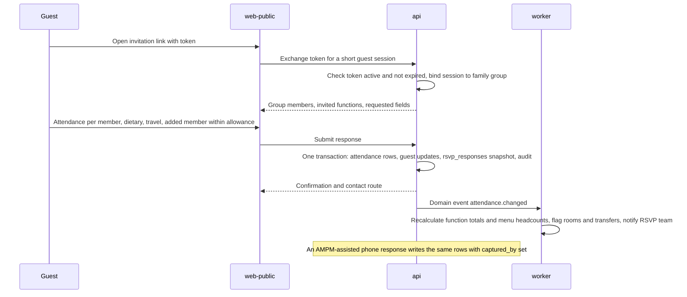
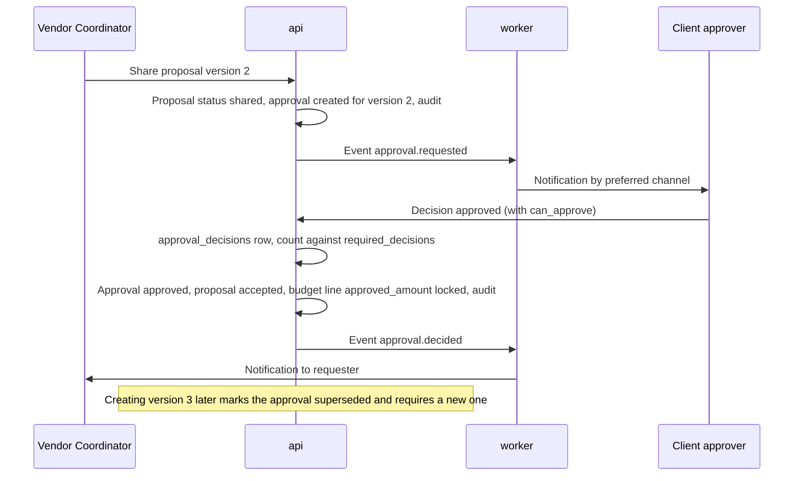
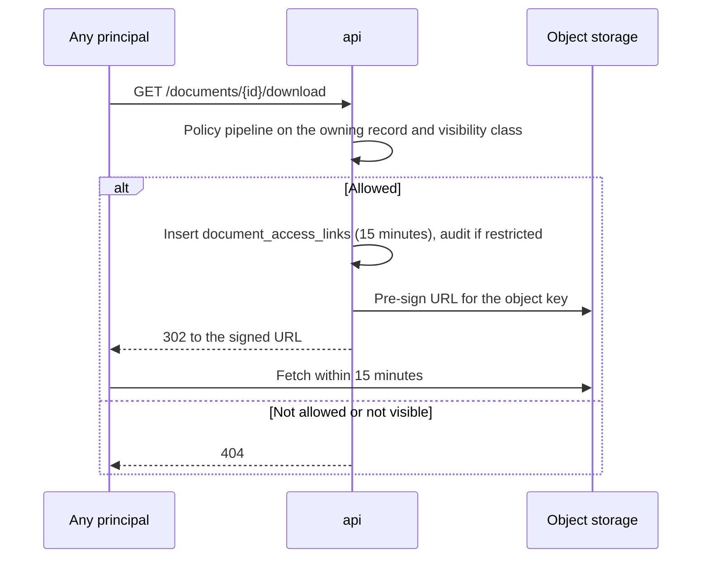

# AMPM Platform — Technical Architecture and Integration Plan

**Status:** DRAFT v0.2, 25 October 2026. AMPM's decisions of 25 October applied where they change the architecture (§0a) and stamped on every decision in §0. Not yet signed off.
**Companions:** [requirements-audit.md](requirements-audit.md) (Q numbers), [data-model.md](data-model.md) (A-1 to A-30), [permission-matrix.md](permission-matrix.md) (P-1 to P-11), [field-matrix.md](field-matrix.md).
**Source of truth being extended:** SPEC §10 (technical and non-functional requirements), §13 (technology ownership, integrations), §14 ("technical architecture and integration plan"), BIZ §8 item 6 ("recommend the technology, hosting, security, backups and maintenance approach"), and audit findings GP-33 to GP-44.

This document recommends; AMPM decides. Every recommendation that depends on an open question carries a decision ID (T-n) that names the question, the alternative, and what it would cost to change later.

---

## 0. Technology decisions register

| ID | Audit ref | Decision adopted in this draft | If AMPM decides otherwise |
|---|---|---|---|
| T-1 | Q1, A-1 | One responsive web platform in a single TypeScript codebase: a public and guest-facing web app, an authenticated web app for clients and staff, one API, one worker. Installable (PWA) mode with read-only offline caching arrives in Phase 4. No native apps in v1. **AMPM (2026-10-26): Changed. Native apps for the team and the client from one codebase, with a browser build of the client portals and tablet layouts for both apps; web for the public website.** | Native apps are added later as React Native clients of the same API. Nothing in the backend changes; front-end effort roughly doubles. |
| T-2 | Q14, A-14 | AWS, Mumbai region (ap-south-1), with backup copies in Hyderabad (ap-south-2). All personal data stays in India. **AMPM (2026-10-26): Changed. Hostinger KVM 4 in the India (Mumbai) datacentre instead of AWS compute; Mumbai S3 buckets for backups, media and the restricted identity store; Cognito in Mumbai for identity.** | The same topology runs on Google Cloud or Azure India regions. Containers and PostgreSQL keep the platform portable. |
| T-3 | Q2, A-2 | Razorpay for online payments (UPI, cards, net banking, payment links), hosted checkout, webhook-driven activation. Offline payments are recorded manually and activate the same way. **AMPM (2026-10-26): Confirmed. Razorpay, card and UPI, hosted checkout, activation once per transaction; no refunds offered.** | PayU, Cashfree or Stripe India fit the same adapter. Offline-only leaves the gateway adapter dormant. |
| T-4 | Q11, A-11 | WhatsApp Business Platform through a business solution provider, Amazon SES for email, an Indian SMS provider with DLT registration for OTP and fallback. All behind one notification adapter. **AMPM (2026-10-25): Partly decided. Email and WhatsApp required, SMS proposed; providers to be confirmed.** | Any provider swap is an adapter change. Dropping WhatsApp removes the longest onboarding lead time (§10). |
| T-5 | Q12, A-12 | Built-in content tables (`cms_pages`, `cms_showcase_items`) rendered statically by the public web app. **AMPM (2026-10-25): Dropped. No content editor; the website is static and maintained outside the app.** | A headless CMS replaces the two tables with a fetch at build time. |
| T-6 | Q13, A-13 | Authentication inside the API: Argon2id passwords, authenticator-app codes mandatory for staff, phone OTP optional for clients, invitation and reset tokens, server-side sessions in secure cookies, guest access by tokenised link. No self-registration anywhere. **AMPM (2026-10-26): Changed. Identity through Amazon Cognito (Mumbai): OTP for prospects and clients with email and mobile verified at activation, password plus authenticator app for staff; principals, guest tokens, entitlements and no self-registration in the API.** | A managed identity provider (Cognito, Auth0, Keycloak) can front the same session model; guest tokens and entitlements stay in the API. |
| T-7 | Q15, A-15 | Sized for 50 staff, 40 concurrent weddings, 1,500 guests per wedding, 500 hotels, 2 TB of media in year one. A modular monolith (one API, one worker) serves this with room for tenfold growth by adding replicas. **AMPM (2026-10-25): Changed. Sized for about 200 hotels and 20 concurrent weddings; the monolith still fits.** | Beyond tenfold growth, media processing and notifications move to their own services; the module boundaries in §5 are the seams. |
| T-8 | Q16, A-16 | INR, English, Asia/Kolkata by default; GST fields present; the guest portal is built with a translation layer from day one so Hindi or other languages are a content task, not a rebuild. **AMPM (2026-10-25): Confirmed. INR and English.** | Multi-currency adds exchange-rate snapshots to money fields. |
| T-9 | Q17, A-17 | Retention jobs, consent capture at the enquiry form and RSVP portal, erasure handled through support tooling, breach runbook. Designed to the Digital Personal Data Protection Act 2023 (GP-40). **AMPM (2026-10-25): Changed. No automatic deletion; retention actions require AMPM approval.** | Periods and notice wording are configuration and copy. |
| T-10 | Q10 | Phase 1 is deployed on the full production topology from the start; there is no throwaway hosting. **AMPM (2026-10-26): Changed. One box from phase 1: production and staging as separate Compose projects on the KVM 4; staging moves to a small second VPS if the box runs tight.** | A reduced Phase 1 runs single-availability-zone database and one task per service on the same code. |
| T-11 | Q1, GP-34 | Offline behaviour in Phase 4: run-of-show, readiness checklists and arrival lists are cached for reading; incident reports and cue updates queue locally and sync with a conflict log. **AMPM (2026-10-25): Changed. Offline-first in the native apps from launch, with sync, conflict detection and protected local storage.** | Without offline support the service worker is omitted. |
| T-12 | GP-35, GP-36 | Proposed targets: 99.5 percent monthly availability excluding announced maintenance, API p95 under 400 ms, portal pages interactive under 3 seconds on 4G, WCAG 2.1 AA for client and guest portals, last two versions of Chrome, Safari, Edge and Firefox plus Android WebView. **AMPM (2026-10-25): Still open. Targets not addressed; proposal stands.** | AMPM may raise or lower; costs scale with availability. |
| T-13 | Q14 | Backups: database point-in-time recovery for 35 days plus daily snapshots copied to the second region; object storage versioning and cross-region replication; quarterly restore drill. Recovery point 15 minutes, recovery time 4 hours. **AMPM (2026-10-26): Changed. pgBackRest archives to an encrypted Mumbai bucket forced every minute, full weekly and differential daily, retention two full sets and fourteen days; Hostinger weekly backups and snapshots as the second layer; monthly restore rehearsal into staging, quarterly full rebuild; targets fifteen minutes and four hours measured, not assumed.** | Tighter targets need a warm standby in the second region at roughly double the database cost. |
| T-14 | Q6, RK | Support model includes on-call cover on wedding days and a deployment freeze while any project is in `live` status. **AMPM (2026-10-25): Not addressed, stands. Not addressed; stands.** | Office-hours-only support shifts incident handling to AMPM staff on the day. |

---

## 0a. Changes from AMPM's decisions (25 October 2026)

| Decision | Change in the architecture |
|---|---|
| Q1 native iOS and Android apps; offline use on the wedding day with synchronisation, conflict detection and protected local storage | T-1 and T-11 change: the team app and the client app are native builds from one React Native (Expo) codebase in TypeScript, sharing the API and the policy module. The public website stays a Next.js site. Each app keeps a local store (SQLite) for the user's role-scoped data, a change queue that replays on reconnect with the original timestamps, server-wins rules for status transitions and a conflict log for everything else, encryption at rest on the device and wipe on sign-out. Push notifications are added to the channels. Whether the client portal also needs a web build is open; React Native Web would provide it from the same code. |
| Q12 no website editing in the app | T-5 is dropped: the public site is a static Next.js site maintained by the developer; the `cms_*` tables are not built. |
| Q13 mobile number and OTP for prospects and clients | T-6 changes: OTP by SMS with WhatsApp fallback replaces passwords for prospects and clients; sessions remain server-side. Staff authentication is still to be finalised; the authenticator-app recommendation stands. SMS DLT registration becomes a launch dependency because OTP depends on it. |
| Q2 card and UPI online; gateway chosen by AMPM | T-3 becomes an adapter with the provider open; any of Razorpay, PayU or Cashfree meets the card, UPI and webhook needs. Idempotent activation (§7.1) is now an explicit AMPM requirement. |
| Q20 live chat on the home page | A real-time channel is added: WebSocket connections on the API (Socket.IO) with Redis as the message bus, backed by the `conversations` and `messages` tables; push notifications wake the apps; a staff chat console lives in the team app. |
| Q9 street view, menu grids, indicative price ranges; about 200 hotels | Google Maps Platform (Street View Static and Maps SDK) joins the integrations; search stays on PostgreSQL. |
| Q15 about 20 concurrent weddings, 200 hotels | T-7 sizing shrinks; the modular monolith and the single database are more than enough; the load profiles in test-cases scale down. |
| Q8 and Q17 no automatic deletion; AMPM approves retention actions | T-9 changes: retention jobs produce deletion proposals that a Super Admin approves in the team app; nothing is deleted unattended. |
| Q16 no GST invoices from the platform | Invoice generation is reduced to internal records; the GST fields stay optional. |
| Q4 milestone payments not online in the first release | The gateway serves subscription payments only until AMPM approves milestone collection. |
| Q10 one first release covering discovery, wedding management, vendors, RSVP, chat and offline operations | The phase plan in §13 stays as the build order, but exit from Phase 4 becomes the launch gate unless AMPM agrees to launch hotel discovery first (open point). |
| Q14 hosting and recovery to be confirmed | T-2 and T-13 stand as the recommendation to be agreed. |

Containers after the decisions:

## 1. Architecture principles

Derived from the specification rather than invented. Each principle names its source.

1. **One backend, several experiences.** One API and one database serve the public website, client portal, team workspace and guest portal (SPEC §10 "shared backend with separate user experiences and permission boundaries"). Nothing is copied between experiences.
2. **Authorisation lives in the API and the storage layer, never only in the interface** (SPEC §6.1, §4 security note). Every request passes the policy pipeline in §6; files are reachable only through short-lived signed links; exports run through the same filters.
3. **A modular monolith, not microservices.** At T-7 scale one deployable API and one worker are simpler to run, cheaper, and easier for a small team to reason about. Module boundaries (§5) follow the data model so that a split later is a deployment change, not a rewrite.
4. **Commercial rules are configuration** (SPEC §10 "avoid hard-coded commercial rules"). Plans, packages, categories, thresholds, templates and labels are database rows editable by the Super Admin.
5. **Everything important is versioned, audited and recoverable.** Soft deletes, immutable shared versions, append-only audit events, point-in-time database recovery (SPEC §10 audit trail and backups).
6. **Privacy by design** (BIZ rule 7, SPEC §2.5). Field visibility classes, a separate restricted bucket for identity documents, minimal guest data, retention jobs, consent captured where data enters.
7. **Managed, boring infrastructure.** Managed PostgreSQL, object storage, queues and containers; infrastructure defined as code; nothing hand-built on a server.
8. **Integrations behind adapters** (SPEC §10 "documented integration boundaries"). Payment, messaging, email, video and maps are each one interface with one provider implementation, so a provider change never touches business logic.

---

## 2. System context

Who talks to what, in words:

- **Public visitors and guests** use only the public and guest web app. Public pages are static and cacheable; the RSVP pages are token-gated and call the API with that token.
- **Prospects, clients and staff** use the authenticated web app, which calls the API with a session cookie.
- **The API** is the only process that reads or writes the database and object storage on behalf of users. **The worker** runs jobs and receives provider webhooks; it shares the API's code and policy modules.
- **Providers** never receive more than the data the integration needs (§10).

---

## 3. Containers

| Container | Responsibility | Scaling unit | Notes |
|---|---|---|---|
| web-public | Marketing pages rendered statically from the content tables (T-5); guest RSVP portal; enquiry and demo request forms | Horizontal, stateless | Separate from the authenticated app so guests and visitors never reach staff or client code paths. Cached at the CDN. |
| web-app | Client portal, demo mode and team workspace as one Next.js app with route groups per experience | Horizontal, stateless | Server components fetch through the API with the session cookie; no direct database access from the web tier. |
| api | All business logic, the policy pipeline (§6), serialisers per visibility class, OpenAPI contract, webhook signature verification | Horizontal, stateless | NestJS modules map to data-model modules (§5). |
| worker | Scheduled jobs, queued jobs, provider webhooks, media processing, exports, imports, retention | Horizontal by queue | Same repository as the API; deployed as a separate service so job load never slows requests. |
| PostgreSQL | System of record, full-text search for hotels, partitioned audit and notification tables | Vertical, read replica for reports when needed | RDS Multi-AZ; encrypted with a customer-managed key. |
| Redis | Job queues, server-side sessions, rate-limit counters, short-lived caches (entitlements, configuration) | Vertical | ElastiCache; nothing in Redis is the only copy of anything. |
| Object storage | Three buckets by sensitivity: media (served through the CDN with signed URLs), documents (signed URLs from the API only), restricted identity documents (separate key, no CDN, access audited) | Unlimited | Versioning on; cross-region replication to Hyderabad (T-13). |
| Video delivery | Hotel walkthroughs and wedding films, transcoded and streamed with signed playback | Provider | "Controlled video delivery" (SPEC §10) without building a transcoding pipeline. |

---

## 4. Technology choices

Each row is a short architecture decision record. "Reversibility" says how hard the choice is to change after Phase 1.

| # | Area | Chosen | Alternatives considered | Why this one | Reversibility | Tied to |
|---|---|---|---|---|---|---|
| 1 | Language and runtime | TypeScript on Node 20 LTS end to end | Python with Django, Ruby on Rails, Java with Spring | One language across web and API; static types make the per-class serialisers (§6) checkable at compile time; large talent pool in India; Next.js synergy. | Medium | T-7 |
| 2 | Web framework | Next.js 14 (App Router) | Remix, SvelteKit, Nuxt | Static generation for the marketing site, server rendering for portals, image optimisation, mature ecosystem. | Medium | T-1, T-5 |
| 3 | API framework | NestJS | Fastify alone, Express, tRPC inside Next.js | Enforced module boundaries, dependency injection, guards and interceptors that map directly onto the policy pipeline, OpenAPI generation, separate deployable from the web tier. | Medium | §5, §6 |
| 4 | ORM and migrations | Prisma | Drizzle, TypeORM, Knex | Schema as code that mirrors data-model.md, versioned migrations, type-safe queries. Row scoping is done in a repository layer; PostgreSQL row-level security is kept as optional hardening (§6). | Medium | §8 |
| 5 | Database | PostgreSQL 16 on RDS Multi-AZ | MySQL, Aurora PostgreSQL | JSONB, declarative partitioning, full-text search with trigram indexes, mature tooling. Aurora is the upgrade path if throughput demands it. | Low | T-2, T-13 |
| 6 | Jobs and queues | BullMQ on Redis | Amazon SQS with Lambda, pg-boss on PostgreSQL | Delayed and repeatable jobs, retries with backoff, per-queue concurrency, a dashboard. pg-boss is the simpler alternative if AMPM wants to avoid Redis; Redis also serves sessions and rate limits, so it earns its place. | Medium | §9 |
| 7 | Object storage and CDN | S3 with CloudFront signed URLs; three buckets by sensitivity | Cloudflare R2 | Versioning, replication, per-bucket keys, lifecycle rules for retention, signed access for everything non-public. | Low | T-2, T-9 |
| 8 | Video | Cloudflare Stream (or Mux) with signed playback | S3 plus MediaConvert plus HLS on CloudFront | Signed, expiring, adaptive playback without building transcoding; predictable cost per minute stored and watched. | Low | SPEC §10 |
| 9 | Image processing | sharp in the worker: thumbnails, WebP, size limits, metadata stripping | Provider image API | Removes location metadata from guest-uploaded images; generates sizes once at upload. | Low | GP-37 |
| 10 | Authentication | Self-managed in the API (T-6) | Cognito, Auth0, Keycloak | No self-registration, three principal types and guest tokens are custom whatever the provider; keeps ownership with AMPM (SPEC §13). | Medium | Q13 |
| 11 | Authorisation | Policy module evaluated in guards, repository scoping, DTO serialisers per class; tests generated from the permission matrix | Hand-written checks per endpoint | Makes permission-matrix.md executable and testable (§6). | Low | SPEC §12 |
| 12 | Payments | Razorpay hosted checkout, orders, payment links, webhooks | PayU, Cashfree, Stripe India | India-first methods, reliable webhooks, card data never touches AMPM so PCI scope stays at the smallest self-assessment level. | Low (adapter) | T-3 |
| 13 | Messaging | WhatsApp through a provider, SES email, DLT-registered SMS | Twilio for all three | Channels Indian guests use; template approval and DLT handled by specialists. | Low (adapter) | T-4 |
| 14 | Search | PostgreSQL full-text and trigram search over a maintained hotel search view | Meilisearch, Typesense, OpenSearch | Five hundred hotels do not justify a search cluster; the view is rebuilt by the worker when hotel data changes. | Low | T-7 |
| 15 | Maps | Static map images on hotel and destination pages from a maps provider | None | Low cost; key restricted to the public domain. | Low | — |
| 16 | Compute | ECS Fargate services behind an application load balancer and WAF | Kubernetes, EC2 with Docker Compose, App Runner | Managed containers without cluster operations; scales per service; fits a small team. | Medium | T-2, T-10 |
| 17 | Infrastructure as code and delivery | Terraform; GitHub Actions; trunk-based development; expand-and-contract migrations | AWS CDK, GitLab CI | Reproducible environments, reviewable infrastructure changes, no manual console work. | Low | §12 |
| 18 | Observability | CloudWatch logs, metrics and alarms; Sentry for errors and traces; synthetic uptime checks | Datadog, Grafana Cloud | Enough signal for the scale; one place for alarms; errors with context. Business audit stays in `audit_events`, not in logs. | Low | GP-38 |
| 19 | Secrets and keys | AWS Secrets Manager; three customer-managed KMS keys (database, general storage, restricted bucket) | Vault | Rotation, access logging, separate blast radius for identity documents. | Low | GP-37 |
| 20 | Testing | Vitest unit tests, Playwright end-to-end, contract tests per adapter, an authorisation suite generated from permission-matrix.md | — | The acceptance scenarios in SPEC §12 (tampering with URLs, API requests and file links) become automated tests. | — | SPEC §12 |
| 21 | Offline (Phase 4) | Workbox service worker, read caches, a mutation queue with server timestamps | Native app | Event-day resilience without an app store (T-11). | Low | GP-34 |

---

## 5. Module boundaries inside the API

Modules mirror data-model.md. Dependencies point downward only; a module may call the modules below it and never the ones above. This is what keeps the monolith modular and makes a later split possible.

Rules the code review enforces:

- A module exposes a service interface and domain events; other modules never query its tables directly.
- Cross-module reactions (for example attendance changes recalculating menu headcounts) go through domain events handled by the worker, not through direct calls upward.
- The shared kernel has no knowledge of weddings; it provides identity, policy, audit, notifications, files and configuration to everyone.
- Each module owns its Prisma models and migrations, under one schema.

---

## 6. How the permission matrix is enforced

Every request, file download and export runs the same pipeline. This is the implementation of permission-matrix.md §1.

```mermaid
flowchart LR
    req["Request"] --> authn["1. Authenticate: session cookie, guest token or webhook signature"]
    authn --> principal["2. Principal: staff, client, demo, guest, system"]
    principal --> ent["3. Entitlements (clients): subscription + agreements + memberships, cached 5 minutes"]
    ent --> guard["4. Guard: permission key and scope (all, assigned, own)"]
    guard --> scope["5. Repository scoping: project membership, is_demo, visibility, soft delete"]
    scope --> svc["6. Service: business rule and status transition check"]
    svc --> ser["7. Serialiser chosen by principal and class set"]
    ser --> audit["8. Audit when the action or field class requires it"]
    audit --> resp["Response, signed URL or export file"]
```

Design details that matter:

- **Sessions.** Staff and client sessions are server-side records in Redis referenced by a secure, HttpOnly, SameSite cookie; they expire after 12 hours of inactivity for staff and 30 days for clients, and are revoked on role or membership change. Guest tokens from `rsvp_tokens` are exchanged once for a short session bound to the family group. Webhooks authenticate by provider signature and are processed by the worker.
- **Permission keys** are seeded from permission-matrix.md §10 and attached to roles; the guard checks the key and the scope qualifier before any data is read.
- **Scoping is in the repository layer**, not in each service: every query on a project-owned table is filtered by the principal's project memberships; demo principals are filtered by `is_demo`; soft-deleted rows are excluded by default. PostgreSQL row-level security can be enabled on the same tables in Phase 5 as a second line of defence.
- **Serialisers per class.** Each resource has one response model per visibility set (for example `BudgetLineClientView`, `BudgetLineInternalView`, `BudgetLineFinanceView`). The pipeline picks the model; fields outside it do not exist in the response, so "hiding in the interface" (SPEC §6.1) cannot happen by accident.
- **Denial equals absence.** A record the principal cannot see returns the same 404 as a record that does not exist.
- **Files** are never public paths. The API checks the owning record, mints a `document_access_links` row, and returns a signed storage URL valid for 15 minutes. Identity-document reads additionally write an audit event and alert.
- **Exports** run in the worker through the same guard and serialiser, then strip SENSITIVE, IDENTITY, BANK and SECRET classes regardless of role (P-10), and write an audit event with filters and row count.
- **Tests are generated from the matrix.** The CSV form of permission-matrix.md §5 and §6 drives a test suite that, for every resource and principal, asserts allowed and denied actions, including URL and identifier tampering (SPEC §12).

---

## 7. Key flows

### 7.1 Subscription purchase and activation (T-3)

### 7.2 RSVP submission through a family-group token (A-7)

### 7.3 Approval of a vendor proposal version (SPEC §12)

### 7.4 Signed document download

### 7.5 Daily hotel freshness job (SPEC §8)

The worker runs once a day: for each `hotel_verifications` row older than `hotel_verification_max_age_days`, set the verification and dependent rate cards to `stale`, refresh `hotels.last_verified_at`, rebuild the hotel search view, and notify the Hotel team of what needs re-verification. Stale rate items render with the stale label and are never presented as confirmed.

---

## 8. Data layer

- **Schema source.** data-model.md is the design; `schema.prisma` is derived from it at the start of Phase 1 and the two are maintained together. Field types, enumerations and constraints come from field-matrix.md.
- **Keys and indexes.** UUID v7 primary keys (time-ordered, index-friendly). Every foreign key is indexed. Composite indexes on (`project_id`, `status`) for project-owned tables, partial indexes on `deleted_at IS NULL`, unique constraints as listed in the data model (for example `saved_hotels` on account and hotel, `guest_function_attendance` on guest and function).
- **Partitioning.** `audit_events` and `notifications` are partitioned by month from day one (T-7). Nothing else needs partitioning at the sized volumes.
- **Soft delete.** A Prisma client extension adds `deleted_at IS NULL` to every read and converts deletes to updates; retention jobs are the only code path that deletes rows.
- **Money.** `numeric(14,2)` with a currency column; no floating point anywhere in the money path; totals computed in the database or with decimal arithmetic (T-8).
- **Search.** A maintained search view over hotels (name, brand, destination, description, facilities) with a `tsvector` column and trigram index; filters for destination, capacity, room count and verified-rate status run as ordinary SQL.
- **Reporting.** Dashboards read from materialised views refreshed by the worker; heavy exports and finance reports move to a read replica when load requires it.
- **Demo isolation** (A-28). Repository scoping by `is_demo`; a nightly job restores demo accounts and the sample wedding from a seed snapshot.
- **Migrations.** Expand and contract: add columns and tables first, deploy code that writes both, backfill, then remove the old shape in a later release. No destructive migration ships with the code that depends on it.
- **Time.** Stored in UTC; displayed in `wedding_projects.timezone` (T-8).

---

## 9. Background jobs

All jobs are idempotent (safe to run twice) and record their outcome. Source references point to permission-matrix.md §8.

| Job | Trigger | Idempotency key | Retry |
|---|---|---|---|
| Payment webhook processing | Gateway webhook | `provider_ref` | Exponential backoff, dead-letter after 5 |
| Subscription expiry and notices | Daily | subscription id and date | Next day |
| Hotel freshness and search view rebuild | Daily and on hotel change | hotel id and date | Next run |
| Notification dispatch | Queue on domain events | notification id | Per channel policy, then failed |
| Delivery status intake | Provider webhooks | provider message id | Backoff |
| Attendance recalculation (totals, headcounts, room and transfer flags) | Event attendance.changed | guest and function | Immediate retry, then alert |
| Material-change impact flags | Event client_request.accepted or budget change beyond threshold | request or line id | Immediate retry |
| Overdue surfacing (tasks, milestones, vendors, readiness) | Hourly | none, read-only | — |
| Incident escalation timer | Delayed job at incident creation | incident id | Re-schedule |
| Media processing (images, video callbacks) | Upload event | storage key | Backoff |
| Import apply | Import job status applied | import job id | Manual |
| Export build | User request | export request id | Manual |
| Retention (identity documents, guest data, leads, demo reset) | Daily | entity id and date | Next day, alert on failure |
| Backup verification | Weekly | date | Alert |

---

## 10. Integration plan

Each integration is one adapter with one provider behind it. "Data crossing" lists the minimum the provider receives; nothing else leaves the platform. "Lead time" is the onboarding AMPM must start early because it does not depend on code.

| Integration | Purpose | Provider (decision) | Data crossing the boundary | Authentication | Failure handling | Phase | Lead time and owner |
|---|---|---|---|---|---|---|---|
| Payment gateway | Subscription and milestone payments, refunds | Razorpay (T-3) | Amount, currency, order reference, payer email and phone; never card details | API key pair; webhook signature | Idempotent webhooks; daily reconciliation of gateway settlements against `payments`; manual recording as fallback | 1 | Business KYC and bank verification, 1 to 2 weeks; AMPM account |
| Email | Transactional email and notifications | Amazon SES (T-4) | Recipient address, template content | IAM role; DKIM, SPF, DMARC on AMPM's domain | Bounce and complaint webhooks update `notifications`; suppression list | 1 | Domain DNS and production-access request, days; AMPM domain owner |
| WhatsApp | Client and guest notifications, RSVP links, reminders | WhatsApp Business Platform through a provider (T-4) | Phone number, approved template parameters | Provider API key; webhook signature | Opt-in required; template rejection falls back to SMS or email; delivery status intake | 1 for clients, 3 for guests | Meta business verification and template approval, 2 to 6 weeks (RK-4); AMPM business manager |
| SMS | OTP and fallback notifications | Indian provider with DLT (T-4) | Phone number, registered template text | API key | Separate OTP route; delivery status intake | 1 | DLT entity, header and template registration, 2 to 4 weeks; AMPM as the registered entity |
| Video delivery | Hotel walkthroughs, wedding films, invitations | Cloudflare Stream or Mux (T-1 row 8) | The video file; no personal data | API token; signed playback tokens | Upload callback retries; failed transcodes alert the uploader | 1 | Account creation, days |
| Maps | Static maps on hotel and destination pages | Maps provider | Coordinates only | Restricted browser key | Page renders without the map | 1 | Days |
| Monitoring and errors | Logs, metrics, traces, errors | CloudWatch, Sentry | Scrubbed logs; no restricted fields | IAM, DSN | — | 1 | Days |
| Calendar | Schedules and deadlines in staff calendars | ICS feed first; Google Calendar sync later (GP-28) | Event titles and times only | Signed feed URL per user | Feed unavailable means nothing lost | 2 | — |
| Accounting export | Hand finance records to AMPM's accountant | CSV export; Tally XML if AMPM uses Tally (Q16) | Invoices, payments, cost entries for Finance only | Export pipeline (§6) | — | 2 | Confirm the accounting tool |
| External hotel systems | Live availability or rates from hotels | None in v1 (GP-39); boundary documented as manual | — | — | — | Later | Confirm whether any hotel partner offers an API |
| Website analytics | Marketing measurement | Privacy-respecting analytics on public pages only (Q12) | Page views; no identifiers from portals | — | — | 1 | Confirm consent banner wording (Q17) |

Integration rules:

- Provider credentials live in Secrets Manager and are injected at runtime; no credential is ever in the repository or in a container image.
- Every webhook endpoint verifies the provider signature, records the raw event, and processes it through an idempotent job.
- Every adapter has a sandbox or test-mode configuration for development and staging; real providers are used only in production.
- Each adapter ships with a contract test that runs against the provider's sandbox in CI.

---

## 11. Security and privacy controls

Mapped to SPEC §10 and the audit's compliance findings. Controls are listed by layer; each names what implements it.

| Layer | Control | Implementation | Reference |
|---|---|---|---|
| Transport | TLS 1.2 or higher everywhere, HSTS, no plain HTTP | Load balancer and CDN policies | SPEC §10 encryption in transit |
| Authentication | Argon2id password hashing; authenticator app mandatory for staff; optional phone OTP for clients; account lockout and rate limits on sign-in and OTP; session rotation on privilege change; device and session list with revoke | API auth module (T-6) | Q13, GP-31 |
| Authorisation | Policy pipeline (§6); serialisers per class; generated tamper tests; optional PostgreSQL row-level security | API and test suite | SPEC §6.1, §12 |
| Input handling | Schema validation on every request body and query; parameterised queries only; output encoding; CSRF protection through SameSite cookies plus a token on state-changing forms; content security policy without inline scripts | NestJS validation pipes, Next.js headers | GP-37 |
| Abuse protection | Per-IP and per-principal rate limits in Redis; WAF managed rules; a low-friction bot check on public forms (AMPM to confirm the vendor) | Edge and API | GP-37 |
| Files | Type detection by content, size limits per document type, antivirus scan in the worker before a file becomes downloadable, metadata stripping from images, private buckets, 15-minute signed URLs, separate restricted bucket and key for identity documents | Worker and storage policies | SPEC §10 private file storage |
| Secrets and keys | Secrets Manager with rotation; three customer-managed keys; no secrets in code or images | Infrastructure | GP-37 |
| Encryption at rest | Database, storage and volumes encrypted with customer-managed keys; backups encrypted | RDS, S3, EBS settings | SPEC §10 |
| Logging and audit | Structured application logs with personal data scrubbed, retained 90 days; `audit_events` append-only and retained per policy; identity-document reads and break-glass reads alert | Logging middleware, worker | SPEC §10 audit trail |
| Supply chain | Dependency and container image scanning in CI; pinned versions; signed images | GitHub Actions | GP-37 |
| Testing | Authorisation suite generated from the permission matrix; penetration test before launch and annually | CI, Phase 5 | SPEC §11 Phase 5 |
| Personal data (DPDP 2023) | Consent captured on the enquiry form and at RSVP with a plain notice; purpose limitation through field classes; data principal requests (access, correction, erasure) handled through support tooling with Super Admin action and audit; retention jobs (A-17); breach runbook naming who notifies the Board and affected people; a grievance contact in the privacy notice | Product and operations | GP-40, Q17 |
| Identity documents | Never Aadhaar; minimum fields; restricted bucket; automatic deletion after checkout plus 30 days; every read audited | A-8, P-5 | GP-41, Q8 |
| Payments | Hosted checkout; card data never enters AMPM systems; smallest PCI self-assessment scope | T-3 | Q2 |

---

## 12. Environments, delivery and operations

### Environments

| Environment | Purpose | Data | Access |
|---|---|---|---|
| Development | Developer machines and a shared cloud sandbox | Synthetic seed only | Developers |
| Staging | Production-like; acceptance testing; demo content rehearsal | Synthetic and anonymised; never real guest data | Developers, AMPM testers |
| Production | Live | Real | Operations; AMPM staff through the application only |

### Delivery

- Trunk-based development with short-lived branches; every pull request runs lint, type checks, unit tests, the generated authorisation suite and contract tests.
- Merges deploy to staging automatically; production deploys from a tagged release after AMPM acceptance on staging.
- Database migrations run as a release step using expand and contract (§8); a release is reversible by redeploying the previous image because the schema stays compatible across one release.
- **Deployment freeze** while any wedding project is in `live` status (T-14); hotfixes only, with the project lead informed.
- Feature flags are rows in `configurations`, so a feature can be switched off without a deploy.

### Backups and disaster recovery (T-13)

| Asset | Mechanism | Recovery point | Recovery time | Verified by |
|---|---|---|---|---|
| Database | Continuous point-in-time recovery, 35 days; daily snapshot copied to the second region | 15 minutes | 4 hours | Quarterly restore drill into staging |
| Object storage | Versioning plus cross-region replication; lifecycle rules per retention class | Minutes | Hours | Quarterly sample restore |
| Configuration and infrastructure | Terraform state and repository | Last commit | Hours | Environment rebuild drill annually |
| Secrets | Secrets Manager replication | Immediate | Minutes | — |

### Monitoring and on-call

- Service-level objectives from T-12; alarms on error rate, latency, queue depth, failed jobs, failed notifications, webhook failures, backup failures and certificate expiry.
- Wedding-day mode: while a project is `live`, alert thresholds tighten and the on-call engineer is named to the project lead.
- A status page for AMPM staff.

### Maintenance and support

- Monthly patch window announced in the team workspace; dependency updates reviewed weekly; major framework upgrades planned per quarter.
- Support tiers to be agreed in the maintenance contract: response within one hour for incidents during live weddings, next business day otherwise.
- Handover documentation (SPEC §14): runbooks for every job and integration, environment rebuild, restore procedure, key rotation, and the data principal request procedure.

### Capacity and running cost

At T-7 sizing the production footprint is: two small web services, one API service with two tasks, one worker service, a Multi-AZ PostgreSQL instance of moderate size, a small Redis, three storage buckets with CDN, monitoring, and the provider accounts. Indicative infrastructure run cost in year one, before WhatsApp conversation fees, SMS, payment gateway charges and video streaming volume, is in the region of USD 450 to 900 per month. This is an order of magnitude for planning only; the priced bill of materials belongs to the estimate deliverable and depends on Q15.

---

## 13. Build-out by phase

Aligned to SPEC §11 as adjusted by A-10.

| Phase | Infrastructure stood up | Integrations live | Modules delivered | Exit check (SPEC §11) |
|---|---|---|---|---|
| 1 Foundation | Full production topology (T-10), CI and CD, backups, monitoring, staging | Payment gateway, email, SMS, WhatsApp for clients, video, maps, analytics | Kernel, CRM and subscriptions, hotels, consultancy, documents and media, public content, demo mode | Lead-to-subscriber journey tested; private data protected; generated authorisation suite green |
| 2 Wedding planning | Read replica if reporting needs it; calendar feed | Accounting export | Projects, functions, budget, vendors, creative and approvals, tasks, invitations | A sample wedding planned and approved end to end |
| 3 Guest operations | Restricted identity bucket and key; WhatsApp templates for guests | WhatsApp for guests | Guests and RSVP, logistics, menus, identity documents | Guest data flows into operational reports |
| 4 Live execution | Service worker and offline caches (T-11); wedding-day monitoring mode | — | Run-of-show, readiness, artists and production, staffing, incidents, closure | A simulated event managed through closure, including offline cue updates |
| 5 Stabilisation | Row-level security hardening; penetration test; restore drill; accessibility audit | — | Reports and exports completed | Critical defects resolved; launch checklist signed |

Before Phase 1 code starts, AMPM must open the accounts the integrations need (payment gateway, WhatsApp business manager, SMS DLT, cloud account under AMPM's ownership per SPEC §13) because their lead times exceed the first sprint.

---

## 14. Architecture risks and mitigations

| Risk | Mitigation |
|---|---|
| WhatsApp and SMS onboarding lead times delay guest communications (RK-4) | Start registrations before development; email and tokenised links work without them |
| Media storage and streaming cost grows with hotel videos and wedding films | Lifecycle rules per retention class; streaming provider with predictable pricing; upload size limits |
| Offline sync conflicts on wedding day | Read-mostly caches; queue only incident reports and cue status; server wins on status transitions; conflict log reviewed by the project lead |
| Cloud lock-in | Containers, PostgreSQL, S3-compatible storage and Terraform keep the platform portable to another Indian region or provider |
| Single-team knowledge | Runbooks and handover documentation are Phase deliverables, not afterthoughts (SPEC §14) |
| Policy drift between the permission matrix and the code | Tests generated from the matrix fail the build when they diverge |

---

## 15. Decisions for AMPM that this plan depends on

In addition to the Tier 1 questions in the audit:

1. **Cloud account ownership** (SPEC §13 technology ownership): the AWS account, domains and provider accounts should be created in AMPM's name with the development team as delegated administrators (T-2).
2. **Payment provider and mode** (Q2, T-3).
3. **Messaging providers and whether WhatsApp is in Phase 1** (Q11, T-4).
4. **Public website analytics and bot protection vendors** (Q12).
5. **Accounting tool** for the finance export (Q16).
6. **Availability, support and on-call expectations** (T-12, T-14), which drive the maintenance contract.
7. **Offline requirement on wedding days** (Q1, T-11).
8. **Data residency confirmation** that an Indian region satisfies AMPM's and its clients' expectations (Q14, T-2).
