# AMPM Platform — Data Model and ER Diagrams

**Status:** DRAFT v0.2, 25 October 2026. AMPM's decisions of 25 October are applied where they change the model (§0a) and stamped on every assumption in §0. Not yet signed off.
**Companions:** [requirements-audit.md](requirements-audit.md) (findings and Q numbers), [permission-matrix.md](permission-matrix.md) (who may read and write what).
**Source of truth being extended:** AMPM Developer Technical Specification v1.0, §3 (module inventory) and §4 (suggested relational data model). Table names from §4 are kept where they existed; new tables cover the records §3 names but §4 does not model (audit §7.1).

How to read this document:

- Each module has a Mermaid `erDiagram`. They render natively on GitHub, GitLab, VS Code (Markdown Preview Mermaid Support extension) and Obsidian.
- Diagrams show key fields only. The standard columns in §1 apply to every table and are not repeated.
- Field comments carry visibility markers: **RESTRICTED** (internal only, server-side guarded), **SENSITIVE** (guest health or identity data), **CLIENT** (client-visible when the owning record is shared). Unmarked fields are internal by default and become client-visible only through the rules in the permission matrix.
- Every design choice that depends on an unanswered question is tagged with an assumption ID (A-n) from §0, which in turn cites the audit question (Q-n) it depends on.

---

## 0. Assumptions register

Each assumption states the default adopted in this draft and what changes if AMPM decides differently. BIZ rule 8 ("do not invent business policies") is respected by treating every one of these as a placeholder for AMPM's answer, not a recommendation on price or policy.

| ID | Audit ref | Assumption adopted in this draft | If AMPM decides otherwise |
|---|---|---|---|
| A-1 | Q1 | Responsive web application with one backend for team workspace, client portal and guest portal; no native apps in v1. Phase 4 adds installable (PWA) mode with read-only offline caching of run-of-show and checklists. **AMPM (2026-10-26): Changed. Native iOS and Android apps with offline use from launch; the client portals also run in the browser; both apps support phones and tablets; the web remains for the public website.** | Native apps change nothing in the schema except adding a `device_tokens` table for push notifications. |
| A-2 | Q2 | Phase 1 supports both an online payment gateway (webhook-driven activation) and offline payment recorded manually by Finance. Both paths create a `payments` row; subscription activation keys off `payments.status = succeeded`. **AMPM (2026-10-26): Changed. Online payment only, by card or UPI through Razorpay, after AMPM creates or invites the account and the client enters basic wedding details; no refund is offered; manual recording stays as a staff fallback.** | Offline-only: gateway fields (`provider`, `provider_ref`) stay unused. Online-only: `method = bank_transfer` path is disabled. |
| A-3 | Q3 | `plans` supports one-time fixed-term and recurring billing. v1 is configured as one-time fixed-term with manual renewal. Trial is a subscription status (`trial`) on a plan with `trial_days`. Demo is a plan flagged `is_demo` on an account flagged `is_demo`. Module entitlements come from `plan_modules`. **AMPM (2026-10-25): Confirmed. Rs 50,000, one-time, one month, configurable; renewal is a new purchase; no separate trial plan, the demo serves that purpose.** | Recurring billing needs an additional `subscription_invoices` cycle and dunning states; the tables here already carry `auto_renew` and `ends_at`. |
| A-4 | Q4 | AMPM may earn a margin on vendor and hotel pricing. Every commercial record therefore stores client-facing amounts and internal cost in separate columns (`vendor_proposals`, `hotel_proposals`, `budget_lines`, `room_blocks`, `project_final_accounts`). Clients see estimates, approved amounts, invoices issued to them, their own payments and outstanding milestones. Clients never see vendor quotes, internal cost, margin, vendor invoices or vendor contracts. **AMPM (2026-10-25): Partly decided. Internal cost and margin never shown: confirmed. Wedding management fee set outside the app. Online milestone payment is out of the first release. Which client-facing amounts the wedding portal shows is still to be confirmed.** | Transparent fee model: internal cost columns equal client amounts and an explicit AMPM fee budget line is added. No structural change. |
| A-5 | Q5 | Several client users per wedding through `project_members` with `project_role` in {client_owner, client_approver, client_viewer}. Finance visibility is a separate flag `can_view_finance`. Approvals need one decision by default; `approvals.required_decisions` allows more. **AMPM (2026-10-26): Changed. Two family representatives, one per side, with equal rights; no viewer role and no finance flag; working decision two individually authenticated accounts, each verified by email and mobile, to be countersigned.** | Single client login: only `client_owner` is used. Multiple mandatory approvers: set `required_decisions` per approval type in configuration. |
| A-6 | Q6 | The eleven roles in SPEC §6 are adopted as global staff roles plus external roles (client roles via project membership, guest via token, demo prospect). Internal cost and margin are readable by Super Admin and Finance everywhere, by the Wedding Project Manager on assigned projects, by the Vendor Coordinator for vendor-side cost and by the Hotel team for hotel-side cost. **AMPM (2026-10-25): Partly decided. Department-based access confirmed; the final role list and who may see hotel and vendor costs are to be confirmed by AMPM.** | Role changes alter `roles`/`role_permissions` seed data. **Superseded 28 Oct 2026 (D-036):** the nine system roles stay seed/code and golden-pinned; a Super Admin may add custom roles as runtime data (`grantable_capabilities`, `role_grants`, `permission_sets`). |
| A-7 | Q7 | The guest list is loaded first (client upload or AMPM entry). Each family group receives a unique tokenised RSVP link. Guests respond per person per function. A group may add accompanying members up to `family_groups.max_additional_guests` (default 0). There is no open registration. Dietary preference is collected for everyone; allergies and accessibility needs are optional and SENSITIVE. The client sees their own guest list except RESTRICTED and identity fields. **AMPM (2026-10-25): Changed. Links per side or one combined link (final structure open); guests identify themselves against the loaded list; no editing after submission; corrections through the RSVP team. Per-person counting, meal preference and allergies confirmed. Family representatives see summaries only and cannot edit the list.** | One shared wedding link would require a guest self-identification step and a de-duplication queue; `rsvp_tokens.family_group_id` would become nullable. |
| A-8 | Q8 | Identity documents are collected only when a project enables it for a defined purpose (hotel check-in). Aadhaar numbers are never stored. Accepted types: passport, voter ID, driving licence. Files live in a separate restricted bucket. `retention_until` defaults to checkout plus 30 days. Every read is audited. **AMPM (2026-10-25): Partly decided. Per wedding, no Aadhaar, restricted storage: confirmed. Automatic deletion removed; retention follows AMPM-approved policy, to be confirmed.** | If AMPM needs Aadhaar for a legal reason, add `document_type = aadhaar_masked` storing only the last four digits and the UIDAI-compliant masked image, after legal review. |
| A-9 | Q9 | Hotel commercials are modelled as indicative rate cards with line items (room rate by category, venue rental, per-plate minimums, taxes), client-visible once verified. Negotiated rates for a specific client live in `hotel_proposals` with client and internal amounts. Availability is checked manually per enquiry; there is no availability calendar. Media carry per-asset rights status. Hotels are bulk-imported from spreadsheets through `import_jobs`. **AMPM (2026-10-25): Confirmed. Confirmed and extended: prices are indicative ranges including wedding package ranges and per-plate pricing, menu grids, street view; Eva updates about three times a year; about 200 hotels at the start.** | A live availability calendar adds `hotel_availability_days`; different price structures change `hotel_rate_items.item_type` values only. |
| A-10 | Q10 | Phase 1 includes demo/trial, the full ten-status hotel enquiry flow, online payment and a minimal built-in CMS. Phase tags per table are in §19. **AMPM (2026-10-26): Changed. First release includes discovery, wedding management, vendors, client portal, department access, RSVP, requests, live chat and offline operations; excludes website editing, online milestone payments and GST invoicing. Single or staged launch to be agreed. Launched at once in one go-live (decided 26 October 2026).** | Removing an item from Phase 1 moves its tables to a later phase; nothing else changes. |
| A-11 | Q11 | Notification channels are in-app, email and WhatsApp (via a business service provider) with SMS fallback. `notifications.channel` enumerates them. **AMPM (2026-10-25): Partly decided. Email and WhatsApp required, SMS proposed, providers to be confirmed; live chat added.** | Unused channels are disabled in configuration. |
| A-12 | Q12 | A minimal built-in CMS (`cms_pages`, `cms_showcase_items`) lets AMPM edit destinations, showcase items and page copy. **AMPM (2026-10-25): Dropped. No website editing in the app; the website is maintained outside the platform.** | A headless CMS replaces these two tables with an integration. |
| A-13 | Q13 | Clients sign in with email and password, with phone OTP as an optional second factor. Staff must use email, password and an authenticator app (TOTP). Guests use token links only and never have accounts. **AMPM (2026-10-26): Changed. Clients are verified by email and mobile and sign in with mobile OTP; staff sign in with a password and an authenticator-app code; the identity service is Cognito.** | Phone-OTP-only for clients changes `users.password_hash` to nullable and adds an OTP flow on `auth_tokens`. |
| A-14 | Q14 | Hosted in an Indian region with private object storage. No schema impact; noted so retention and residency rules are consistent. **AMPM (2026-10-26): Changed. Hosted on AMPM's dedicated VPS, a Hostinger KVM 4 in Mumbai; backups and files in Mumbai S3 buckets; all personal data stays in India.** | None for the schema. |
| A-15 | Q15 | Sizing used for index and partition choices: up to 50 staff users, 40 concurrent projects, 1,500 guests per project, 500 hotels, 2 TB of media in year one. **AMPM (2026-10-25): Changed. About 200 hotels and 20 concurrent weddings; staff and guest capacity to be confirmed.** | Larger volumes change indexing and partitioning (notably `audit_events`, `notifications`, `guest_function_attendance`), not the model. |
| A-16 | Q16 | Single currency (INR) at launch; a `currency` column is kept wherever money appears. GST fields exist on invoices and invoice lines. English only. Time zone is stored per project, default Asia/Kolkata. **AMPM (2026-10-25): Confirmed. INR and English confirmed; the platform does not issue GST invoices, so GST fields are dormant.** | Multi-currency adds exchange-rate snapshots on `payments` and `budget_lines`. |
| A-17 | Q17 | Retention classes: closed leads 24 months; guest personal data 12 months after project close; identity documents checkout plus 30 days; demo data reset on a schedule. `retention_class` and `retention_until` sit on `documents`, `identity_documents` and `wedding_projects.client_access_until`. **AMPM (2026-10-25): Changed. No automatic deletion; retention and deletion require AMPM approval; periods to be confirmed. Jobs become proposed deletion lists awaiting approval.** | Different periods are configuration values. |
| A-18 | Q18 | A wedding may use several hotels (`project_hotels`) and venues outside the database (`external_venues`). `wedding_projects.primary_hotel_id` is a convenience pointer only. **AMPM (2026-10-25): Confirmed. Multiple hotels and venues per wedding.** | Single-hotel weddings simply have one `project_hotels` row. |
| A-19 | Q19 | Room blocks are held per project, hotel, room category and date range. Allocations reference a block. Occupants are individual guests, children included. Sharing rules are not enforced by the schema. **AMPM (2026-10-25): Confirmed. Room blocks by hotel, category and dates; team-managed allocation; room-wise and person-wise counts, children included.** | Rules such as "two adults per room maximum" become validations, not schema. |
| A-20 | Q20 | No free-form chat in v1. A client "question" is a `client_requests` row of type `question` with a threaded `comments` trail. All exchanges are logged and visible to the assigned team. **AMPM (2026-10-25): Changed. Live chat is required in addition to tracked requests.** | Real-time messaging adds `conversations` and `messages`. |
| A-21 | Q21 | Change requests are `client_requests` of type `change_request` with the statuses listed in §11. A configurable threshold marks a request `is_material`. **AMPM (2026-10-25): Confirmed. Confirmed, with a closed status added.** | Separate change-request table if the workflow diverges from questions. |
| A-22 | Q22 | Vendors and hotels never log in. `users.user_type` has no vendor value. **AMPM (2026-10-25): Confirmed. No vendor or hotel logins.** | A vendor portal later adds a `vendor` user type scoped to `vendor_assignments`; the `vendors` table is unchanged. |
| A-23 | Q23 | Clients keep read-only portal access for 12 months after closure (`wedding_projects.client_access_until`), then the project is archived. **AMPM (2026-10-25): Changed. Three months of read-only access, then archiving on AMPM approval.** | The period is configuration. |
| A-24 | Q24 | Post-wedding feedback is a `client_feedback` row; archive is `wedding_projects.archived_at` plus retention jobs. **AMPM (2026-10-25): Confirmed. Feedback form and archived state.** | None structural. |
| A-25 | Q25 | A change is material when it exceeds configurable thresholds (for example a budget line delta of 10 percent or a date or venue change). Material changes set `is_material` and populate `impact_flags_json`, which drives the §8 automation in the spec. **AMPM (2026-10-25): Partly decided. Configurable thresholds confirmed; values and approval rules to be defined by AMPM.** | Thresholds are configuration values. |
| A-26 | AM-3 | `functions.status` (planned, confirmed, cancelled) and `functions.readiness_status` are two fields; readiness is derived from the function's checklist. **AMPM (2026-10-25): Confirmed. Readiness rule confirmed; the two fields stand.** | Merge into one field if AMPM prefers a single status. |
| A-27 | AM-5 | `hotel_room_categories.room_count` is the inventory in that category; `max_occupancy` is per room. **AMPM (2026-10-25): Not addressed, stands. Not addressed; stands.** | None. |
| A-28 | AM-8 | Demo data lives in the same database, isolated by `client_accounts.is_demo`, `wedding_projects.is_demo` and `hotels.demo_visible`; demo accounts see a curated subset of real hotels with rate items masked and one sample project. **AMPM (2026-10-26): Changed. Demo after OTP with no time limit: three locations, one real hotel each with indicative prices and street view, managed by the admin.** | A separate demo database removes the flags and adds a copy job. |
| A-29 | AM-9 | A subscription belongs to an account and covers every project on that account. **AMPM (2026-10-25): Not addressed, stands. Not addressed; stands.** | Per-wedding subscriptions add `subscriptions.project_id`. |
| A-30 | AM-14 | Single tenant (AMPM only). No `organisation_id` column anywhere. **AMPM (2026-10-25): Confirmed. For AMPM's internal use, not for licensing.** | If AMPM intends to license the software, add `organisation_id` to every root table before build; it is expensive to retrofit. |

---

## 0a. Changes from AMPM's decisions (25 October 2026)

The decision log ([decision-log.md](decision-log.md)) records every answer. The ones that change this model:

| Decision | Change in the model |
|---|---|
| Q9 prices are indicative ranges, with wedding package ranges and per-plate pricing; street view | `hotel_rate_items` gains `amount_max` and `is_indicative`, and `wedding_package` as an item type; `hotels` gains `street_view_ref` |
| Q2 the client enters basic wedding details before paying | `client_accounts` gains `couple_names` and `preferred_locations` |
| Q5 two family representatives, one per side, equal rights | `project_members.project_role` gains `client_representative` with `client_side`; the owner, approver and viewer roles are retired; `can_view_finance` and `can_approve` stay as configuration, both true for representatives |
| Q7 RSVP links per side or one combined link; guests identify themselves; no editing after submission; corrections through the RSVP team | `rsvp_tokens` gains `link_scope` (household, side or wedding) and `side`, with `family_group_id` nullable; `guests` gains `identification_status`; `rsvp_responses` gains `locked`; `guest_support_requests` gains the `correction` type |
| Q20 live chat alongside tracked requests | New module Q: `conversations` and `messages` (§18a) |
| Q8 and Q17 no automatic deletion; retention on AMPM approval | `identity_documents.retention_until` nullable and `deletion_approved_by` added; retention jobs produce proposals for approval |
| Q23 three months of read-only access, archive on approval | `wedding_projects.client_access_until` defaults to closure plus three months; `archived_by` added |
| Q4 vendor contacts may be shared in an approved case | `vendor_assignments.share_contact` |
| Q21 change requests end in closed | `client_requests.status` gains `closed` |
| Q3 Zoom call before purchase | `lead_activities.activity_type` gains `call_request` |
| Q12 no website editing | Module P (`cms_pages`, `cms_showcase_items`) is retained as dormant and not built |
| Q16 no GST invoices from the platform | GST fields on `invoices` and `invoice_lines` stay optional and unused |
| Q1 native apps with offline use | No table changes; an offline change queue is a client-side store, mirrored by `audit_events` on sync (architecture §0a) |

## 1. Conventions

- **Keys.** Every table has `id` (UUID v7, time-ordered). Foreign keys are named `<table_singular>_id`. Human-readable codes (for example the wedding code `AMPM-2027-014`) are separate unique columns, never primary keys.
- **Standard columns on every table** (not repeated in diagrams): `created_at`, `created_by`, `updated_at`, `updated_by`, `deleted_at` (soft delete). Wedding, guest and finance records are never hard-deleted (WHY §4); physical deletion happens only through retention jobs (A-17).
- **Money.** `amount` is `numeric(14,2)` with a sibling `currency` (ISO 4217, default INR, A-16). Client-facing and internal amounts are always separate columns, never one column with a flag (SPEC §4 security note).
- **Statuses** are fixed enumerations in code because automation depends on them (SPEC §8). Display labels are configurable (`configurations`). The full status lists are in the permission matrix §7.
- **Reference tables** (`lead_sources`, `plans`, `service_types`, `function_types`, `budget_categories`, `vendor_categories`, `checklist_templates`) are editable by Super Admin so that SPEC §10 "configurable packages, categories, statuses and pricing" holds without code changes.
- **Versioned records** (`design_versions`, `menu_versions`, `invitation_versions`, `vendor_proposals`, `hotel_proposals`) are immutable once shared. A new version supersedes the old one; `approvals` point at the exact version (SPEC §12).
- **Visibility.** `documents.visibility` and `media_assets.visibility` are enumerations (`internal`, `client`, `guest`, `public`, `demo`). Everything else follows the owning record: a file attached to a vendor proposal is client-visible only if the proposal is shared and the user is a member of that project. The API enforces this on every request and on every export (SPEC §6.1, §9).
- **Polymorphic references** (`owner_type` + `owner_id`, `entity_type` + `entity_id`, `record_type` + `record_id`) are used only for documents, media, comments, approvals, audit events and notifications. They carry a check constraint on the allowed types.
- **Audit.** `audit_events` records every create, update, delete, approval, share, export and restricted-field read on the entities listed in the permission matrix §9. Rows are append-only and partitioned by month (A-15).
- **Demo isolation** (A-28). Queries for a demo user are scoped to `is_demo = true` accounts and projects and `demo_visible = true` hotels at the repository layer, not in the interface.
- **Time.** All timestamps are stored in UTC; `wedding_projects.timezone` drives display (A-16).

---

## 2. Overview: how the modules connect

Core entities only, no attributes. Each is detailed in its module section.

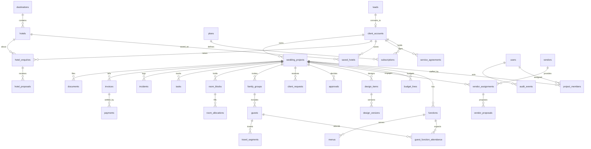

---

## 3. Module A — Identity, access and administration

Covers SPEC §3 "Administration" (user, role, permission, notification, audit event, configuration) and adds `auth_tokens`, `notification_preferences`, `import_jobs`, `sessions` and `job_runs`. The dynamic-RBAC catalog (`grantable_capabilities`, `permission_sets`, `role_grants`, `permission_set_grants`, `role_permission_sets`; D-036) is added for Super-Admin-defined custom roles.

```mermaid
erDiagram
    users ||--o{ user_roles : has
    roles ||--o{ user_roles : grants
    roles ||--o{ role_permissions : includes
    permissions ||--o{ role_permissions : in
    roles ||--o{ role_grants : grants
    grantable_capabilities ||--o{ role_grants : granted_as
    permission_sets ||--o{ permission_set_grants : bundles
    grantable_capabilities ||--o{ permission_set_grants : bundled_as
    roles ||--o{ role_permission_sets : attaches
    permission_sets ||--o{ role_permission_sets : attached_to
    users ||--o{ project_members : member_of
    wedding_projects ||--o{ project_members : has
    users ||--o{ auth_tokens : issued
    users ||--o{ notifications : receives
    users ||--o{ notification_preferences : sets
    users ||--o{ audit_events : performs
    users ||--o{ import_jobs : runs
    users ||--o{ sessions : has

    users {
        uuid id PK
        string user_type "enum staff / client / demo (A-13, A-22)"
        string name
        string email UK
        string phone
        string status "enum invited / active / disabled / locked"
        string identity_subject UK "the identity service's subject (Cognito sub, T-6); null until activated"
        bool mfa_enabled "mandatory true for staff (A-13); enforced by the identity service, mirrored here"
        datetime last_login_at
    }
    roles {
        uuid id PK
        string role_key UK "super_admin, sales, hotel_team, project_manager, creative, vendor_coordinator, rsvp_team, hospitality, finance"
        string name
        bool is_system
    }
    permissions {
        uuid id PK
        string permission_key UK "module.resource.action, e.g. budget.internal_cost.read"
        string description
    }
    role_permissions {
        uuid role_id FK
        uuid permission_id FK
    }
    user_roles {
        uuid user_id FK
        uuid role_id FK
    }
    grantable_capabilities {
        uuid id PK
        string capability_key UK "module.resource.action:scope, with #<condition-signature> when conditioned (D-036)"
        string module
        string resource
        string action
        string scope "enum all / assigned / own"
        json conditions "packages/policy Condition[]; empty is a plain grant"
        json source_roles "the StaffRole codes that hold this grant, for the class ceiling"
        bool is_staff_only
        bool is_escalation_locked "role/account admin and identity: never assignable to a custom role"
        string label
    }
    permission_sets {
        uuid id PK
        string set_key UK
        string name
        string description
        bool is_system
    }
    role_grants {
        uuid role_id FK
        uuid grantable_capability_id FK
        uuid created_by "who granted it"
    }
    permission_set_grants {
        uuid permission_set_id FK
        uuid grantable_capability_id FK
        uuid created_by
    }
    role_permission_sets {
        uuid role_id FK
        uuid permission_set_id FK
        uuid created_by
    }
    project_members {
        uuid id PK
        uuid project_id FK
        uuid user_id FK
        string project_role "enum project_lead / staff / client_representative (A-5 changed by Q5: two per wedding, one per side)"
        string client_side "enum bride / groom, for client representatives (Q5)"
        bool can_view_finance "configuration, true for representatives pending Q4"
        bool can_approve "configuration, true for representatives"
        string status "enum invited / active / removed"
        datetime invited_at
        datetime accepted_at
    }
    auth_tokens {
        uuid id PK
        uuid user_id FK
        string purpose "enum invite / password_reset / otp / magic_link"
        string token_hash "RESTRICTED"
        datetime expires_at
        datetime used_at
    }
    notifications {
        uuid id PK
        string recipient_type "enum user / guest"
        uuid recipient_id
        string channel "enum in_app / email / whatsapp / sms / push (A-11)"
        string template_key
        string entity_type
        uuid entity_id
        string status "enum queued / sent / delivered / failed / read"
        string provider_ref
        datetime sent_at
        datetime delivered_at
        json data "server-only render variables e.g. the activation link (5.2); never in a view"
    }
    notification_preferences {
        uuid id PK
        uuid user_id FK
        string event_type
        string channel
        bool enabled
    }
    audit_events {
        uuid id PK
        uuid actor_user_id FK
        string actor_type "enum user / guest_token / system"
        string action "enum create / update / delete / approve / share / export / restricted_read"
        string entity_type
        uuid entity_id
        uuid project_id "nullable, denormalised for project-scoped queries"
        json before_json
        json after_json
        string ip_address
        datetime occurred_at
    }
    configurations {
        uuid id PK
        string config_key UK "e.g. hotel_verification_max_age_days, material_change_threshold_pct"
        json value_json
        string scope "enum global / project"
        uuid scope_id
    }
    import_jobs {
        uuid id PK
        string import_type "enum hotels / guests / vendors (A-9)"
        uuid project_id "nullable, required for guests"
        uuid file_document_id FK
        string status "enum uploaded / validating / failed / applied"
        int row_count
        json error_report_json
    }
    sessions {
        uuid id PK
        uuid user_id FK
        string token_id UK "the access token's jti (Cognito or the local adapter); one session per token"
        int idle_timeout_minutes "staff 720 / client 43200 from configurations session.idle_timeouts"
        datetime last_seen_at
        datetime revoked_at "set on sign-out or a role or membership change; idle is enforced against last_seen_at, not written"
        string revoked_reason
    }
    job_runs {
        uuid id PK
        string job_name "e.g. demo.restore"
        string idempotency_key "the run's key; correlates retries"
        string status "enum running / succeeded / failed"
        json detail_json "per-table counts or other outcome detail"
        string error "nullable; the sanitised failure message"
        datetime started_at
        datetime finished_at "nullable until the run ends"
    }
```

Notes:

- Staff get global roles through `user_roles`; their reach into a wedding is limited by `project_members` for the roles the spec marks "assigned" (Project Manager, Creative, Vendor Coordinator, RSVP, Hospitality). Client users are ordinary `users` rows with `user_type = client` and a `project_members` row per wedding (A-5).
- `permissions.permission_key` follows `module.resource.action` and optionally `.scope`; the permission matrix lists them.
- `audit_events.project_id` is denormalised so a project manager can read the history of their own project without scanning everything.
- **26 October 2026 (T-6, D-022):** credentials, OTP and authenticator codes live in Amazon Cognito; `users` keeps `identity_subject` instead of `password_hash` and `mfa_secret_ref`, and `auth_tokens` remains for the invitation and link tokens the API still mints. Implemented in `apps/api/prisma/schema.prisma` (bootstrap step 5).
- **28 October 2026 (D-036, dormant):** dynamic RBAC. `grantable_capabilities` is the code-defined capability catalog, seeded from `packages/policy/src/generated/capabilities.json` (every grant variant a system role holds; the matrix stays the source). A Super Admin builds custom roles from it: `role_grants` are a role's direct capabilities, `permission_sets` are reusable bundles attached through `role_permission_sets`, and a set's capabilities are `permission_set_grants`. The nine system roles stay matrix-authoritative and golden-pinned; these tables add custom roles *on top*. The engine does not read them yet — the API resolves a custom role's capabilities and injects them as `PolicyPrincipal.resolvedGrants`, validated against the catalog, once custom roles are wired (supersedes A-6/P-1). FKs are `ON DELETE RESTRICT`, so a capability, role or set in use cannot be removed.
- **`sessions` (28 October 2026, D-033):** the server-side session security.md requires. The access token proves identity; a `sessions` row, keyed by the token's `jti`, is what the API can expire (staff 12 h / client 30 d idle, from `configurations`) and revoke (on sign-out or a role or membership change). Added here because the original model left it to the identity service, which cannot revoke on an AMPM role change.
- **Client-login cap (28 October 2026, feature 5.3):** the Q5 "two client logins per wedding, one per side" rule is enforced at the database by a partial unique index on `project_members (project_id, client_side)` where `deleted_at IS NULL AND status <> 'removed' AND client_side IS NOT NULL` (raw migration; partial indexes are not expressible in the Prisma schema). The service also pre-checks it for a friendly error, but the index is the race-safe backstop. Staff memberships (`client_side` NULL) are unconstrained.
- **`job_runs` (29 October 2026, feature 5.5):** the recorded outcome api.md requires for a background job — the session reaper only logs. Append-only: one row per run with its `job_name`, `idempotency_key`, `status`, a `detail_json` of per-table counts and a sanitised `error`. The nightly demo-restore job writes one; other scheduled jobs reuse it. No soft-delete columns (operational, like `sessions`). Not partitioned yet — volume is a handful of rows a day; revisit with the other operational tables if it grows.

---

## 4. Module B — CRM, subscriptions and commercial agreements

Covers SPEC §3 "CRM/subscriptions" and resolves audit GP-2 (trial), GP-3 (plans and module entitlements), GP-5 (hotel-assistance commercial flow), GP-6 (milestone payments), GP-17 (payment direction).

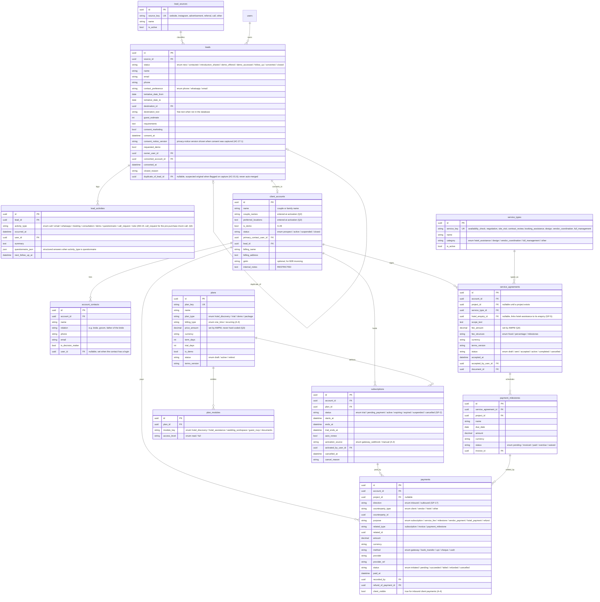

Notes:

- **Lead to account.** A lead converts into a `client_accounts` row; the lead keeps its history. A demo request is a lead with `requested_demo = true` and a `lead_activities` row of type `demo` once access is granted.
- **Consent and privacy (Q17, AC-27.1).** The public enquiry form captures `consent_marketing`, `consent_at` and the `consent_notice_version` shown; changing the notice never alters a historical lead. The consent/privacy wording and the lead retention period are AMPM's to confirm and are held as configuration; leads are never hard-deleted — a retention job proposes deletions for a Super Admin to approve.
- **Duplicates (AC-01.6).** A new enquiry whose email or phone matches an existing lead or client account is accepted and flagged (`duplicate_of_lead_id` names the suspected original), never refused to the visitor and never auto-merged; Sales merges, choosing the survivor, and the duplicate is closed with reason `merged`.
- **Entitlements** (audit GP-1) are resolved as: active or trial subscription gives the `plan_modules` of its plan; an active `service_agreements` row gives its service's module; an active `project_members` row gives `wedding_workspace` for that project regardless of subscription state. Expiry removes the subscription modules and nothing else. The permission matrix §3 has the full table.
- **Hotel assistance** (GP-5): the client's request creates a `hotel_enquiries` row (module D). If AMPM charges for it, Sales creates a `service_agreements` row that points back to the enquiry; work beyond availability checking waits for `status = active`.
- **Payments** carry a direction and a counterparty so one table serves subscription receipts, milestone receipts, vendor payouts and refunds. `client_visible` is true only for inbound client payments.

---

## 5. Module C — Hotel intelligence

Covers SPEC §3 "Hotel intelligence" and resolves audit GP-8 (prices), GP-9 (availability), GP-10 (saved hotels), GP-20 (media rights), AM-5 (room capacity). `media_assets` is defined in module N.

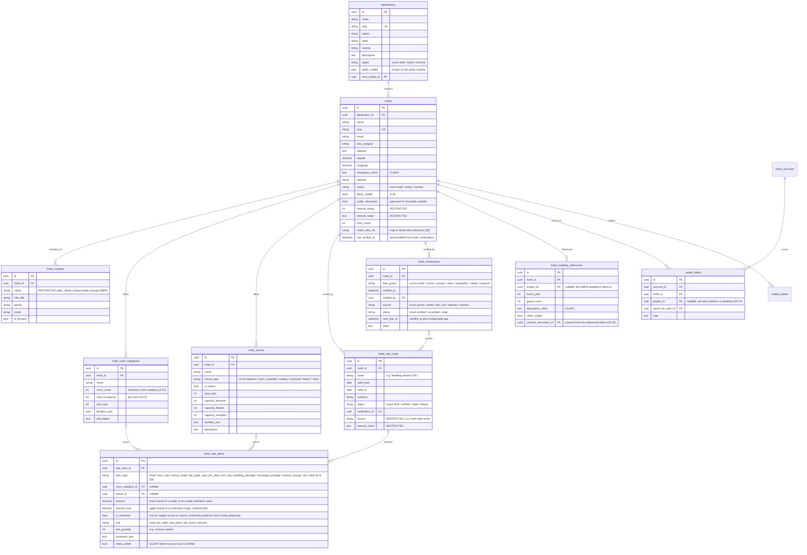

Notes:

- **Freshness.** `hotel_verifications` is the source of truth; `hotels.last_verified_at` and `hotel_rate_cards.status = stale` are maintained by a scheduled job using `configurations.hotel_verification_max_age_days` (SPEC §8). A rate card whose verification is older than the configured age is shown with a stale label and its items are never presented as confirmed (SPEC §12).
- **Availability** (GP-9, A-9) is not stored as a calendar. "Availability" in `hotel_verifications.field_group` records when AMPM last confirmed general availability for a season; date-specific availability is answered inside a `hotel_enquiries` row.
- **Compare hotels** is a view over `saved_hotels`; no table is needed. `saved_hotels` is unique on (`account_id`, `hotel_id`).
- **Previous wedding media** (GP-20) are `media_assets` with `owner_type = hotel`, `rights_status = consent_obtained` and `consent_source_project_id` set; the publishing rule in the permission matrix refuses client or public visibility without it.

---

## 6. Module D — Hotel consultancy

Covers SPEC §3 "Hotel consultancy" (availability enquiry, response, negotiation, site visit, proposal, booking milestone), which §4 modelled only as `hotel_enquiries`. Resolves audit GP-5 (link to a paid agreement) and acceptance test "AMPM records negotiation and site visit without exposing internal notes".

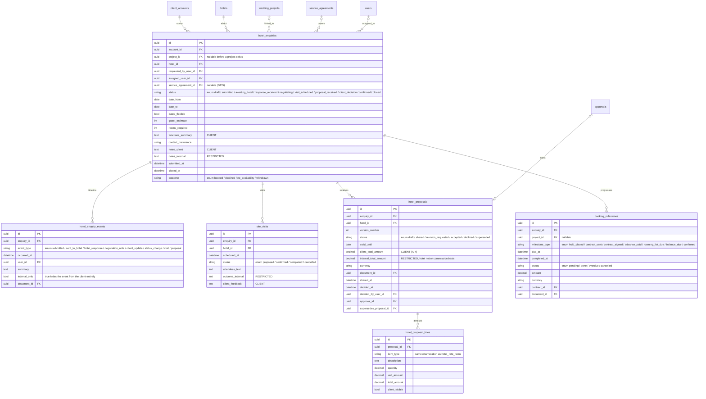

Notes:

- An enquiry is never a booking (SPEC §7). `status = confirmed` is reached only when a `booking_milestones` row of type `confirmed` is completed and a contract exists.
- When a project is created later, `hotel_enquiries.project_id`, `saved_hotels.project_id` and `service_agreements.project_id` are back-filled for the account (GP-27, WHY §3).
- The client sees the enquiry status, `notes_client`, non-internal events, site visit dates and their own feedback, and proposals in `shared` or later status with client amounts only.

---

## 7. Module E — Wedding project

Covers SPEC §3 "Wedding project" (project, client contacts, scope, team assignment) and resolves audit GP-12 (several hotels and venues outside the database) and GP-1 (post-closure access window). `project_members` is defined in module A.

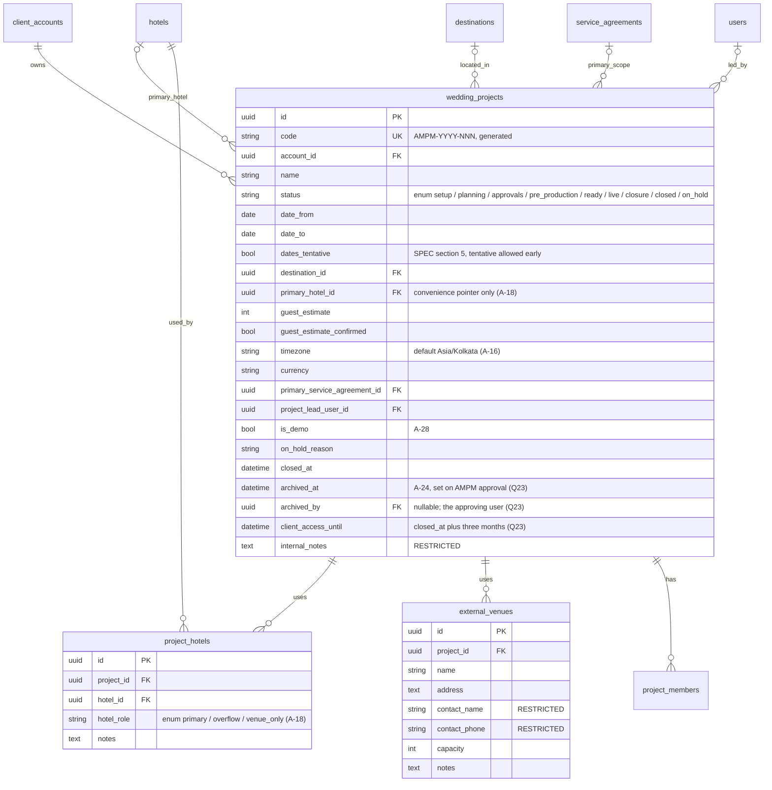

Notes:

- The project is the parent of every wedding record (SPEC §15). Creating it requires only name, account and a tentative date range (SPEC §5); everything else is captured when relevant.
- `status` is the project-level status; it does not replace function, task or readiness statuses (SPEC §7). Moving to `closed` requires the closure checklist (module O) to be complete and the final account (module G) approved.
- `client_access_until` is set at closure to `closed_at` plus the configured window (A-23). After it passes, client members are set to `removed` by a retention job; the records remain.

---

## 8. Module F — Functions, programme and run-of-show

Covers SPEC §3 "Functions" (function, schedule, checklist, venue, run-of-show). The readiness checklist uses the generic checklist tables in module O. Resolves audit AM-2 (venue typing) and AM-3 (status versus readiness).

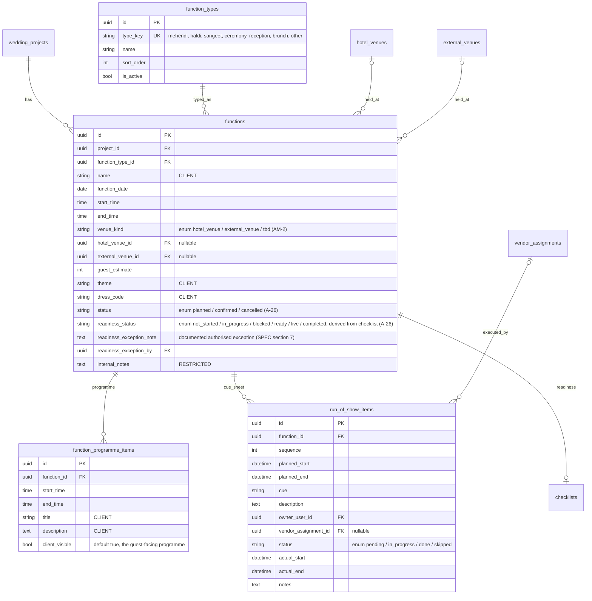

Notes:

- Two schedules exist on purpose: `function_programme_items` is the shared programme the client and guests may see; `run_of_show_items` is the internal cue sheet with owners, vendors and actual times (SPEC §2.3 "shared schedules" versus §2.4 "run-of-show").
- `readiness_status` is recalculated whenever a `checklist_items` row changes: `ready` when every required item is `done` or `exception`; `blocked` when any item is flagged blocked by its owner; `live` and `completed` are set by the project manager on the day.
- Budget lines, vendor assignments, menus, design items, tasks, incidents and production items all reference `functions.id` optionally, so a function's workspace is a filtered view of those tables.

---

## 9. Module G — Budget and finance

Covers SPEC §3 "Budget/finance" (budget category, line, quote, contract, invoice, payment, cost entry) and "Closure" final account. Resolves audit GP-17 (client versus internal invoices), GP-18 (GST), GP-19 (reference tables) and implements A-4. `payments` is defined in module B; `vendor_quotes` in module H.

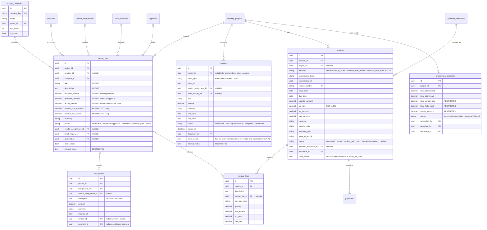

Notes:

- **Three client-facing amounts, two internal.** The client sees `estimate_amount`, `approved_amount` and `actual_amount` of lines flagged `client_visible`. Internal cost columns are never serialised to a client session; the API uses separate response models per audience rather than filtering one model (SPEC §4 security note).
- **Invoices are split by direction**, not by dual amount columns. An invoice issued to the client is a client document; invoices received from vendors and hotels are internal cost evidence. This closes the leak path noted in audit GP-17.
- **GST.** `tax_rate`, `tax_amount`, GSTIN and HSN/SAC code fields exist so the platform can issue compliant invoices if AMPM confirms it will (Q16). Until then they are optional.
- **Variance** (SPEC §9) is computed as `actual_amount - approved_amount` for the client view and `internal_cost_actual - internal_cost_estimate` for the internal view; it is a report, not a column.
- `project_final_accounts` is one row per project, created at closure and approved by Finance before the project can close (module O).

---

## 10. Module H — Vendors, artists and production

Covers SPEC §3 "Vendors" and the artist, technical rider and production item records of "Food/entertainment/production". Resolves audit GP-21 (vendor availability) and the vendor decision field of SPEC §5. Vendor portfolios are `media_assets` with `owner_type = vendor` (module N).

```mermaid
erDiagram
    vendor_categories ||--o{ vendors : primary_category
    vendors ||--o{ vendor_category_links : also_offers
    vendor_categories ||--o{ vendor_category_links : listed_under
    vendors ||--o{ vendor_availability : availability
    vendors ||--o{ vendor_quotes : quotes
    vendors ||--o{ vendor_assignments : assigned_as
    wedding_projects ||--o{ vendor_assignments : engages
    functions |o--o{ vendor_assignments : for_function
    vendor_assignments ||--o{ vendor_proposals : proposes
    vendor_assignments ||--o{ vendor_quotes : priced_by
    vendor_assignments ||--o{ vendor_deliverables : delivers
    vendor_assignments ||--o{ artist_bookings : performs
    functions ||--o{ artist_bookings : at
    functions ||--o{ production_items : requires
    vendor_assignments |o--o{ production_items : supplies
    contracts |o--o| vendor_assignments : contracted_by
    approvals |o--o| vendor_proposals : locks
    vendors ||--o{ media_assets : portfolio

    vendor_categories {
        uuid id PK
        string category_key UK "decor, photography, videography, sound_light, artists, catering, tents_props, sfx, transport, other"
        string name
        uuid parent_id FK
        bool is_active
    }
    vendors {
        uuid id PK
        string name "CLIENT when presented"
        uuid primary_category_id FK
        text description_client "CLIENT"
        string contact_name "RESTRICTED"
        string phone "RESTRICTED"
        string email "RESTRICTED"
        string website
        string instagram_handle
        string base_city
        string service_area
        string status "enum prospective / active / preferred / inactive / blacklisted"
        int internal_rating "RESTRICTED"
        text internal_notes "RESTRICTED"
        string gstin
        uuid bank_details_document_id FK "RESTRICTED"
        datetime onboarded_at
    }
    vendor_category_links {
        uuid id PK
        uuid vendor_id FK
        uuid category_id FK
    }
    vendor_availability {
        uuid id PK
        uuid vendor_id FK
        date date_from
        date date_to
        string status "enum available / tentative / booked / unavailable (GP-21)"
        datetime verified_at
        uuid verified_by FK
        string source
        text note
    }
    vendor_assignments {
        uuid id PK
        uuid project_id FK
        uuid function_id FK "nullable"
        uuid vendor_id FK
        uuid category_id FK
        text scope_text "CLIENT"
        string status "enum option / shortlisted / selected / contracted / delivering / completed / cancelled / declined"
        string client_decision "enum none / interested / shortlisted / selected / declined (SPEC section 5)"
        datetime client_decision_at
        uuid client_decision_by FK
        datetime presented_at "CLIENT sees the option from here"
        uuid contract_id FK "nullable"
        datetime completion_confirmed_at "vendor completion for closure"
        uuid completion_confirmed_by FK
        bool share_contact "true only in an AMPM-approved case (Q4)"
        text internal_notes "RESTRICTED"
    }
    vendor_quotes {
        uuid id PK
        uuid vendor_id FK
        uuid project_id FK
        uuid vendor_assignment_id FK "nullable"
        int version_number
        decimal amount "RESTRICTED table, raw quote to AMPM"
        string currency
        datetime received_at
        date valid_until
        uuid document_id FK
        string status "enum received / shortlisted / selected / rejected / expired"
        text internal_notes "RESTRICTED"
    }
    vendor_proposals {
        uuid id PK
        uuid vendor_assignment_id FK
        int version_number
        string title "CLIENT"
        text description_client "CLIENT"
        text inclusions_text "CLIENT"
        decimal client_visible_amount "CLIENT (A-4)"
        decimal internal_cost "RESTRICTED (A-4)"
        string currency
        string status "enum draft / shared / revision_requested / accepted / declined / superseded"
        datetime shared_at
        datetime decided_at
        uuid decided_by_user_id FK
        uuid approval_id FK
        uuid document_id FK
        uuid supersedes_proposal_id FK
    }
    vendor_deliverables {
        uuid id PK
        uuid vendor_assignment_id FK
        uuid function_id FK "nullable"
        string title
        datetime due_at
        string status "enum pending / in_progress / delivered / accepted / rejected"
        uuid accepted_by FK
        datetime accepted_at
        text notes
    }
    artist_bookings {
        uuid id PK
        uuid vendor_assignment_id FK
        uuid function_id FK
        string artist_name "CLIENT"
        string performance_type
        datetime slot_start
        datetime slot_end
        string status "enum enquiry / held / confirmed / performed / cancelled"
        uuid technical_rider_document_id FK
        text hospitality_requirements
        text travel_arrangements
        decimal fee_internal "RESTRICTED"
        string currency
    }
    production_items {
        uuid id PK
        uuid function_id FK
        uuid vendor_assignment_id FK "nullable"
        string category "enum sound / lighting / stage / led / tent / props / sfx / power / other"
        text description
        int quantity
        string status "enum planned / ordered / delivered / installed / tested / struck"
        uuid owner_user_id FK
        uuid checklist_item_id FK "nullable, links to a readiness item"
        text notes
    }
```

Notes:

- **Options to the client.** Presenting a vendor creates a `vendor_assignments` row with `status = option` and `presented_at` set. Five to ten options per category is a guideline, not a constraint (SPEC §12): nothing in the schema limits the count.
- **Quotes versus proposals.** `vendor_quotes` are what vendors send AMPM and are internal. `vendor_proposals` are what AMPM shows the client, versioned, with a client amount and an internal cost (A-4). A proposal's `approval_id` points at the approval that locked that exact version.
- **Completion.** `vendor_assignments.completion_confirmed_at` is set when all deliverables are `accepted`; the closure checklist item "vendor completion" reads it (module O).
- Vendor contact details are restricted because clients deal with vendors through AMPM (BIZ §2.C "vendor negotiations ... must not be visible to clients"). If AMPM wants selected vendors' contacts shared after selection, that becomes a `client_visible` flag on `vendors`, settable per assignment.

---

## 11. Module I — Creative, approvals and client requests

Covers SPEC §3 "Creative/approvals" (design brief, version, comment, approval, change request). Resolves audit GP-14 (change requests), GP-15 (questions), AM-7 (multiple approvers) and implements A-20, A-21, A-25.

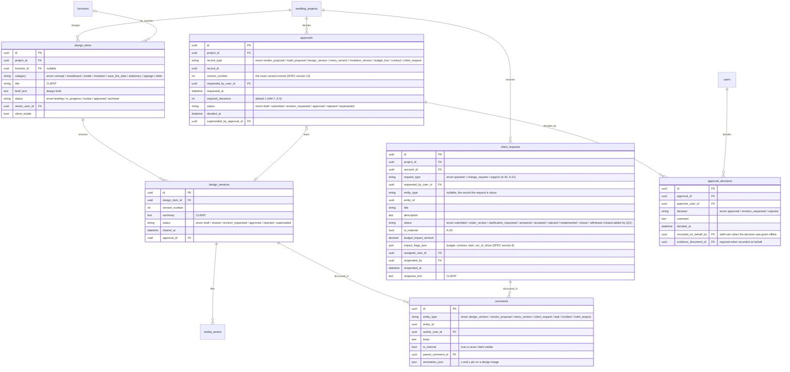

Notes:

- **Approvals lock versions.** An approval references `record_type`, `record_id` and `version_number`. Creating a new version of the record marks the earlier approval `superseded` and requires a new one. Revisions never overwrite an approved version (SPEC §12).
- **Multiple approvers** (AM-7): `required_decisions` on the approval and one `approval_decisions` row per approver. The approval becomes `approved` when the count of `approved` decisions reaches `required_decisions`; a single `rejected` or `revision_requested` decision moves it to that status.
- **Offline decisions.** When the family approves on a call, staff record the decision with `recorded_on_behalf_by` and attach evidence; the audit log shows it was not the client's own click.
- **Client requests** replace both the messaging feature in the client-portal flowchart and the change-request record in the spec (A-20, A-21). A material request (A-25) raises flags on budgets, contracts, tasks and run-of-show items as SPEC §8 requires.

---

## 12. Module J — Invitations, guests and RSVP

Covers SPEC §3 "Invitations/RSVP" (invitation, recipient, guest, family group, response, attendance) and the guest request record of "Rooms/logistics/hospitality". Resolves audit GP-13 (guest is the atomic unit), GP-16 (family groups, invitations, recipients), GP-24 (dietary data), AM-1 (tokens per family group) and implements A-7. Identity documents are in module N.

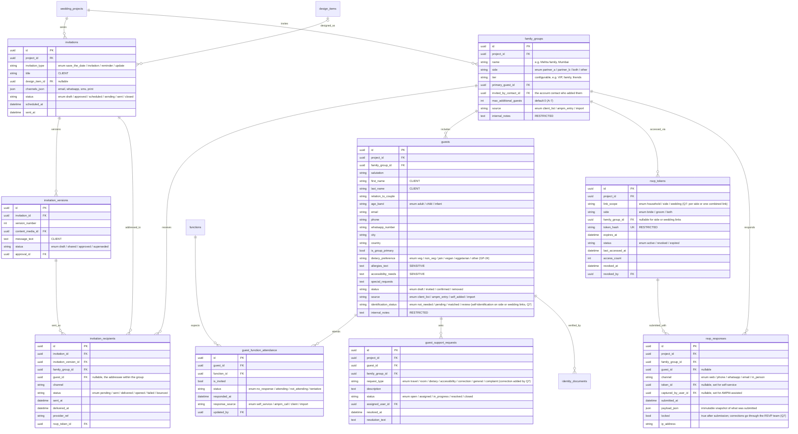

Notes:

- **The guest is the atomic record** (GP-13). Headcounts are counted from `guest_function_attendance` rows, so children and accompanying members are real rows, not a `party_count`. `guest_function_attendance` is unique on (`guest_id`, `function_id`).
- **One token per family group** (A-7). The RSVP portal shows the group's members and the functions each is invited to. A self-service submission and an AMPM-assisted phone response both write `guest_function_attendance` and append an `rsvp_responses` snapshot, which is how "the same guest database without duplicates" (SPEC §12) is achieved.
- **Accompanying members.** A group may add up to `max_additional_guests` rows with `source = self_added`; AMPM or the client sets that number per group. Unknown guests cannot create themselves otherwise.
- **Dietary data** (GP-24). `dietary_preference` feeds `menu_headcounts` (module L). `allergies_text` and `accessibility_needs` are SENSITIVE: visible to the RSVP, hospitality and project-management staff on that project and to the client owner, never in exports by default (SPEC §9).
- **Attendance changes** recalculate function totals and raise flags on menus, room allocations and transfers (SPEC §8) through the automation listed in the permission matrix §8.

---

## 13. Module K — Rooms, travel and transport

Covers SPEC §3 "Rooms/logistics/hospitality" (room allocation, travel segment, transfer, vehicle) and the departure and lost-and-found records of "Closure". Resolves audit GP-11 (room blocks) and implements A-19.

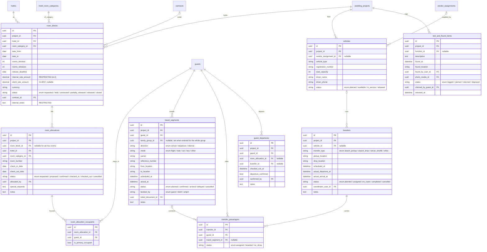

Notes:

- **Blocks before allocations** (GP-11). A `room_allocations` row that references a block is validated against `rooms_blocked - rooms_released` for its dates. Ad hoc rooms (no block) are allowed but flagged in the rooming report.
- **Change history** for room allocations (SPEC §7) comes from `audit_events`; no separate history table.
- **Manifests** (SPEC §9 "arrival/departure manifests") are reports over `travel_segments` joined to `transfer_passengers` and `room_allocation_occupants`.
- `guest_departures` is the closure evidence that every staying guest has checked out and left; the closure checklist item "departures" reads it (module O).

---

## 14. Module L — Menus and food service

Covers the menu version record of SPEC §3 "Food/entertainment/production" and resolves audit GP-24 (headcounts by dietary category).

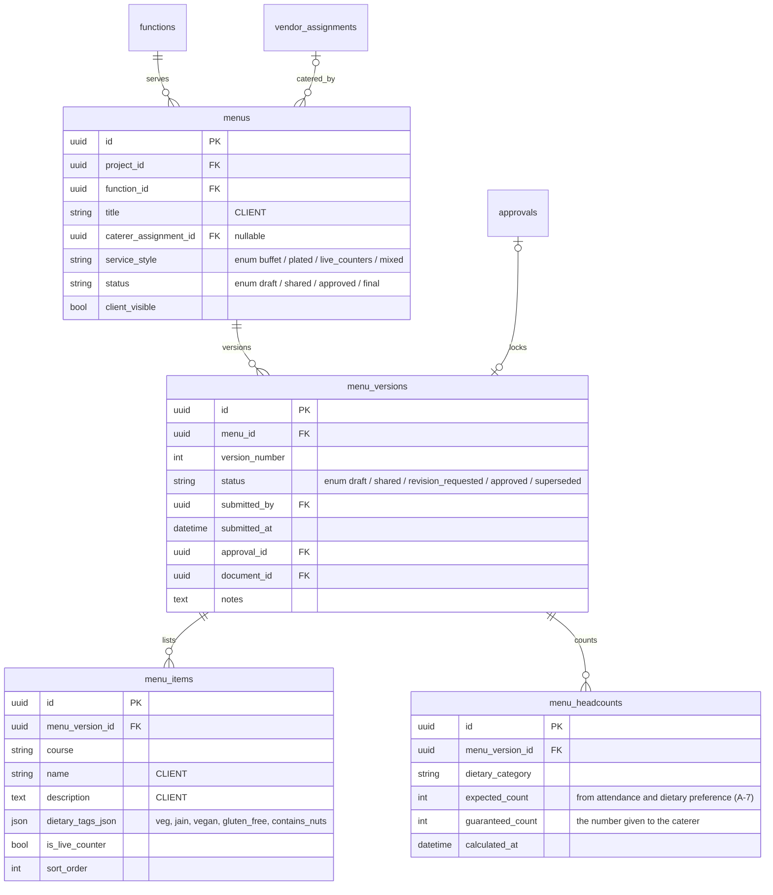

Notes:

- `menu_headcounts` is a snapshot, recalculated when attendance changes and frozen when the guaranteed number is sent to the caterer. The guaranteed count is the commercial commitment; the expected count keeps moving.
- Allergies are never listed per guest to a caterer; the hospitality team handles them through `guest_support_requests` of type `dietary`.

---

## 15. Module M — Tasks, staffing and incidents

Covers SPEC §3 "Tasks/risk" (task, dependency, staff assignment, incident, resolution). Resolves audit GP-30 (staffing). Incident updates use the generic `comments` table (module I).

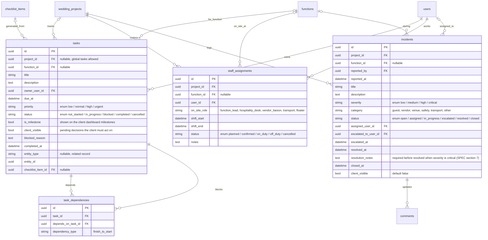

Notes:

- Overdue tasks, unconfirmed vendors, unpaid milestones and incomplete readiness checks are dashboard queries over these tables (SPEC §8); no extra tables are needed.
- Critical incidents follow the escalation rules held in `configurations` (for example escalate to the project lead after 15 minutes unassigned).

---

## 16. Module N — Documents, media and identity documents

Covers SPEC §4 `documents / media`, split into files with versions (`documents`) and gallery media with rights (`media_assets`). Resolves audit GP-20 (media rights), GP-41 (Aadhaar) and implements A-8 and A-17.

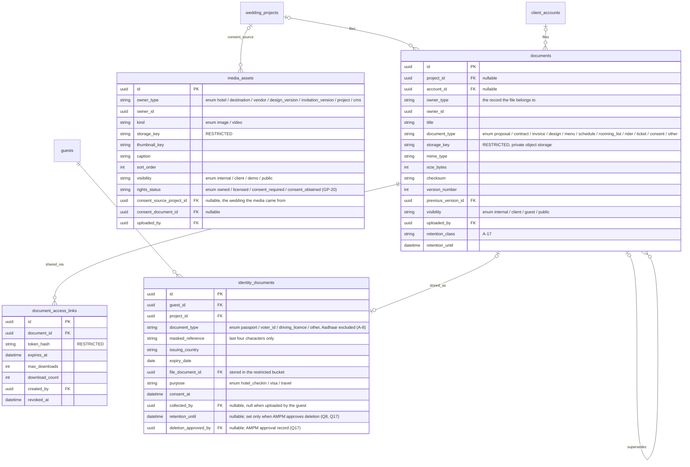

Notes:

- **Access follows the owning record.** Reading a document requires permission on `owner_type`/`owner_id`; `visibility` further narrows it. Download URLs are short-lived signed links (`document_access_links`), never permanent paths (SPEC §10, §12).
- **Media rights** (GP-20). Only `rights_status = owned`, `licensed` or `consent_obtained` may be set to `client`, `demo` or `public` visibility; the API rejects the rest.
- **Identity documents** (A-8) live in a separate restricted bucket with its own key, are never included in exports, and every read writes an `audit_events` row with `action = restricted_read`. A retention job deletes the file and nulls `file_document_id` after `retention_until`.

---

## 17. Module O — Checklists, closure and feedback

Covers the checklist, readiness check and closure records of SPEC §3 and the "feedback" step in the team flowchart (audit GP-29). The same two tables serve function readiness and project closure.

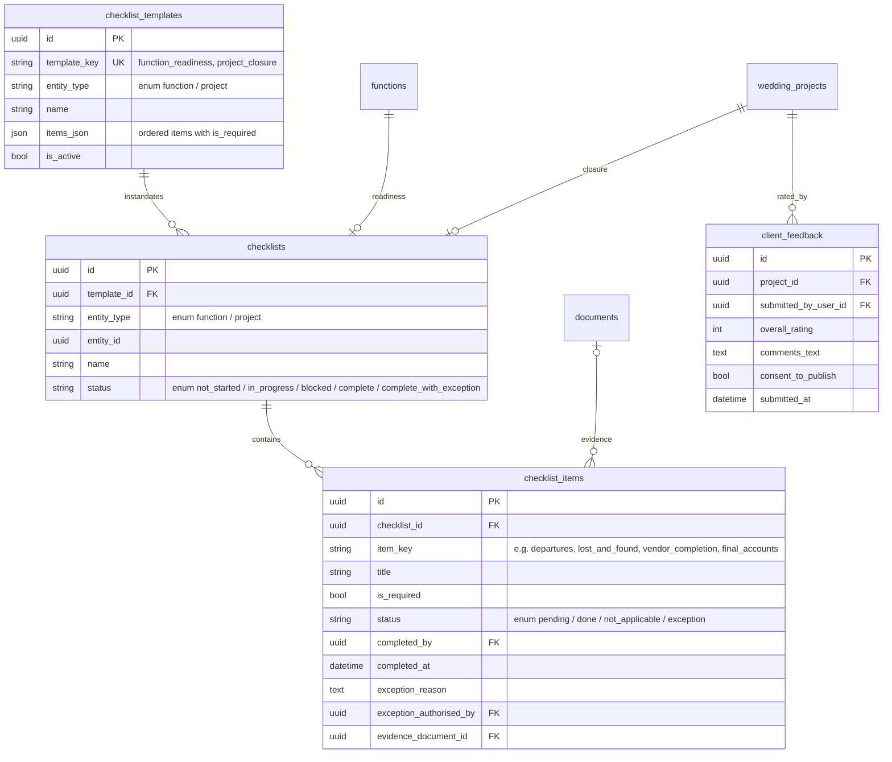

Notes:

- **Readiness** (SPEC §7): a function cannot reach `ready` until every `is_required` item is `done` or carries an `exception` with `exception_authorised_by` set to a user holding the readiness-exception permission.
- **Closure** (SPEC §7, §12): the project-closure checklist's required items are backed by data: `departures` checks `guest_departures`, `lost_and_found` checks no `logged` or `claimed` items remain, `vendor_completion` checks every active `vendor_assignments` row has `completion_confirmed_at`, `final_accounts` checks `project_final_accounts.status = approved`. The project moves to `closed` only when the checklist is `complete` or `complete_with_exception`.

---

## 18. Module P — Public website content (dormant)

AMPM decided on 25 October 2026 that staff will not edit website content through the app (Q12). The two tables are kept in the model so the decision is reversible, but they are not built; the public website is maintained outside the platform. The original design follows for reference.

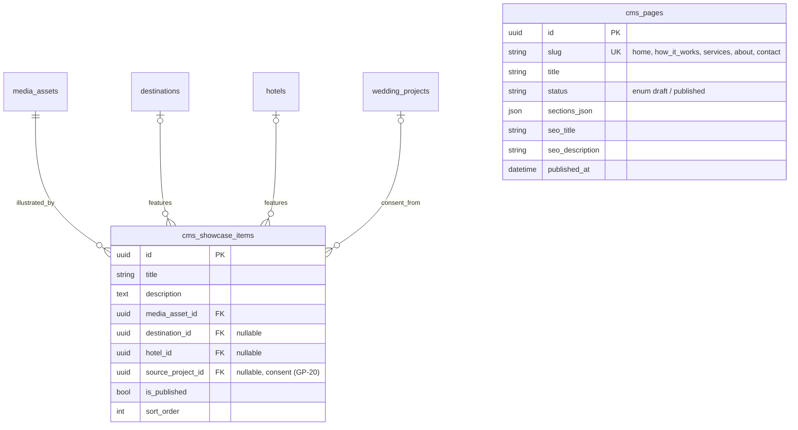

Notes:

- The public website reads only `cms_pages`, published `cms_showcase_items`, `destinations` with `public_visible = true` and `hotels` with `public_showcase = true`, and only their `PUBLIC` fields. The private hotel database is never queried by public pages (BIZ §2.A).
- The enquiry form writes to `leads` (module B); the demo request sets `requested_demo = true`.

---

## 18a. Module Q — Live chat

Added for AMPM's decision that live chat is required alongside tracked requests (Q20). A conversation is a lightweight thread for immediate help; anything that needs an approval history becomes a `client_requests` row, which a message can link to.

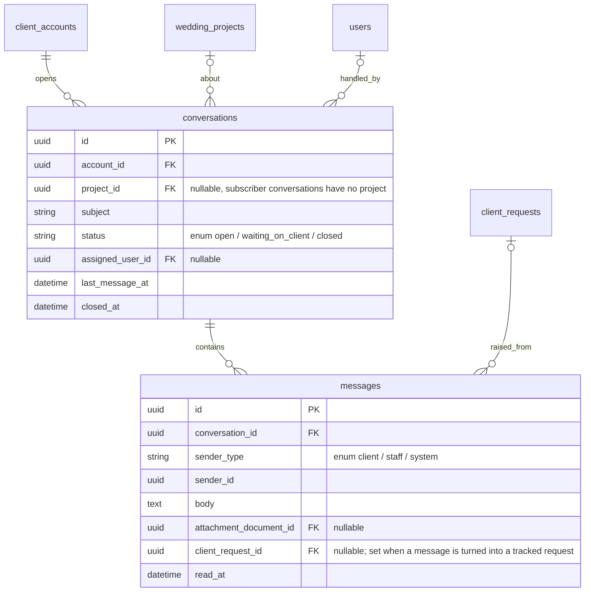

Notes:

- A conversation never carries an approval. "Turn into a request" creates a `client_requests` row with the message as its description and links back, so the formal history stays on the request (AMPM's rule that chat and requests are distinguished).
- Staff see conversations for the accounts and projects they may reach; the two family representatives see their own account's conversations. Messages are CLIENT class on both sides; internal staff notes stay in `comments` with `is_internal`.
- Delivery is real time (architecture §0a); unanswered conversations surface on the team dashboard.

---

## 19. Entity index

Phase numbers follow SPEC §11 as adjusted by A-10. "Restricted" lists the fields or tables that the permission matrix guards server-side.

| Entity | Module | Phase | Purpose | Restricted or sensitive |
|---|---|---|---|---|
| users | A | 1 | Staff, client and demo logins | password_hash, mfa_secret_ref |
| roles, permissions, role_permissions, user_roles | A | 1 | Role-based access | — |
| grantable_capabilities, role_grants, permission_sets, permission_set_grants, role_permission_sets | A | 1 | Dynamic RBAC: Super-Admin custom roles and permission sets (D-036) | — |
| project_members | A | 2 | Per-wedding staff and client membership | — |
| auth_tokens | A | 1 | Invites, resets, OTP | token_hash |
| notifications, notification_preferences | A | 1 | Delivery log and preferences | — |
| audit_events | A | 1 | Append-only change history | — |
| configurations | A | 1 | Thresholds, labels, escalation rules | — |
| import_jobs | A | 1 | Spreadsheet imports for hotels, guests, vendors | — |
| lead_sources, leads, lead_activities | B | 1 | Enquiry pipeline and follow-up | — |
| client_accounts, account_contacts | B | 1 | Client account and family contacts | internal_notes |
| plans, plan_modules | B | 1 | Packages and module entitlements | — |
| subscriptions | B | 1 | Trial and paid hotel-discovery access | — |
| service_types, service_agreements | B | 1 | Paid services beyond the subscription | fee set by AMPM |
| payment_milestones | B | 2 | Payment stages for engagements | — |
| payments | B | 1 | Inbound and outbound money movements | outbound rows |
| destinations | C | 1 | Destination catalogue | — |
| hotels | C | 1 | Hotel profile | internal_rating, internal_notes |
| hotel_contacts | C | 1 | Hotel sales contacts | whole table |
| hotel_room_categories, hotel_venues | C | 1 | Inventory and event spaces | — |
| hotel_rate_cards, hotel_rate_items | C | 1 | Indicative commercials | source, internal_notes |
| hotel_verifications | C | 1 | Freshness of each field group | — |
| hotel_wedding_references | C | 1 | Past weddings at the hotel | consent required |
| saved_hotels | C | 1 | Client shortlist | — |
| hotel_enquiries | D | 1 | Assistance requests and consultancy | notes_internal |
| hotel_enquiry_events | D | 1 | Enquiry timeline | internal_only rows |
| site_visits | D | 1 | Scheduled visits | outcome_internal |
| hotel_proposals, hotel_proposal_lines | D | 1 | Negotiated offers shown to the client | internal_total_amount |
| booking_milestones | D | 1 | Hold, contract, advance, confirmation | — |
| wedding_projects | E | 2 | Parent of all wedding records | internal_notes |
| project_hotels, external_venues | E | 2 | Venues used by the wedding | external venue contacts |
| function_types, functions | F | 2 | Events within the wedding | internal_notes |
| function_programme_items | F | 2 | Shared programme | — |
| run_of_show_items | F | 4 | Internal cue sheet with actual times | whole table |
| budget_categories, budget_lines | G | 2 | Estimate, approved, actual; internal cost | internal_cost_estimate, internal_cost_actual, internal_notes |
| cost_entries | G | 2 | Internal actual costs | whole table |
| contracts | G | 2 | Client, vendor and hotel contracts | vendor and hotel rows |
| invoices, invoice_lines | G | 2 | Issued and received invoices with GST | received rows |
| project_final_accounts | G | 4 | Closure reconciliation | cost and margin totals |
| vendor_categories, vendors, vendor_category_links | H | 2 | Vendor master | contacts, internal_rating, internal_notes, bank details |
| vendor_availability | H | 2 | Verified availability windows | — |
| vendor_assignments | H | 2 | Options, decisions, delivery per wedding | internal_notes |
| vendor_quotes | H | 2 | Raw quotes to AMPM | whole table |
| vendor_proposals | H | 2 | Versioned proposals to the client | internal_cost |
| vendor_deliverables | H | 2 | Delivery tracking and acceptance | — |
| artist_bookings | H | 4 | Performers, slots, riders | fee_internal |
| production_items | H | 4 | Sound, light, stage, tents, effects | — |
| design_items, design_versions | I | 2 | Versioned creative work | — |
| comments | I | 2 | Threads on designs, proposals, requests, tasks, incidents | is_internal rows |
| client_requests | I | 2 | Questions, change requests, support | — |
| approvals, approval_decisions | I | 2 | Version-locked decisions | — |
| invitations, invitation_versions | J | 2 | Save-the-dates and invitations (AM-12) | — |
| invitation_recipients | J | 3 | Distribution status per household | — |
| family_groups | J | 3 | Invited households | internal_notes |
| guests | J | 3 | One row per person | allergies_text, accessibility_needs, internal_notes |
| guest_function_attendance | J | 3 | Attendance per guest per function | — |
| rsvp_tokens, rsvp_responses | J | 3 | Tokenised links and submission log | token_hash |
| guest_support_requests | J | 3 | Guest tickets | — |
| room_blocks | K | 3 | Rooms held per hotel, category, dates | internal_rate_amount |
| room_allocations, room_allocation_occupants | K | 3 | Rooming list | — |
| travel_segments | K | 3 | Arrivals and departures | — |
| vehicles, transfers, transfer_passengers | K | 3 | Transport planning and manifests | driver_phone |
| guest_departures | K | 4 | Closure evidence of departures | — |
| lost_and_found_items | K | 4 | Items logged on site | — |
| menus, menu_versions, menu_items | L | 3 | Versioned menus | — |
| menu_headcounts | L | 3 | Dietary headcounts for caterers | — |
| tasks, task_dependencies | M | 2 | Accountability and milestones | — |
| staff_assignments | M | 4 | On-site rosters | — |
| incidents | M | 4 | Event-day issues and escalation | whole table by default |
| documents, document_access_links | N | 1 | Files with versions and expiring links | storage_key |
| media_assets | N | 1 | Images and videos with rights | storage_key |
| identity_documents | N | 3 | Conditional identity capture | whole table |
| checklist_templates, checklists, checklist_items | O | 4 | Readiness and closure | — |
| client_feedback | O | 4 | Post-wedding feedback | — |
| cms_pages, cms_showcase_items | P | dormant | Public website content, not built (Q12) | — |
| conversations, messages | Q | 1 | Live chat threads and messages (Q20) | — |

Count: 108 tables (including join tables, two of them dormant), against 35 rows in SPEC §4.

---

## 20. Coverage against the audit

### 20.1 Records named in SPEC §3 that §4 did not model (audit §7.1)

| Module in SPEC §3 | Missing record | Now modelled as |
|---|---|---|
| CRM/subscriptions | plan/package | `plans`, `plan_modules` |
| Hotel intelligence | inventory snapshot, rates | `hotel_rate_cards`, `hotel_rate_items`, `hotel_room_categories.room_count` |
| Hotel consultancy | response, negotiation, site visit, hotel proposal, booking milestone | `hotel_enquiry_events`, `site_visits`, `hotel_proposals`, `hotel_proposal_lines`, `booking_milestones` |
| Budget/finance | budget category, quote, cost entry | `budget_categories`, `vendor_quotes`, `cost_entries` |
| Functions | schedule, checklist | `function_programme_items`, `checklists`, `checklist_items` |
| Creative/approvals | design brief, comment, change request | `design_items.brief_text`, `comments`, `client_requests` |
| Vendors | vendor category, portfolio | `vendor_categories`, `media_assets` (owner_type vendor) |
| Invitations/RSVP | invitation, recipient, family group | `invitations`, `invitation_versions`, `invitation_recipients`, `family_groups` |
| Rooms/logistics | vehicle, request/ticket | `vehicles`, `guest_support_requests` |
| Food/entertainment/production | artist booking, technical rider, production item, readiness check | `artist_bookings`, `artist_bookings.technical_rider_document_id`, `production_items`, `checklist_items` |
| Tasks/risk | dependency, staff assignment | `task_dependencies`, `staff_assignments` |
| Closure | departure record, lost-and-found, vendor completion, final account | `guest_departures`, `lost_and_found_items`, `vendor_assignments.completion_confirmed_at`, `project_final_accounts` |
| Administration | notification, configuration | `notifications`, `configurations` |

### 20.2 Audit gaps and ambiguities resolved by this draft

| Finding | Resolution |
|---|---|
| GP-1 entitlement resolution | §4 notes and permission matrix §3 |
| GP-2 trial mechanics | `subscriptions.status = trial`, `trial_ends_at`, `plans.trial_days` |
| GP-3 plans and module mapping | `plans`, `plan_modules` |
| GP-5 hotel-assistance commercial flow | `service_agreements.hotel_enquiry_id`, `service_types` |
| GP-6 milestone payments | `payment_milestones`, `payments.purpose = milestone` |
| GP-8 hotel prices | `hotel_rate_cards`, `hotel_rate_items` |
| GP-9 availability | per-enquiry, `hotel_verifications.field_group = availability` |
| GP-10 saved hotels | `saved_hotels` |
| GP-11 room blocks | `room_blocks` |
| GP-12 one hotel per wedding | `project_hotels`, `external_venues`, `functions.venue_kind` |
| GP-13 guest atomic unit | `guests` per person, `family_groups`, occupants and passengers per guest |
| GP-14 change requests | `client_requests` type change_request |
| GP-15 messaging | `client_requests` type question plus `comments` (A-20) |
| GP-16 missing entities | §20.1 |
| GP-17 payment direction, invoice split | `payments.direction`, `invoices.direction` |
| GP-18 GST | tax and GSTIN fields on `invoices`, HSN/SAC on `invoice_lines` |
| GP-19 missing statuses | every status enumeration is listed on its table; transitions are in permission matrix §7 |
| GP-20 media rights | `media_assets.rights_status`, consent references |
| GP-21 vendor availability | `vendor_availability` |
| GP-22 bulk import | `import_jobs` |
| GP-23 CMS | `cms_pages`, `cms_showcase_items` (A-12) |
| GP-24 dietary data | `guests.dietary_preference`, `allergies_text`, `menu_headcounts` |
| GP-25 guest list ownership | `guests.source`, `family_groups.invited_by_contact_id`; rights in permission matrix |
| GP-26 client-side users | `project_members` client roles, `can_view_finance`, `can_approve` |
| GP-27 pre-project linking | `project_id` back-fill on `saved_hotels`, `hotel_enquiries`, `service_agreements` |
| GP-29 feedback and archive | `client_feedback`, `wedding_projects.archived_at` |
| GP-30 staffing | `staff_assignments` |
| GP-31 authentication | `users` auth fields, `auth_tokens` (A-13) |
| GP-32 notifications | `notifications`, `notification_preferences` |
| GP-41 Aadhaar | `identity_documents.document_type` excludes Aadhaar (A-8) |
| GP-44 retention | `retention_class`, `retention_until`, `client_access_until` (A-17) |
| AM-1 RSVP link model | `rsvp_tokens` per family group (A-7) |
| AM-2 function venue | `functions.venue_kind` with two optional foreign keys |
| AM-3 status versus readiness | two fields (A-26) |
| AM-5 room capacity | `room_count` and `max_occupancy` (A-27) |
| AM-7 multiple approvers | `approvals.required_decisions`, `approval_decisions` |
| AM-8 demo separation | `is_demo` and `demo_visible` flags (A-28) |
| AM-9 subscription scope | per account (A-29) |
| AM-13 time zones | `wedding_projects.timezone` |
| AM-14 tenancy | single tenant (A-30) |
| AM-15 consultation and questionnaire | `lead_activities.activity_type`, `questionnaire_json` |

Not resolved by a data model (they are policy or platform decisions): GP-4 recurring billing scope, GP-7 refunds, GP-28 calendar sync, GP-33 to GP-40 non-functional and compliance items, GP-42 and GP-43 hosting.

---

## 21. Open modelling questions for review

These are design choices a reviewer should confirm; each has a default in the draft.

1. **Client-visible actuals.** `budget_lines.actual_amount` is client-visible by default. If AMPM prefers clients to see only approved amounts and invoices, drop the CLIENT marker (Q4).
2. **Vendor contacts after selection.** Vendor phone and email are restricted throughout. Some clients expect to speak to their photographer directly; a per-assignment `share_contact` flag would allow it (Q4, Q22).
3. **Guest contact details to the client.** The client sees guest names, phones and emails because the family supplied them. Confirm this holds when AMPM adds guests on the family's behalf (Q7).
4. **Comments table scope.** One polymorphic `comments` table serves designs, proposals, menus, requests, tasks, incidents and enquiries. Splitting it per entity is cleaner for indexing but multiplies code; the draft keeps one table with a type check constraint.
5. **Demo hotels.** Demo accounts see real hotels flagged `demo_visible` with rate items masked. If AMPM prefers invented sample hotels, seed them as `hotels` rows with `status = inactive` and `demo_visible = true` (A-28).
6. **Audit granularity.** Restricted-field reads are audited for identity documents and internal cost. Auditing every read of every restricted field is possible but noisy; confirm the list in permission matrix §9.
7. **Partitioning.** `audit_events` and `notifications` are partitioned monthly from day one; `guest_function_attendance` is indexed by project and function. Revisit if volumes exceed A-15.
