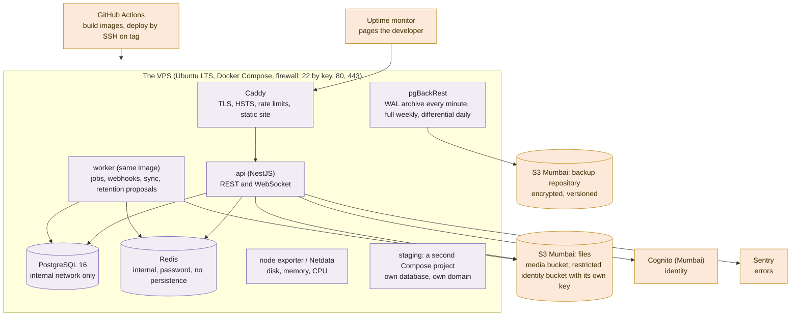

# AMPM Platform — The VPS: Setup Specification and Runbooks

**Status:** version 0.1, 26 October 2026 · **Decision:** R13 locked as G2, everything on AMPM's dedicated VPS, with pgBackRest archives to an S3 bucket in Mumbai and rehearsed restores (D-015). This document is what sprints 6–7 build (build-plan §3; the v0.1 "sprint 2" reference predates the locked execution plan) and what the operator keeps to. It sets aside the architecture's principle 7 ("nothing hand-built on a server") deliberately: the server is built from code in this repository and can be rebuilt from it.

## 0. The facts (recorded 26 October 2026; confirm the items marked so at purchase)

| Fact | Value | Why it matters |
|---|---|---|
| Provider and plan | Hostinger VPS, plan KVM 4 (the user's choice, 26 October 2026) | |
| Datacentre city | **India (Mumbai)**. The plan is not bought yet; the user confirmed on 26 October 2026 that the India (Mumbai) datacentre will be selected at purchase. Buy it before sprint 2 day 8 | Data residency: the lock holds only with an Indian datacentre |
| Specification | 4 vCPU, 16 GB RAM, 200 GB NVMe, 16 TB monthly transfer, KVM virtualisation | Meets the recommended production sizing in part 2; production and staging together fit at this scale with resource limits |
| Dedicated to AMPM, or shared | To confirm; the plan assumes dedicated to AMPM | Isolation; a shared box needs separate users, networks and limits |
| Who holds root today, and who will patch | The user (the developer); access for the build sessions is granted in a later phase, needed by sprint 2 day 8 (build plan part 11.4) | Until then the `infra/` files are developed and tested against a local virtual machine |
| Provider snapshots and backups | Hostinger: automatic weekly backups included, manual snapshots on demand, daily backups as an add-on (take it); these are the second layer, pgBackRest archives remain the first | Recovery |
| Addresses | One dedicated IPv4 and IPv6 from Hostinger; reverse DNS set in the panel | TLS, email reputation, firewall |
| Operating system | Ubuntu 24.04 LTS template (plain, not the Docker template; `bootstrap.sh` installs Docker pinned) | Reproducibility |
| Staging | A separate Compose project on the same KVM 4 during the build, with its own database and limits; a small second Hostinger VPS (KVM 1 or 2) for staging before launch if the box runs tight | Part 2 |
| Price | About ₹1,100 to 2,400 a month depending on term and renewal (list prices seen on 26 October 2026; confirm in the Hostinger panel) | Part 8 |

## 1. Topology

Files live in S3 in Mumbai, not on the box: the media bucket behind a content network with signed links, and the restricted identity-document bucket under its own key with every read audited (architecture §3, §11). MinIO on the VPS is possible but adds a second thing to back up; it is not the default.

## 2. Sizing

| Workload | Minimum | Recommended |
|---|---|---|
| Production alone | 4 vCPU, 8 GB, 160 GB NVMe, 2 TB transfer | 4 vCPU, 16 GB, 240 GB NVMe |
| Production and staging on one box | 6 vCPU, 16 GB, 320 GB NVMe | 8 vCPU, 32 GB |
| **Hostinger KVM 4 as chosen: 4 vCPU, 16 GB, 200 GB NVMe** | Production alone: recommended tier met. Production plus staging: fits during the build with limits (PostgreSQL 6 GB, API 2 GB, worker 1 GB, staging 3 GB, the rest for the system and page cache); move staging to a KVM 1 or 2 if memory or disk run above 80 percent | |

Twenty concurrent weddings, two hundred hotels and a few thousand users are small for one box; PostgreSQL gets half the memory, the API two tasks' worth of CPU, the worker one. Growth path: a bigger VPS; then a managed database beside it (G1); then a warm standby with streaming replication before launch if availability on wedding days demands it.

## 3. The stack as code (`infra/` in the repository)

| Path | Contents |
|---|---|
| `infra/docker/Dockerfile` | The single multi-stage image that runs api, worker or the migration job by command (feature 6.1, D-048); non-root, the built `dist` plus the installed workspace |
| `infra/bootstrap.sh` | One-shot host preparation: users, SSH hardening, firewall, Docker, unattended upgrades, time sync, swap, log rotation, fail2ban |
| `infra/compose/production/compose.yml` | caddy, api, worker, postgres, redis, pgbackrest, node-exporter; pinned image tags; healthchecks; `restart: unless-stopped`; memory and CPU limits; read-only root filesystems where possible; non-root users; internal network for postgres and redis; only caddy publishes ports |
| `infra/compose/staging/compose.yml` | The same, own project name, own database, own domain, smaller limits |
| `infra/compose/local/compose.yml` | The local smoke stack: builds the image from source with throwaway creds, for `pnpm infra:smoke` and CI (feature 6.1) |
| `infra/caddy/Caddyfile` | Domains, automatic TLS, HSTS, security headers, rate limits on sign-in, OTP and public forms, static public site, reverse proxy to the API with WebSocket support |
| `infra/pgbackrest/pgbackrest.conf` | Repository on S3 Mumbai with repo encryption, `archive_timeout` 60 seconds, full backup weekly, differential daily, retention 2 full sets and 14 days of archives, `process-max` 2 |
| `infra/postgres/` | `postgresql.conf` tuned to the box (shared buffers a quarter of memory, WAL level replica, archive command to pgBackRest, logging), `pg_hba.conf` internal only |
| `infra/secrets/*.enc.yaml` | `sops` with `age`: database password, Redis password, Cognito, S3, Razorpay, provider keys; decrypted on the host at deploy; the age key lives only on the host and in the developer's password manager |
| `infra/monitoring/` | node exporter or Netdata configuration; alert thresholds (disk 80 percent, memory 90 percent, backup age over 26 hours, archive lag over 10 minutes, certificate under 14 days) |
| `.github/workflows/deploy.yml` | Build images to the GitHub registry on main and on tags; deploy to staging on merge to main; deploy to production on a release tag; migration job before the new API starts; health gate; rollback by redeploying the previous tag |
| `infra/runbooks/` | Rebuild, restore, rotate secrets, upgrade PostgreSQL, respond to an incident (part 6) |

## 4. Backups and recovery

- **Database.** pgBackRest archives every WAL segment to the Mumbai bucket, forced at least every minute (`archive_timeout`), so the recovery point is about one minute. A full backup every week and a differential every day keep restores fast; the repository is encrypted and the bucket versioned. A daily `pgbackrest check` and `info` run from the worker's schedule and alert on failure or age.
- **Files.** Already in S3 with versioning; nothing to back up from the box.
- **The box.** Provider snapshots nightly, seven kept, as the second layer; the Compose files, configuration and runbooks are in the repository, so the box itself is disposable.
- **Restore rehearsal.** Monthly: restore the latest backup into the staging project with point-in-time recovery to a chosen minute, run the smoke tests, record the measured recovery point and time in the vault. Quarterly: the full rebuild runbook on a fresh VPS, timed. The architecture's targets, fifteen minutes and four hours, are met if the monthly figures stay under them; AC-22 in the test plan is this drill.
- **Retention and deletion.** Backups are retained 14 days of archives plus two full sets; longer retention of wedding data is the platform's job, not the backup's.

## 5. Security baseline

- Ubuntu LTS; unattended security updates; a monthly patch window for the rest, announced in the team workspace; reboot in the window.
- SSH on key only, no root login, from a short allowlist of addresses where the provider's firewall permits; fail2ban; `ufw` default deny, allowing 22, 80, 443.
- Docker: no socket exposed; images pinned by tag and digest; containers non-root; read-only filesystems; `no-new-privileges`; resource limits; log driver with rotation.
- PostgreSQL and Redis on the internal Compose network only, never published; passwords from secrets; TLS inside the box is unnecessary, outside the box everything is TLS.
- Full-disk or volume encryption where the provider supports it; the backup repository encrypted by pgBackRest; the identity-document bucket under its own KMS key with access only from the API's role.
- Secrets: `sops` and `age`; nothing in environment files committed; rotation yearly and on any suspicion; the runbook names every secret and where it is used.
- Caddy: automatic TLS, HSTS, security headers, rate limits; the API's own rate limits behind it.
- Audit: SSH logins and sudo logged and shipped off the box (journald to the monitoring service); the platform's own audit stays in `audit_events`.
- A penetration test before launch covers the host as well as the application.

## 6. Runbooks (summaries; the full text lives in `infra/runbooks/`)

- **Rebuild from nothing.** Provision a VPS; run `bootstrap.sh`; place the age key; `sops` decrypt; `docker compose up` for postgres and pgbackrest; `pgbackrest restore` to the latest or to a point in time; start redis, api, worker, caddy; point DNS; run the smoke tests. Target four hours; rehearsed quarterly.
- **Restore the database only.** Stop api and worker; restore into a fresh data directory; start; verify; restart. Target under one hour.
- **Deploy and roll back.** Tag a release; Actions builds and deploys; the migration job runs expand steps; the health gate passes; roll back by redeploying the previous tag; contract steps ship only in a later release. No deploys while a wedding is live (the configuration flag checked by the workflow).
- **Rotate secrets.** New value in the encrypted file; deploy; revoke the old at the provider; record in the vault.
- **Incident.** Uptime or Sentry page; check Caddy and container health; disk and memory; PostgreSQL logs; if the box is lost, the rebuild runbook; the project lead is told during a live wedding.
- **Upgrade PostgreSQL.** Major versions through a logical dump to the staging project first, then `pg_upgrade` in the patch window with a fresh full backup before.

## 7. Monitoring and alerts

Sentry for API, worker and app errors; an outside uptime monitor on the website, the API health endpoint and the staging health endpoint, paging the developer; node exporter or Netdata for disk, memory, CPU and load, with the thresholds in part 3; pgBackRest age and archive lag; certificate expiry; failed jobs and webhook failures from the application's own metrics. Wedding-day mode tightens thresholds while a project is live.

## 8. Costs

| Item | Monthly |
|---|---|
| The VPS: Hostinger KVM 4 | ₹1,100 to 2,400 depending on term; daily backups add-on if offered separately |
| S3 Mumbai: backup repository and the two file buckets, under 500 GB | ₹300 to 1,500 |
| Cognito | ₹0 at this scale |
| Sentry Team | about ₹2,200 |
| Uptime monitor | ₹0 to 800 |
| Content network in front of media | ₹0 to 1,500 |
| **Total** | **about ₹3,600 to 8,400** |

## 9. What this gives up, stated once

One box is one point of failure for the application and the database together. The data is safe to within a minute through the archives, and the box is rebuilt in hours from code, but during a provider incident the client portal, chat and notifications are down while the team app keeps working offline. If that is not acceptable on wedding days by launch, the answer is a managed database beside the VPS (G1) or a warm standby VPS with streaming replication; both are a configuration change, not a redesign.
