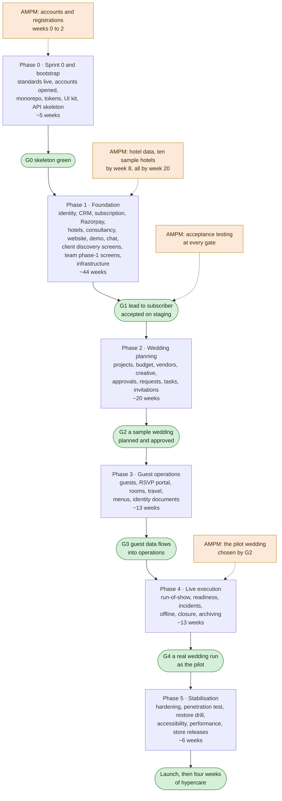
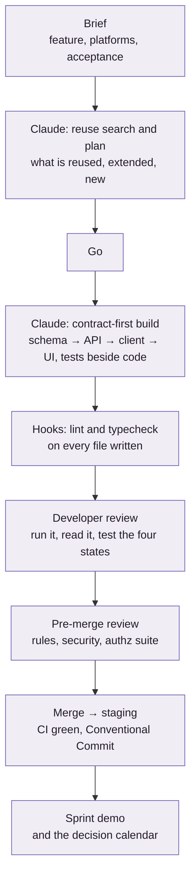

# AMPM Platform — The Build Plan: Schedule, Effort, Cost and Method

**For:** the development team, and AMPM for information · **Date:** 26 October 2026 · **Status:** version 0.2, the execution plan. Decisions are locked by the developer; nothing waits for a signature. Built on the platform blueprint (version 0.2), the engineering standards (version 1.0), AMPM's decisions of 25 and 26 October 2026 and the delivery model recorded the same day: one developer building the whole platform with Claude Code. Estimates are the developer's, with the method and every rate shown so that each number can be challenged.

This is the end-to-end plan for building AMPM: how the work is done with Claude, the phases and sprints, the effort and what it costs, when each remaining decision is needed, how the one launch is reached, and what can go wrong. It answers the specification's request for "a milestone schedule with cost estimate" (SPEC §14) and the business explanation's item 7.

Three things to hold while reading:

> **DECIDED.** The whole first release goes live at once (R17, 26 October). The plan is therefore one critical path through five build phases and a stabilisation phase, with internal releases to staging at every phase exit and one public launch at the end.

> **ASSUMED.** The developer's own planning inputs (K1 to K22) are not yet answered. Where the plan needs them it states an assumption and shows the alternatives: hours per week as three capacity scenarios, the commercial arrangement as a formula with a worked example, the hosting variant as two cost lines.

> **GAP.** The schedule is honest about size. At the likely estimate, one developer working full time with Claude needs about two years to the launch; at lower weekly hours proportionally longer. Part 5.5 lists the levers that shorten it; the developer chooses among them when locking the plan (part 11).

---

## 1. The plan in one picture

Durations are weeks at 40 hours a week of the developer's time (part 5). At 30 hours multiply by 1.33; at 20 hours by 2.

| Milestone | What is true when it is reached | Week at 40 h | Week at 30 h | Week at 20 h |
|---|---|---|---|---|
| G0 Skeleton green | Standards enforced; accounts open; monorepo, tokens, UI kit and API skeleton build and test clean | 5 | 7 | 10 |
| G1 Foundation | A prospect can enquire, be invited, see the demo, pay ₹50,000 and explore hotels on staging; the team app runs leads, hotels and enquiries; private data proven protected | 49 | 65 | 98 |
| G2 Wedding planning | A sample wedding planned, budgeted, vendors selected, designs and menus approved, requests handled, end to end on staging | 69 | 92 | 138 |
| G3 Guest operations | Guest lists, RSVP by link, rooms, travel and menus feed operational reports; identity documents handled in the restricted store | 82 | 109 | 164 |
| G4 Live execution | A real AMPM wedding run through the system as the pilot, including the day itself offline, and closed | 95 | 126 | 190 |
| Launch | Penetration test closed, restore drill passed, accessibility and performance checked, apps in the stores, launch checklist signed; AMPM starts inviting | 105 | 140 | 210 |

---

## 2. How we build with Claude

One developer and Claude Code are the development team. The method below is what makes that safe: the rules are enforced by tooling, every change passes the same gates, and AMPM sees working software at every phase exit rather than at the end.

### 2.1 Roles

| Who | Does |
|---|---|
| The developer | Owns the plan, the architecture and every merge; writes the feature briefs; reviews and tests what Claude produces; runs the environments; talks to AMPM |
| Claude Code | Writes most of the code, tests and documentation from the briefs, under the rules in `.claude/rules/`; explores and reviews on request; never merges |
| AMPM's founder | Is informed at each gate; provides what part 7.2 lists: accounts in AMPM's name, the pilot wedding, content, testers |
| Eva and the hotel team | Load and verify the hotel data; test the hotel screens |
| AMPM staff (one or two per department) | Acceptance testing on staging at each gate, with synthetic data |
| Outside parties | Penetration tester (phase 5); AMPM's legal adviser for privacy wording (phase 3) |

### 2.2 The rhythm

Two-week sprints. Each sprint has a goal written in the plan, a demo at the end, and a note of what moved. Each phase ends with a gate: AMPM's team runs that phase's acceptance scenarios on staging, the developer fixes what they find and closes the gate, recording it in the vault.

### 2.3 Session practices

- **One feature, one worktree, one brief.** Every feature starts from the feature prompt in the standards (§2.8): Claude searches `packages/` and reports what it will reuse, extend and add; the developer says go; Claude builds contract-first (Zod schema, NestJS module, client hook, UI from `packages/ui`), with loading, empty, error and offline states and tests beside the code.
- **The rules are files, not memory.** `CLAUDE.md` and the path-scoped rules load themselves; the lint hook runs on every TypeScript file Claude writes; the typecheck hook refuses to end a turn red; the Stop hook commits the turn. A rule is added when the same mistake happens twice.
- **Review is the developer's job.** Nothing merges unread. The pre-merge prompt lists violations file by line; the code-review and security-review skills run on every pull request that touches money, permissions, files or sync; the generated authorisation suite is the safety net that fails the build when code drifts from the permission matrix.
- **Design before code for anything new.** A new pattern or dependency category gets a build-decision record (`new_decision.py`) first. The data model and the permission matrix are updated in the same task as the schema or policy change, so the documents stay the source of truth.
- **Subagents for breadth, the developer for judgement.** Exploration, inventories and independent reviews go to subagents; estimates, merges and anything that changes a locked decision stay with the developer.
- **Memory and graph.** Sessions are mined into the memory wing and the knowledge graph is refreshed when documents change, so a new session can ask "why was this done" and get the answer.
- **Synthetic data only.** Development and staging never hold real guest data; fixtures use reserved phone ranges and example domains. Secrets live in the secret manager, never in a session.

### 2.4 Gates and quality

| Gate | Runs | Passes when |
|---|---|---|
| Every file written | Prettier, ESLint with boundaries | No errors |
| Every turn | Typecheck | Green |
| Every commit | lefthook: lint-staged, commitlint | Conventional Commit, lint clean |
| Every pull request | CI: lint, typecheck, unit, authorisation suite, contract tests against sandboxes, end-to-end smoke | Green; reviewed by the developer |
| Every sprint | Demo on staging; dependency updates reviewed | Sprint goal demonstrated |
| Every phase | AMPM's acceptance scenarios for the phase (test-cases §3); security review of the phase's modules; accessibility pass on new screens | Closed by the developer after AMPM's testers pass the pack |
| Before launch | Penetration test closed; restore drill; full accessibility audit; load profile; launch checklist | All items ticked |

### 2.5 Releases and environments

Three environments: development (local containers for PostgreSQL and Redis, synthetic seed), staging (production-like, synthetic data, where AMPM tests; a separate Compose project on the VPS or a second small VPS), production (live, on the VPS). Trunk-based development: merges deploy to staging automatically; production deploys from a tagged release after acceptance. Apps go to AMPM's testers through TestFlight and Play internal testing from phase 1; store submissions happen in phase 5, with one to two weeks of review allowed per submission. Migrations are expand-and-contract, so a release is reversible by redeploying the previous image. Feature switches are configuration rows. No deployment while a wedding is live.

### 2.6 Working with AMPM

A thirty-minute checkpoint every week; a demo every sprint; a gate meeting every phase. The remaining decisions are the developer's and are locked by the decision calendar in part 7, each before the sprint that needs it; AMPM is told what was locked. Change requests to locked items are written down with their effect on the plan before they are accepted. AMPM's own work (accounts, hotel data, content, testers, legal wording) has dates in part 7, because the plan slips when they slip.

---

## 3. Phases and sprints

Each phase lists its goal, what it builds (counted from the blueprint), its sprint themes at the 40-hour baseline, its exit, and what AMPM provides. Tables and screens follow the phase tags in the data model and the wireframes; flows are the twelve in the user-flow draft.

### Phase 0 · Sprint 0 and bootstrap (about 5 weeks)

**Goal.** The standards enforced in a working monorepo, every external account opened, and the skeleton from which everything else grows.

**Builds.** The six bootstrap steps of the standards (§2.7): monorepo skeleton with the three apps and six packages; tokens from AMPM's palette and the NativeWind pipeline; quality tooling and CI; the UI foundation (ThemeProvider, Text, Button, Input, Card, Sheet, Toast, ErrorState, EmptyState, OfflineState, Skeleton, Icon, Image, Link, StatusChip, Callout, MoneyText, layout helpers, `useBreakpoint`) with tests, stories and a gallery on phone, tablet and web; the domain and policy skeleton with the identity integration, the eight-step pipeline as guards, module A's schema, `/health` and `/me`; handover notes.

| Sprint | Theme |
|---|---|
| 1 | Accounts and registrations started by AMPM; monorepo skeleton; tokens and styling pipeline |
| 2 | Quality tooling, hooks verified, CI; UI foundation, gallery on web and native |
| 3 (half) | Domain, policy and API skeleton; identity service wired; first record of the stack as built |

**Exit (G0).** `pnpm check` green; the gallery renders identically on web and native, light and dark, phone and tablet; a deliberate boundary violation fails lint; `/me` works from both apps.

**AMPM provides.** Accounts in AMPM's name in weeks 0 to 2: cloud (or Supabase organisation), Razorpay merchant onboarding, Meta business verification, SMS DLT registration, Apple Developer and Google Play, domain. The hosting variant (R13).

### Phase 1 · Foundation (about 44 weeks)

**Goal.** The product AMPM sells: enquiry to demo to subscription to hotel discovery, with the team app running leads, hotels and enquiries, on real infrastructure.

**Builds.** 43 tables (modules A, B, C, D, N, Q); 55 screens (9 public pages, 6 sign-in, the demo landing, 13 client discovery screens including chat and notification preferences, 26 team screens: dashboard, leads and clients, hotels, enquiries, documents, payments ledger, settings, chat console); flows 1, 2, 11 and 12; eleven integrations (identity service, Razorpay, email, WhatsApp for clients, SMS for OTP, push, video, maps, monitoring, analytics and bot check, the hotel search view); ten background jobs; live chat; the permission pipeline, the policy package and the generated authorisation suite; demo mode with seed and reset; hotel import; the media pipeline with signed links; the infrastructure as code and the three environments.

| Sprints | Theme |
|---|---|
| 3 to 5 | Identity and kernel: users verified by email and mobile, OTP sign-in, staff second factor, roles, memberships, sessions, audit, configurations, notifications adapter with email and SMS |
| 6 to 7 | The VPS as code, completed: Compose stack, hardening, secrets, pgBackRest schedule and retention, files in the Mumbai buckets, outside monitoring and alerts, a content network in front of media, CI to staging and tagged production deploys; the rebuild runbook rehearsed once end to end |
| 8 to 10 | CRM and subscription: leads and activities, accounts, plans, subscriptions, agreements, payments; Razorpay checkout and idempotent activation; expiry and renewal; entitlements |
| 11 to 14 | Hotels: destinations, hotels, rooms, venues, rate cards with verification and freshness, references with consent, saved hotels; spreadsheet import; search view; maps and street view; media upload, sizing, scanning, signed links; video provider |
| 15 to 16 | Consultancy: enquiries with their ten statuses, events, visits, proposals with client and internal totals, booking milestones |
| 17 | Public website: nine pages, forms to leads with consent and source, analytics and bot check |
| 18 | Demo mode: scoping, seed and nightly reset, demo landing, Zoom call request; WhatsApp for clients and push |
| 19 | Live chat: gateway, conversations and messages, staff console, turn into a request |
| 20 to 22 | Client app discovery screens on phone, tablet and web: home, destinations, results, hotel detail, selection and compare, assistance request, enquiry tracker and detail, proposal decision, subscription and wedding details, notifications, chat |
| 22 to 24 | Team app phase-1 screens: dashboard, lead pipeline and detail, accounts, subscription and agreement editors, hotel editors and queues, enquiry queue and detail, proposal editor, documents, payments ledger, settings screens, chat console |
| 24 | Flows 1, 2, 11, 12 end to end; policy suite complete; AMPM acceptance window |

**Exit (G1).** Test-cases §3 phase 1 pack: AC-01 to AC-05, AC-12, AC-17 to AC-21, AC-24 to AC-26, AC-32 subscriber rows, AC-35.1, plus AC-16 on public pages and portal, AC-28 for payment, email, SMS and video, AC-34.1 search load. AMPM's scenarios 1 to 7 and 9 pass on staging.

**AMPM provides.** Hotel import format agreed and ten sample hotels by week 8; the full hotel database with photographs, menus and rate cards by week 20; website copy and selected work with permissions by week 30; visual design approvals before sprints 20 and 22; testers for the acceptance window; the answers in the decision calendar for phase 1.

### Phase 2 · Wedding planning (about 20 weeks)

**Goal.** A wedding planned end to end: project, functions, budget, vendors, creative work, approvals, requests, tasks, invitations.

**Builds.** 32 tables (modules E, F, G, H, I, M, and invitations in J); 39 screens (15 client: wedding dashboard, overview, functions, function workspace, budget, invoice, vendor options and proposal, design studio and item, invitations, approvals inbox, requests and detail, documents; 24 team: calendar, projects and project wizard, dashboard, settings and members, functions, function workspace, budget workbook and line, vendor assignments and proposal editor, designs, invitations editor, requests queue, approvals tracker, vendor master, profile editor, quotes, contracts and deliverables, tasks and detail, invoices, milestones, reports hub); flows 3 to 6; accounting export and calendar feed; material-change flags and overdue surfacing.

| Sprints | Theme |
|---|---|
| 25 to 26 | Projects, members (the two representatives), hotels and venues, functions and programme; project creation back-fills discovery data |
| 27 to 28 | Budget and finance: categories, lines with client and internal amounts, cost entries, contracts, invoices as internal records, milestones by bank transfer |
| 29 to 30 | Vendors: categories, master, availability, assignments and options, quotes, versioned proposals, deliverables, share-contact flag |
| 31 to 32 | Creative, approvals and requests: design items and versions, comments, approvals with required decisions and on-behalf records, client requests with material flags, impact tasks |
| 33 | Tasks and dependencies, invitation editor and versions, accounting export, calendar feed, reports hub |
| 34 | Flows 3 to 6 end to end; client and team screens completed; AMPM acceptance window |

**Exit (G2).** Phase 2 pack: AC-06 to AC-09, AC-29 planning rules, AC-30 planning reports, AC-31, AC-36.1, AC-36.2, AC-36.5, AC-23.3, AC-32 engaged rows. AMPM's scenarios 8, 9, 10, 17 pass. The pilot wedding is chosen.

**AMPM provides.** Vendor categories and a sample of vendors with portfolios; budget categories; the first design assets; the decision calendar answers for phase 2 (R5 countersigned, R6, R7, R18).

### Phase 3 · Guest operations (about 13 weeks)

**Goal.** Guests invited and answering by link, headcounts flowing into rooms, travel and menus, identity documents handled where a hotel requires them.

**Builds.** 19 tables (modules J, K, L, identity documents in N); 22 screens (9 guest wizard steps and off-path screens, 4 client read-only guest screens, 9 team: guest database, household editor, attendance board, call list, tokens and distribution, rooming, travel and transport, support requests, guest import); flows 7 and 8; WhatsApp templates for guests; attendance recalculation and reminder jobs; the restricted identity store with audited reads; guest import.

| Sprints | Theme |
|---|---|
| 35 to 36 | Guest model: households, guests, attendance, tokens by scope, locked responses, support requests, recipients; guest import |
| 37 | Guest portal: the seven-step wizard, household identification, consent, language switch, confirmation and correction requests |
| 38 to 39 | Rooms, travel and transport: blocks, allocations and occupants, travel segments, vehicles and transfers, manifests without identity data |
| 40 | Menus and headcounts; identity documents in the restricted store; WhatsApp templates for guests; reminders and the call list |
| 41 (half) | Flows 7 and 8 end to end; AMPM acceptance window |

**Exit (G3).** Phase 3 pack: AC-10, AC-11, AC-23, AC-27.2, AC-27.3, AC-28.3, AC-30 guest reports, AC-35.2 to AC-35.4, AC-16 guest portal, AC-34.2 RSVP burst. AMPM's scenario 11 passes.

**AMPM provides.** Privacy wording approved (R12); WhatsApp templates approved by Meta (started in phase 1); the pilot wedding's guest list for the shadow run; the RSVP link structure (R11).

### Phase 4 · Live execution (about 13 weeks)

**Goal.** The wedding day run from the team app, offline where needed, and the wedding closed, archived and reopened under AMPM's control.

**Builds.** 12 tables (run-of-show, staffing, incidents, artists, production items, checklists, feedback, departures, lost and found, final accounts, archiving fields); 10 screens (closure and final accounts, artists and production, staffing roster, run-of-show editor and live view, readiness board, incidents, event-day console, final accounts; client feedback and closed state); flows 9 and 10; offline-first in the team app; incident escalation and retention proposal jobs; wedding-day monitoring mode and the deployment-freeze switch.

| Sprints | Theme |
|---|---|
| 42 to 43 | Run-of-show, readiness checklists and templates, exceptions authorised by the Super Admin, production items and artist bookings |
| 44 | Staffing roster, incidents with escalation, event-day console |
| 45 to 46 | Offline-first: local store, change queue, sync, conflict log, encryption and wipe, indicators; airplane-mode tests |
| 47 | Closure checklist, final accounts, feedback, read-only window, archiving and reopening; retention proposals; wedding-day mode |
| 48 | The pilot wedding's day on the system; fixes; AMPM acceptance window |

**Exit (G4).** Phase 4 pack: AC-13 to AC-15, AC-29 execution rules, AC-33 offline, AC-36.3 to AC-36.6, AC-32 closure rows, AC-27.4, AC-27.5. AMPM's scenarios 12 to 16, 18, 19 pass. The pilot wedding has been run through the day on the app.

**AMPM provides.** The pilot wedding, with a department manager per team willing to run the day on the app alongside the current process; R19 and R16 answered.

### Phase 5 · Stabilisation and launch (about 6 weeks)

**Goal.** Launch-ready: hardened, tested by an outsider, recoverable, accessible, performant, in the stores.

**Builds.** Row-level security as the second line of defence; penetration test and remediation; restore drill into staging; full accessibility audit and fixes; performance against T-12; reports and exports completed; retention proposal screens; store submissions and release builds; production seed and the hotel data cut-over; runbooks and handover; the launch checklist.

| Sprints | Theme |
|---|---|
| 49 | Hardening and the penetration test window; restore drill |
| 50 | Remediation; accessibility and performance fixes; reports and exports |
| 51 | Store submissions; production seed; runbooks; launch checklist; launch |

**Exit.** Every criterion's P1 to P3 tests; AC-22 restore drill; AC-34 full profile; AC-16 full audit; penetration findings closed; launch checklist complete.

**AMPM provides.** The penetration tester engaged (or the decision to rely on internal review, K15); the maintenance arrangement signed (R16); the first prospects to invite.

### Cross-cutting, every phase

Acceptance support (fixing what AMPM's testers find, about a tenth of build effort), the pilot wedding support in phases 2 to 4, documentation and runbooks, sprint demos and the weekly checkpoint, dependency maintenance. These are in the effort table as their own line and in the phase durations above.

---

## 4. Effort

### 4.1 Method

The estimate is bottom-up from the blueprint's inventories, in developer-days: one day is eight hours of the developer's time, with Claude Code writing most of the code, tests and documentation and the developer briefing, reviewing, running, testing, integrating and fixing. The rates below are what one developer can review and stand behind per day, not what Claude can generate. Each phase total is the sum of its units; the cross-cutting line and a buffer are added on top. The low and high figures change the rates by a fifth either way and the buffer from a fifth to about a third.

| Unit | Likely rate | What it covers |
|---|---|---|
| Table | 0.6 day (0.2 for join and reference tables, up to 1.5 for budget lines, approvals, guests) | Prisma model and migration, repository with scoping, service rules and transitions, Zod schemas, endpoints, unit and authorisation tests |
| Client app screen | 1.0 day | Phone and tablet layouts, web export, four states, accessibility, component tests, wiring to hooks |
| Team app screen | 1.1 days | As above; editors, tables and workspaces are denser |
| Guest wizard step | 0.8 day | Web, consent, language switch |
| Public page | 0.5 day | Static page from the design |
| Flow end to end | 2 days | Cross-module wiring, notifications, Playwright or Maestro test |
| Integration adapter | 0.5 to 4 days | Interface, implementation, sandbox configuration, contract test, failure handling |
| Background job | 0.75 day | Idempotent job, retry policy, outcome record |

### 4.2 By phase

| Phase | Units | Likely days | With 25 % buffer | Share of the acceptance, pilot and documentation line | Phase total |
|---|---|---|---|---|---|
| 0 Bootstrap | Six bootstrap steps | 20 | 25 | — | 25 |
| 1 Foundation | 43 tables (26); 55 screens (51); 4 flows (8); 11 integrations (23); 10 jobs (7.5); chat (6); policy pipeline and generated suite (15); demo (3); hotel import (2.5); media pipeline (5); infrastructure (12) | 158.5 | 198 | 22 | 220 |
| 2 Wedding planning | 32 tables (19); 39 screens (41); 4 flows (8); 2 integrations (2.5); 2 jobs (1.5) | 72.5 | 91 | 11 | 102 |
| 3 Guest operations | 19 tables (11.5); 22 screens (21); 2 flows (4); guest WhatsApp (2); 2 jobs (1.5); identity store (3); guest import (1.5) | 44.5 | 56 | 9 | 65 |
| 4 Live execution | 12 tables (7); 10 screens (11); 2 flows (4); offline-first (20); 2 jobs (1.5); wedding-day mode (2) | 45.5 | 57 | 9 | 66 |
| 5 Stabilisation and launch | Hardening (3), penetration remediation (4), restore drill (1), accessibility (3), performance (3), store releases (3), seed and checklist (1) | 18 | 22.5 | 6 | 29 |
| Cross-cutting | Acceptance support 10 % of build (34); pilot wedding support (8); documentation and runbooks (8) | 50 | 63 | distributed above | — |
| **Total** | | **409** | **511** | | **≈ 510** |

| Case | Rates | Buffer | Developer-days |
|---|---|---|---|
| Low | A fifth better than likely | 20 % | ≈ 400 |
| **Likely** | As in 4.1 | 25 % | **≈ 510** |
| High | A third worse than likely | 35 % | ≈ 700 |

Not included: the visual design track if the developer does it with Claude rather than AMPM paying a designer (about 15 days, K12); work AMPM does (hotel data, content, testing, legal wording); the maintenance period after launch.

### 4.3 Where the days go

Half of the effort is screens: 126 of them, each on phone, tablet and web with four states. A quarter is the data and API layer. The rest is integrations, the permission pipeline, offline, infrastructure, chat, and the acceptance and pilot support that a solo developer cannot delegate. The single largest technical risk, offline-first, is twenty days likely and up to thirty.

---

## 5. Schedule

### 5.1 Capacity scenarios

The calendar depends on the developer's hours (K1). Effective days per week are hours divided by eight.

| Hours a week | Days a week | Build weeks (510 days) | Plus waits that do not overlap (store review, launch) | Months to launch |
|---|---|---|---|---|
| 40 | 5 | 102 | 4 | **about 24** |
| 30 | 3.75 | 136 | 4 | about 32 |
| 20 | 2.5 | 204 | 4 | about 48 |

AMPM's acceptance windows overlap the next phase's first sprint, because one developer keeps building while AMPM tests; they cost the developer time (the acceptance support line), not calendar.

### 5.2 The critical path

Everything is on one path because there is one developer. Within it, the order is chosen so that the long external waits start first and the hardest technical piece is proved early:
1. Accounts and registrations (AMPM, weeks 0 to 2): WhatsApp business verification two to six weeks, SMS DLT two to four weeks, Razorpay one to two weeks, Apple and Google days. Started in week 0 they are ready long before they are needed; started late they stall phase 1.
2. Identity, infrastructure, CRM and payments before hotels, because every later screen signs in through them.
3. Hotels and consultancy next, because they are the product and need Eva's data to be tested.
4. The offline proof-of-concept is built in phase 1's kernel sprints as a thin spike (two days inside the identity sprints) so that the sync library is chosen early, even though offline ships in phase 4.
5. The pilot wedding is chosen at G2 so that its guest list exists for phase 3 and its day falls inside phase 4.

### 5.3 External waits and lead times

| Item | Owner | Lead time | Needed by |
|---|---|---|---|
| Cloud account or Supabase organisation in AMPM's name | AMPM | Days | Sprint 1 |
| Razorpay merchant onboarding (KYC) | AMPM | 1 to 2 weeks | Sprint 8 |
| Meta business verification and WhatsApp templates | AMPM, developer | 2 to 6 weeks | Sprint 18 (clients), sprint 40 (guests) |
| SMS DLT entity, headers, templates | AMPM | 2 to 4 weeks | Sprint 3 (OTP) |
| Apple Developer and Google Play accounts | AMPM | Days | Sprint 2 (internal builds), sprint 51 (release) |
| Domain and email authentication | AMPM | Days | Sprint 6 |
| Store review | Apple, Google | 1 to 2 weeks per submission | Sprint 51 |
| Penetration test | Outside firm | 2 to 3 weeks including retest | Sprint 49 |

### 5.4 Buffers and what they are for

The 25 percent buffer covers rework after review, learning on parts of the stack the developer has not shipped before (K4), app review rejections, provider surprises (template rejections, sandbox differences) and AMPM's change requests within locked scope. It is not a reserve for new scope.

### 5.5 Levers that shorten the calendar

The honest conclusion is that one developer, full time, reaches a single launch in about two years. Each lever below changes that, and the first three are decisions already written up for the founder.

| Lever | Effect on the 40-hour calendar | What it costs |
|---|---|---|
| Discovery goes live after phase 1 (reopens R17) | First revenue and real feedback at about month 11 instead of 24; the rest of the plan unchanged | Two go-lives, two support windows |
| Web-first client portals: ship the web export in phase 1 and the native client app at launch | Saves roughly 15 to 20 days of store and native work before G1; no change to the total | The demo and discovery run in the browser first |
| Defer tablet layouts to after launch | Saves roughly 15 days across phases 1 to 4 | Phones only at launch |
| Hosted chat service instead of the built channel | Saves about 5 days in phase 1 | A monthly fee |
| A managed database beside the VPS (G1) instead of everything on it | Removes database administration and the monthly restore rehearsal from the developer's load | About US$40 to 120 a month |
| Plain uploads instead of streaming video at first | Saves about 2 days and a cost line | Weaker hotel pages |
| A second developer for phases 1 and 2 | Up to 40 percent off the calendar for those phases if the work is split by app and API | Cost, coordination, and the solo plan's simplicity |
| More hours a week | Linear | The developer's other commitments |

---

## 6. Cost

### 6.1 Development

Development cost is the developer-days multiplied by the agreed day rate, in whatever commercial form AMPM and the developer settle (K20: fixed price per phase, time and materials, or retainer). The formula and an illustration:

| Case | Developer-days | At an illustrative ₹10,000 a day |
|---|---|---|
| Low | 400 | ₹40 lakh |
| Likely | 510 | ₹51 lakh |
| High | 700 | ₹70 lakh |

The rate is not decided; the illustration exists only to show the scale. Under a fixed price per phase, the phase totals in 4.2 are the units; under time and materials, the sprint notes are the record.

### 6.2 One-off costs (approximate, 2026 prices, ₹84 to the US dollar)

| Item | Amount | Note |
|---|---|---|
| Apple Developer Program | about ₹8,300 a year | US$99 a year |
| Google Play developer account | about ₹2,100 once | US$25 once |
| SMS DLT principal entity registration | ₹5,900 plus GST | Paid to the operator portal; templates and headers free |
| Penetration test, manual, web, API and two apps, with retest | ₹2 to 5 lakh | Indian market range for a login-based app with payments; automated scans are cheaper and not equivalent |
| Domain and DNS | ₹2,000 to 5,000 a year | |
| Visual design, if a designer is engaged | AMPM's quote | Otherwise about 15 developer-days (K12) |

### 6.3 Running costs per month (approximate, before the maintenance arrangement)

| Item | AWS as drafted | Supabase variant | Basis |
|---|---|---|---|
| Hosting, as locked: everything on the Hostinger KVM 4, backups and identity documents in Mumbai buckets | ₹1,500 to 4,000 | Same | The KVM 4 ₹1,100 to 2,400 a month by term; the backup and identity-document buckets under ₹1,500; Cognito free at this scale. For comparison, the drafted AWS topology was US$450 to 900 and Supabase about US$170 to 240 |
| Payment gateway | 2 % plus GST on each ₹50,000 subscription: ₹1,180 each | Same | Razorpay standard pricing applies to UPI and cards alike; a new-merchant waiver of the platform fee may apply for the first 90 days |
| WhatsApp | ₹1,000 to 3,000 plus the provider's platform fee (₹2,000 to 5,000) | Same | Utility and authentication messages about ₹0.115 plus GST each; marketing ₹0.86 plus GST; a 600-guest wedding with six utility messages per household costs under ₹600 |
| SMS for OTP | ₹500 to 1,500 | Same | ₹0.13 to 0.20 plus GST per message; a few thousand sign-ins a month |
| Email | Under ₹500 | Same | Amazon SES or equivalent |
| Video | ₹500 to 1,500 | Same | US$5 per 1,000 minutes stored and US$1 per 1,000 delivered; 200 hotels with short films |
| Maps and street view | ₹0 to 5,000 | Same | Static maps and street view per thousand loads, within the provider's free allowance at first |
| App builds | ₹1,600 to 8,300 | Same | Expo's Starter plan US$19 or Production plan US$99; local builds are free |
| Error tracking | about ₹2,200 | Same | Sentry Team |
| **Typical month before gateway fees** | **₹10,000 to 30,000** | Same | Gateway fees scale with subscriptions sold: ten a month is ₹11,800 |

Not included: the maintenance and on-call arrangement (R16, K22), which is priced when the service levels are agreed; WhatsApp marketing campaigns, if any; AMPM's own staff time.

### 6.4 What AMPM should budget for

Development at the agreed rate for 400 to 700 developer-days; one-off costs of roughly ₹2.5 to 5.5 lakh, most of it the penetration test; running costs of roughly ₹10,000 to 30,000 a month on the locked VPS platform, plus 2.36 percent of subscription revenue to the gateway; and the maintenance arrangement after launch.

---

## 7. The decision calendar and AMPM's dates

### 7.1 Decisions still open, by when they are needed

All are the developer's to lock; the defaults apply until then.

| Needed before | Decision | Default if not locked |
|---|---|---|
| Sprint 0 | K1 hours a week; K3 pace; K4 stack skills; K10 infrastructure to run; K20 commercial form; K21 account ownership | Plan at 40 hours; AWS as drafted; accounts in AMPM's name |
| Sprint 0 | Locked 26 October: K1 40 hours a week, K20 time and materials, no levers, code in this repository, R13 (Hostinger KVM 4 in Mumbai), the identity service (Cognito), R10. Still open: R15 who owns the WhatsApp and SMS accounts | Developer selects providers, AMPM owns |
| Sprint 3 | R10 staff sign-in: locked 26 October (password plus authenticator app) | — |
| Sprint 8 | R8 which hotel services carry a fee | Availability included, the rest by agreement |
| Sprint 10 | R9 staff roles and cost visibility | Nine roles as drafted |
| Sprint 17 | R12 consent wording for the enquiry form (draft for approval) | Developer drafts |
| Sprint 25 | R5 countersigned; R6 one approval or both; R7 amounts the client sees; R18 material-change thresholds and approval | Two accounts; one approval; level 2; 10 % line, 5 % total, PM approves |
| Sprint 35 | R11 RSVP link structure; R12 retention periods and privacy wording | Per side, combined as option; 24, 12 months, 30 days |
| Sprint 42 | R19 archiving and reopening | Super Admin approves; 30-day read-only reopening |
| Sprint 48 | R16 service levels and support; K17, K18, K22 | As drafted |
| Sprint 49 | R14 capacity (for the load profile) | 50 staff, 1,500 guests |

### 7.2 What AMPM provides, with dates (40-hour baseline)

| By week | Item |
|---|---|
| 0 to 2 | Cloud or Supabase organisation, Razorpay onboarding, Meta business verification, DLT registration, Apple and Google accounts, domain; the hosting variant approved |
| 8 | Hotel import format agreed; ten sample hotels with photographs, menus and rates |
| 20 | The full hotel database loaded and verified by Eva |
| 30 | Website copy, selected work with photograph permissions |
| Before sprints 20, 22, 30, 37, 44 | Visual design approvals for the screens of the coming sprints |
| 49, 69, 82, 95 | Acceptance testing windows of one week, one or two testers per department, on staging with synthetic data |
| 69 | The pilot wedding named, with its departments' agreement to run the day on the app |
| 75 | Privacy notices and terms approved by AMPM's legal adviser |
| 98 | Penetration tester engaged; maintenance arrangement signed |
| 105 | Launch checklist complete; the first prospects to invite |

---

## 8. The pilot and the launch

**The pilot wedding.** Chosen at G2, a real AMPM wedding whose planning falls in phases 2 and 3 and whose date falls in phase 4. It is run in the system alongside AMPM's current process: project, functions, budget, vendors, designs and menus in phase 2; guest list, RSVP by link, rooms and travel in phase 3; the day itself on the team app in phase 4, with each department manager carrying a device, offline where the venue demands it. What breaks is fixed before launch; what the departments ask for is written down for after launch.

**Launch readiness (phase 5).** Row-level security on; penetration test closed; restore drill passed with the measured recovery point and time recorded; accessibility audit passed for the client and guest portals; the load profile run; the retention proposal screens live; the apps approved in both stores; the hotel database cut over to production; runbooks for every job and integration; the launch checklist in architecture §13 ticked.

**Launch day and after.** The website goes live; AMPM starts inviting prospects to the demo at its own pace, because nobody self-registers; the first subscriptions are watched through the payment and activation path; the developer is on call for four weeks of hypercare with daily checks; the first real wedding after launch is treated as a second pilot, with the deployment freeze observed. The maintenance arrangement then takes over.

---

## 9. Risks

| Risk | Likelihood | Effect | Mitigation in this plan |
|---|---|---|---|
| The developer's weekly hours are fewer than planned | High | Calendar stretches linearly | Capacity scenarios stated up front; the levers in 5.5 agreed before signing |
| Offline sync proves harder than estimated | Medium | Phase 4 overruns, launch slips | Spike in phase 1; sync library chosen early; thirty-day high estimate; read-mostly scope of offline |
| Provider onboarding stalls (WhatsApp verification, DLT, Razorpay KYC) | Medium | Phase 1 features wait | Started in week 0 by AMPM; email and links work without them |
| Hotel data arrives late or incomplete | Medium | Phase 1 cannot be demonstrated or accepted | Ten sample hotels by week 8; the import tool early; the acceptance window needs the full database |
| App store review rejections | Medium | Launch slips by weeks | Internal testing builds from phase 1; two weeks allowed; a web launch is possible first |
| Single developer unavailable | Medium | Everything stops | Runbooks and handover as phase deliverables; AMPM owns source and accounts; the standby arrangement in K19 |
| Scope grows through change requests | High | Effort and calendar grow | Locked register; every change request priced against the plan before acceptance |
| Acceptance testing not staffed at AMPM | Medium | Gates slip, defects reach later phases | Testers named per department before G1; one-week windows in the calendar |
| Learning curve on parts of the stack (K4) | Medium | Early sprints slower | Bootstrap sprint; the buffer; simplify choices where K4 says so |
| Security finding late in the penetration test | Low to medium | Launch slips | Security review at every gate; generated authorisation suite; the policy package |

---

## 10. Assumptions of this plan

| ID | Assumption | If it changes |
|---|---|---|
| B-1 | One developer with Claude Code; no other developers | A second developer changes phases 1 and 2 (lever in 5.5) |
| B-2 | Developer-day rates as in 4.1, derived from reviewing Claude-generated code rather than writing it | Replace the rates after sprint 3's measured pace and re-run the totals |
| B-3 | The engineering standards (version 1.0) apply from sprint 0 | A stack change (Hono, Drizzle, Supabase) changes phase 1 by a few days either way |
| B-4 | Everything on AMPM's dedicated VPS in an Indian datacentre, with pgBackRest archives to a Mumbai bucket and rehearsed restores (R13 locked 26 October 2026; VPS facts pending) | A managed database beside the VPS (G1) adds about US$40 to 120 a month and removes database operations; the drafted AWS topology adds US$450 to 900 and a second region |
| B-5 | One go-live (R17) | Discovery first moves first revenue to about month 11 |
| B-6 | Browser version of the client portals from the shared code (R4) and tablet layouts for both apps | Deferring either saves days as in 5.5 |
| B-7 | AMPM delivers the items in 7.2 on their dates | Each late item moves the gate it feeds |
| B-8 | Visual design approved by AMPM before each screen sprint; produced by AMPM or in the optional design track | A designer's calendar joins the critical path |
| B-9 | A penetration test by an outside firm in phase 5 | Internal review only removes the cost and the two-week window and lowers assurance |
| B-10 | The open points (R6 to R16, R18, R19) are answered by the sprints in 7.1 | A late answer defers that feature within its phase |
| B-11 | Store review within two weeks per submission | Longer reviews delay the launch, not the build |
| B-12 | Prices in part 6 as of October 2026, at ₹84 to the dollar | Re-check before the budget is approved |

> **Your decision:** The plan is locked when the capacity (K1), the commercial form (K20), the data platform (R13) and the levers in 5.5 are chosen; then the sprint themes become sprint goals and the dates are set. Part 11 is how the first weeks start.

---

## 11. Start now: sprint 0 in detail

The plan is built to start. This part is the first two sprints as a checklist, so that the day the decisions below are locked, work begins.

### 11.1 Lock before the first session (one sitting)

| Decision | Choose | Where it is written |
|---|---|---|
| K1 hours a week, and the days | **Locked 26 October 2026: 40 hours a week as the planning baseline** | The 40-hour column in part 1 is the calendar from the start date; re-cut once after sprint 3 against the measured pace |
| K20 commercial form with AMPM | **Locked 26 October 2026: time and materials** | The sprint notes are the record; the day rate is agreed with AMPM outside this plan |
| R13 data platform | **Locked 26 October 2026: G2, everything on AMPM's dedicated VPS, a Hostinger KVM 4 (4 vCPU, 16 GB, 200 GB NVMe)** with pgBackRest archives to a Mumbai bucket and rehearsed restores (options document part 7; facts in `docs/engineering/vps-setup.md`); the India datacentre is confirmed at purchase; access to the box for the build sessions by sprint 2 | D-015; architecture T-2 and T-13 in v0.3 |
| Identity service | **Locked 26 October 2026: Amazon Cognito in Mumbai** | T-6 in v0.3 |
| Levers | **Locked 26 October 2026: none; the plan runs as drafted** | Parts 3 to 5 stand |
| R10 staff sign-in | **Locked 26 October 2026: password plus authenticator app** | Phase 1 sprint 3 |
| Where the code lives | **Locked 26 October 2026: this repository, `apps/` and `packages/` beside `docs/`** | The bootstrap prompt; the hooks and the graph ignore list already assume it |

### 11.2 Accounts and registrations (AMPM opens, the developer is delegated administrator)

| Account | Why now | Lead time |
|---|---|---|
| The Hostinger KVM 4 in the India datacentre (buy or confirm the location), with root access for the build sessions by sprint 2; an AWS account in AMPM's name for the Mumbai backup bucket, the identity-document bucket and Cognito | The VPS stack in sprint 2 | Days |
| Razorpay merchant onboarding (KYC with company documents) | Payments in sprint 8; test mode available at once | 1 to 2 weeks |
| Meta Business Manager verification, then WhatsApp Business account and a sending number | Client messages in sprint 18, guest messages in sprint 40 | 2 to 6 weeks |
| SMS DLT principal entity, sender header, OTP template | OTP sign-in in sprint 3 | 2 to 4 weeks |
| Apple Developer Program and Google Play developer account | Internal test builds from sprint 2 | Days |
| Domain, DNS zone, email authentication records | Website and email in sprint 6 | Days |
| GitHub organisation with the repository, branch protection and Actions | Day 1 | Hours |
| Expo account (EAS) for builds | Sprint 2 | Hours |

### 11.3 Sprint 1 (weeks 1 and 2)

| Day | Work | Done when |
|---|---|---|
| 1 | Lock 11.1; open 11.2; create the monorepo skeleton with Claude from the standards §2.7 step 1: pnpm and Turborepo, `apps/web`, `apps/mobile`, `apps/api`, the six packages | `pnpm install` clean; both apps start |
| 2 | Tokens from AMPM's palette; NativeWind and the Tailwind preset in both apps; one Tailwind major checked against NativeWind's docs | A View and a Text render identically on web and native, light and dark |
| 3 | Quality tooling: strict tsconfig, ESLint with the boundaries and the arbitrary-value rule, Prettier, Vitest, turbo scripts, lefthook, commitlint; the Claude hooks verified on a real file | `pnpm check` green; a deliberate boundary violation fails |
| 4 | GitHub Actions workflow; branch protection; first tagged skeleton release | CI green on a pull request |
| 5 to 7 | UI foundation, first half: ThemeProvider, Text, Button, Input, Card, Icon, Stack and Row, `useBreakpoint`; tests and stories | Gallery screen on phone, tablet and web |
| 8 to 9 | UI foundation, second half: Sheet, Toast, ErrorState, EmptyState, OfflineState, Skeleton, Image, Link, StatusChip, Callout, MoneyText | Every component with every state in the gallery |
| 10 | Sprint demo; the measured pace recorded against the rates in part 4.1 | Demo note in the vault |

### 11.4 Sprint 2 (weeks 3 and 4)

| Day | Work | Done when |
|---|---|---|
| 1 to 3 | `packages/core`: errors, logger, first Zod schemas, i18next; `packages/policy` seeded from the permission matrix with the test generator stub | Unit tests green |
| 4 to 6 | `apps/api`: NestJS with request id, structured logging, error envelope, env validation; the identity service wired (Cognito or Supabase Auth); the eight-step pipeline as guards and interceptors; Prisma schema for module A generated from the data model; `/health` and `/me` | `/me` answers for a staff and a client principal with the right visibility model |
| 7 | `packages/api-client`: typed client and `useMe()`; both apps call `/me` with the shared states | Works on web and native |
| 8 | The VPS stack as code, first cut: Compose with PostgreSQL 16, Redis, Caddy and the API; hardening; pgBackRest archiving to the Mumbai bucket with the first rehearsed restore; the staging project; CI deploys to staging (`docs/engineering/vps-setup.md`) | Staging answers `/health`; a restore from the bucket has been timed |
| 9 | Offline spike (two days total, this and the next): the local store and a queued mutation replayed on reconnection, on the chosen library | A cue update made in airplane mode reaches the API after reconnecting |
| 10 | Spike concluded and the sync library decided; D-record for the stack as built; sprint demo; G0 | `pnpm check` green; G0 closed |

### 11.5 The first session's brief (everything in 11.1 is locked; paste into Claude Code to start sprint 1)

"We are starting the AMPM platform. Read `CLAUDE.md`, `docs/engineering/standards.md` and `.claude/rules/code.md` first; they override your defaults. The data platform is AMPM's dedicated VPS, a Hostinger KVM 4 in Mumbai (`docs/engineering/vps-setup.md`), with Mumbai S3 buckets for backups, media and identity documents; the identity service is Amazon Cognito; the code lives in this repository, `apps/` and `packages/` beside `docs/`. Run the bootstrap plan in standards §2.7, step 1 only: the monorepo skeleton with `apps/web` (Next.js), `apps/mobile` (Expo with Expo Router, created with Expo's CLI, pnpm configured per Expo's monorepo docs), `apps/api` (NestJS with Prisma) and `packages/tokens, ui, core, policy, api-client, config`, each with `package.json`, a `tsconfig` extending `packages/config` and `src/index.ts`, package scope `@ampm`. Use current stable versions from each tool's documentation, not memory; React and React Native versions come from the Expo SDK and the web app uses the same React. Ask before adding any dependency not named in the standards. Stop when `pnpm install` is clean and both apps start, and report what you created and why."

### 11.6 From sprint 3

Phase 1 begins with the identity and kernel sprints in part 3, in the order of the critical path in part 5.2. After sprint 3 the measured pace replaces the rates in part 4.1 and the calendar is re-cut once; from then on the sprint notes are the record.
