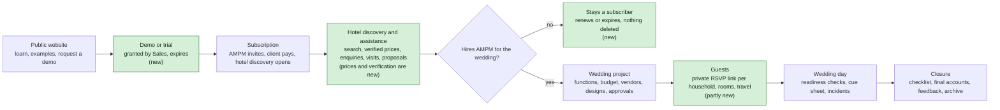
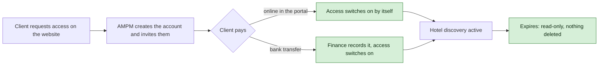
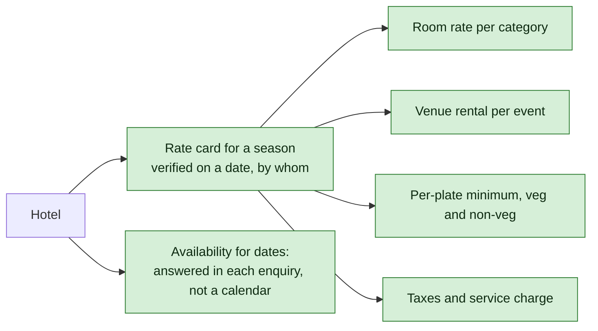
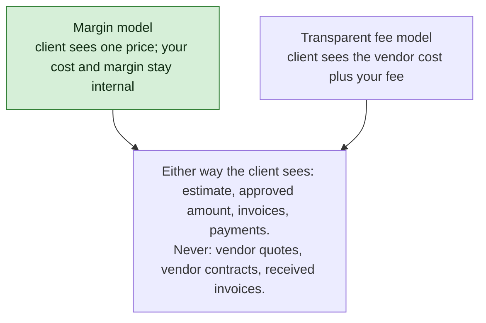
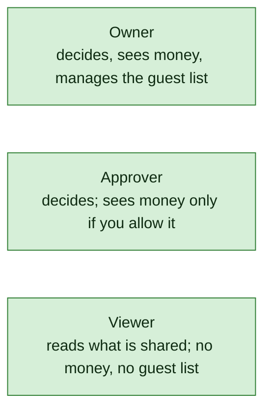
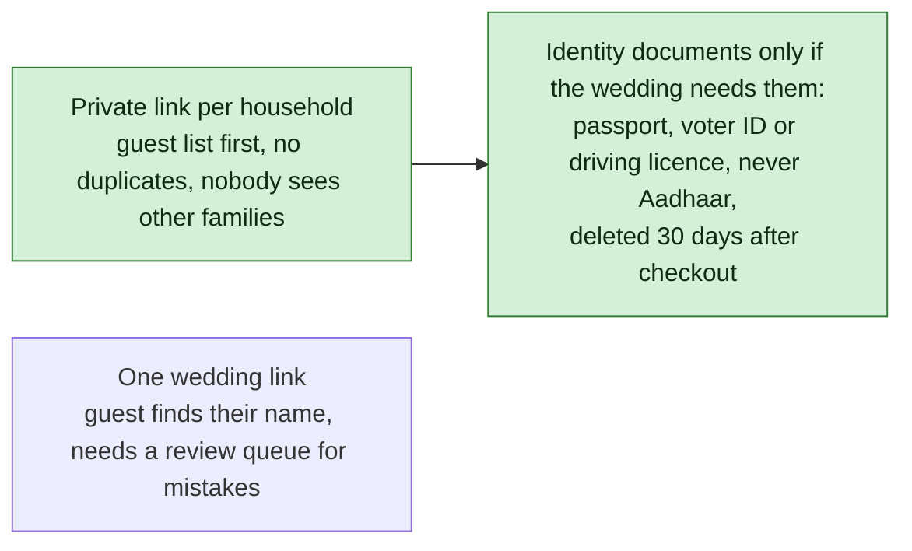
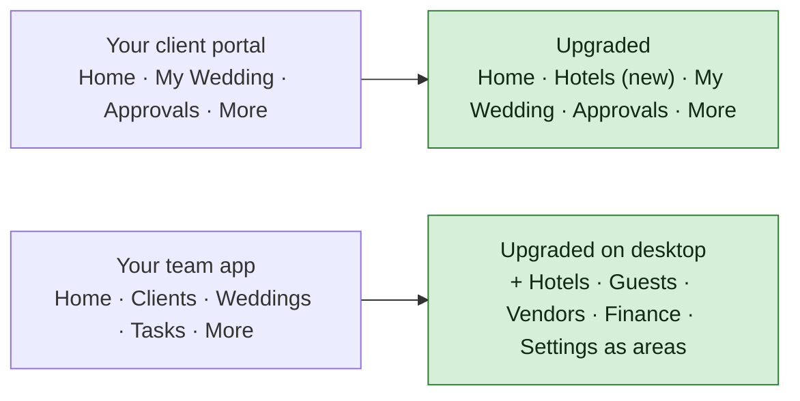

# AMPM Platform — Decision Brief

**For:** AMPM · **Date:** 24 October 2026, updated 25 October 2026 with AMPM's answers · **Status:** all 25 questions answered; 11 points remain to confirm, listed at the end.

## How to use this

> **DECIDED.** AMPM answered every question on 25 October 2026 in two documents, "Compiled Questions & Answers" and "Final App Decision Brief & Developer Requirements". Each question below now carries AMPM's decision in green. Where a point remains open it is listed under the question and again at the end.

This brief has three parts. Part 1 shows the platform as we understand it, in one picture. Part 2 explains, in eight short sections, what your documents left open and what we did about it in the meantime. Part 3 is the decisions: ten to make now, fifteen that can wait, and the assumptions worth a glance. Write in the boxes, or reply by question number.

Nothing here has been decided for you. Where your documents were silent we chose a sensible default so that design work could continue, and every default is marked so you can overturn it. The full developer package (the audit, the data model, the screen designs, the tests) sits behind this brief for anyone who wants the detail; you do not need to read it to answer.

---

## Part 1 · The platform in one picture

Four experiences share one system: the public website, the client portal, your team's workspace, and the guest RSVP pages. Green boxes are stages your documents mentioned but did not define, or did not mention at all; the sections below explain each.

---

## Part 2 · What was left open, and what we did

### 1. Getting in and paying

**What your documents say.** Nobody signs up by themselves; AMPM creates every account. There is a demo or limited trial. A client purchases a subscription and access activates after payment.

**What was missing.** How a demo is granted and when it ends. Whether the subscription is a one-time fee or a recurring charge. How "AMPM creates the account" fits with "the client pays online": one document implies the client pays from the website, the other says you create the account first. What an expired subscriber can still see.

**What we did for now.** Sales grants a demo from the enquiry record; it is time-boxed and shows a curated set of hotels with prices hidden plus one sample wedding. You create the account and invite the client; the client then pays inside the portal, online or by bank transfer, and hotel discovery opens. The subscription is a one-time fee for a fixed period. When it expires the client keeps the names of saved hotels and read access to their enquiries; nothing is deleted.

**You decide.** Q2 how clients pay · Q3 what the subscription is · Q10 whether the demo is in the first release.

### 2. Hotels and prices

**What your documents say.** Clients explore hotels with venues, rooms, photos, previous weddings, and "relevant pricing and availability", and the system must show whether a price was verified and when.

**What was missing.** The specification's data model has no place to store a price at all. Availability has no record either. Previous clients' wedding photos need that client's permission before they appear on a hotel page. Nothing says how much hotel data you already have or who will keep it fresh.

**What we did for now.** Each hotel gets rate cards by season, each with line items (room rate per category, venue rental, per-plate minimums, taxes), each verified on a date by a named team member and shown as "Stale" after a period you set. Availability for specific dates is answered by your team inside each enquiry, not kept as a calendar. Every photo and video carries a rights status and cannot be shown without one. Hotel data can be imported from spreadsheets.

**You decide.** Q9 what data exists, who verifies it and how often, what a price looks like, and whether you have photo rights.

### 3. Money: how AMPM earns and what the client sees

**What your documents say.** Clients see "budget information intended for clients" and never see profit margins or vendor negotiations. Which amounts they see is listed as undecided.

**What was missing.** Whether AMPM earns a margin inside vendor and hotel prices, or charges a visible fee on top. Whether clients pay wedding milestones through the portal. Which hotel services carry a fee.

**What we did for now.** We designed for the stricter case: every price has a client-facing amount and a separate internal cost, and the internal side never leaves the server. Clients see estimates, approved amounts, invoices to them, their payments and their next milestone, and can pay a milestone online. Availability checks are included in the subscription; negotiation, site visits, contract review and booking help wait for an agreement the client accepts in the portal.

**You decide.** Q4 the money model, what clients see, online milestone payment, and which hotel services are chargeable.

### 4. The client side: who logs in, who approves

**What your documents say.** The client portal is for "clients" and their "authorised family / decision-maker contacts". Who approves for the family, and whether two approvals are ever needed, is undecided.

**What was missing.** How many client logins a wedding has and whether they differ. In many weddings the parents pay and the couple designs.

**What we did for now.** Three client roles per wedding, and a separate switch for who may see money. One approval completes a decision unless you say two. Your team may record a decision the family gave by phone, but only with a note or document attached, and the portal shows it was recorded on their behalf.

**You decide.** Q5 the client roles, approvals and on-behalf decisions · Q6 whether the eleven staff roles in your specification are final and who may see cost and margin.

### 5. Guests, RSVP and privacy

**What your documents say.** Guests receive a link, confirm attendance, give travel and accommodation details; your team can enter responses by hand. Collect only what the event needs; identity documents are not compulsory by default.

**What was missing.** Whether "a link" is one link for the whole wedding or a private link per household. Who may add extra family members. Meal preferences and allergies, which menus and caterers need. Whether identity documents are ever needed, and the fact that Indian rules restrict storing Aadhaar numbers.

**What we did for now.** The guest list is loaded first and each household gets its own private link, so nobody sees another family and nothing is duplicated. A household may add members up to an allowance the family sets. Everyone attending gives a meal preference; allergies are optional and seen only by hospitality staff. Identity documents are collected only when a wedding needs them for hotel check-in, never Aadhaar, kept in a locked store seen by named staff, and deleted thirty days after checkout. Guests see a short privacy notice before they begin.

**You decide.** Q7 the link model, extra members, meals and what the couple sees about guests · Q8 identity documents.

### 6. The wedding day and closure

**What your documents say.** Live operations cover production, show flow, readiness and incidents; closure covers final invoices, reconciliation, feedback and archive.

**What was missing.** Staff will use the system on phones inside ballrooms and lawns with poor signal, and nothing mentions working without a connection. Who may let a function go live with a check unmet. How long the couple keeps access after the wedding.

**What we did for now.** The cue sheet, readiness checks and arrival lists can be read without signal, and updates made offline are sent when signal returns. A function cannot go live until every required check is done or a named manager records an exception. Closure is a checklist verified against the data: every guest departed, nothing left in lost and found, every vendor confirmed complete, final accounts approved. The couple keeps read-only access for twelve months, then the wedding is archived; nothing is deleted.

**You decide.** Q1 includes whether offline use is required · Q10 who may authorise an exception · Q23 the access period after the wedding.

### 7. Your flowcharts and your specification disagree in places

**What your documents say.** The client-portal flowchart has four tabs: Home, My Wedding, Approvals, More. The team-app flowchart has five tabs and one straight line from a qualified client to closure.

**What was missing.** The client-portal flowchart has no hotel area, yet hotel discovery is the product a subscription pays for, and its Home countdown assumes every client has a wedding date. The team-app flowchart has no place for the Hotel team or the RSVP team and nothing before a wedding exists. "Messages, questions" implies a chat feature nothing else describes.

**What we did for now.** The client portal gains a Hotels tab and a different home page for a subscriber who has no wedding yet. The team app keeps your five tabs on phones and uses the nine areas from your specification on desktop, so Hotels and Guests have a home. Questions and change requests are tracked requests with a conversation under each, which your team answers, rather than live chat. Your flowcharts are reproduced and redrawn, box by box, in the full package.

**You decide.** Q20 whether tracked requests are enough or you want live chat · the redrawn flowcharts to approve or mark up.

### 8. Technology and operations

**What your documents say.** A responsive interface, secure sign-in, encryption, backups, configurable prices and packages, and integration points for payment, email and messaging.

**What was missing.** Whether "app" means a native phone app or a website. Where the data is hosted and how fast it must be recoverable. Which channels reach clients and guests. How people sign in. How big the system must be. Whether your team edits the public website.

**What we did for now.** A responsive website that can be installed on a phone like an app, hosted in an Indian cloud region with copies in a second Indian region, recoverable to within fifteen minutes. Email, WhatsApp and SMS, with WhatsApp through a business provider. Staff sign in with an authenticator code; clients with email and password and an optional phone code; guests through their private link. Sized for fifty staff, forty weddings at a time, fifteen hundred guests per wedding and five hundred hotels. Your team edits website pages and showcase items in a simple editor.

**You decide.** Q1 website or native app · Q11 channels · Q12 website editing · Q13 sign-in · Q14 hosting and recovery · Q15 size · Q16 currency, language and invoicing · Q17 privacy wording and retention.

---

## Part 3 · Decisions

### A. Decide now: these ten unblock the design sign-off

**Q1 · Website or app?** Your flowcharts say "app", your specification says "responsive". A website reaches every phone the day it is published; native apps roughly double the front-end work. Staff work in venues with poor signal, so say whether offline reading on the wedding day is required.
Choices: responsive website, installable, with offline reading on the day *(assumed)* · native apps for staff · website first, apps later.

> **Your decision:** ______________________ · offline on the day ☐ yes ☐ no

> **DECIDED.** Native iOS and Android apps are required. Offline access to essential wedding-day information is required, with automatic synchronisation when the device reconnects, conflict detection and a controlled resolution process. The final technical architecture is to be agreed with the development team. **Still open:** Whether the client portal is also needed on the web (desktop) in addition to the apps.

**Q2 · How do clients pay for the subscription?** Online in the portal by card, UPI or net banking, or by bank transfer with your team switching access on. In both cases you create the account first. A gateway merchant account takes one to two weeks to open.
Choices: both paths *(assumed)* · online only · bank transfer only.

> **Your decision:** ______________________ · gateway preference, if any ______

> **DECIDED.** AMPM creates the client's account or sends an invitation link. The client enters basic wedding details (couple's names, contact information, tentative dates, preferred locations) and pays the subscription online by card or UPI. The gateway provider will be selected by AMPM. Payments must create a record, activate the subscription once, and be reviewable by authorised staff. **Still open:** Payment gateway provider.

**Q3 · What is the subscription?** One-time for a fixed period or recurring; what it includes; whether there is a trial and what the demo shows.
Assumed: one-time fixed term · includes hotel discovery and availability checks · trial granted by Sales, time-boxed · demo shows curated hotels with prices hidden and one sample wedding.

> **Your decision:** period ______ inclusions ______ trial ______ demo ______

> **DECIDED.** The subscription is for hotel discovery only: Rs 50,000, one-time, one month from activation, configurable in settings. Renewal is a new purchase. After expiry the client keeps read-only access to saved hotel names and existing enquiries; nothing is deleted; renewal restores access and data. There is no separate trial: the demo, reached by mobile OTP, serves that purpose. **Still open:** Demo duration; Demo limits: up to three locations, one or two sample hotels per location.

**Q4 · How does AMPM earn, and what money does the client see?** Margin inside prices, or a visible fee. Which amounts clients see. Whether they pay milestones online. Which hotel services carry a fee.
Assumed: margin model · clients see estimates, approved amounts, invoices, payments, milestones · online milestone payment · availability included, other hotel services by agreement.

> **Your decision:** model ______ client sees ______ online milestones ☐ yes ☐ no · chargeable hotel services ______

> **DECIDED.** Hotel discovery is a separate paid service. The wedding management fee is decided separately by AMPM, outside the app, and never derived from the subscription. Internal costs, margins, vendor rates, quotations, commissions and negotiations are never shown to clients. Vendor profiles and service details are visible only after AMPM is appointed. Online collection of wedding milestone payments is not required in the first release unless AMPM separately approves it. **Still open:** Which client-facing amounts appear in the wedding portal (budget summary, approved amounts, invoices, payment status); Which hotel-assistance services beyond availability checks carry a fee.

**Q5 · Who on the client's side logs in and approves?** Assumed: owner, approver and viewer roles; money visible only where you allow; one approval per decision; your team may record a phone decision with a note attached.

> **Your decision:** roles ______ approvals needed ______ on-behalf decisions ☐ allowed ☐ not allowed

> **DECIDED.** Only two nominated family representatives use the client portal, one from the bride's side and one from the groom's side; the families decide who. No other family member may hold an account without AMPM's authorisation. Cost and margin information is never visible to them. AMPM may record a decision made outside the portal when a note or supporting record is attached. **Still open:** One shared login or two separately authenticated accounts on the same wedding (separate accounts recommended for security and audit history); Whether one representative's approval completes a decision or both must approve.

**Q6 · Are the eleven roles in your specification final, and who sees cost and margin?** Assumed: the eleven stand; cost and margin visible to the Super Admin and Finance everywhere, the Wedding Project Manager on their own weddings, the Vendor Coordinator for vendor costs and the Hotel team for hotel costs.

> **Your decision:** roles ______ who sees cost and margin ______

> **DECIDED.** AMPM manages the system and controls permissions. Staff access is restricted by assigned responsibilities and department; a department manager on a phone sees only their own sections. Functional departments named: hotel team, vendor team, RSVP team, hospitality team, production team, project manager, senior authorised management. Internal financial information is restricted to specifically authorised personnel. **Still open:** Final staff role list and which users may see hotel costs and vendor costs.

**Q7 · How do guests respond, and what do you collect?** Assumed: private link per household, guest list loaded first; extra members within an allowance the family sets; meal preference required, allergies optional; the couple sees their full guest list, viewers see counts only.

> **Your decision:** link model ______ extra members ______ meals and allergies ☐ yes ☐ no · couple sees ______

> **DECIDED.** Guest invitation links are issued per side (one for the bride's side, one for the groom's side) or as one combined link when AMPM chooses; the final structure is to be decided. The RSVP team imports or creates the guest list and sends the links. Guests cannot see other households or the guest list, and cannot edit a submitted response; corrections go through a change request or the help option to the RSVP caller. The two family representatives see approved RSVP summaries and cannot edit the list. Each guest is counted individually, children included; meal preference, allergies where required, rooming and travel where applicable are collected. **Still open:** Final link structure: per side, or one combined link.

**Q8 · Identity documents from guests?** Assumed: off unless a wedding switches it on for hotel check-in; passport, voter ID or driving licence only, never Aadhaar; seen only by named RSVP staff and hospitality at check-in; deleted thirty days after checkout.

> **Your decision:** collect? ☐ never ☐ per wedding · types ______ who sees ______ deleted after ______

> **DECIDED.** Identity documents may be collected only where a hotel requires them for a wedding, under AMPM's control, in restricted storage, visible only to authorised staff, and never Aadhaar documents or numbers. Nothing is deleted automatically; retention and deletion follow AMPM-approved policy, to be confirmed before launch. **Still open:** Retention period and privacy wording for identity documents.

**Q9 · Hotel data.** What you have today and in what form; who enters and verifies it and how often; what a price looks like; whether availability is always checked by hand per enquiry; whether you may publish previous clients' wedding photos. The first release is only as good as this database.

> **Your decision:** existing data ______ who verifies, how often ______ price items ______ availability ______ photo rights ______

> **DECIDED.** Eva maintains the existing hotel data and updates seasonal prices roughly three times a year. Hotel pages show hotel and venue details, rooms, photographs and videos, food and menu information in a grid, approximate room pricing, wedding package price ranges, indicative venue rental, approximate per-plate pricing, capacity and facilities, and street view or map location. Prices are indicative ranges with a last-verified date, never internal cost. Availability is checked by the team when a client requests it or adds a hotel to their selection. Previous clients' photographs appear only with permission, controlled by AMPM. Hotels can be imported from spreadsheets. About 200 hotels at the start.

**Q10 · What is in the first release?** Assumed: the demo and trial, the full hotel-assistance workflow, online payment and website editing are all in Phase 1; exceptions on the wedding day may be authorised by the Wedding Project Manager or the Super Admin.

> **Your decision:** demo and trial ☐ · full hotel assistance ☐ · online payment ☐ · website editing ☐ · exception authority ______

> **DECIDED.** The first release includes the demo and the subscription hotel-discovery workflow, wedding management after appointment, vendor selection, the client portal, department-based team access, RSVP, tracked requests, live chat and offline wedding-day operations. It excludes website editing, online milestone payments and GST invoicing. Only Eva's authorised personnel may approve operational exceptions; the authority must be configurable. **Still open:** Whether this scope launches as one release or hotel discovery launches first while the wedding modules follow.

### B. Decide before building starts, and before the later phases

| Q | Question | What we assumed | AMPM decided (25 October 2026) |
|---|---|---|---|
| Q11 | Channels for clients and guests | Email, WhatsApp through a business provider, SMS; WhatsApp and SMS registrations take two to six weeks and should start early | Email and WhatsApp are required; SMS is proposed. Live chat is also required on the home page. Providers are to be confirmed. Open: WhatsApp and SMS providers. |
| Q12 | Will your team edit the public website? | Yes, in a simple editor; analytics and a bot check on forms | No. AMPM staff will not edit public website content through the app in the initial scope; the website editor is not approved. |
| Q13 | How do people sign in? | Clients: email and password, optional phone code. Staff: plus an authenticator app. Guests: private link. No self-registration | Prospects, demo users and clients sign in with their mobile number and an OTP. There is no unrestricted self-registration; AMPM creates the account or sends an invitation. Staff have individual authorised accounts with role- and department-based access; the exact staff authentication method is to be finalised with the development team. Open: Staff authentication method (authenticator app recommended). |
| Q14 | Where is data hosted, how fast recovered? | Indian cloud region with a second Indian copy; fifteen minutes of data at most lost, four hours to recover; accounts in AMPM's name | Hosting arrangements, backup frequency and recovery timelines are yet to be confirmed with the developer. Open: Hosting provider and region; Backup location; Recovery targets. |
| Q15 | How big will it get? | Fifty staff, forty weddings at a time, fifteen hundred guests per wedding, five hundred hotels | About 200 hotels at the start and roughly 20 concurrent weddings as a planning assumption; multiple weddings and departmental staff access; staff and guest capacity to be confirmed. Open: Staff count and largest guest count. |
| Q16 | Currency, language, invoices | Rupees; English, guest pages ready for a second language; GST invoices issued from the platform | Indian rupees. English as the primary language. The platform will not issue GST invoices. |
| Q17 | Privacy wording and retention | Consent notices in wording you approve; leads kept two years after closing, guest data one year after the wedding, identity documents thirty days after checkout | AMPM will decide the final privacy wording and the data retention policy. Retention and deletion require AMPM's approval; guest and wedding information must remain access-controlled; wedding records are not deleted automatically. Open: Privacy wording; Retention periods for leads, guest records and identity documents. |
| Q18 | Weddings across several hotels or outside venues | Allowed | Yes. A wedding can involve multiple hotels and venues. |
| Q19 | Room blocks and rooming rules | Rooms blocked per hotel, category and dates; guests allocated against the block; children count | Room blocks by hotel, room category and dates. Allocation and rooming are handled by the team, not automatically. Counts must support both room-wise and person-wise calculations, children included. |
| Q20 | Questions and messages in the portal | Tracked requests with a conversation, not live chat | Both tracked requests with conversation history and live chat are required; live chat on the home page, distinguished from tracked requests so a formal change request keeps its own approval history. More options may be added later. |
| Q21 | Change requests | Submitted, reviewed, accepted or rejected, implemented; a change to an approved item makes a new version to approve | Change requests are submitted, reviewed, accepted or rejected, then implemented and closed. A change to an approved item creates a new version for approval. |
| Q22 | Vendors or hotels logging in | Not in this project; possible later | No vendor or hotel logins in the current version. |
| Q23 | Client access after the wedding | Read-only for twelve months, then archived; nothing deleted | Read-only client access for three months after the wedding, then the project is archived following AMPM's approval. Records are not deleted; archiving is a change of status and permissions. Later access or reopening is controlled by AMPM. Open: Exact workflow for archiving and for restoring access after archiving. |
| Q24 | Feedback and archive | A short feedback form; an archived state that keeps everything | A short feedback form after the wedding and an archived state that preserves the records. |
| Q25 | What is a "material" change | A budget line moving ten percent or more, or a date or venue change; thresholds are settings | Thresholds must be configurable; AMPM will define the final budget-change percentages, date-change and venue-change thresholds and the approval rules. Open: Material-change thresholds and approval rules. |

### C. Assumptions worth a look

These were the fourteen assumptions with the most business consequence. AMPM's answers settle them as shown in the last column; the full list of 98 with their status is in the assumptions sheet of the full package.

| We assumed | Why | AMPM's answer |
|---|---|---|
| Nobody can register themselves; AMPM invites every client and prospect | Your "Why" note says so; your specification does not | Confirmed |
| A subscription grants hotel modules only; wedding modules come only from a service agreement and a project | Your "critical rule" | Confirmed |
| Expiry or cancellation turns access read-only and never deletes records | Your "Why" note says so; nothing else defined it | Confirmed |
| A wedding project is created when an agreement for anything beyond hotel help is accepted | Your business steps 5 and 6 | Confirmed |
| Only a name, the account, tentative dates and a lead are required to create a wedding | Your rule 2: not everything mandatory | Confirmed; the client also enters couple, contact, dates and locations at activation |
| Every price has a client-facing amount and a separate internal cost; the internal side never leaves the server | Your rule 1 and the specification's security note | Confirmed |
| Vendor contact details stay internal even after a vendor is selected | Your rule that vendor negotiations are private; some couples will want to call their photographer | Confirmed, with AMPM able to share a specific contact in an approved case |
| Five to ten vendor options is a guideline, never enforced | Your acceptance test says so | Confirmed |
| A decision locks the exact version; a revision is a new version with a new approval | Your acceptance test says so | Confirmed |
| Guests are counted one person at a time, grouped into households | Children, rooms and meals need per-person counts | Confirmed, children included |
| Headcounts for caterers are frozen when sent, while expected counts keep moving | Catering contracts guarantee a number | Not addressed; stands |
| A function cannot go live with a required check unmet unless a named manager records an exception | Your specification's readiness rule | Confirmed; only Eva's authorised personnel may record the exception |
| Prices, fees, categories and thresholds are settings your team changes, never code | Your specification: no hard-coded commercial rules | Confirmed |
| The system is built for AMPM alone, not for licensing to other planners | Your "Why" note calls it "a paid business asset", which could mean either | Confirmed |

### Still to confirm (AMPM's own list, 25 October 2026)

1. Exact demo duration and final hotel and location limits
2. Whether the demo shows one or two sample hotels per location with indicative prices
3. Payment gateway provider and transaction-handling requirements
4. Whether the two family representatives share one login or have separate authenticated accounts
5. Final staff roles and which internal users may access hotel costs or vendor costs
6. Hosting provider, backup location and recovery targets
7. Initial capacity for staff, hotels, weddings and guests
8. Communication provider for WhatsApp and SMS
9. Privacy wording and retention periods for leads, guest records and identity documents
10. Final material-change thresholds and approval rules
11. The exact workflow for archiving projects and restoring access after archiving

Two more from our side: whether the client portal is also needed on the web alongside the apps, and which client-facing amounts the wedding portal shows.

All of these, with the points that came up while applying your answers, are written out as nineteen questions with choices and answer boxes in [the questions still open](remaining-questions.md).

### Answer sheet (completed 25 October 2026)

| Q | Decision | Decided by | Date |
|---|---|---|---|
| Q1 | Native iOS and Android apps are required | AMPM | 25 Oct 2026 |
| Q2 | AMPM creates the client's account or sends an invitation link | AMPM | 25 Oct 2026 |
| Q3 | The subscription is for hotel discovery only: Rs 50,000, one-time, one month from activation, configurable in settings | AMPM | 25 Oct 2026 |
| Q4 | Hotel discovery is a separate paid service | AMPM | 25 Oct 2026 |
| Q5 | Only two nominated family representatives use the client portal, one from the bride's side and one from the groom's side; the families decide who | AMPM | 25 Oct 2026 |
| Q6 | AMPM manages the system and controls permissions | AMPM | 25 Oct 2026 |
| Q7 | Guest invitation links are issued per side (one for the bride's side, one for the groom's side) or as one combined link when AMPM chooses; the final structure is to be decided | AMPM | 25 Oct 2026 |
| Q8 | Identity documents may be collected only where a hotel requires them for a wedding, under AMPM's control, in restricted storage, visible only to authorised staff, and never Aadhaar documents or numbers | AMPM | 25 Oct 2026 |
| Q9 | Eva maintains the existing hotel data and updates seasonal prices roughly three times a year | AMPM | 25 Oct 2026 |
| Q10 | The first release includes the demo and the subscription hotel-discovery workflow, wedding management after appointment, vendor selection, the client portal, department-based team access, RSVP, tracked requests, live chat and offline wedding-day operations | AMPM | 25 Oct 2026 |

Assumptions changed by the answers: see the assumptions sheet in the full package (35 changed, 4 dropped, 28 confirmed).

**What happens next.** The answers are being applied to the design documents (version 0.2 of each is in the full package, with the changes listed at the top of every document). The eleven points above are what remains before the screen designs and the data model can be signed off and the schedule and cost estimate drafted.
