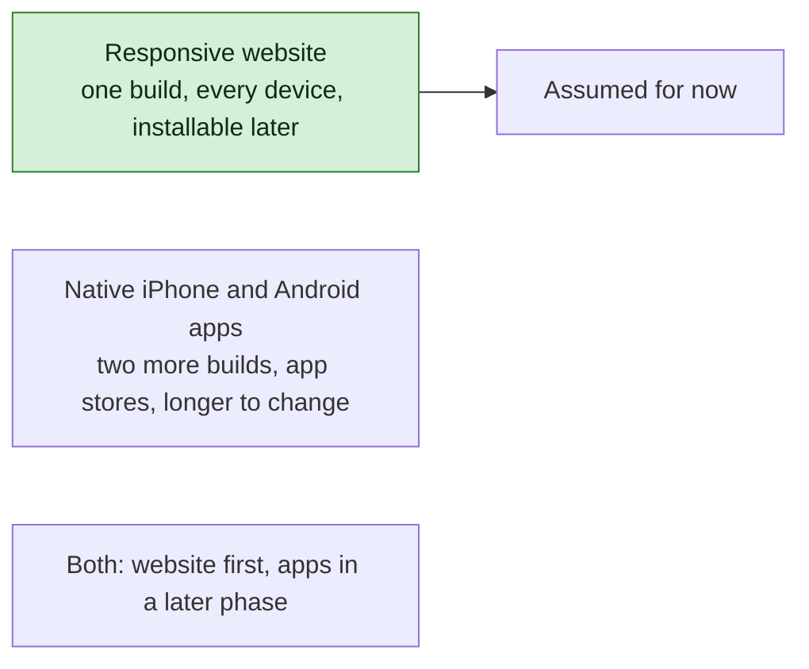
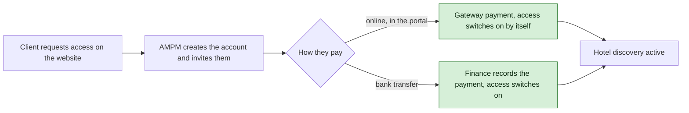
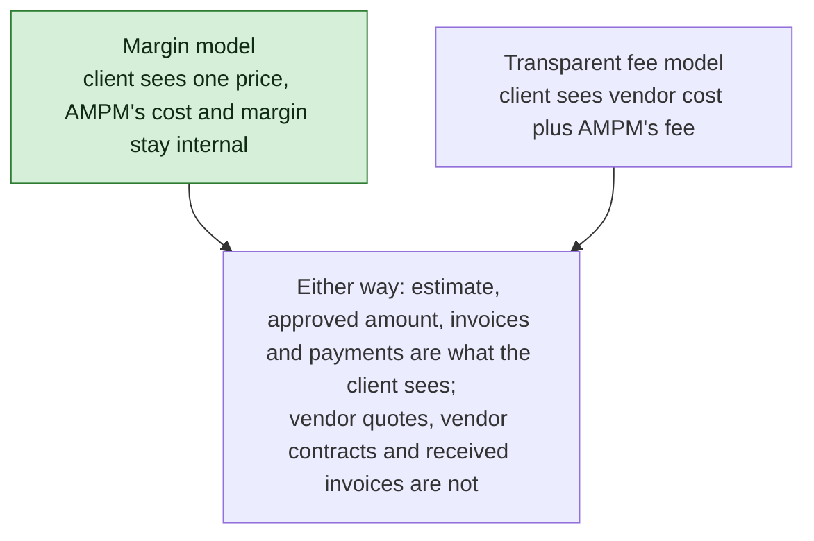
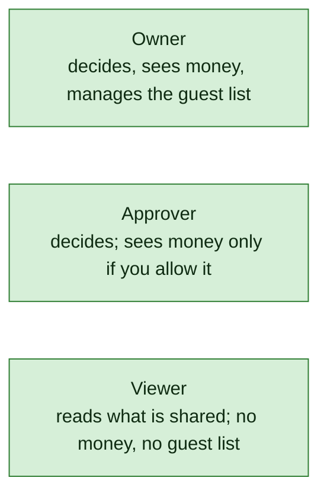
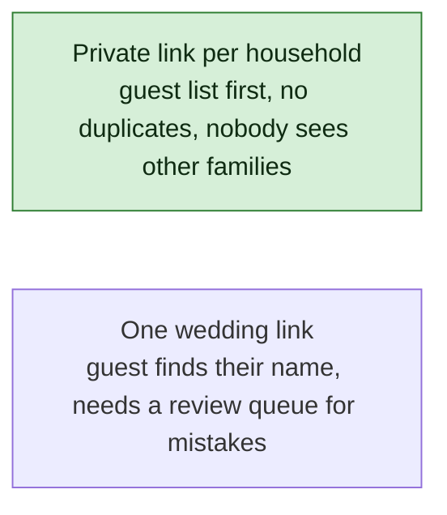
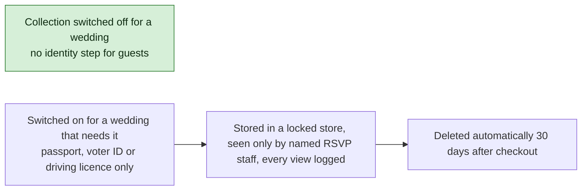
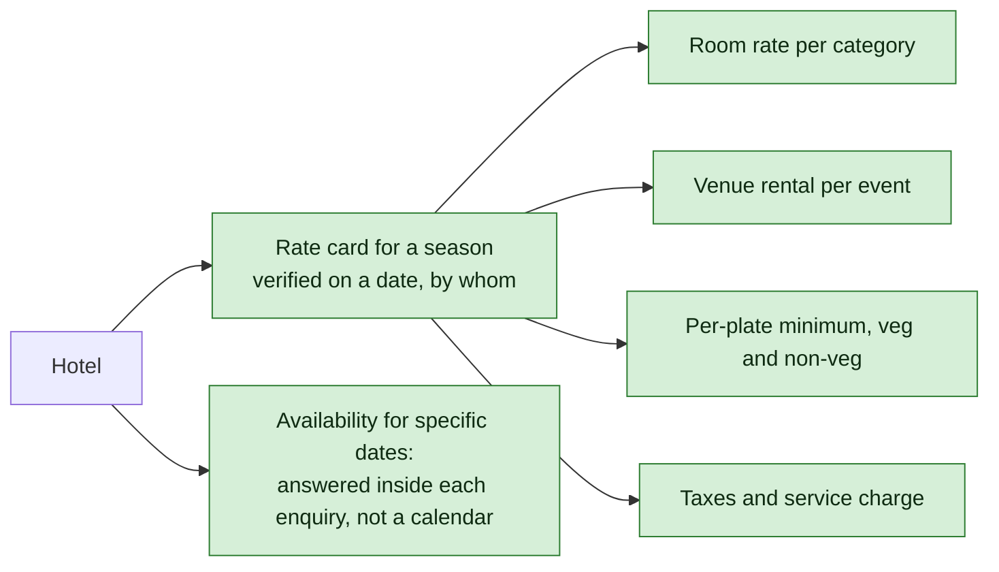

# AMPM Platform — The Decisions We Need From You

**For:** AMPM review · **Date:** 24 October 2026 · **Status:** answered by AMPM on 25 October 2026; the answers are recorded in the decision log and shown in the decision brief. The answer boxes below are kept for reference.

Your brief told the developer to ask rather than assume. These are the questions. Each one says what we need to know, why it matters, the choices as we see them, which choice we assumed for now so that design work could continue, and what changes if you choose differently. Where a picture helps, there is one. Write your decision in the box under each question, or fill in the answer sheet at the end.

The ten questions in Tier 1 block the sign-off of the screen designs and the data model. Tier 2 must be answered before building starts. Tier 3 can wait for the planning phases.

---

## Tier 1 — needed before the design is signed off

### Q1 · What runs on phones: a website or an app?

**What we need to know.** Should the team workspace and the client portal be a responsive website that works on any phone browser, native iPhone and Android apps, or a website that can be installed like an app?

**Why it matters.** Your flowcharts say "app" and your specification says "responsive interface". Native apps roughly double the front-end work and need app-store accounts; a website reaches everyone the day it is published. Staff will use this on their phones inside hotel ballrooms with poor signal, so the answer also decides how much offline behaviour we build.

**Choices.** A: responsive website with an installable mode and offline reading on the wedding day (assumed). B: native apps for staff, website for clients. C: website first, native apps later.

**What changes with your answer.** B or C adds the native builds to the estimate and the schedule; everything on the server stays the same.

> **Your decision:** ______________________ **Offline on the wedding day needed?** ☐ yes ☐ no

### Q2 · How does a client pay for the subscription?

**What we need to know.** Does a client pay online by card, UPI or net banking inside the portal, or do they pay you by bank transfer and your team switches their access on?

**Why it matters.** Your "Why AMPM App" note says AMPM creates every account and nobody signs up by themselves. Your specification describes a "payment journey" from the website. Both can be true, but the order matters, and an online gateway needs a merchant account that takes one to two weeks to open.

**Choices.** A: both paths, online and bank transfer (assumed). B: online only. C: bank transfer only, no gateway in the first release.

**What changes with your answer.** C removes the gateway from Phase 1 and the merchant-account task. Any choice keeps the rule that AMPM invites the client first.

> **Your decision:** ______________________ **Preferred gateway, if any:** ______________________

### Q3 · What is the subscription?

**What we need to know.** Is it a one-time fee for a fixed period or a recurring charge? How long does it last? What does it include? Is there a free trial, and what does a demo show?

**Why it matters.** Recurring billing needs renewals, failed-payment handling and reminders, which is a sizeable piece of work on its own. The demo and trial appear in your "Why" note but nowhere else, so we had to define them.

**Choices.** Period: one-time for a fixed term (assumed) or recurring. Inclusions: hotel discovery plus availability checks (assumed) or discovery only. Trial: Sales grants a time-boxed trial on request (assumed) or no trial. Demo: a curated set of real hotels with prices hidden and one sample wedding (assumed) or invented sample hotels.

**What changes with your answer.** Recurring billing adds the renewal machinery. Inclusions change which hotel services need a separate agreement (see Q4). The demo content is a data choice, not a design change.

> **Your decision:** period ______ inclusions ______ trial ______ demo ______

### Q4 · How does AMPM earn, and what money does the client see?

**What we need to know.** Does AMPM earn a margin on vendor and hotel prices, which must stay confidential, or charge a transparent planning fee on top of pass-through costs? Exactly which amounts may the client see: the vendor's quote, the negotiated price, your fee, taxes, invoices, payment status? Can clients pay milestones through the portal? Which hotel services carry a fee?

**Why it matters.** This decides the shape of every money screen and table. We designed for the strictest case: every price has a client-facing amount and a separate internal cost, and the internal side never leaves the server.

**Choices.** Margin model (assumed) or transparent fee. Client sees estimates, approved amounts, invoices to them, their payments and milestones (assumed); add or remove items. Milestone payment online (assumed yes). Hotel services: availability checks included, negotiation, site visits, contract review and booking help by agreement (assumed).

**What changes with your answer.** A transparent fee adds a visible fee line and lets internal cost equal the client amount; no structural change. Removing online milestone payment turns the Pay button into bank-transfer instructions.

> **Your decision:** model ______ client sees ______ online milestones ☐ yes ☐ no · chargeable hotel services ______

### Q5 · Who on the client's side uses the portal, and who approves?

**What we need to know.** How many people from the couple and family get logins? Do they have different rights, for example one who approves and sees money, and others who only view? Who approves for the family, and are two approvals ever required? May your team record a decision the family gave by phone?

**Why it matters.** In many weddings the parents pay and the couple designs. The portal must show money to the right people and nobody else.

**Choices.** Three roles as shown (assumed). One approval per decision (assumed) or two for budgets and contracts. Decisions recorded by staff on the family's behalf allowed with a written note or document (assumed) or never.

**What changes with your answer.** Fewer roles simplify the portal; a second approval adds a step to every approval screen; forbidding on-behalf decisions removes that path.

> **Your decision:** roles ______ approvals needed ______ on-behalf decisions ☐ allowed ☐ not allowed

### Q6 · Are the eleven roles in your specification final?

**What we need to know.** Your specification lists nine staff roles plus the client and the guest. Your business brief says roles must not be assumed. Please confirm or change them, and say who may see internal cost and margin.

**Choices.** Keep the eleven roles (assumed). Internal cost visible to the Super Admin and Finance everywhere, to the Wedding Project Manager on their own weddings, to the Vendor Coordinator for vendor costs and to the Hotel team for hotel costs (assumed).

**What changes with your answer.** Roles are configuration; changing them changes a table, not the design.

> **Your decision:** roles ______ who sees cost and margin ______

### Q7 · How do guests respond, and what do you collect?

**What we need to know.** Is the guest list loaded first, with a private link sent to each household, or is there one link for the whole wedding where guests identify themselves? Who may add extra family members, and how many? Do you collect meal preferences and allergies? What can the couple see about their guests?

**Why it matters.** One link for everyone forces guests to find themselves in a list, which creates duplicates and lets people see other families. A private link per household avoids both but means the list must exist before invitations go out.

**Choices.** Private link per household (assumed) or one wedding link. Extra members: an allowance set per household by the family, default none (assumed). Meal preference required for everyone attending, allergies and access needs optional (assumed). The couple sees their full guest list except restricted notes and identity documents; viewers see counts only (assumed).

**What changes with your answer.** One wedding link adds a self-identification step and a review queue. Different collection rules change the guest form.

> **Your decision:** link model ______ extra members ______ meals and allergies ☐ yes ☐ no · couple sees ______

### Q8 · Do you need identity documents from guests?

**What we need to know.** Hotels ask for identity at check-in. Should the platform collect identity documents at all, for which purpose, which document types, who may see them, and when are they deleted?

**Why it matters.** Identity documents are the most sensitive data in the system. Indian rules restrict storing Aadhaar numbers, and a breach would be serious.

**Choices.** Off by default, switched on per wedding (assumed). Never Aadhaar (assumed). Seen only by named RSVP staff with an explicit grant and by hospitality at check-in (assumed). Deleted 30 days after checkout (assumed).

**What changes with your answer.** If you never need identity documents, the whole feature is dormant. If you need Aadhaar for a legal reason, that needs a legal review first.

> **Your decision:** collect? ☐ never ☐ per wedding · types ______ who sees ______ deleted after ______

### Q9 · Hotel data: what exists today, who keeps it fresh, and what does a price look like?

**What we need to know.** How much hotel information do you already have, and in what form? Who enters and verifies it, and how often? What price structure do you want to store: room rates by category and season, venue rental, per-plate minimums, taxes? Is availability always checked by hand for each enquiry? May you publish previous clients' wedding photos on hotel pages?

**Why it matters.** The first release is only as good as the hotel database behind it. Your brief asks for verified prices, but the specification's data model had no place to put a price, so we designed one.

**Choices.** Price structure as shown (assumed). Availability per enquiry (assumed) or a live calendar. Media only with a consent record from the client whose wedding it was (assumed). Existing data imported from spreadsheets with a template (assumed there is some).

**What changes with your answer.** A live availability calendar is a large addition. Different price items change a list, not the design. No existing data means Phase 1 launches with an empty search unless data entry starts now.

> **Your decision:** existing data ______ who verifies, how often ______ price items ______ availability ______ photo rights ______

### Q10 · What is in the first release?

**What we need to know.** Does Phase 1 include the demo and trial, the full hotel-assistance workflow (negotiation, site visits, proposals, booking milestones), online payment, and editing of website content by your team? Who may authorise an exception that lets a function go live with a check unmet?

**Choices.** All four in Phase 1 (assumed). Exceptions authorised by the Wedding Project Manager or the Super Admin (assumed), or the Super Admin only.

**What changes with your answer.** Anything removed moves to a later phase and shortens Phase 1.

> **Your decision:** demo and trial ☐ · full hotel assistance ☐ · online payment ☐ · website editing ☐ · exception authority ______

---

## Tier 2 — needed before building starts

### Q11 · Which channels for clients and guests?

Email, WhatsApp, SMS, or all three? We assumed all three, with WhatsApp through a business messaging provider. WhatsApp business verification and template approval take two to six weeks and SMS needs a DLT registration of two to four weeks, so this should start early.

> **Your decision:** channels ______ providers, if you have a preference ______

### Q12 · Will your team edit the public website?

We assumed yes, through a simple editor for pages, destinations and showcase items, and that the site has analytics and a low-friction bot check on forms.

> **Your decision:** ☐ our team edits it ☐ the developer updates it · analytics ☐ yes ☐ no

### Q13 · How do people sign in?

We assumed email and password for clients with an optional phone code, email, password and an authenticator app for staff, and private links for guests. Nobody can register themselves.

> **Your decision:** clients ______ staff ______

### Q14 · Where is the data hosted, and what recovery do you need?

We assumed an Indian cloud region with copies in a second Indian region, data recoverable to within fifteen minutes and systems back within four hours, and that the cloud and provider accounts are opened in AMPM's name.

> **Your decision:** hosting ______ recovery targets ______ accounts in AMPM's name ☐ yes

### Q15 · How big will it get?

We sized for fifty staff users, forty weddings at a time, fifteen hundred guests per wedding, five hundred hotels, and two terabytes of photos and video in the first year. The cost estimate depends on these numbers.

> **Your decision:** staff ______ weddings per year ______ largest guest count ______ hotels ______

### Q16 · Currency, language and invoices

We assumed Indian rupees only, English only with the guest portal ready for a second language, and that the platform issues GST-compliant invoices.

> **Your decision:** currency ______ languages ______ invoices from the platform ☐ yes ☐ no · accounting tool ______

### Q17 · Privacy wording and how long data is kept

We assumed consent notices on the enquiry form and the guest portal in wording you approve, closed leads kept two years, guest personal data kept one year after a wedding closes, identity documents thirty days after checkout.

> **Your decision:** notice wording ☐ we will provide · retention ______

---

## Tier 3 — before the planning phases

### Q18 · Weddings across several hotels, or at venues not in your database

We assumed both are allowed: a wedding can use a main hotel and overflow hotels, and a function can be at a venue outside the database.

> **Your decision:** ______

### Q19 · Room blocks and rooming rules

We assumed rooms are blocked per hotel, category and dates from the contract, guests are allocated against the block, and children count as occupants.

> **Your decision:** ______

### Q20 · Questions and messages inside the portal

We assumed no live chat: a client asks a question or raises a change as a tracked request with a conversation under it, which your team answers.

> **Your decision:** ☐ requests as assumed ☐ live chat needed

### Q21 · Change requests

We assumed a change request moves through submitted, under review, accepted or rejected, and implemented, and that an accepted change to something already approved produces a new version for a new approval.

> **Your decision:** ______

### Q22 · Will vendors or hotels ever log in?

We assumed not in this project. A vendor portal can be added later without changing the vendor records.

> **Your decision:** ☐ never ☐ later ☐ in this project

### Q23 · Client access after the wedding

We assumed the couple keeps read-only access for twelve months after closure, then the wedding is archived and their logins are removed. Nothing is deleted.

> **Your decision:** months ______

### Q24 · Feedback and archive

We assumed a short feedback form after closure and an archived state that keeps every record.

> **Your decision:** ______

### Q25 · What counts as a "material" change?

Your specification says material changes must flag budgets, contracts, tasks and the run-of-show. We assumed a change is material when a budget line moves by ten percent or more, or a date or venue changes, and that the thresholds are settings you can change.

> **Your decision:** thresholds ______

---

## Answer sheet

| Q | Decision | Decided by | Date |
|---|---|---|---|
| Q1 | | | |
| Q2 | | | |
| Q3 | | | |
| Q4 | | | |
| Q5 | | | |
| Q6 | | | |
| Q7 | | | |
| Q8 | | | |
| Q9 | | | |
| Q10 | | | |
| Q11 | | | |
| Q12 | | | |
| Q13 | | | |
| Q14 | | | |
| Q15 | | | |
| Q16 | | | |
| Q17 | | | |
| Q18 | | | |
| Q19 | | | |
| Q20 | | | |
| Q21 | | | |
| Q22 | | | |
| Q23 | | | |
| Q24 | | | |
| Q25 | | | |

Every answer feeds [the assumptions sheet](assumptions-taken.md): the decision register in the developer package lists exactly which assumptions each answer confirms or replaces.
