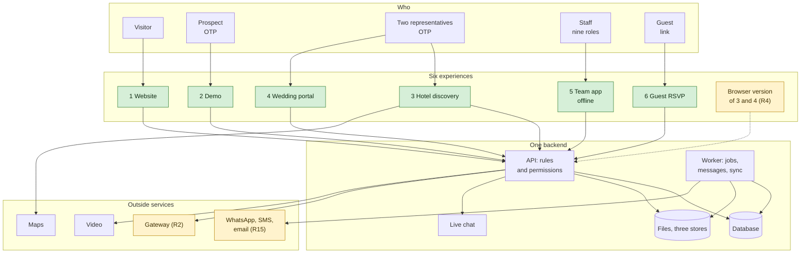
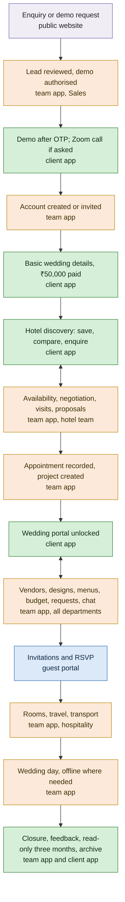
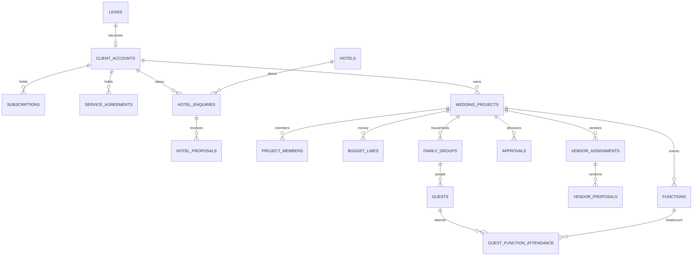

# AMPM Platform — The Blueprint: Platforms, Data Model and Flows for Sign-off

**For:** AMPM review, and the development team · **Date:** 26 October 2026 · **Status:** version 0.1, for sign-off. Built from AMPM's five source documents, the two answer documents of 25 October 2026, and the six developer drafts (version 0.2). Nothing in it is invented: every rule names the document it comes from.

This is the document to finalise the platform against. It describes each platform, what it carries, how the platforms connect, the data model underneath, who may see what, and the flows that run across all of it. Every point is marked as one of three things, so that AMPM can lock what is settled and decide what is not:

> **DECIDED.** **Locked.** Decided by AMPM on 25 October 2026, or set by one of the eighteen business rules in AMPM's brief. The drafts are built to it; changing it later is a change request.

> **ASSUMED.** **Proposed.** Chosen in the developer drafts because the documents left it open; it stands unless AMPM says otherwise. A tick in the sign-off sheet locks it.

> **GAP.** **Open.** Needs AMPM's answer. Each carries the number of the question in [the questions still open](remaining-questions.md) (R1 to R19), where the choices are written out.

How to use it: read part by part; at the end of each platform section there is a lock box. The [short version](platform-blueprint-short.md) collects the lock boxes on a few pages, for signing. Once the open points are answered and the boxes are ticked, the screens, the schema and the tests are built to this document, and it becomes version 1.0.

Sources, and how they are cited: AMPM's business explanation (BIZ), the "Why AMPM App" note (WHY), the Developer Technical Specification v1.0 (SPEC), the two Level-1 flowcharts, the compiled questions and answers of 25 October (Q&A) and the brief of the same date (Brief, with its section numbers). The developer drafts: the data model (tables), the permission matrix (roles and visibility), the user flows (Flow 1 to Flow 12), the wireframes (screen identifiers such as CP-05), the architecture (decisions T-1 to T-14) and the test cases (criteria AC-01 to AC-38).

---

## 1. The platform in one picture

AMPM's brief names four connected experiences: the public website, the hotel discovery portal, the client wedding portal and the AMPM team app (Brief §1). Two more are implied by the same documents and built in the drafts: the demo, which is a mode of the client app with its own data, and the guest RSVP portal, which guests reach through a link without signing in. All six run on one backend: one API, one database, one set of rules (SPEC §10 "shared backend with separate user experiences and permission boundaries"). Nothing is copied between experiences; the same hotel, the same wedding and the same guest exist once.

| # | Experience | Who uses it | Where it runs | How they get in | What it exists for | Status |
|---|---|---|---|---|---|---|
| 1 | Public website | Anyone | Browser | No sign-in | Explain AMPM, capture enquiries and demo requests, hold the login and invitation entry points | Locked (Brief §13) |
| 2 | Demo | Prospects AMPM has authorised | Client app | Mobile number and OTP | Show a limited, sample view of hotel discovery before buying | Locked in principle (Brief §2); limits open (R1) |
| 3 | Hotel discovery portal | Clients with an active subscription | Client app; browser open (R4) | Mobile number and OTP, account created or invited by AMPM | Explore hotels, save, compare, enquire, request availability | Locked (Brief §3 and §4) |
| 4 | Client wedding portal | The two family representatives | Client app; browser open (R4) | Same account, unlocked after appointment | Follow the wedding, approve, request changes, chat | Locked (Brief §5, §7, §12) |
| 5 | AMPM team app | AMPM staff by role and department | iOS and Android, offline-capable | Individual accounts; method open (R10) | Run everything: leads, hotels, weddings, vendors, guests, operations, finance, settings | Locked (Brief §9, §10, §14) |
| 6 | Guest RSVP portal | Invited guests | Browser, from a link | Link per side or combined (R11); the household identifies itself | Confirm attendance and give the details the wedding needs | Locked (Brief §8) |

Two rules apply to every experience and are repeated nowhere else in this document because they are everywhere:

> **DECIDED.** **Commercial privacy.** Vendor rates, internal quotations, negotiated amounts, internal costs, commissions, margins and private negotiations are never shown to a client, "through client-facing screens, exports, notifications, or APIs" (Brief §6, rule 8). The platform keeps client-facing amounts and internal amounts in separate fields from the first table onward, and every response to a client is built from a model that does not contain the internal fields.

> **DECIDED.** **Enforced on the server.** "Enforce permissions on the server, not just hide information in the interface" (Brief §14, rule 18). Every request, file download and export passes one permission pipeline in the API; a record a user may not see is answered as if it did not exist.

---

## 2. The platforms, one by one

Each section says what the platform is for, who uses it, what it carries (with the small details that decide the build), how it connects to the others, and then lists what is locked, what is proposed and what is open, with a lock box.

### 2.1 Public website

**Purpose.** The shop window and the front door. Visitors learn what AMPM does, see selected work, and ask for a conversation or a demo. Nobody signs up on the website; nobody reaches the hotel database from it.

**Who.** Anyone, on any device, in a browser.

**What it carries.**
- Pages: Home, About, Services, How It Works, selected work, Contact, Request a Demo (BIZ §6), and a page that explains the demo and the subscription (SPEC §2.1).
- Enquiry form and demo-request form, each with a consent notice; the enquiry records its source (website, Instagram, advertisement, referral, call) and becomes a lead for Sales.
- Login and invitation entry points for clients and staff (Brief §13), which hand over to the apps and, if R4 is answered yes, to the browser version of the client portal.
- Selected work only "when AMPM has the necessary permission to display" the photographs (Brief §4).
- Analytics on public pages only, and a bot check on the forms (architecture §10, §11), both small defaults in the short answers of the questions document.

**What it does not carry.** No hotel database, no prices, no private content (WHY §4). No editing of website content by AMPM staff through the app in the first release: "the public website editor described in the original decision brief are not approved for the current release" (Brief §13). The site is maintained by the developer as a static site.

**How it connects.** Enquiry or demo request → a lead in the team app's Sales area (Flow 1). Login entry point → the client app or the team app. Nothing flows back to the website from the platform except the showcase content the developer publishes.

> **DECIDED.** Pages and forms as listed; no self-registration (rule 1); no website editing in the app (rule 15, Q12); the private hotel database is never public (WHY §3).

> **ASSUMED.** A static site generated by the developer's tooling (Next.js), with the consent wording on the forms drafted for AMPM's approval (R12); privacy-respecting analytics; a low-friction bot check on the two forms.

> **Your decision:** Website locked as described ☐ · analytics and bot check ☐ fine ☐ none · changes: ______

### 2.2 The demo

**Purpose.** The only "trial" AMPM offers: a prospect sees hotel discovery working, on sample content, before paying ₹50,000. WHY calls it "a time-limited and restricted trial"; the Brief makes it a controlled, OTP-gated view.

**Who.** Prospects whose enquiry AMPM has reviewed and authorised (Brief §2 step 3). Sales grants it from the lead; there is no self-serve demo (Flow 1, U-1 confirmed).

**What it carries.**
- Sign-in by mobile number and OTP (Q13; Brief §2 step 4); no password, no registration.
- A limited view: up to three locations, with street view where available (Q&A; Brief §2); one or two sample hotels per location with indicative prices (open: R1); limited hotel information; "not unrestricted access to the full database" (Brief §2 step 6).
- A sample wedding, so the prospect sees what the wedding portal looks like after appointment (draft assumption A-28); proposed, not required by the brief.
- A way to request the 15 to 20 minute Zoom call before purchase (Q&A; Brief §2 step 7).
- Expiry after a set duration (open: R1), after which the lead returns to Sales follow-up; demo data is reset on a schedule from a seed.
- Separation: demo accounts see only records flagged as demo; "demo data must remain separate from real client data" (WHY §4); a demo user's requests become Sales activities, not hotel enquiries.

**How it connects.** Sales authorises the demo from the lead (team app) → the prospect signs in (client app) → the prospect's interest and Zoom request flow back to the lead → when the prospect proceeds, AMPM creates the account or sends the invitation (Flow 1). The demo never writes into the real hotel enquiries.

> **DECIDED.** OTP entry; AMPM controls demo access (rule 2); up to three locations; limited information; the Zoom call option; demo data separate from client data; a demo user cannot reach records outside the demo (acceptance scenario 2). No time limit; one real hotel per location with indicative prices; managed by the admin (26 October 2026).

> **ASSUMED.** Real hotels from the database shown with indicative price ranges rather than invented hotels; one sample wedding; the demo expires and the data resets nightly from a seed.

> **DECIDED.** R1 answered 26 October 2026: no time limit; three locations; one real hotel per location with indicative prices; managed by the admin.

> **Your decision:** Demo locked as described, subject to R1 ☐ · changes: ______

### 2.3 The hotel discovery portal

**Purpose.** The product AMPM sells by subscription: a private, curated hotel database with indicative prices, where a family explores, saves, compares and asks AMPM to check availability. "Hotel discovery and complete wedding management are two separate services" (Brief, core business rule).

**Who.** A client whose account AMPM created or invited, after the client completed the basic wedding details (couple's names, contact information, tentative dates, preferred locations) and paid online (Brief §2 stage 2). Access lasts one month from activation.

**What it carries.**
- **Getting in and paying.** Account by AMPM invitation; basic wedding details form; payment of ₹50,000 by card or UPI through the gateway; activation after confirmed payment, once per transaction, never twice from repeated notifications; start and expiry dates shown; staff can review the payment (Brief §3). The fee and the duration are settings, not code (rule 17).
- **Hotel pages.** Hotel name, city and location; property photographs and videos; wedding venues with photographs; room categories with photographs; approximate room pricing; wedding package price ranges; indicative venue rental; food and menu information in a grid, vegetarian and non-vegetarian where available; approximate per-plate pricing where available; guest accommodation capacity and facilities; street view or map where available; previous wedding photographs only with permission (Brief §4). Every price carries a last-verified date and is labelled indicative, and a stale price is shown as stale and never as confirmed (SPEC §12).
- **Finding hotels.** Search by destination, with filters for capacity, rooms and verified-rate status, and freshness labels on results (Flow 2, screens CP-01 to CP-05).
- **Saving and comparing.** Saved hotels and favourites; side-by-side compare (CP-06).
- **Asking AMPM.** Enquiry submission; availability-check request from a saved hotel or the selection, routed to the hotel team, who check with the property and record the answer; the client compares responses (Brief §4 "Hotel availability"). The portal marks every piece of information as indicative, requested, verified or awaiting confirmation.
- **Beyond availability.** Negotiation, site visits, contract review and booking assistance: the draft requires a recorded service agreement before the team starts (U-3); whether these carry a fee is open (R8). Proposals from the hotel team arrive with client-facing amounts only; the client accepts, asks for a revision or declines (CP-09, CP-10).
- **After the month.** Active features stop; saved hotel names and existing enquiries stay readable; nothing is deleted; renewal is a new purchase that restores everything (Brief §3, rule 5).
- **Locked doors.** Vendor selection and the wedding modules are visible as locked entries with a one-line explanation (draft W-1), never usable: "a hotel-discovery-only subscriber cannot access vendor selection" (rule 7).

**How it connects.** Payment → the gateway → activation (Flow 1). Enquiries and availability requests → the hotel team's queue in the team app, where internal notes, negotiation and internal amounts stay internal (Flow 2). Saved hotels and enquiries → carried into the wedding project when AMPM is appointed (Flow 3 back-fill). Expiry and renewal → Flow 12.

> **DECIDED.** Everything under "Getting in and paying", "Hotel pages", "After the month" and "Locked doors": Brief §2, §3, §4 and rules 3 to 7; availability checked by the team on request, not live (Q9); prices indicative with a verified date (Q9); Eva maintains the data, about three updates a year, about 200 hotels at the start (Q9, Q15). Razorpay and no refunds; the browser version of the portals; a client verified by email and mobile (26 October 2026).

> **ASSUMED.** Razorpay as the gateway (R2); the search and compare screens as drafted; the enquiry statuses (submitted, awaiting hotel, response received, negotiating, visit scheduled, proposal received, client decision, confirmed, closed); a service agreement before chargeable work.

> **GAP.** R8 which hotel services carry a fee. Answered 26 October 2026: R2 Razorpay; R3 no refund is offered; R4 the client portals also run in the browser.

> **Your decision:** Hotel discovery locked as described, subject to R2, R3, R4, R8 ☐ · changes: ______

### 2.4 The client wedding portal

**Purpose.** The family's window on their wedding once AMPM is appointed: what is planned, what needs their decision, what has been approved, and a place to ask and to raise changes. It shows "only information approved for the client" (Brief §7).

**Who.** Exactly two nominated family representatives, one from the bride's side and one from the groom's side, chosen by the families; no other family member without AMPM's authorisation (Brief §5, rule 9). Whether they share one login or hold two accounts is open (R5); whether one approval completes a decision is open (R6). AMPM may record a decision the family made outside the portal, with a note or supporting record attached (Brief §5).

**What it carries.** The navigation in the drafts has five entries: Home, Hotels, My Wedding, Approvals, More, with help and live chat reachable from the home page (W-1, Q20).
- **Home.** Countdown, upcoming functions, latest updates, pending decisions, help and chat (PORTAL-FLOW; CP-20).
- **My wedding.** Couple and family profile; functions and schedule; venues and hotels attached to the wedding (CP-21 to CP-23 in the drafts). Readiness checklists are hidden from the client by default (small default).
- **Hotels and bookings.** The hotels chosen for the wedding, their proposals and booking milestones; milestone amounts shown only where the client pays the hotel directly (draft W-14, part of R7).
- **Vendors.** For each category, the five to ten options AMPM presents (a guideline, not a software limit): approved profile, portfolio, service description, photographs, "other information AMPM chooses to share"; the family compares, shortlists, selects, submits the selection, reviews AMPM's response, and requests changes (Brief §6). Vendor contact details stay internal by default; AMPM may share a specific contact in an approved case. The section is locked until the project is activated.
- **Proposals, designs, menus, invitations.** Each is versioned: the family reviews a version, pins comments on a design, and approves, requests a revision or rejects; an approval refers to the exact version and a later version needs a new approval (SPEC §12; Flow 5). Internal comments are never shown.
- **Approvals.** One list of decisions waiting and decisions made, with the version each refers to (Flow 4, Flow 5).
- **Budget.** The client-facing budget: what it shows is open (R7). The drafts show planned and approved amounts, invoices issued to the client, the client's own payments and outstanding milestones, and the actual amount per line; never vendor quotes, internal cost or margin. Milestone payments are not collected online in the first release (Brief §7).
- **Documents.** Proposals, designs, contracts with the client, menus, schedules and records of approvals, downloaded through short-lived signed links.
- **Guests.** Approved RSVP summaries and relevant guest updates; the representatives "cannot directly edit the RSVP list or change individual guest responses" (Brief §8); corrections go to the RSVP team.
- **Requests and chat.** Tracked requests with a conversation history, each with a status from submitted, under review, accepted, rejected, implemented, closed (Brief §12); and live chat on the home page, handled immediately, distinct from tracked requests so that a formal change keeps its approval history; a chat message can be turned into a tracked request (Flow 6). Clients cannot alter approved items directly: a change request is reviewed, and an accepted change to an approved item creates a new version for approval (Brief §12).
- **After the wedding.** A short feedback form; read-only access for three months; then archiving on AMPM's approval; records never deleted (Brief §11, Q24). What the client sees after archiving is part of R19.

**How it connects.** Everything the client sees is produced in the team app: proposals by the hotel and vendor teams, designs by Creative, menus by the vendor team, budgets by Finance and the project manager, guest summaries by the RSVP team. Decisions flow back as approvals with the version locked and the budget line's approved amount locked (Flow 4). Requests and chat land with the project lead and the assigned staff (Flow 6). Access is granted when the project is created (Flow 3) and ends with Flow 12.

> **DECIDED.** Two representatives, families choose, no others without authorisation (Brief §5); what they cannot do (edit RSVP, see costs and margins, see negotiation details, see other weddings, change approved items outside the change process); on-behalf decisions with a note (Q5); vendor section locked until appointment, five to ten options as a guideline, contacts internal by default (Brief §6); versioned approvals and change requests (Brief §12, Q21); tracked requests and live chat both required (Q20); three months read-only, then archive on approval, nothing deleted (Q23); feedback form (Q24); the section 5 rules reconfirmed as written on 26 October 2026.

> **ASSUMED.** The five navigation entries with locked entries for subscriber-only accounts; pinned comments on designs; readiness hidden from the client; a contact route after archiving; programme and calendar files for guests from the day invitations go out.

> **GAP.** R6 one approval or both; R7 which amounts the budget shows and hotel milestone amounts; R19 archiving mechanics and reopening. Answered 26 October 2026: R4 browser version yes; R5 working decision two individually authenticated accounts, to be countersigned.

> **Your decision:** Wedding portal locked as described, subject to R4 to R7 and R19 ☐ · changes: ______

### 2.5 The AMPM team app

**Purpose.** AMPM's own workspace: every lead, hotel, wedding, vendor, guest, task and rupee, organised by department, with the wedding day run from a phone that keeps working without signal.

**Who.** AMPM staff with individual authorised accounts, each with a role and department; "a department manager using the app on a mobile phone must only see and update the sections relevant to their assigned work" (Brief §9, rule 11). The drafts carry nine staff roles from the specification (part 5 of this document); the final list is open (R9).

**What it carries, by department.** Functional examples named in the brief are in bold; the rest comes from the specification and the drafts.
- **Sales and relationship management.** Leads with source and owner, activities, questionnaire and consultation notes; demo authorisation; account creation and invitations; subscription activation or suspension; service agreements for chargeable hotel services and for the wedding engagement, with fees recorded on the agreement and never in the subscription (Flow 1, Flow 3).
- **Hotel team.** The hotel database: add and edit hotels, import from spreadsheets, update prices and packages, upload photographs and menus, record who verified a price and when, mark information outdated, manage photograph and video permissions (Brief §4 "Hotel data management"); availability enquiries and responses; negotiation with internal-only notes; site visits; proposals with client-facing and internal amounts in separate fields; booking milestones (hold, contract, advance); room blocks per hotel, category and dates (Flow 2, Flow 8).
- **Project managers.** Create the wedding project after the agreement is recorded; add staff members and the two client users; attach hotels and venues; functions and schedule; tasks with owners, deadlines and dependencies; approvals and pending decisions; change requests; readiness; run-of-show; incidents; closure checklist; archiving proposal (Flows 3, 6, 9, 10).
- **Vendor team.** Vendor master by category (photography and videography, decor and production, catering, entertainment and artists, makeup and styling, transport and logistics, others per AMPM's structure); profiles and portfolios; raw quotes, internal only; options presented to the family; proposals with versions; contracts; deliverables; completion confirmation (Flow 4).
- **Creative and design.** Design briefs, versions, internal review, sharing for approval; invitation designs (Flow 5).
- **RSVP team.** Import or create the guest list with households, members and side; issue the links; reminders and the call list; assisted entry that writes the same records as the guest; corrections and change requests from guests; identity documents where a hotel requires them, visible only with an explicit grant (Flow 7).
- **Hospitality and logistics.** Room blocks and allocations, rooming lists, travel segments, vehicles and transfers, manifests for arrivals and departures, check-in with identity check where enabled, lost and found, departures (Flow 8).
- **Production.** Readiness checklists, cue sheets and run-of-show, staffing roster, production items, incidents on the day (Flow 9).
- **Finance and accounts.** Budgets with estimate, approved amount and actuals; cost entries; vendor quotes and contracts; invoices as internal records (no GST invoices from the platform, Q16); payments and milestones; final accounts and reconciliation; exports for the accountant (Flow 10).
- **Senior authorised management and the Super Admin.** Roles and permissions; settings: subscription price and duration, demo limits, hotel and vendor categories, pricing thresholds, change-request rules, access and approval settings (Brief §14); approval of retention and deletion proposals; approval of archiving; reopening an archived wedding; operational exceptions, which under the current policy only Eva's authorised personnel may approve, through a configurable authority (Brief §10, rule 13).
- **Everyone.** Dashboard with today's work, alerts, upcoming weddings, overdue tasks and pending approvals; calendar; notifications; the staff side of live chat; activity history.
- **Offline, on the wedding day.** Each staff member's device holds the information already downloaded for their role: assigned tasks, department information, readiness checklists, cue sheets, arrival and operational lists. Updates can be recorded offline where supported; the app shows that it is offline and which changes are pending; on reconnection it synchronises without silently losing anything, detects conflicts and offers a controlled resolution; local data is encrypted and limited to the role, and wiped on sign-out (Brief §10; architecture §0a). The drafts add: status changes resolve in the server's favour, free-text merges keep both with a conflict log reviewed by the project lead.

**How it connects.** The team app is where everything the other platforms show is made. It receives enquiries, payments, approvals, requests, chat and RSVP responses, and it sends proposals, options, versions, invitations, notifications and decisions outward. On the wedding day it runs with the backend when connected and alone when not.

> **DECIDED.** Individual accounts; role and department scoping with a mobile view limited to the manager's sections (Brief §9); internal financial information restricted to specifically authorised personnel, vendor and hotel costs invisible to unauthorised users; significant updates and approvals recorded against the responsible user; changes to approved items create a new version (Brief §9); the full offline list and sync behaviour (Brief §10, rule 12); readiness exceptions recorded with the unmet check, reason, person, time and resulting status, approved only by Eva's authorised personnel (rule 13); closure steps (Brief §10); configurable commercial settings (rule 17); both apps on phones and on iPad and Android tablets (26 October 2026).

> **ASSUMED.** Native iOS and Android app from one codebase shared with the client app; the department-by-department functions as listed; the conflict rules; wedding-day monitoring mode with no deployments while a wedding is live.

> **GAP.** R9 final roles and cost visibility; R16 service levels and on-call cover; R18 material-change approval rule. Answered 26 October 2026: R10, staff sign in with a password plus an authenticator-app code.

> **Your decision:** Team app locked as described, subject to R9, R10, R16, R18 ☐ · changes: ______

### 2.6 The guest RSVP portal

**Purpose.** A short, private form through which each invited household confirms who is coming to which function and gives the details the wedding needs, without seeing anyone else.

**Who.** Guests, from a link. The RSVP team imports or creates the guest list and sends the links; separate links for the bride's side and the groom's side, or one combined link where AMPM chooses (Brief §8); the final structure is open (R11).

**What it carries.**
- Open the link; a plain privacy notice and consent (SPEC §2.5; T-9).
- Identify the household: name and phone matched against the loaded list; an unmatched guest is held for the RSVP team's review (Flow 7, revised). With a private link per household, this step disappears.
- Attendance per person per function, children included and counted individually (Brief §8).
- Meal preference; allergies where required; rooming and accommodation information where applicable; travel information where applicable (Brief §8).
- Identity documents only when AMPM has enabled collection for that wedding because a hotel requires them; never Aadhaar documents or numbers; stored in a restricted store seen only by authorised staff (Brief §8).
- Review and submit once; the response is then locked. A correction is a change request or the help option that reaches the RSVP caller (Brief §8).
- Confirmation with a contact route; the wedding programme and calendar files, from the day invitations go out (draft default).
- A language switch is built in from day one so that a second language is a content task (T-8).
- Never: another household's information, the guest list, counts (rule 10).

**How it connects.** Links are issued from the team app; each submission updates the same guest records the RSVP team edits, so self-service and assisted responses never produce duplicates (SPEC §12); every change recalculates function headcounts and menu quantities and flags rooms and transfers for Hospitality (Flow 7); the representatives see summaries in the wedding portal.

> **DECIDED.** Everything in Brief §8 and rule 10; identity documents per Brief §8 and Q8; guests cannot edit after submission (Q7).

> **ASSUMED.** Household self-identification by name and phone; reminders on a schedule then a call from the RSVP team; programme and calendar files from the day invitations go out; the language switch.

> **GAP.** R11 link structure; small defaults for reminder cadence and programme timing.

> **Your decision:** Guest portal locked as described, subject to R11 ☐ · changes: ______

### 2.7 The shared backend

**Purpose.** One system of record and one set of rules behind all six experiences. The founder does not operate it, but every lock in this document is enforced here, which is why it is described.

**What it carries.**
- **The API.** All business logic, in modules that mirror the data model (identity and sessions; policy; audit; notifications; documents and media; configuration; CRM and subscriptions; hotels; hotel consultancy; wedding projects; functions and run-of-show; budget and finance; vendors; creative and approvals; guests and RSVP; rooms, travel and transport; menus; tasks, staffing and incidents; closure). Modules talk through defined interfaces and events, never through each other's tables, so the system can be split later without a rewrite (architecture §5).
- **The permission pipeline.** Eight steps on every request: authenticate; identify the principal (staff, client, demo, guest, system); compute a client's entitlements from subscription, agreements and memberships; check the permission key and its scope (all records, assigned weddings, own); filter the query by membership, demo flag, visibility and soft delete; apply the business rule and status transition; build the response from the visibility model for that principal; write an audit event where required (architecture §6). Files are reached only through 15-minute signed links; exports pass the same filter and strip sensitive classes whatever the role.
- **The worker.** Payment and messaging webhooks; subscription expiry notices; hotel price freshness; notification dispatch to email, WhatsApp, SMS and push; attendance recalculation; material-change impact flags; overdue surfacing; incident escalation timers; media processing; imports and exports; retention proposals; backup verification (architecture §9). Every job is safe to run twice.
- **Live chat.** A real-time channel on the API with a staff console in the team app, backed by the conversation and message tables; push notifications wake the apps (Q20).
- **Storage.** The database; a queue and session store; three file stores by sensitivity: media (served through the content network with signed links), documents (signed links from the API only), restricted identity documents (separate key, no content network, every read audited).
- **Configuration.** Plans, demo limits, categories, thresholds, templates, labels, approval settings and feature switches are rows the Super Admin edits, never code (rule 17).

> **DECIDED.** One shared backend with separate experiences (SPEC §10); server-side enforcement (rule 18); audit records; reliable backups and recovery; protection of offline data; isolation between weddings (Brief §14 "Security requirements").

> **ASSUMED.** The technology choices in part 7; the module boundaries; the pipeline as drawn.

> **GAP.** R15 providers; R16 service levels. Answered 26 October 2026: R13, everything on AMPM's dedicated VPS, a Hostinger KVM 4 in Mumbai, with pgBackRest archives to a Mumbai bucket and Cognito for identity (docs/engineering/vps-setup.md).

> **Your decision:** Backend design locked as described, subject to R13, R15, R16 ☐ · changes: ______

---

## 3. How the platforms connect

### 3.1 The journey across platforms

One family's path, and which platform carries each step. The numbers are the flows in the user-flow draft.

### 3.2 What moves between platforms

| From | To | What moves | Rule that governs it |
|---|---|---|---|
| Public website | Team app | Enquiry with source, consent; demo request | Lead saved with source and owner (SPEC §12) |
| Team app (Sales) | Client app | Demo authorisation; account or invitation; subscription activation or suspension | AMPM creates accounts and controls demo access (rules 1, 2) |
| Client app | Payment gateway, then team app | ₹50,000 payment; payment record with amount, date, status, reference | Activation once, reviewable by staff (Brief §3) |
| Client app | Team app (hotel team) | Enquiries, availability requests, decisions on proposals | Internal notes and amounts never flow back (rule 8) |
| Team app | Client app | Hotel pages, availability answers, proposals (client amounts), options, versions, approvals requested, notifications | Indicative, requested, verified, awaiting confirmation labels (Brief §4) |
| Hotel discovery | Wedding project | Saved hotels, enquiries and agreements carried into the project | Back-fill at project creation (Flow 3) |
| Client app | Team app | Approvals with the version locked; change requests; chat messages; selections | Approval refers to the exact version (SPEC §12) |
| Team app (RSVP) | Guest portal | Links per side or combined; reminders | Each side private (Brief §8) |
| Guest portal | Team app | Attendance, meals, allergies, rooming, travel, identity documents where enabled | Same records for self-service and assisted entry (SPEC §12) |
| Team app (RSVP) | Client app | Approved RSVP summaries only | Representatives cannot edit (Brief §8) |
| Guest records | Hospitality and menus | Headcounts, menu quantities, room and transfer flags | Recalculated on every change (Flow 7) |
| Team app | Staff devices | Role-scoped offline data; queued updates back on reconnection | No silent loss, conflicts resolved (Brief §10) |
| Team app (Finance) | AMPM's accountant | Exports of invoices, payments, cost entries | Finance only; sensitive classes stripped (P-10) |
| Any platform | Nowhere | Internal costs, margins, vendor rates, negotiations, identity documents to clients | Never (rules 8 and 18) |

### 3.3 Outside services

| Service | Used for | Provider | Status | AMPM must do |
|---|---|---|---|---|
| Payment gateway | ₹50,000 subscription payment by card and UPI; refunds (R3); milestone payments only if AMPM later approves | Razorpay proposed; PayU or Cashfree equivalent | Open R2 | Open the merchant account in AMPM's name, one to two weeks |
| WhatsApp | Client and guest messages, invitation links, reminders | WhatsApp Business Platform through a business solution provider | Open R15 | Meta business verification and templates, two to six weeks |
| SMS | OTP codes for every client and prospect sign-in; fallback messages | Indian provider registered for DLT | Open R15 | DLT entity, header and template registration, two to four weeks |
| Email | Notifications and documents | Amazon SES | Proposed | Domain records, days |
| Maps and street view | Hotel and destination pages | Google Maps Platform | Proposed (Q9 asks for street view) | A key, days |
| Video delivery | Hotel walkthroughs, wedding films, invitations | Cloudflare Stream or Mux | Proposed | Account, days |
| Push notifications | Waking the apps for chat and alerts | Apple and Google services | Proposed | App-store accounts in AMPM's name |
| Analytics and bot check | Public website only | Privacy-respecting analytics; a form bot check | Small default | A tick |
| Accounting export | Handing finance records to the accountant | CSV; Tally XML if AMPM uses Tally | Small default | Name the accounting tool |
| Calendar feed | Staff calendars | Signed feed per user; Google Calendar sync later | Proposed, phase 2 | None |
| Hotel systems | Live availability or rates | None in the first release; manual | Locked (Q9: on request) | Tell us if a hotel partner offers an interface |
| Monitoring | Logs, metrics, errors | CloudWatch and Sentry | Proposed | None |

Every provider sits behind one adapter, so a provider can be changed without touching business rules; every webhook is signature-checked and processed once; every provider has a sandbox for development, and real providers are used only in production (architecture §10).

---

## 4. The data model

One database holds everything: 108 tables in seventeen modules, drawn in eighteen diagrams in the data-model draft. Forty-three tables are built in phase 1, thirty-two in phase 2, nineteen in phase 3, twelve in phase 4; two are dormant (the website content tables, kept so that Q12 stays reversible). This part explains the shape, the rules every table obeys, each module in turn, and which tables the open questions still touch.

### 4.1 The spine

A lead becomes a client account. The account holds the subscription, any service agreements, the hotel enquiries and the saved hotels. When AMPM is appointed, the account gets a wedding project, and everything about the wedding hangs off that project: functions, budget lines, vendor assignments, designs, approvals, requests, family groups and their guests, room blocks, tasks, incidents, invoices and documents (the picture shows the spine; saved hotels, designs, requests, rooms, tasks and incidents hang off the same account and project). "Each wedding is a separate project with its own budget, guests, vendors, documents, approvals and permissions" (WHY §4).

### 4.2 Rules every table obeys

These conventions are where several of AMPM's rules are enforced structurally, which is why they are locked or proposed here rather than left to code review.

| Rule | How the model enforces it | Status |
|---|---|---|
| Client-facing and internal amounts are never the same field | Every commercial record carries separate columns, for example a budget line has estimate, approved and actual amounts for the client and internal cost estimate and actual for AMPM; a hotel proposal has a client total and an internal total; "always separate columns, never one column with a flag" | Locked (rule 8) |
| Visibility is a property of the field | Fields are marked CLIENT (visible to the client when the owning record is shared), RESTRICTED (internal only, guarded on the server, read audited where sensitive) or SENSITIVE (guest health or identity data); unmarked fields are internal by default; whole tables such as hotel contacts, vendor quotes, cost entries and identity documents are restricted | Locked in principle (rule 18); the marks on budget actuals are R7 |
| Nothing is deleted | Every table has a soft-delete mark; wedding, guest and finance records are never physically deleted; only retention jobs delete, and since 25 October they only propose and a Super Admin approves | Locked (Q17, rule 5) |
| Shared versions are immutable | Design versions, menu versions, invitation versions, vendor proposals and hotel proposals cannot change once shared; an approval points at the exact version; a change makes a new version | Locked (SPEC §12, Q21) |
| Commercial settings are rows | Plans and prices, service types, function types, budget and vendor categories, checklist templates, thresholds, labels and escalation rules are editable reference data; statuses are fixed in code, their labels configurable | Locked (rule 17) |
| Demo data is separate | Demo accounts and projects carry a demo flag; hotels carry a demo-visible flag; every query for a demo user is limited to flagged records | Locked (WHY §4) |
| Everything is traceable | Every table records who created and changed it and when; an append-only audit table, partitioned by month, records create, update, delete, approve, share, export and restricted reads with before-and-after values | Locked (Brief §9, §14) |
| Money and time | Amounts are exact decimals with a currency column, rupees by default; times are stored in UTC and shown in the wedding's time zone | Locked (Q16) |

### 4.3 The modules

Tables are named as in the data-model draft; the purpose is one line; "rule" is the business rule the module enforces.

**A · Identity, access and administration** (12 tables, phase 1). Users (staff, client, demo; OTP-only users have no password); roles, permissions and their links; project members (a user's membership of one wedding as project lead, staff or client representative, with a side for representatives); sign-in tokens (invitation, reset, OTP); notifications and preferences (in-app, email, WhatsApp, SMS, push); the audit log; configurations (thresholds, labels, escalation rules, global or per wedding); import jobs for spreadsheets. Rule: staff roles are global, but roles that work "on assigned weddings" (project manager, creative, vendor coordinator, RSVP, hospitality) reach a wedding only through a membership row; a client is a user with a membership per wedding. Open: R5 decides whether one or two client users hold the two representative memberships; R9 the role rows.

**B · CRM, subscriptions and agreements** (12 tables, phase 1). Lead sources, leads and activities (including the Zoom call request); client accounts (with couple names and preferred locations from the basic wedding details) and contacts; plans and plan modules (the entitlements: hotel discovery, hotel assistance, wedding workspace, guest RSVP, documents), with the price "set by AMPM, never hard-coded"; subscriptions; service types and service agreements (the chargeable services and the wedding engagement, fee set by AMPM); payment milestones; payments (every money movement, inbound or outbound; only inbound client payments are client-visible). Rule: an active subscription grants its plan's modules; an active agreement grants its service's module; a project membership grants the wedding workspace regardless of the subscription; "expiry removes the subscription modules and nothing else". Open: R3 refund rule; R8 which service types carry a fee.

**C · Hotel intelligence** (10 tables, phase 1). Destinations; hotels (client description, internal rating and notes, demo-visible and public-showcase flags, street view reference); hotel contacts (whole table restricted); room categories and venues; rate cards and rate items (dated, indicative, with a maximum amount and a type that includes wedding package, draft, verified or stale); verifications per field group; past wedding references with the consent document; saved hotels. Rule: a stale card is labelled and never presented as confirmed; availability is answered per enquiry, there is no calendar; past-wedding media need consent and a source wedding before any client or public use. Open: R1 whether demo hotels are real rows flagged demo-visible or seeded samples.

**D · Hotel consultancy** (6 tables, phase 1). Hotel enquiries with ten statuses and separate client and internal notes; enquiry events (internal-only events hidden from the client); site visits (internal outcome, client feedback); hotel proposals and their lines (client total and internal total apart); booking milestones (hold, contract, advance, confirmation). Rule: "an enquiry is never a booking": confirmed needs a completed confirmation milestone and a contract; the client sees status, client notes, non-internal events, visit dates, their own feedback and shared proposals with client amounts only.

**E · Wedding project** (3 tables, phase 2). Wedding projects (code AMPM-YYYY-NNN, client access until, archived at and by, demo flag; a primary hotel pointer for convenience only); project hotels (primary, overflow, venue only); external venues (contact details restricted). Rule: creation needs only a name, an account and tentative dates; closing needs the closure checklist complete and the final account approved; after the access date client members become removed and "the records remain". Open: R19 who sets and approves archiving.

**F · Functions, programme and run-of-show** (4 tables, phase 2; cue sheet phase 4). Function types; functions (status and a derived readiness status, kept as two fields); programme items (the shared programme the client and guests see); run-of-show items (the internal cue sheet with actual times). Rule: two schedules on purpose; a function is ready only when every required checklist item is done or carries an authorised exception.

**G · Budget and finance** (7 tables, phase 2; final accounts phase 4). Budget categories; budget lines (estimate, approved and actual for the client; internal cost estimate and actual, and internal notes, restricted); cost entries (whole table restricted); contracts (client contracts client-visible, vendor and hotel contracts internal); invoices and lines (issued to the client, client-visible; received from vendors and hotels, internal; GST fields optional and unused); final accounts (one per wedding, cost and margin totals restricted). Rule: three client-facing amounts and two internal ones; internal cost is "never serialised to a client session" because the API has a separate model per audience; Finance approves the final account before closure. Open: R7 whether the actual amount stays client-visible, and milestone amounts; the accounting tool for exports.

**H · Vendors, artists and production** (10 tables, phase 2; artists and production items phase 4). Vendor categories and links; vendors (client name and description; contacts, rating, notes and bank details restricted); availability windows; vendor assignments per wedding (option, client decision, delivery; a per-assignment share-contact flag); vendor quotes (whole table restricted); vendor proposals (versioned; client-visible amount and internal cost apart); deliverables; artist bookings (internal fee restricted); production items. Rule: presenting a vendor is an assignment in status option with a presented date; five to ten options is "a guideline, not a constraint"; quotes are internal and proposals client-facing; "clients deal with vendors through AMPM".

**I · Creative, approvals and client requests** (6 tables, phase 2). Design items and versions; comments (one thread table for everything, internal comments never client-visible); client requests (question, change request, support; a material flag); approvals and approval decisions (version-locked; required decisions default one; a decision recorded on the family's behalf names the staff member and the evidence). Rule: approved when the approved decisions reach the required number; a staff-recorded decision is logged as not the client's click; material requests flag budgets, contracts, tasks and the run-of-show. Open: R6 the required number; R18 thresholds.

**J · Invitations, guests and RSVP** (9 tables, phase 3; invitations phase 2). Invitations, versions and recipients (delivery per household); family groups (households); guests (one row per person; names client-visible; allergies and accessibility sensitive; internal notes restricted; an identification status for self-identified guests); attendance per guest per function; RSVP tokens (scope household, side or wedding) and immutable RSVP responses; guest support requests including corrections. Rule: the guest is "the atomic record" and every headcount is computed from attendance rows; allergies and accessibility needs are visible only to the RSVP, hospitality and project staff on that wedding, "never in exports by default". Open: R11 the token scope used; R12 the retention period for guest records.

**K · Rooms, travel and transport** (9 tables, phase 3; departures and lost and found phase 4). Room blocks (internal rate restricted, client rate client-visible); allocations and occupants; travel segments; vehicles, transfers and passengers (driver phone restricted); departures; lost-and-found items. Rule: allocations are checked against rooms blocked minus released; an ad hoc room is allowed but flagged; room changes are traced through the audit log.

**L · Menus and food service** (4 tables, phase 3). Menus, versions and items; dietary headcounts per version. Rule: headcounts are a snapshot frozen when the guaranteed number goes to the caterer; "allergies are never listed per guest to a caterer".

**M · Tasks, staffing and incidents** (4 tables, phase 2; roster and incidents phase 4). Tasks and dependencies (client-visible flag); staff assignments (the on-site roster); incidents (restricted by default, escalation rules in configuration). Rule: dashboards are queries over these tables, no extra tables.

**N · Documents, media and identity documents** (4 tables, phase 1; identity documents phase 3). Documents with versions, a visibility of internal, client, guest or public, and retention fields; media assets with a rights status and a visibility that includes demo; identity documents (passport, voter ID, driving licence, never Aadhaar; whole table restricted; retention date set only on AMPM's approval, with the approver recorded); expiring download links. Rule: access follows the owning record; downloads only through short-lived signed links; only owned, licensed or consented media may be client, demo or public; identity documents live in a separate restricted store, are never exported, and every read is audited.

**O · Checklists, closure and feedback** (4 tables, phase 4). Checklist templates, checklists and items for function readiness and project closure; client feedback. Rule: a function cannot be ready until required items are done or excepted; a project closes only when its checklist is complete or complete with an exception covering departures, lost and found, vendor completion and the approved final account.

**P · Public website content** (2 tables, dormant). Page copy and showcase items; not built after Q12, kept so the decision is reversible. The public site reads only public-visible destinations, public-showcase hotels and PUBLIC fields, "never the private hotel database".

**Q · Live chat** (2 tables, phase 1). Conversations (per account, optionally per wedding; reachable by the staff who reach the account and by its two representatives) and messages (client-visible on both sides). Rule: a conversation "never carries an approval"; "turn into a request" creates a tracked request; internal notes stay in comments.

### 4.4 Where the open questions touch the tables

| Question | Tables and fields it changes |
|---|---|
| R1 demo | Whether demo hotels are real `hotels` rows flagged demo-visible with masked rates, or seeded sample rows; the demo plan's trial days |
| R3 refunds | A refund is an outbound `payments` row against the original; the rule decides when Finance may create it |
| R5 logins | One or two `users` rows behind the two `project_members` rows with a side; audit of approvals names the user |
| R6 approvals | `approvals.required_decisions`, one by default, per approval type in configuration |
| R7 amounts the client sees | The CLIENT mark on `budget_lines.actual_amount`; `client_visible` on invoices and milestones; the client rate on room blocks and booking milestones |
| R8 fees | Which `service_types` carry a fee and therefore need an agreement before work |
| R9 roles | The `roles` rows and their permissions; who holds the cost-reading permissions |
| R11 RSVP links | Which `rsvp_tokens.link_scope` values are issued (household, side, wedding) and whether `guests.identification_status` is used |
| R12 retention | `retention_until` values on documents, identity documents and guest data; the retention class periods in configuration |
| R18 material changes | The threshold rows in `configurations`; `client_requests.is_material`; the approval rule for accepted material requests |
| R19 archiving | Who sets `archived_at` and `archived_by`, and how `client_access_until` is extended for a reopening |

### 4.5 Modelling points still open for review, and wording to fix

The data-model draft keeps seven questions for its reviewer. Four are now covered by the questions above (client-visible actuals under R7; demo hotels under R1; vendor contacts, answered by the brief's "internal by default, shared in an approved case" and the per-assignment flag; guest contact details to the client, answered by Q7: the representatives see summaries). Three are developer decisions that need no answer from AMPM: whether comments stay in one table, how many restricted reads are audited (identity documents and internal cost today), and partitioning beyond the sized volumes.

For version 0.3 the developer also has to correct wording that the 25 October answers left behind in the drafts. In the data model: the "client owner" role and "one token per family group" in the guest module, the retention sentence that still says a job deletes identity documents automatically, the trial plan values that A-3 dropped, the mandatory authenticator flag on users that R10 has not settled, and the phase tags that still put RSVP in phase 3 although the first release includes it. In the wireframes: screen bodies that still name the owner, approver and viewer roles, "Pay online" on the invoice screen, "Request access" on the wedding overview and "Update your response" on the guest confirmation, all superseded by the change list at the top of that draft. In the permission matrix: a row that lets a "client owner" read guest-sensitive fields while the representative column gives none, the exception permission still listed for the project manager although the policy names the Super Admin, and the vendor coordinator described as wedding-scoped in one place and all-records in another. None of these changes a decision; all of them are settled by the answers already given.

> **DECIDED.** The spine and the rules in 4.2 as far as they implement Brief §3 to §14 and the eighteen rules; the module contents that restate AMPM's lists (hotel page fields, guest fields, request statuses, closure items, configurable settings).

> **ASSUMED.** The 108 tables and their phases; the visibility marks; the entitlement model (plan modules, agreements, memberships); one comments table; the audit scope.

> **GAP.** R5, R7, R11, R12 change fields; R1, R3, R6, R8, R9, R18, R19 change rows and settings.

> **Your decision:** Data model locked as described, subject to the questions in 4.4 ☐ · changes: ______

---

## 5. Roles and access

### 5.1 The principals

Thirteen kinds of user, from the permission matrix. Nine are staff roles taken from the specification's role table; the final list is open (R9).

| Code | Role | Reach |
|---|---|---|
| SA | Super Admin | Everything; the only role that configures roles, plans and statuses; restricted reads audited |
| SM | Sales / Relationship Manager | Leads, demos, accounts, subscriptions, service agreements; all records |
| HT | Hotel / Destination Team | Hotel database, verification, enquiries, site visits, hotel proposals, booking milestones, room blocks; all records |
| PM | Wedding Project Manager | Assigned weddings: everything inside the project, including client-facing finance and the internal cost of that project |
| CD | Creative / Design Team | Assigned weddings: design items, versions, invitations, programme theme |
| VC | Vendor Coordinator | Vendor master across all records; assignments, proposals, quotes, deliverables, production on any project |
| RG | RSVP / Guest Team | Assigned weddings: guests, family groups, invitation distribution, attendance, tokens, travel, guest requests; identity documents with an explicit grant |
| HL | Hospitality / Logistics Team | Assigned weddings: rooming, transport, departures, lost and found, run-of-show, readiness items, incidents |
| FA | Finance / Accounts | Budgets, cost, quotes, contracts, invoices, payments, milestones, final accounts, bank details; all records |
| CR | Client representative | Own wedding: one for the bride's side and one for the groom's side, equal rights: all client-visible information, decisions, requests and chat |
| GU | Guest | One household's RSVP, travel and support, through a link |
| DP | Demo prospect | A demo account: masked hotel discovery and one sample wedding |
| SYS | System | Scheduled jobs, webhooks and automation |

The brief's "senior authorised management" maps to the Super Admin role unless AMPM wants a separate role (R9); Eva's exception authority is a configurable permission held by that role.

### 5.2 Who sees money

| Information | Super Admin | Finance | Hotel team | Vendor coordinator | Project manager | Everyone else | Client |
|---|---|---|---|---|---|---|---|
| Hotel internal amounts, cost entries for hotels | yes | yes | yes | no | own weddings, read | no | never |
| Vendor quotes, vendor internal cost | yes | yes | no | yes | own weddings, read | no | never |
| Client-facing amounts (estimates, approved amounts, invoices to the client) | yes | yes | yes | yes | own weddings | assigned weddings, read | per R7 |
| Final accounts, margin | yes | yes | no | no | own weddings, read | no | never |
| Service agreement fees | yes | yes | no | no | own weddings | Sales | the client's own |

Locked: internal financial information restricted to specifically authorised personnel; vendor and hotel costs invisible to unauthorised users (Brief §9). Proposed: the columns above (R9 confirms them).

### 5.3 How access is decided

- **Scope words.** Every permission is a key such as module.resource.action with a scope: all records, assigned weddings only, or own records only. "Assigned" means a membership row on that wedding; "own" means the record the principal created or that belongs to them.
- **Entitlements for clients.** A client's reach is the sum of their subscription's modules, their agreements' modules and their memberships: hotel discovery from the subscription, hotel assistance from an agreement, the wedding workspace from a membership, guest RSVP and documents as granted. Expiry removes only the subscription modules.
- **Visibility classes.** Every field belongs to one of ten classes, and the class decides both who may read it and which response model carries it. A record is answered through the model for the principal's classes, so a field outside them is not sent at all. Exports never include the guest-sensitive, identity, bank and secret classes, and the internal-finance class only for Finance and the Super Admin.

| Class | What is in it | Who may read it |
|---|---|---|
| PUBLIC | Website content, public-flagged destinations, hotel showcase | Anyone |
| CLIENT | Client-marked fields and shared records: hotel profiles and verified rates, enquiry status, client amounts on proposals and budgets, client invoices, shared designs, menus, programme, invitations, documents | That wedding's representatives; staff with module access |
| INTERNAL | Everything else: unshared drafts, run-of-show, readiness, staff assignments, tasks, verification | Staff with module access |
| RESTRICTED, notes | Internal notes and ratings, internal-only enquiry events and comments, incidents by default | Staff with module access; never a client, guest or demo user |
| RESTRICTED, finance | Internal cost and margin, quotes, cost entries, received invoices, vendor and hotel contracts, outbound payments | Super Admin and Finance; the project manager on assigned weddings; the vendor coordinator on the vendor side; the hotel team on the hotel side |
| RESTRICTED, contact | Hotel, vendor and venue contacts; driver phones | Super Admin; hotel team, vendor coordinator and Sales per resource; project manager and hospitality on assigned weddings |
| RESTRICTED, bank | Vendor bank documents, client billing beyond the name | Super Admin and Finance |
| SENSITIVE, guest | Allergies, accessibility needs, related requests | RSVP, hospitality and project manager on assigned weddings; Super Admin; the guest's own row |
| RESTRICTED, identity | Identity documents | RSVP team with an explicit grant; hospitality at check-in; Super Admin break-glass, audited and alerted; the guest sees only their own status |
| SECRET | Password hashes, authenticator references, token hashes, storage keys | The system only |
- **Break-glass.** The Super Admin may read identity documents in an emergency; every such read is audited and alerted (a small default in the questions document asks whether to keep this, require two people, or remove it).
- **On behalf.** A decision the family gave by phone is recorded by the project manager with a note or document and is marked as recorded on behalf (Q5).
- **Readiness exceptions.** Requested by the project manager, authorised by the role that holds the exception permission, which under AMPM's policy is Eva's authorised personnel (rule 13).
- **Sessions.** Staff sessions time out after 12 hours idle, client sessions after 30 days; a session ends when the role or membership changes; guests exchange their link for a short session bound to their household.

### 5.4 Statuses and who moves them

The permission matrix fixes the status list of every record type and who may move it; the flows in part 6 show them in action. The ones a founder will meet:

| Record | Statuses | Moved by |
|---|---|---|
| Lead | new, contacted, introduction shared, demo offered, demo accessed, follow-up, converted, closed | Sales |
| Subscription | pending payment, active, expiring, expired, suspended, cancelled | Payment confirmation, jobs, Finance, Sales |
| Service agreement | draft, sent, accepted, active, closed | Sales; the client accepts |
| Hotel enquiry | draft, submitted, awaiting hotel, response received, negotiating, visit scheduled, proposal received, client decision, confirmed, closed | Hotel team; the client decides |
| Wedding project | setup, planning, approvals, pre-production, ready, live, closure, closed, on hold; archived | Project manager; Super Admin for reopening and archiving |
| Function | status: planned onward; readiness: not started, in progress, blocked, ready, live, completed | Owners of checklist items; exception authority |
| Vendor assignment | option, shortlisted, selected, contracted, delivering, completed; declined, cancelled | Vendor coordinator; the client decides |
| Proposal, design, menu, invitation version | draft, shared, approved, revision requested, rejected, superseded | Author shares; the client decides; a new version supersedes |
| Approval | submitted, approved, revision requested, rejected, superseded | The representatives; staff on behalf with evidence |
| Client request | submitted, under review, clarification requested, answered, accepted, rejected, implemented, closed; withdrawn | Assigned staff and project manager; the client withdraws |
| Invitation and RSVP | invitation: approved, scheduled, sending, sent, closed; token: active, expired, revoked; attendance: no response, attending, not attending, tentative | RSVP team; the guest responds once |
| Room block and allocation | block: requested, held, contracted, partially released, released, closed; allocation: requested, proposed, confirmed, checked in, checked out, cancelled | Hotel team; hospitality |
| Incident | open, assigned, in progress, escalated, resolved, closed | On-site staff; escalation chain; resolution notes required |
| Final accounts | draft, reconciled, approved, closed | Finance |

### 5.5 What is audited

Every entry carries the actor, the time, the before-and-after values and the network address, and the log is append-only, partitioned by month. Audited: changes to roles, permissions, wedding memberships and user status; changes to configuration; every approval submission and decision, including on-behalf decisions with their evidence; every amount on budget lines, proposals, contracts, invoices, payments, milestones, cost entries and final accounts; subscription and agreement status; changes to visibility flags; every status transition in 5.4; identity-data reads, Super Admin finance reads outside Finance, and break-glass reads; every export with its report, filters and row count; room allocation changes; RSVP token issue, revocation and use; every deletion by a retention job; readiness exceptions; reopening of an archived wedding. System actions are logged with the system as actor.

> **DECIDED.** Department scoping; cost restriction; audit of significant updates and approvals; exception authority; the client's limits (Brief §5, §9); no vendor or hotel logins (Q22).

> **ASSUMED.** The nine staff roles and the client representative role; the cost-visibility columns; the scope words; the session lengths; break-glass for the Super Admin.

> **GAP.** R9 roles and cost visibility; R6 approvals; the break-glass default. Answered 26 October 2026: R10 staff sign-in.

> **Your decision:** Roles and access locked as described, subject to R6, R9, R10 ☐ · changes: ______

---

## 6. The flows

Twelve flows run across the platforms: the five the specification names (subscription, hotel assistance, wedding engagement, RSVP, execution) and the seven that connect them. Each is drawn in full in the user-flow draft; here each is reduced to what happens, which platform does it, what it is locked to, and what is open. Status names are the ones the data model uses.

| # | Flow | Trigger | Who | What happens | Locked to | Open |
|---|---|---|---|---|---|---|
| 1 | Lead to demo to subscription | An enquiry or demo request | Sales; prospect; system | Sales reviews the enquiry and authorises the demo; the prospect signs in by OTP and sees the limited demo; may ask for the Zoom call; AMPM creates the account or sends the invitation; the client completes the basic wedding details and pays ₹50,000 by card or UPI; payment confirmed once activates one month of hotel discovery; vendor selection stays locked; after a month, read-only saved names and enquiries, renewal is a new purchase | Brief §2 and §3; rules 1 to 7 | R1 demo limits; R2 gateway; R3 refunds |
| 2 | Hotel discovery and assistance | An active subscription | Client; hotel team; Sales; Finance | Search, results with freshness labels, hotel detail with the verified date, save and compare; availability request from the selection; the hotel team checks with the property and records the answer; chargeable services need a recorded agreement first; negotiation with internal-only notes; site visit; proposal with client and internal amounts kept apart; the client accepts, asks for a revision or declines; booking milestones; an enquiry is never a booking until a confirmed milestone and a signed contract exist | Brief §4; Q9 availability on request; rule 8 | R8 which services carry a fee |
| 3 | Wedding engagement and project creation | The client decides to appoint AMPM | Sales; client; project manager; system | The agreement with scope and fees is recorded by AMPM, outside the subscription; the first milestone is paid by bank transfer and recorded by Finance; the project is created with name, dates, lead, currency and time zone; staff members and the two client users are added; saved hotels, enquiries and agreements are carried in; readiness and closure checklists are created from templates; the wedding workspace opens for the client; planning streams then run in parallel | Brief §2 stage 4; Q4 fee outside the app, no online milestones; Q5 | R5 logins; R6 approvals |
| 4 | Vendor options, proposals and selection | A function or category needs a vendor | Vendor coordinator; client; project manager; Finance | Shortlist by category and availability; present options with portfolios and client descriptions; the client marks interested, shortlisted, selected or declined; raw quotes collected internally; proposal versions with client amount and internal cost; approval locks the version and the budget line's approved amount; contract; deliverables tracked; a new version supersedes and needs a new approval | Brief §6; SPEC §12 exact version | R6 approvals; R7 amounts the client sees |
| 5 | Versioned creative approvals | A design brief, a menu draft, an invitation draft | Creative or project manager; client; vendor coordinator for menus | Version shared for approval; the client pins comments and approves, requests a revision or rejects; approved files are frozen; internal comments never shown; menu approval freezes the guaranteed headcount; approving an invitation does not send it | Brief §12; SPEC §12 | None |
| 6 | Client requests, change requests, chat | The client asks, changes or complains | Client; assigned staff; project manager | A request with type and related record; assignment and review; questions answered in the thread; change requests clarified, accepted or rejected with a reason, then implemented; material changes raise impact flags and review tasks; chat handled immediately, a message can become a request | Brief §12 statuses; Q20 | R18 thresholds and approval rule |
| 7 | Invitations and RSVP | An approved invitation and a guest list | RSVP team; guests; system | The list with households, members and side; links per side or one combined link; the guest opens the link, reads the notice, identifies the household, answers per person per function with meals, allergies, rooms and travel as asked, submits once; unmatched guests held for review; headcounts, menus, rooms and transport recalculated; reminders then the call list; corrections through the RSVP caller; representatives see summaries | Brief §8; rule 10; Q7 | R11 link structure; reminder cadence |
| 8 | Rooms, travel and transport | A hotel contract with a room block, confirmed attendance | Hotel team; hospitality; RSVP team | Room blocks per hotel, category and dates; release-deadline reminder; rooming list from attending guests, counted room-wise and person-wise with children; travel segments; vehicles and transfers; manifests without identity data; check-in with identity check where enabled; check-out and departures; attendance changes flag affected rooms and transfers | Q19 allocation by the team, not automatically | None |
| 9 | Live execution | A function in pre-production | Project manager; hospitality; vendor coordinator; on-site staff | Readiness items completed by their owners; a function cannot go live with a required item open unless an authorised exception is recorded with the unmet check, the reason, the person, the time and the resulting status; cues started and ended with actual times; arrivals and check-ins; incidents reported, assigned, escalated and closed with notes; offline updates queue and sync; deployments frozen while a wedding is live | Brief §10; rule 12; rule 13 | R16 on-call cover |
| 10 | Closure | The last function is completed | Project manager; hospitality; vendor coordinator; Finance; client | The closure checklist: departures confirmed, lost and found cleared, vendor completion confirmed, final accounts reconciled and approved, documents complete; the project closes; feedback requested; read-only access for three months; archiving on approval; retention proposals, never automatic deletion | Brief §10 closure, §11; Q23, Q24, Q17 | R19 archiving mechanics; R12 retention periods |
| 11 | Sign-in, activation, recovery, guest access | Any protected screen | Everyone | Prospects and clients by mobile number and OTP; staff by their own method; guests by link; lockout and rate limits; sessions revoked when a role or membership changes; no self-registration anywhere; a disabled membership ends the session at the next request | Brief §13; rule 1 | R10 staff method; R5 logins |
| 12 | Entitlement changes | Jobs and dates | System | Expiry notices; expiry removes the active features and keeps saved names and enquiries; suspension by Finance; cancellation; the closure window and its end; account suspension; nothing deletes data | Brief §3; rule 5; Q23 | R3 refunds |

Three cross-cutting rules hold in every flow: nothing happens off-system except a phone call or a signature, which is then recorded (U-4, Q5); every status change is written against the responsible user (Brief §9); and the parallel planning streams of a wedding (vendors, creative, guests, rooms, budget) never wait for each other (BIZ rule 3).

> **Your decision:** The twelve flows locked as described, subject to the open points named in the table ☐ · changes: ______

---

## 7. The architecture decisions

The architecture draft recommends and AMPM decides. Its fourteen numbered decisions, with their status after 25 October, are the technical half of this blueprint.

| ID | Decision | Status after 25 October | What AMPM still does |
|---|---|---|---|
| T-1 | Native iOS and Android apps for the team and the client from one shared codebase, with a browser version of the client portals and tablet layouts; the public website in the browser | Locked by Q1 and the decisions of 26 October 2026 | None |
| T-2 | Everything on AMPM's dedicated VPS, a Hostinger KVM 4 in Mumbai; backups, media and identity documents in Mumbai S3 buckets; accounts in AMPM's name | Locked 26 October 2026 (D-015) | None |
| T-3 | Razorpay behind an adapter; hosted checkout so card data never touches AMPM; activation once per transaction; no refunds | Locked (Brief §3; 26 October 2026) | None |
| T-4 | Email, WhatsApp through a business provider, SMS with DLT registration, all behind one notification adapter; push added for the apps | Channels locked (Q11); providers open | R15 |
| T-5 | Website content editor | Dropped by Q12; the site is static | None |
| T-6 | Identity through Cognito: OTP for prospects and clients with email and mobile verified at activation; staff by password plus authenticator app; guests by link; no self-registration | Locked 26 October 2026 | None |
| T-7 | One deployable API and one worker (a modular monolith), sized for about 200 hotels and 20 concurrent weddings with room to grow tenfold | Proposed; sizing partly locked (Q15) | R14 |
| T-8 | Indian rupees, English, Indian time zone; the guest portal ready for a second language | Locked (Q16) | None |
| T-9 | Consent captured where data enters; retention proposals approved by a Super Admin; nothing deleted unattended; designed to the DPDP Act 2023 | Principle locked (Q8, Q17); periods and wording open | R12 |
| T-10 | One box from phase 1: production and staging as separate projects on the KVM 4 | Locked with R13 | None |
| T-11 | Offline-first team app: local store, change queue replayed on reconnection, server wins on status changes, conflict log, encrypted local data | Locked by Q1 and Brief §10 | None |
| T-12 | Service levels: 99.5 percent monthly availability, most requests under 0.4 seconds, pages usable in 3 seconds on 4G, accessibility AA for client and guest portals | Proposed, not addressed | R16 |
| T-13 | pgBackRest archives to an encrypted Mumbai bucket every minute, full weekly and differential daily; monthly rehearsed restores, quarterly rebuild; about one minute lost, back within four hours | Locked 26 October 2026 | None |
| T-14 | On-call cover from the developer on wedding days; no deployments while a wedding is live | Proposed, not addressed | R16 |

**Technology, in one table.** These are the developer's choices behind the decisions above; each is reversible to the degree stated in the architecture draft, and none changes what the founder sees.

| Layer | Choice | Why |
|---|---|---|
| Apps | React Native with Expo, TypeScript, one codebase for the team app and the client app; React Native Web would give the browser version from the same code | One team, one language, screens designed once |
| Website and guest pages | Next.js, static pages, guest RSVP pages served from the same site | Fast, cacheable, nothing private on it |
| API | NestJS modular monolith, REST and WebSocket | Module boundaries and guards that mirror the permission matrix |
| Database | PostgreSQL 16, managed, multi-zone, point-in-time recovery | One system of record; search over hotels without a separate search engine |
| Jobs and sessions | Redis with BullMQ | Queues, sessions, rate limits, the chat bus |
| Files | Object storage in three buckets by sensitivity, signed links, content network for media only | Identity documents under a separate key with no public path |
| Video | Cloudflare Stream or Mux with signed playback | Hotel walkthroughs and films without building transcoding |
| Infrastructure | Managed containers, infrastructure as code, continuous delivery, staging that never holds real guest data | Reproducible, no hand-built servers |
| Security | TLS everywhere, encryption at rest with AMPM-owned keys, rate limits, a firewall, antivirus on uploads, metadata stripped from images, logs scrubbed of personal data, a penetration test before launch | Brief §14 security requirements |
| Testing | Unit, end-to-end and contract tests; an authorisation suite generated from the permission matrix that tries to tamper with URLs, requests and file links | SPEC §12 acceptance scenarios become automated tests |

**Build order and launch.** Five phases: 1 Foundation (website, demo, subscription, hotels, consultancy, documents); 2 Wedding planning (projects, functions, budget, vendors, creative and approvals, tasks, invitations); 3 Guest operations (guests and RSVP, logistics, menus, identity documents); 4 Live execution (run-of-show, readiness, production, staffing, incidents, closure, offline); 5 Stabilisation (hardening, penetration test, restore drill, accessibility, reports). AMPM's first release covers phases 1 to 4 (Q10); whether hotel discovery goes live after phase 1 or everything together after phase 4 is open (R17). Before phase 1 starts, AMPM opens the accounts whose lead times exceed the first sprint: the payment gateway, the WhatsApp business manager, the SMS registration, and the cloud account in AMPM's name.

**Acceptance.** AMPM's twenty acceptance scenarios (Brief §19) are each mapped to numbered tests in the test plan; the phase exit packs assume AMPM accepts on the staging system before each tagged release (who signs is a small default in the questions document).

> **Your decision:** Architecture locked as described, subject to R4, R10, R13, R14, R15, R16, R17 ☐ · changes: ______

---

## 8. The two registers

### 8.1 What is locked

The decisions the drafts are built to. Each names its source; none can change without a change request once this document is signed.

**Business model and access**
- L-1 Hotel discovery and complete wedding management are two separate services; buying discovery unlocks nothing else; full wedding access only after AMPM and the client agree (Brief core rule; rules 3, 6, 7).
- L-2 The subscription: ₹50,000, one-time, one month from activation, renewable by a new purchase, configurable in settings; read-only saved hotel names and enquiries after expiry; nothing deleted (Brief §3; rules 4, 5, 17).
- L-3 No self-registration; AMPM creates accounts, sends invitations and controls demo access (rules 1, 2; WHY §4).
- L-4 Payment online by card and UPI; a payment record with amount, date, status and reference; activation once; staff can review (Brief §3).
- L-5 The wedding management fee is decided by AMPM outside the app and never derived from the subscription; milestone payments are not collected online in the first release (Q4; Brief §7).
- L-6 Only two nominated family representatives, one per side, chosen by the families; no other accounts without AMPM's authorisation; on-behalf decisions recorded with a note (Brief §5; rule 9).
- L-7 Prospects and clients sign in by mobile number and OTP; staff hold individual accounts with role and department access (Brief §13).

**What people see**
- L-8 Commercial privacy: internal costs, margins, vendor rates, quotations, commissions and negotiations are never shown to clients, anywhere (rule 8; Brief §6, §7).
- L-9 Hotel pages show indicative prices and ranges with a last-verified date, distinguished from confirmed quotations; availability is checked by the team on request, never assumed from a price; the portal marks information as indicative, requested, verified or awaiting confirmation (Brief §4; Q9).
- L-10 Eva maintains the hotel data, about three updates a year; AMPM controls photograph and video permissions; about 200 hotels at the start (Q9, Q15).
- L-11 Vendor selection locked until appointment; five to ten options as a guideline; approved profiles only; contacts internal by default (Brief §6).
- L-12 Department scoping: a department manager on a phone sees only their sections; internal financial information only for specifically authorised personnel (Brief §9; rule 11).
- L-13 Guests never see other households, the guest list or counts; the representatives see approved summaries and cannot edit the list (Brief §8; rule 10).

**How things change**
- L-14 Clients cannot alter approved items; a change request is reviewed and accepted or rejected; an accepted change to an approved item creates a new version with its own approval; an approval refers to the exact version (Brief §12; Q21; SPEC §12).
- L-15 Tracked requests with the statuses submitted, under review, accepted, rejected, implemented, closed, and a conversation history; live chat on the home page, kept distinct (Brief §12; Q20).
- L-16 Significant updates and approvals are recorded against the responsible user (Brief §9).
- L-17 Material-change thresholds are configurable and raise flags on budgets, contracts, tasks and the run-of-show (Q25; SPEC §8).

**Guests and privacy**
- L-18 Guest records: name, household, side, attendance, number attending, meal preference, allergies where required, rooming and travel where applicable, change-request status; every guest counted individually, children included; per-side links or one combined link; no editing after submission; corrections through the RSVP team (Brief §8).
- L-19 Identity documents only where a hotel requires them for a wedding, never Aadhaar, restricted storage, authorised staff only, retention and deletion per AMPM-approved policy (Brief §8; Q8).
- L-20 Nothing is deleted automatically; retention and deletion require AMPM's approval; guest and wedding information stays access-controlled (Q17; Brief §14).
- L-21 Weddings can span several hotels and venues; room blocks by hotel, category and dates; allocation by the team; counts room-wise and person-wise with children (Q18, Q19).

**Operations**
- L-22 Native iOS and Android apps; offline access on the wedding day to assigned tasks, department information, readiness checklists, cue sheets and arrival and operational lists; offline updates where supported; synchronisation on reconnection; visible offline and pending state; no silent loss; conflict detection with controlled resolution; protected local data limited to the role (Brief §10, §13; rule 12).
- L-23 A function cannot be marked ready with required checks incomplete unless an authorised exception is recorded with the unmet check, reason, person, time and resulting status; only Eva's authorised personnel may approve exceptions, through a configurable authority (Brief §10; rule 13).
- L-24 Closure covers departmental checklists, vendor completion, guest and operational reconciliation, lost and found, final accounts and approvals, feedback, archiving (Brief §10).
- L-25 Read-only client access for three months after the wedding, then archiving on AMPM's approval; archiving is a change of status and permissions, never deletion; the project stays available to authorised staff; later access or reopening controlled by AMPM (Brief §11; Q23, Q24).
- L-26 Configurable without a developer: subscription price and duration, demo limits, hotel and vendor categories, pricing thresholds, change-request rules, access and approval settings (Brief §14; rule 17).
- L-27 Enforced on the server; audit records; reliable backups and recovery; protected offline data; no cross-wedding access (Brief §14; rule 18).
- L-28 Indian rupees, English, no GST invoices from the platform (Q16); no vendor or hotel logins in this version (Q22); no website editing in the app (rule 15).
- L-29 The platform is for AMPM's internal business use, not for licensing to other planners (Brief §1).

**Decided on 26 October 2026** (relayed by the developer; to be countersigned in the sign-off sheet)
- L-30 The whole first release goes live at once, in one launch (R17).
- L-31 Razorpay is the payment gateway; no refund is offered on the subscription (R2, R3).
- L-32 The demo has no time limit, shows three locations with one real hotel each at indicative prices, and is managed by the admin (R1).
- L-33 The client portals, hotel discovery and the wedding portal, also run in the browser; both apps support phones and tablets, iPad and Android (R4).
- L-34 A client is verified by both email and mobile number; sign-in stays by mobile number and OTP.
- L-35 The brief's section 5 rules on client-portal access and permissions stand as written; working decision on logins: two individually authenticated accounts (R5, to be countersigned).
- L-36 Staff sign in with a password plus an authenticator-app code; the identity service is Amazon Cognito in Mumbai (R10, 26 October 2026).
- L-37 The platform runs on AMPM's dedicated VPS, a Hostinger KVM 4 in the India (Mumbai) datacentre, with pgBackRest archives to a Mumbai bucket and rehearsed restores; media and identity documents in Mumbai buckets (R13, 26 October 2026; D-015).

### 8.2 What is open, and what each point blocks

| R | Question | Blocks the sign-off of | Default until answered |
|---|---|---|---|
| R1 | Demo duration, hotels per location, real or invented | Demo content preparation (2.2) | Answered 26 October 2026: no time limit, three locations, one real hotel each, indicative prices, managed by the admin |
| R2 | Payment gateway | Payment adapter, merchant onboarding (2.3, 3.3) | Answered 26 October 2026: Razorpay |
| R3 | Cancellation and refunds | Payment screen wording, Finance refund rule (2.3, flow 12) | Answered 26 October 2026: no refund is offered |
| R4 | Browser version of the client portals | Client app scope, the estimate (2.3, 2.4, T-1) | Answered 26 October 2026: yes, with tablet layouts for both apps and email-and-mobile verification of clients |
| R5 | One shared login or two accounts | Client membership model, audit of approvals (2.4, part 4) | Working decision 26 October 2026: two accounts, to be countersigned |
| R6 | One approval or both representatives | Approval settings (2.4, flows 4 and 5) | One approval |
| R7 | Amounts the client sees | Client budget screens, client-visible fields on budget lines and milestones (2.4, part 4) | Level 2: approved amounts, invoices, payment status |
| R8 | Hotel services with a fee | The agreement step in flow 2 | Availability included, the rest by agreement |
| R9 | Staff roles and cost visibility | Roles table, permission matrix, generated tests (2.5, part 5) | Nine roles as drafted |
| R10 | Staff sign-in | Staff branch of flow 11 (2.5) | Answered 26 October 2026: password plus authenticator app; Cognito |
| R11 | RSVP link structure | Guest portal first step, token model (2.6, part 4) | Per side, combined as an option |
| R12 | Retention periods and privacy wording | Retention settings, notices, consent text (2.6, T-9) | 24 months, 12 months, 30 days |
| R13 | Hosting, backups, recovery, ownership | Infrastructure build, maintenance contract (2.7, T-2, T-13) | Answered 26 October 2026: everything on AMPM's Hostinger KVM 4 in Mumbai; pgBackRest to a Mumbai bucket; Cognito |
| R14 | Capacity | Sizing, load tests, the estimate (T-7) | 50 staff, 1,500 guests per wedding |
| R15 | Messaging providers | Notification adapters, OTP delivery, registrations (3.3, T-4) | Developer selects |
| R16 | Service levels and support | Maintenance contract, monitoring thresholds (T-12, T-14) | As drafted |
| R17 | One go-live or discovery first | The schedule and the estimate (part 7) | Answered 26 October 2026: one go-live for the whole first release |
| R18 | Material-change thresholds and approval | Change-request flow, impact flags (flow 6) | 10 percent on a line, any date or venue change |
| R19 | Archiving and reopening | Closure flow and the post-wedding screens (flow 10, 2.4) | Super Admin approves; reopening read-only for 30 days |

---

## 9. Lock sheet

Tick to lock. Where a section depends on open points, the lock holds for everything else and the open point is answered in the questions document.

| Section | Locked | With these changes |
|---|---|---|
| 2.1 Public website | ☐ | |
| 2.2 Demo (R1 answered 26 October) | ☐ | |
| 2.3 Hotel discovery portal (subject to R8; R2, R3, R4 answered) | ☐ | |
| 2.4 Client wedding portal (subject to R6, R7, R19; R4 answered, R5 working decision) | ☐ | |
| 2.5 AMPM team app (subject to R9, R16, R18; R10 answered) | ☐ | |
| 2.6 Guest RSVP portal (subject to R11) | ☐ | |
| 2.7 Shared backend (subject to R15, R16; R13 answered) | ☐ | |
| 3 Connections and outside services | ☐ | |
| 4 Data model (subject to R5, R7, R11, R12) | ☐ | |
| 5 Roles and access (subject to R6, R9; R10 answered) | ☐ | |
| 6 Flows | ☐ | |
| 7 Architecture (subject to R14 to R16; R4, R10, R13 and R17 answered) | ☐ | |

Locked by the developer: ______________________ · Date: ______________

> **Your decision:** When this sheet and the questions come back, the drafts move to version 0.3 as the build specification, and the schedule and cost estimate are drafted against them.

---

## Appendix A · Navigation and screens

The wireframe draft specifies 127 screens after the 25 October changes (three were added for OTP sign-in, live chat and the chat console; one, the website editor, was dropped), so 126 are to be built. They are listed here by platform so that each platform's lock covers a known set of screens. A screen marked † changed on 25 October.

**Public website.** Top navigation: Home, How it works, Destinations, Services, About, Contact, with a persistent "Request a demo"; the client sign-in is a small utility link, not a main entry; footer: privacy notice, terms, contact, Instagram.
- PUB-01 Home: convert visitors to enquiries or demo requests
- PUB-02 How it works
- PUB-03 Services: hotel assistance, design, vendor coordination, full management
- PUB-04 Destinations and selected work: public examples only
- PUB-05 About
- PUB-06 Contact, enquiry and demo request: a lead with consent and source
- PUB-07 Demo and subscription: explains; the purchase happens in the portal
- PUB-08 Privacy notice and terms
- PUB-09 Enquiry submitted

**Sign-in and demo.** No registration screen exists anywhere. Demo users enter the client portal under a persistent "Demo" banner with the expiry date and a "Talk to AMPM" action; My Wedding shows the sample wedding.
- AUTH-01† Sign in: staff only after Q13
- AUTH-02† Account activation from an invitation, ending in OTP sign-in
- AUTH-03† Password reset: staff only
- AUTH-04 Access help: AMPM contacts, a task for Sales
- AUTH-05 Authenticator enrolment for staff (R10)
- AUTH-06 Mobile OTP sign-in for prospects and clients (new)
- DM-01† Demo landing and banner: limits, indicative prices, street view, Zoom call request, expiry

**Client app, hotel discovery (phase 1).** Navigation: Home, Hotels, My Wedding, Approvals, More. For a subscriber-only account, My Wedding and Approvals are locked with a one-line explanation; More holds the subscription, requests, documents, notifications, profile and sign out.
- CP-01† Subscriber home: search, saved hotels, enquiry status, chat entry
- CP-02 Destination list
- CP-03 Destination detail with its hotels
- CP-04 Hotel search results: filters, freshness labels
- CP-05† Hotel detail: every commercial fact dated; rates as ranges with the verified date; menus tab; street view
- CP-06† My selection: saved hotels, side-by-side compare, "Check availability" per hotel creating an enquiry
- CP-07 Request hotel assistance: availability, negotiation, visits, booking
- CP-08 Enquiry tracker
- CP-09 Enquiry detail: the client's view, no internal work
- CP-10 Hotel proposal detail and decision
- CP-11† Subscription, plans and agreements: the "Your wedding" details step, buy, renew, pay by card or UPI
- CP-42 Live chat (new)

**Client app, engaged wedding (phase 2 unless noted).** Home becomes the wedding dashboard; Hotels keeps CP-01; My Wedding opens; Approvals opens; More adds feedback after closure. After closure everything is read-only with a banner; after archiving no project is visible.
- CP-20† Wedding dashboard: dates, decisions, the permitted budget view, chat entry
- CP-21† Wedding overview and contacts: both representatives with their side
- CP-22 Functions list
- CP-23 Function workspace: the shared plan
- CP-24† Budget: client-facing amounts and invoices (contents per R7)
- CP-25† Invoice detail: bank-transfer instructions, no online payment in the first release
- CP-26 Vendor options: review, record decisions
- CP-27 Vendor proposal detail: approve, revise, decline
- CP-28 Design studio
- CP-29 Design item detail: comment, decide
- CP-30 Invitations and save-the-dates: approve; distribution is the RSVP team's
- CP-31† Guest list: read-only summary, "Ask the RSVP team" (phase 3)
- CP-32† Household and guest detail: read-only (phase 3)
- CP-33† RSVP progress: counts (phase 3)
- CP-34 Menus: approve per function (phase 3)
- CP-35† Approvals inbox: either representative decides (R6)
- CP-36 Requests: typed and tracked
- CP-37 Request detail
- CP-38 Documents and schedules
- CP-39 Notifications and preferences, including the WhatsApp opt-in (phase 1)
- CP-40 Feedback (phase 4)
- CP-41† Closed project state: the three-month read-only period made explicit (phase 4)

**Team app.** On a tablet or desktop a left rail: Home, Leads and Clients, Hotels, Weddings, Guests, Vendors, Tasks and Operations, Finance and Reports, Settings; a rail entry appears only if the user's roles grant a permission there. On a phone: Home, Clients, Weddings, Tasks, More. Inside a wedding, a function workspace with tabs Overview, Programme, Run-of-show, Vendors, Design, Menu, Production, Artists, Readiness, Guests, Staffing, Incidents.
- Home: TW-01 Team dashboard (weddings, overdue tasks, approvals, alerts, open conversations); TW-02 Calendar
- Leads and clients: TW-10 Lead pipeline; TW-11 Lead detail with consultation and questionnaire; TW-12 Client accounts; TW-13 Account detail, the commercial and access hub; TW-14 Subscription detail; TW-15 Service agreement editor with scope, fees and payment stages
- Hotels: TW-20 Destinations; TW-21 Hotels list; TW-22 Hotel profile editor, verified per field group; TW-23 Rate card editor; TW-24 Verification queue; TW-25 Hotel import; TW-26 Enquiry queue; TW-27 Enquiry detail, internal work kept internal; TW-28 Hotel proposal editor with client and internal totals
- Weddings: TW-30 Projects list; TW-31 Create project wizard; TW-32 Project dashboard; TW-33 Project settings and members, with the identity-capture switch; TW-34 Functions list and editor; TW-35 Function workspace; TW-36 Budget workbook, estimate to variance; TW-37 Budget line detail; TW-38 Vendor assignments; TW-39 Vendor proposal editor with client and internal amounts; TW-40 Design items and versions; TW-41 Invitations editor and distribution; TW-42 Client requests queue and detail with impact tracking; TW-43 Approvals tracker; TW-44 Documents with visibility control; TW-45† Closure checklist and final accounts, Super Admin archives
- Guests: TW-50 Guest database across assigned weddings; TW-51† Household and guest editor, sensitive and identity panels gated, retained until AMPM approves deletion; TW-52 Attendance board; TW-53 RSVP call list; TW-54 Tokens and distribution status; TW-55 Rooming: blocks, allocations, check-in and out; TW-56† Travel and transport, transfers, manifests, offline arrival lists; TW-57 Guest support requests; TW-58† Guest import
- Vendors: TW-60 Vendor master; TW-61 Vendor profile editor, client and internal parts split; TW-62 Vendor quotes, internal only; TW-63 Vendor contracts and deliverables; TW-64 Artists and production
- Tasks and operations: TW-70† Tasks; TW-71 Task detail; TW-72 Staffing roster; TW-73† Run-of-show editor and live view, offline; TW-74† Readiness board, exceptions authorised by the Super Admin, requested by the project manager; TW-75 Incidents; TW-76† Event-day console, offline
- Finance and reports: TW-80 Payments ledger and reconciliation; TW-81 Invoices, issued and received; TW-82 Milestones and dunning; TW-83 Reports hub with permission-filtered exports; TW-84 Final accounts, approved before closure
- Settings: TW-90 Users and roles; TW-91 Roles and permissions viewer; TW-92 Plans and packages; TW-93 Reference data (categories, templates, labels); TW-94 Notification templates and channels; TW-95† Configuration: thresholds and rules, verification age, retention proposals, access window; TW-96 Audit log; TW-98 Chat console (new); TW-97 Public content, dropped

**Guest RSVP portal (phase 3).** No navigation and no sign-in; a seven-step wizard with a progress indicator, "Need help?" and the privacy notice on every step, a language switch, autosave; every step names the wedding and the household.
- GR-01† Invitation landing: the link becomes a guest session; side link with household identification
- GR-02† Confirm your household: add members only within the allowance
- GR-03 Attendance: per member, per function
- GR-04 Meals and needs
- GR-05 Travel and accommodation: only when asked; identity document only if required for that wedding
- GR-06 Review and submit
- GR-07† Confirmation: contact route; "Request a correction"
- GR-08 Link unavailable: no data revealed
- GR-09† Support request: travel, rooms, meals, access, corrections

## Appendix B · AMPM's acceptance scenarios and the tests that prove them

AMPM's brief (§19) says the first release should not be approved until twenty scenarios pass. Each is mapped to numbered tests in the test plan, so that sign-off of this blueprint is also sign-off of what will be demonstrated.

| AMPM's scenario | Tests |
|---|---|
| A prospect cannot access the full hotel database without AMPM-authorised access | AC-03.2, AC-03.3, AC-17.9 |
| A verified demo user sees only the permitted demo information | AC-03.2, AC-03.5, AC-03.8 |
| A client can purchase the ₹50,000 hotel discovery subscription online | AC-02.1 |
| Successful payment activates the one-month subscription | AC-02.1, AC-02.5 |
| Expiry changes access without deleting saved hotels or enquiries | AC-02.7, AC-32.2 |
| Renewal restores active discovery access and preserves previous data | AC-02.11 |
| A hotel-discovery-only subscriber cannot access vendor selection | AC-02.2 |
| AMPM can activate wedding management after the client appoints the company | AC-06.1, AC-32.1 |
| Client screens and APIs never reveal internal costs, margins or private vendor rates | AC-05.2, AC-08.5, AC-12.3, AC-36.1 |
| Only authorised family representatives can access the client wedding portal | AC-06.2, AC-06.3, AC-06.5 |
| Guests cannot access another household's information or edit the master RSVP list | AC-10.6, AC-10.11, AC-10.13 |
| Department managers cannot access unrelated departments | AC-38.1, AC-38.2 |
| Essential operational information remains accessible offline | AC-33.1 |
| Offline updates synchronise when connectivity returns | AC-33.2, AC-33.3, AC-33.6 |
| An incomplete readiness check cannot be bypassed without an authorised exception | AC-13.1, AC-13.2 |
| Both tracked requests and live chat work as intended | AC-37.1 to AC-37.5, AC-10.13 |
| Approved changes create a new version and follow the approval workflow | AC-09.1, AC-09.2 |
| Wedding access becomes read-only after three months and archiving follows AMPM approval | AC-15.5, AC-15.7 |
| Archived data is retained according to AMPM's approved policy | AC-15.8, AC-27.3 |
| Public website editing is unavailable to AMPM staff in the current release | No such route exists; covered by the route inventory in AC-02.10 |
