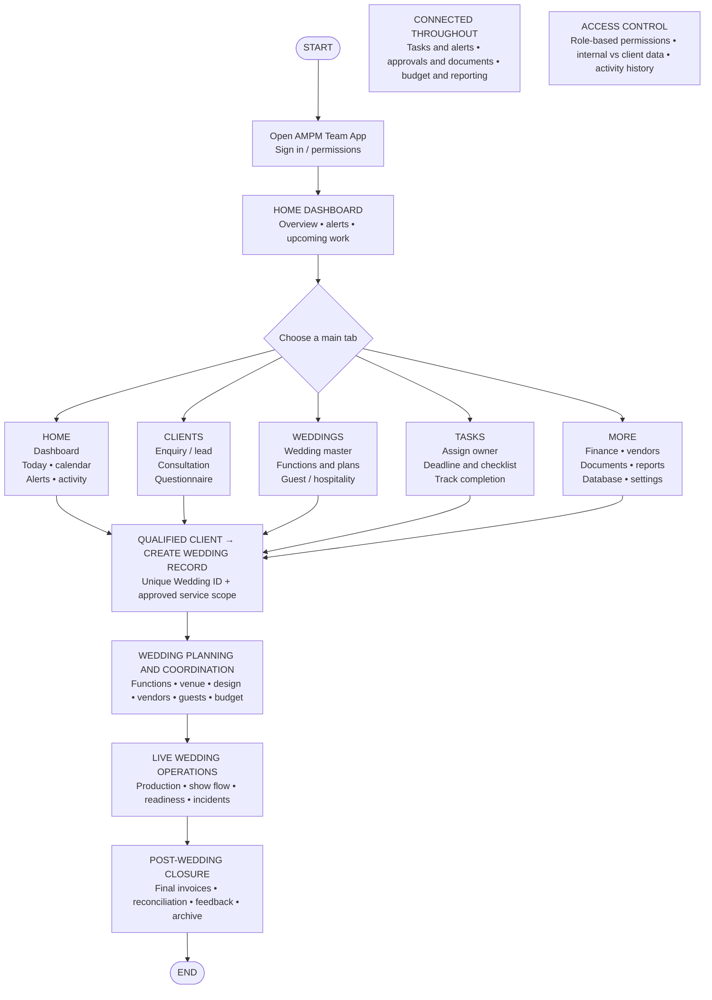
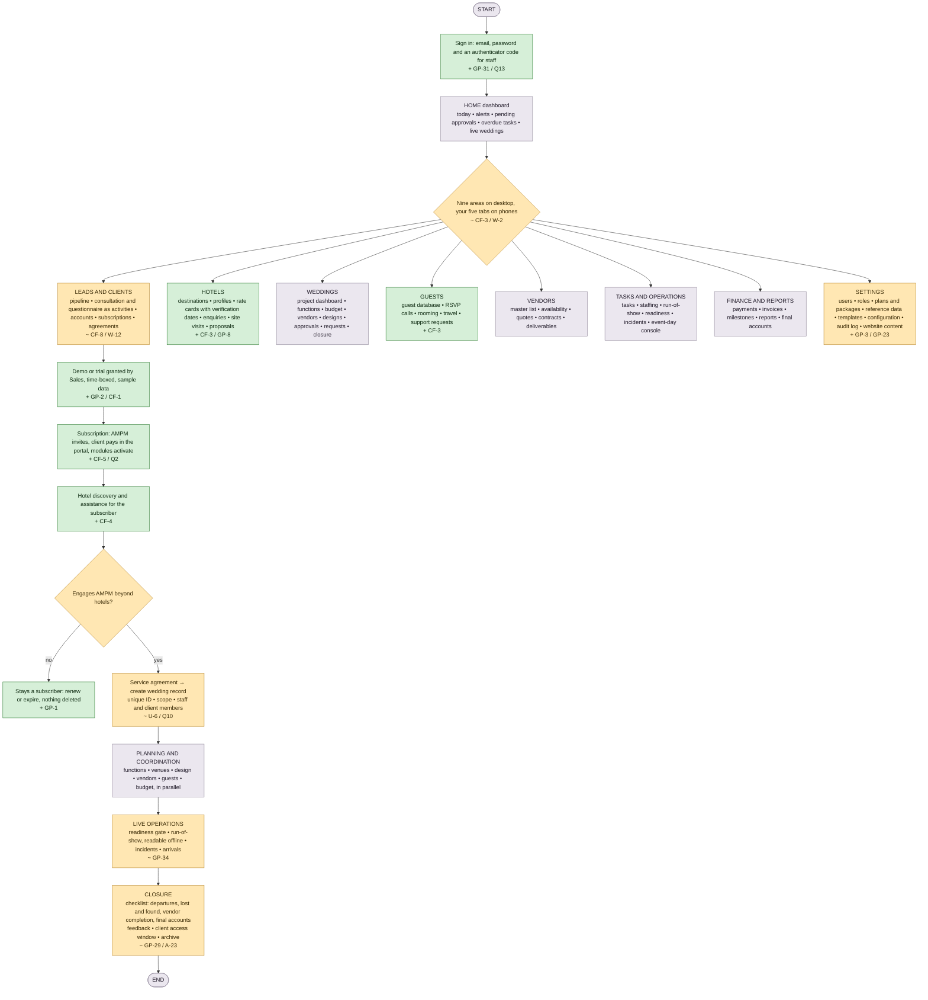
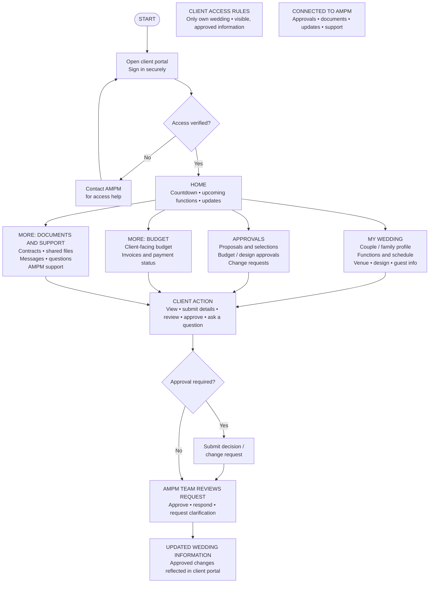
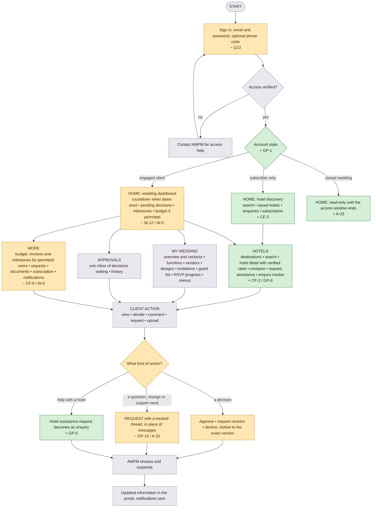
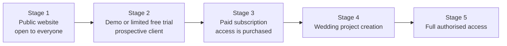
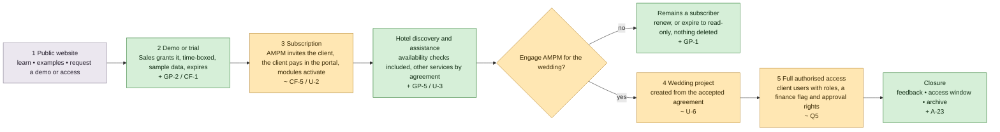
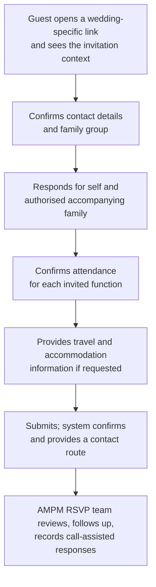
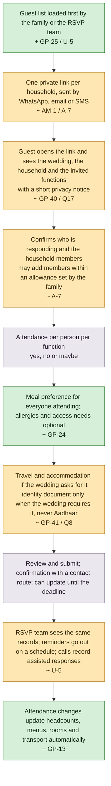

# AMPM Platform — Your Flowcharts, Redrawn With the Gaps Filled

**For:** AMPM review · **Date:** 24 October 2026 · **Status:** proposal, nothing approved.

This document takes the two Level-1 flowcharts you supplied (the team app and the client portal) and the customer journey described in your "Why AMPM App" note, reproduces each faithfully, and then shows the upgraded version. Every box in an upgraded diagram is colour-coded so you can see at a glance what was yours, what was added to fill a gap, and what was changed. The tag inside a box names the finding it answers; the findings are explained in plain language in [the annotated brief](annotated-brief.md) and the decisions you are asked for are in [the open decisions document](open-decisions.md).

## Legend

| Colour | Meaning | Tag |
|---|---|---|
| Grey | As in your flowchart, unchanged | none |
| Green | Added to fill a gap your documents left open | `+ ID` |
| Amber | Kept, but changed in scope or meaning | `~ ID` |

Tags refer to findings in the audit: **CF** a conflict between two of your documents, **GP** a gap, **AM** an ambiguity, **Q** a decision only AMPM can make, **A / U / W** an assumption we made meanwhile (listed in [the assumptions sheet](assumptions-taken.md)).

---

## 1. Team app

### 1.1 Your flowchart, as supplied

Five navigation tabs and one linear path from a qualified client to closure.

What this flowchart does well: the four stages after the wedding record is created (planning, live operations, closure) match the specification and are kept as they are.

What it leaves out: the business before a wedding record exists. Your specification's "critical rule" says a hotel-discovery subscription never implies full wedding management, and most clients will stop at discovery or hotel assistance. The flowchart has no subscription, no demo, no hotel work, and no place for the Hotel team or the RSVP team to work (findings CF-3 and CF-4).

### 1.2 Upgraded team app

What changed and why:

| Box | Change | Finding | Where it is specified |
|---|---|---|---|
| Sign in | Authenticator code for staff; no self-registration anywhere | GP-31, Q13 | wireframes AUTH-01 to AUTH-05; permission matrix P-6 |
| Nine areas / five tabs | Your five tabs stay on phones; desktop shows the nine areas your specification lists, so Hotels and Guests have a home | CF-3, W-2 | wireframes §2 |
| Leads and clients | "Consultation" and "Questionnaire" become logged activities on the lead, and subscriptions and agreements live here | CF-8, W-12 | wireframes TW-10 to TW-15 |
| Hotels | New area: the private database, rate cards with verification dates, enquiries, visits and proposals | CF-3, GP-8 | wireframes TW-20 to TW-28; data model modules C and D |
| Guests | New area: cross-wedding guest operations for the RSVP team | CF-3 | wireframes TW-50 to TW-58 |
| Settings | Plans and packages, website content and configuration added, so prices and rules are never in code | GP-3, GP-23 | wireframes TW-90 to TW-97 |
| Demo or trial | A stage your "Why" note requires but no other document specified | GP-2, CF-1 | user flows Flow 1 (U-1) |
| Subscription | Purchase path defined: AMPM invites, client pays, modules activate | CF-5, Q2 | user flows Flow 1 (U-2) |
| Hotel discovery and assistance | The branch most clients take and the flowchart omitted | CF-4 | user flows Flow 2 |
| Stays a subscriber | Expiry and renewal without deleting records | GP-1 | user flows Flow 12 |
| Create wedding record | Triggered by an accepted service agreement for anything beyond hotel help | U-6, Q10 | user flows Flow 3 |
| Live operations | Readiness gate and offline-readable cue sheet added | GP-34 | user flows Flow 9 |
| Closure | Your "feedback" and "archive" kept and given records; a client access window added | GP-29, A-23 | user flows Flow 10 |

---

## 2. Client portal

### 2.1 Your flowchart, as supplied

What this flowchart does well: the approve-or-request loop at the bottom is exactly how the portal should behave and is kept.

What it leaves out: hotel discovery, which is the Phase 1 product and the thing a subscription pays for. The Home tab's countdown also assumes every client has a wedding date, which a hotel-discovery subscriber does not (finding CF-2). "Messages, questions" implies a chat feature no other document describes (GP-15), and "Invoices and payment status" commits to showing money the specification leaves undecided (CF-6).

### 2.2 Upgraded client portal

What changed and why:

| Box | Change | Finding | Where it is specified |
|---|---|---|---|
| Sign in | Method defined; no self-registration | Q13 | wireframes AUTH-01 |
| Account state | The portal has three states: subscriber only, engaged client, closed wedding | GP-1 | permission matrix §3; wireframes §2 |
| Home for subscribers | Hotel discovery is the home page until a wedding project exists | CF-2 | wireframes CP-01 |
| Home for engaged clients | Countdown only when dates exist; budget card only for users allowed to see money | W-12, W-5 | wireframes CP-20 |
| Hotels | New tab: the Phase 1 product | CF-2, GP-8 | wireframes CP-02 to CP-11 |
| More | Finance shown only to permitted users; subscription management added | CF-6, W-5 | wireframes CP-11, CP-24, CP-25 |
| Requests | Your "messages, questions" delivered as typed, tracked requests rather than chat | GP-15, A-20 | wireframes CP-36, CP-37; user flows Flow 6 |
| Hotel assistance | A client's request for hotel help becomes an enquiry the Hotel team works | GP-5 | user flows Flow 2 |

---

## 3. The customer journey

### 3.1 As described in your "Why AMPM App" note

### 3.2 Upgraded journey

---

## 4. The guest RSVP flow

### 4.1 As described in your specification (section 2.5)

### 4.2 Upgraded guest flow

What changed and why:

| Step | Change | Finding | Where it is specified |
|---|---|---|---|
| Guest list first | Households and members are loaded before invitations go out, so the link knows who is responding | GP-25, U-5 | user flows Flow 7; wireframes CP-31, TW-58 |
| One link per household | Your "wedding-specific link" becomes a private link per household, so no guest can see another household | AM-1, A-7 | data model module J; permission matrix P-4 |
| Privacy notice | Consent and retention stated where the data is collected | GP-40, Q17 | wireframes GR-01 |
| Household allowance | Accompanying members are allowed up to a number the family sets per household | A-7 | wireframes GR-02 |
| Meal preference | Collected for the menus and caterer counts; allergies optional and restricted | GP-24 | wireframes GR-04 |
| Identity documents | Only when the wedding needs them for hotel check-in, never Aadhaar, deleted after checkout | GP-41, Q8 | data model module N; wireframes GR-05 |
| Reminders and calls | Scheduled reminders, then calls; assisted entries write the same records | U-5 | wireframes TW-53 |
| Automatic updates | Headcounts, menus, rooms and transport react to every change | GP-13 | user flows Flows 7 and 8 |

---

## 5. Every addition in one list

| Tag | What was added or changed | Diagram |
|---|---|---|
| + GP-31 / Q13 | Staff sign-in with an authenticator code; client sign-in with optional phone code; no self-registration | 1.2, 2.2 |
| ~ CF-3 / W-2 | Nine areas on desktop, five tabs on phones; Hotels and Guests get a home | 1.2 |
| ~ CF-8 / W-12 | Consultation and questionnaire become lead activities; "Database" means the Hotels area | 1.2 |
| + CF-3 / GP-8 | Hotels area with rate cards and verification dates | 1.2 |
| + GP-3 / GP-23 | Plans, packages and website content in Settings, not in code | 1.2 |
| + GP-2 / CF-1 | Demo or trial stage with expiry | 1.2, 3.2 |
| + CF-5 / Q2 | Subscription purchase path: invite, pay in portal, activate | 1.2, 3.2 |
| + CF-4 | The hotel discovery and assistance branch | 1.2, 3.2 |
| + GP-1 | Expiry and renewal without deletion; account states in the portal | 1.2, 2.2, 3.2 |
| ~ U-6 / Q10 | Wedding record created from an accepted agreement | 1.2, 3.2 |
| ~ GP-34 | Readiness gate and offline-readable cue sheet on the day | 1.2 |
| ~ GP-29 / A-23 | Closure checklist, feedback, client access window, archive | 1.2, 3.2 |
| + CF-2 / GP-8 | Hotels tab and subscriber home in the client portal | 2.2 |
| ~ W-12 / W-5 | Countdown only with dates; finance only for permitted users | 2.2 |
| ~ CF-6 / W-5 | Invoices and payments shown only to users with the finance flag | 2.2 |
| ~ GP-15 / A-20 | Requests with a tracked thread instead of messages | 2.2 |
| + GP-5 | Hotel assistance requests become enquiries | 2.2, 3.2 |
| ~ Q5 | Several client users per wedding with different rights | 3.2 |
| + GP-25 / U-5, ~ AM-1 / A-7, ~ GP-40 / Q17, + GP-24, ~ GP-41 / Q8, + GP-13 | The guest flow additions listed in section 4 | 4.2 |
