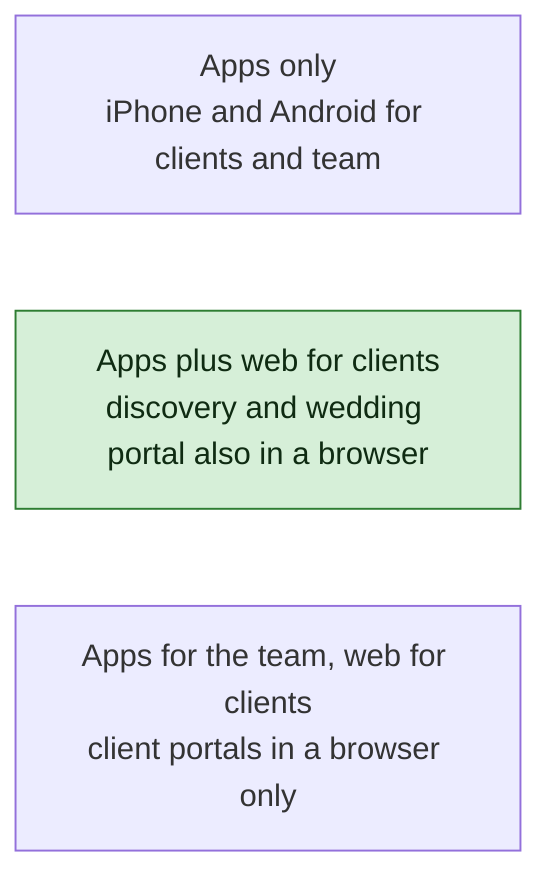
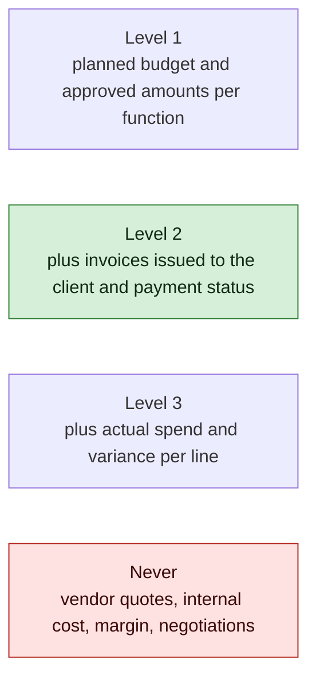
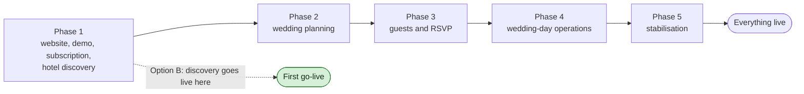

# AMPM Platform — The Questions Still Open

**For:** AMPM review · **Date:** 26 October 2026 · **Status:** open; your answers will be recorded in the decision log and applied to the drafts, as your 25 October answers were.

On 25 October you answered all twenty-five questions. This document is the second and shorter round: everything that is still open after those answers, in one place, written so that each point can be decided in a minute or two. We compiled it from three sources: the eleven items your own brief lists under "Items to confirm before development", the two points we raised from our side, and the open points we recorded in the decision log while applying your answers, several of which were on nobody's list until now.

Every question says what we need to know, why it matters, what your documents already say about it (quoted, so you can see where an answer exists and where it does not), what we propose, and the choices. Write your decision in the box, or reply by number: R1 to R19. The R numbers are new; the Q numbers in brackets are the original questions they come from.

Three things to know before you start:

> **DECIDED.** Some of your eleven items are already partly answered in your own brief. The transaction-handling requirements under R2 are in your section 3, word for word; the post-wedding policy under R19 is in your section 11. For those we only need the small remaining part, and we say which.

> **CONFLICT.** Your two documents of 25 October disagree on one point. The compiled questions and answers say under Q5 that "both representatives will use the same login credentials", while the brief says the choice "must be finalised before development" and that "separate authenticated accounts are preferable for security and audit history". R5 asks you to settle it.

> **AMBIGUITY.** Your brief says the demo "can show up to two sample hotels" per location, and its closing note says "your notes mention both one hotel per city and two sample hotels". R1 asks for the final number.

Nine questions need a real decision from you (R1, R3, R4, R5, R6, R7, R8, R11, R17). For the other ten we have a proposal in the drafts already, and a tick is enough if you agree with it. Seven were answered on 26 October 2026 (R1, R2, R3, R4, R10, R13, R17) and R5 carries a working decision; each is marked where it stands, and the record is in the decision log. If you would rather decide from one page, [the short version](remaining-questions-short.md) has every question as one line with its proposal and tick boxes; come back here for the reasons and the choices.

---

## Group 1 · Getting in: the demo, payment and refunds

### R1 · The demo: how long, how many places, how many hotels (Q3)

> **DECIDED.** Answered 26 October 2026: no time limit; three locations; one real hotel per location with indicative prices; managed by the admin.

**What we need to know.** How long does a prospect's demo access last? How many locations and how many hotels per location does it show? Are the demo hotels real hotels from your database with prices rounded or hidden, or invented sample hotels?

**Why it matters.** The demo is the first thing a prospect sees and the only "trial" you offer. Its limits are settings, so changing them later costs nothing; but the demo data has to be prepared before launch, and whether it is real or invented decides who prepares it.

**What your documents say.** The compiled answers: "The demo should show a maximum of three locations, with limited hotel information and streetview access" and "selected hotels and approximate pricing". The brief, section 2: "The proposed demo allows up to three locations", "The demo can show up to two sample hotels with indicative prices", and "The exact number of hotels, cities, and demo duration must be finalised with the AMPM team before development". The closing note of the brief flags the one-or-two-hotels discrepancy. Duration is mentioned nowhere.

> **ASSUMED.** The drafts show real hotels flagged as demo-visible with their rate details masked, plus one sample wedding, for a demo that Sales grants and that expires. Three locations is already applied.

**What we propose.** Seven days of access from the first OTP sign-in, extendable once by Sales; three locations; two hotels per location; real hotels from your database with indicative price ranges rather than invented ones, so that the demo looks like the product and Eva's data does the work.

**Choices.** Duration: 7 days (proposed), 3 days, 14 days, or until Sales closes it. Hotels per location: two (proposed) or one. Hotels: real with indicative prices (proposed) or invented samples.

**What changes with your answer.** Invented samples need six hotel pages written and photographed from scratch. Everything else is a setting.

> **Your decision:** duration ______ locations ______ hotels per location ______ real ☐ invented ☐

### R2 · Payment gateway (Q2)

> **DECIDED.** Answered 26 October 2026: Razorpay.

**What we need to know.** Which payment gateway should take the ₹50,000 subscription payment by card and UPI? Only the provider is open: the requirements are already settled.

**Why it matters.** The merchant account takes one to two weeks to open and must be in AMPM's name. Code for the chosen gateway is written in Phase 1.

**What your documents say.** The brief, section 3: "The payment gateway provider will be selected by AMPM." The same section already lists what the payment system must do: generate a payment record; record amount, date, status and transaction reference; activate the subscription after confirmation; prevent duplicate activation from repeated payment notifications; show start and expiry dates; let authorised staff review payment status. All of that is in the drafts, so the "transaction-handling requirements" part of your item 3 needs nothing more from you.

> **ASSUMED.** Razorpay, with hosted checkout and activation driven by the gateway's notification. PayU and Cashfree fit the same adapter; any of the three supports card, UPI and the notifications we need.

**What we propose.** Razorpay, unless AMPM already has a merchant account elsewhere.

**Choices.** Razorpay (proposed), PayU, Cashfree, or another provider you name.

**What changes with your answer.** A different provider is a different adapter, a few days of work, as long as it supports card, UPI and payment notifications.

> **Your decision:** gateway ______ existing merchant account? ☐ yes, with ______ ☐ no

### R3 · Cancellation and refunds for the subscription (Q3, new)

> **DECIDED.** Answered 26 October 2026: no refund is offered.

**What we need to know.** If a client pays ₹50,000 and asks for their money back, what is the rule? Can a subscription be cancelled before it starts?

**Why it matters.** Your business explanation lists "cancellation and refund terms" among the decisions the developer must not assume, and your rule 8 says refund terms must be confirmed before they are implemented. The 25 October answers do not mention refunds or cancellation, and this point was on no list. The portal has to say something at the moment of payment, and Finance needs a button or a rule.

**What your documents say.** Business explanation, section 9: "Cancellation and refund terms" are still to be confirmed. The compiled answers and the brief are silent on the subject.

> **ASSUMED.** A refund path through the gateway is designed (finding GP-7); whether and when it is used is left to you. No refund wording is in the drafts.

**What we propose.** No refund once the subscription is activated, because access is immediate and the data stays with the client; refund in full if AMPM cancels before activation or cannot deliver the service. Refunds, when they happen, are made by Finance through the gateway and recorded against the payment.

**Choices.** No refund after activation (proposed); full refund within a cooling-off period you set (for example 48 hours if the client has not saved a hotel); case-by-case at AMPM's discretion, recorded with a reason.

**What changes with your answer.** A cooling-off rule adds a check at refund time; case-by-case is a Finance permission and a note. The wording appears on the payment screen and in the terms either way.

> **Your decision:** rule ______ cooling-off period, if any ______

---

## Group 2 · The client side

### R4 · The client portals on the web as well as in the apps (Q1)

> **DECIDED.** Answered 26 October 2026: yes, the client portals also run in the browser. Added the same day: a client is verified by both email and mobile number, and both apps support iPad and Android tablets as well as phones.

**What we need to know.** Your 25 October answer asks for iPhone and Android apps. Should the hotel discovery portal and the client wedding portal also work in a browser on a laptop, or are they apps only? The team app is separate: it is native because of offline use.

**Why it matters.** This is the largest open cost item. Families compare hotels with photographs, menus and price grids, which many people prefer to do on a laptop; the demo is reached from your website; and an app-only portal means every prospect must install an app before seeing the demo. On the other side, a web version is a further build to design, test and maintain. Your original specification asked for a "responsive desktop, tablet and mobile interface"; your brief asks for iOS and Android and says the final architecture "should be agreed with the development team". Both can be true; we need to know which.

> **ASSUMED.** Since 25 October the drafts build the team app and the client app natively from one shared codebase, and the public website for the browser. Nothing is drafted for a browser version of the client portals.

**What we propose.** Option B: the two client portals also run in the browser, built from the same code as the client app so that screens are designed once. The team app stays native only.

**Choices.** A: apps only. B: apps plus a browser version for clients (proposed). C: client portals in the browser only, apps for the team.

**What changes with your answer.** B adds the web build for the client screens to the estimate; it is a fraction of the client-app effort when the code is shared, and the estimate will carry the figure. C removes the client app and its app-store work. A keeps the current drafts and is the cheapest, at the cost of the laptop experience and the install step before the demo.

> **Your decision:** ☐ A apps only ☐ B apps plus web ☐ C web for clients, apps for the team

### R5 · The two family representatives: one shared login or two accounts (Q5)

> **DECIDED.** 26 October 2026: the brief's section 5 access and permission rules are confirmed as written. Working decision on logins: two individually authenticated accounts, the brief's stated preference; countersign here ☐.

**What we need to know.** Do the bride's-side and groom's-side representatives share one set of login details, or does each have their own account with access to the same wedding?

**Why it matters.** With one shared login the system cannot tell who approved a design, a menu or a budget line; the audit trail says only "the client". With two accounts each person signs in with their own mobile number and OTP, both see the same wedding with the same rights, and every decision carries a name. Sharing one phone number for OTP is also awkward in practice.

**What your documents say.** The compiled answers, Q5: "Both representatives will use the same login credentials." The brief, section 5: "The precise login implementation, one shared login or two individually authenticated accounts with access to the same wedding, must be finalised before development. Separate authenticated accounts are preferable for security and audit history." The brief's closing note repeats that separate logins "will be safer and will give AMPM an audit trail of who approved each decision".

> **CONFLICT.** The two documents differ; the brief's position is the later and more considered one, and it matches our recommendation.

**What we propose.** Two accounts, one per representative, with identical rights on the same wedding. They still "share responsibility", as your brief intends; they just do not share a phone.

**Choices.** Two accounts (proposed) or one shared login.

**What changes with your answer.** One shared login removes per-person approval history and means one OTP phone for both families. Nothing else changes.

> **Your decision:** ☐ two accounts ☐ one shared login

### R6 · Does one representative's approval complete a decision, or must both approve (Q5)

**What we need to know.** When the portal asks the family to approve a design, a menu, a proposal or a budget change, is one representative's approval enough, or must both the bride's side and the groom's side approve?

**Why it matters.** Your specification lists "whether multiple approvals are required" among the decisions to confirm, and the 25 October answers do not address it. One approval keeps things moving; two approvals protect both families on money matters but add a step to every approval screen and a wait whenever one representative is unavailable.

**What your documents say.** Specification, section 13: "Approvals: who approves for the couple/family; whether multiple approvals are required." The compiled answers say "the families will mutually decide who is authorised to manage the portal", which settles who, not how many. Your brief says the representatives "share responsibility for the wedding portal".

> **ASSUMED.** One approval completes a decision. The number is a setting per approval type, so budgets and contracts could require two while designs and menus require one.

**What we propose.** One approval for everything in the first release, with the setting available if you later want two for budget and contract approvals.

**Choices.** One approval for all (proposed); two for budgets and contracts, one for the rest; two for everything.

**What changes with your answer.** Two approvals add a "waiting for the other side" state and a reminder to the second representative.

> **Your decision:** ☐ one approval for all ☐ two for budgets and contracts ☐ two for everything

### R7 · Which amounts the client sees in the wedding portal (Q4)

**What we need to know.** Once AMPM is appointed for the wedding, what money does the client-facing budget screen show? Your rule is clear on what it must never show: internal costs, margins, vendor rates, quotations and negotiations. The question is what it does show.

**Why it matters.** Your business explanation and specification both ask for a "client-facing budget" and a "budget summary showing only approved client-facing fields", and your specification lists "financial visibility: which amounts clients see" among the decisions to confirm. Without an answer we cannot sign off those screens. Since milestone payments are not collected online in the first release, the amounts are shown for information, not for paying.

**What your documents say.** The brief, section 7: "Display only information approved for the client." Specification: client portal "budget summary showing only approved client-facing fields"; decision table "which amounts clients see: vendor quote, negotiated quote, AMPM fee, tax and payment details". Business explanation: "planned budget, quotations, approved amounts, payments and final costs, with appropriate access restrictions".

> **ASSUMED.** Level 3 today: the client sees estimates, approved amounts, invoices issued to them, their own payments and outstanding milestones, and the actual amount per budget line. Booking-milestone amounts for hotels appear only where the client pays the hotel directly.

**What we propose.** Level 2: planned and approved amounts per function, invoices issued to the client and their payment status; actual spend and variance stay internal unless you want the client to see them.

**Choices.** Level 1, Level 2 (proposed) or Level 3. Separately: hotel booking-milestone amounts shown to the client ☐ only when the client pays the hotel directly (assumed) ☐ always ☐ never.

**What changes with your answer.** Level 1 removes the invoices and payments screens from the client portal for now. Level 3 keeps the drafts as they are.

> **Your decision:** level ______ hotel milestone amounts ______

### R8 · Which hotel services carry a fee (Q4)

**What we need to know.** Beyond the ₹50,000 subscription, which hotel-assistance services are charged separately: price negotiation with a hotel, site visits, contract review, booking assistance? Availability checks are already confirmed as part of the subscription.

**Why it matters.** Your business explanation lists "fees for hotel research, negotiation, site visits and booking assistance" among the decisions the developer must not assume, and the 25 October answers do not return to it. The answer decides whether a client can ask for a site visit with one tap, or whether the request first produces a service agreement to accept. The amounts themselves stay outside the app, like the wedding management fee.

**What your documents say.** Business explanation, section 9: "Fees for hotel research, negotiation, site visits and booking assistance" are still to be confirmed. Brief, section 4, confirms availability-check requests as a discovery feature. Specification: "Client may separately request availability checks, price negotiation, site visits and booking assistance."

> **ASSUMED.** Availability checks are included. Negotiation, site visits, contract review and booking assistance need an accepted service agreement before the team starts, with the fee recorded on the agreement.

**What we propose.** Keep the assumption: included availability checks, and a recorded agreement before any chargeable service, even if the fee on it is zero for a particular client.

**Choices.** All assistance included in the subscription; availability included and the rest by agreement (proposed); everything by agreement including availability checks.

**What changes with your answer.** "All included" removes the agreement step from the hotel flow. "Everything by agreement" moves it earlier, before the first availability check.

> **Your decision:** ______ services that carry a fee: negotiation ☐ site visits ☐ contract review ☐ booking assistance ☐

---

## Group 3 · Your team

### R9 · Staff roles, and who may see hotel costs and vendor costs (Q6)

**What we need to know.** Is the list of nine staff roles below final, and which of them may see what hotels and vendors actually charge AMPM?

**Why it matters.** Every screen, permission and test in the drafts is built on these roles. Your brief names departments as "functional examples" and says the final list "must follow AMPM's approved staff structure". Cost visibility is the one permission your brief singles out as restricted to "specifically authorised personnel".

**What your documents say.** Brief, section 9, names the hotel team, vendor team, RSVP team, hospitality team, production team, project manager and senior authorised management, and adds: "These are functional examples. The final role list and permissions must follow AMPM's approved staff structure." Also: "Vendor costs and hotel costs must not be visible to unauthorised users."

> **ASSUMED.** Nine staff roles, from your specification: Super Admin; Sales / Relationship Manager; Hotel / Destination Team; Wedding Project Manager; Creative / Design Team; Vendor Coordinator; RSVP / Guest Team; Hospitality / Logistics Team; Finance / Accounts. Hotel costs are visible to Super Admin, Finance and the Hotel Team, and to the Project Manager for their own weddings. Vendor costs are visible to Super Admin, Finance and the Vendor Coordinator, and to the Project Manager for their own weddings. Everyone else sees client-facing amounts only.

**What we propose.** Confirm the nine roles as they stand and the cost visibility as drafted. If "senior authorised management" is a person rather than the Super Admin role, tell us whether they need a role of their own.

| Role | Sees hotel costs | Sees vendor costs | Your change |
|---|---|---|---|
| Super Admin | yes | yes | |
| Finance / Accounts | yes | yes | |
| Hotel / Destination Team | yes | no | |
| Vendor Coordinator | no | yes | |
| Wedding Project Manager | own weddings | own weddings | |
| Sales / Relationship Manager | no | no | |
| Creative / Design Team | no | no | |
| RSVP / Guest Team | no | no | |
| Hospitality / Logistics Team | no | no | |

**What changes with your answer.** Adding or renaming a role is a day of work; moving cost visibility is a permission change and a test change.

> **Your decision:** roles final ☐ yes ☐ with these changes: ______ · cost visibility as in the table ☐ yes ☐ changed above

### R10 · How staff sign in (Q13)

> **DECIDED.** Answered 26 October 2026: password plus an authenticator-app code; the identity service is Amazon Cognito in Mumbai.

**What we need to know.** Clients sign in with their mobile number and an OTP, as you decided. How should staff sign in?

**Why it matters.** Staff accounts reach costs, identity documents and every wedding they are assigned to, so they need stronger protection than a client account. Staff also work inside venues with poor signal, where an SMS code may not arrive.

**What your documents say.** Brief, section 13: "The exact authentication method for staff should be finalised with the development team."

> **ASSUMED.** Email, password and a six-digit code from an authenticator app on the staff member's phone. The code works without network, which matters on the wedding day.

**What we propose.** Keep it. If AMPM's team already uses Google Workspace or Microsoft 365, sign-in through that account is an alternative that gives you central control when someone leaves.

**Choices.** Password plus authenticator app (proposed); password plus SMS OTP (simpler, depends on signal and on the SMS provider); sign-in through Google Workspace or Microsoft 365 if you use one.

**What changes with your answer.** SMS OTP for staff makes the SMS provider a dependency for the team app on the wedding day. Workspace sign-in needs the account details of your workspace.

> **Your decision:** ☐ authenticator app ☐ SMS OTP ☐ Google Workspace or Microsoft 365: ______

---

## Group 4 · Guests

### R11 · RSVP links: one per side, one for the wedding, or both (Q7)

**What we need to know.** Your answer says the system can support a bride's-side link and a groom's-side link, or one combined link, and that "the final link structure is to be decided". Do you want both styles from the first release, or per-side links only, with the combined link later?

**Why it matters.** With a per-side or combined link, a guest opens the link and must find themselves in the list before responding; with one private link per household, no search is needed but every household needs a phone number or email up front. The choice decides the first screen of the RSVP form, how duplicates are prevented, and which of the drafted tests run.

**What your documents say.** Brief, section 8: "AMPM must be able to create separate guest invitation links for the bride's side and groom's side. A single combined wedding link may also be supported where AMPM chooses to use it." Compiled answers: "The final link structure is to be decided."

> **ASSUMED.** Per-side links, with guests identifying themselves against the loaded list; the combined link is the same mechanism with one list. Private links per household remain available as an option for weddings where you have every household's contact.

**What we propose.** Per-side links as the standard, the combined link as an option per wedding, both in the first release since they share one mechanism. Keep the household link for weddings whose list arrives with phone numbers.

**Choices.** Per-side only; per-side and combined (proposed); combined only; private link per household.

**What changes with your answer.** Dropping the combined option removes one setting. Choosing household links only removes the "find yourself" step and requires contacts for every household.

> **Your decision:** ______

---

## Group 5 · Privacy and retention

### R12 · Retention periods and privacy wording (Q8, Q17)

**What we need to know.** How long is each kind of personal data kept before AMPM is asked to approve its deletion: closed leads, guest records after a wedding, identity documents after checkout? And who at AMPM approves the privacy wording we draft?

**Why it matters.** Your answers say nothing is deleted automatically and that AMPM approves retention and deletion. The system therefore needs the periods after which it proposes a deletion for your approval, and the privacy notices on the enquiry form and the RSVP form need agreed wording before launch. Both your Q8 and your Q17 answers point to this one decision, which is why your items 9 and our Q8 and Q17 are the same question.

**What your documents say.** Compiled answers, Q17: "AMPM will decide the final privacy wording and data retention policy." Brief, section 8: "The final retention period and privacy wording must be confirmed by AMPM before launch." Brief, section 14: AMPM will approve "retention policies, privacy wording, and recovery targets with the development team before launch".

> **ASSUMED.** Closed leads: 24 months. Guest personal data: 12 months after the wedding project closes. Identity documents: 30 days after checkout. Demo data: reset on a schedule. When a period ends the system lists the records for deletion and a Super Admin approves; nothing is deleted unattended. Notices are designed to the Digital Personal Data Protection Act 2023.

**What we propose.** Keep the periods above, and have the privacy notices drafted by us and reviewed by AMPM and its legal adviser in Phase 3, when the guest flows are built.

**Choices.** Periods as proposed, or your own numbers. Wording: drafted by the developer for your approval (proposed) or supplied by AMPM.

**What changes with your answer.** Periods are settings. Wording supplied by AMPM shortens our Phase 3 work by a few days.

> **Your decision:** leads ______ months · guest records ______ months after closure · identity documents ______ days after checkout · wording approved by ______

---

## Group 6 · Technology and operations: we propose, you approve

### R13 · Hosting, backups and recovery (Q14)

> **DECIDED.** Answered 26 October 2026: everything on AMPM's dedicated VPS, a Hostinger KVM 4 bought with the India (Mumbai) datacentre; pgBackRest archives to a Mumbai S3 bucket with rehearsed monthly restores; media and identity documents in Mumbai buckets under their own keys; accounts in AMPM's name. The specification is docs/engineering/vps-setup.md.

**What we need to know.** Do you approve the hosting arrangement below, including that the cloud account and every provider account is opened in AMPM's name?

**Why it matters.** Hosting decides where personal data lives, how fast the platform is for users in India, what a disaster costs you, and who owns the infrastructure if the development relationship ends. Your specification lists "technology ownership: hosting, source-code ownership, maintenance and support responsibility" among the decisions to confirm. Nothing in your documents has been decided on it; the brief says AMPM will approve the arrangements with the developer before launch, so this is a proposal for you to approve.

**What your documents say.** Compiled answers, Q14: "Final hosting arrangements, backup frequency and recovery timelines are yet to be confirmed." Brief, section 14: "AMPM will approve the hosting arrangements, retention policies, privacy wording, and recovery targets with the development team before launch."

> **ASSUMED.** Amazon Web Services in the Mumbai region, with backup copies in the Hyderabad region, so that all personal data stays in India. Database recoverable to any point in the last 35 days plus daily snapshots in the second region; files versioned and copied across regions. If the worst happens, at most 15 minutes of data is lost and the platform is back within 4 hours; a restore is rehearsed every quarter. Accounts, domains and provider accounts in AMPM's name, with the development team as delegated administrators. The full production set-up is built from Phase 1, not a throwaway.

**What we propose.** Approve as drafted. The same design runs on Google Cloud or Microsoft Azure's Indian regions if AMPM has a preference or an existing relationship.

**Choices.** Approve (proposed); another cloud provider; tighter recovery targets, which need a warm standby in the second region at roughly double the database cost.

**What changes with your answer.** Provider changes are a change of names in the plan. Tighter targets change the cost line.

> **Your decision:** ☐ approve as drafted ☐ provider ______ ☐ recovery targets ______ · accounts in AMPM's name ☐ yes · source code owned by AMPM ☐ yes

### R14 · How big: staff, weddings, guests, hotels (Q15)

**What we need to know.** How many staff accounts, now and in two years? What is the largest wedding you expect, in guests? Will the hotel database grow much beyond 200? Roughly how many photographs and videos per hotel?

**Why it matters.** The numbers size the database, the storage and the load tests, and they go into the cost estimate. Your answer gives two of the four: about 200 hotels and about 20 weddings at a time.

**What your documents say.** Brief, section 16: "Initial planning assumption: approximately 20 concurrent weddings and up to 200 hotels. Confirm the required staff and guest capacity before implementation." Compiled answers, Q15: "Final capacity requirements for simultaneous weddings, guests and staff will be confirmed separately." Your business explanation's worked example is a wedding of 250 guests in Jaipur.

> **ASSUMED.** Before your answer the drafts were sized for 50 staff, 40 concurrent weddings, 1,500 guests per wedding, 500 hotels and 2 TB of media in the first year. They are now rescaled to 200 hotels and 20 weddings, with staff and guests still at the original numbers.

**What we propose.** Confirm 50 staff accounts and 1,500 guests for the largest wedding as upper bounds, unless you expect larger weddings.

**Choices.** Fill in the numbers.

**What changes with your answer.** Larger numbers change indexing and the storage estimate, not the design.

> **Your decision:** staff now ______ in two years ______ · largest wedding ______ guests · hotels in two years ______ · media per hotel ______

### R15 · WhatsApp and SMS providers (Q11)

**What we need to know.** Which providers send WhatsApp messages, SMS (including the OTP codes every client sign-in depends on) and email? Do you have a preference, or should the developer choose? Who at AMPM owns the WhatsApp Business account and the sending number?

**Why it matters.** WhatsApp Business onboarding and the Indian SMS registration (DLT) take two to six weeks and must be done in AMPM's name, so they start before coding does. Because clients sign in by OTP, the SMS provider is a launch dependency.

**What your documents say.** Brief, section 16: "Email, WhatsApp and SMS are the proposed channels. Final implementation and provider selection remain to be confirmed." Compiled answers, Q11: email and WhatsApp supported, with live chat on the home page.

> **ASSUMED.** WhatsApp through the WhatsApp Business Platform via an Indian business solution provider; email through Amazon SES; SMS through an Indian provider registered for DLT, for OTP and as a fallback. All three sit behind one adapter, so a provider swap later is contained.

**What we propose.** Let the developer select the business solution provider and the SMS provider on price and reliability, with AMPM owning the accounts; AMPM creates its Meta Business Manager and registers the sender for DLT in the first week of the project.

**Choices.** Developer selects (proposed); AMPM names providers it already uses; WhatsApp deferred to a later phase.

**What changes with your answer.** Deferring WhatsApp removes the longest lead time but leaves email and SMS as the only channels at launch.

> **Your decision:** providers ______ · WhatsApp account owner at AMPM ______ · sending number ______

### R16 · Service levels, support and on-call (new)

**What we need to know.** Do you accept the service-level targets and the support model proposed below? They drive the maintenance contract and part of the running cost.

**Why it matters.** Your brief asks for "reliable backups and recovery" and your specification lists "maintenance and support responsibility" among the decisions to confirm, but no document names an availability target or says who answers the phone during a wedding. These targets were proposed in the architecture draft and never addressed.

**What your documents say.** Specification, section 13: "Technology ownership: hosting, source-code ownership, maintenance and support responsibility." Nothing on availability, response times or on-call.

> **ASSUMED.** Availability of 99.5 percent per month excluding announced maintenance; most requests answered in under 0.4 seconds; portal pages usable within 3 seconds on 4G; accessibility to WCAG 2.1 AA for the client and guest portals; the last two versions of the major browsers. On-call cover from the development team on wedding days, and no deployments while any wedding is live.

**What we propose.** Accept as drafted.

**Choices.** Accept (proposed); office-hours support only, in which case incidents on the wedding day fall to AMPM staff until the next working day; a higher availability target, at higher cost.

**What changes with your answer.** Office-hours support lowers the maintenance cost and raises the operational risk on the day. Higher availability changes the hosting design and its cost.

> **Your decision:** ☐ accept as drafted ☐ office hours only ☐ higher target: ______

### R17 · One go-live, or hotel discovery first (Q10)

> **DECIDED.** Answered 26 October 2026: the whole first release goes live at once.

**What we need to know.** Your answer defines the first release: demo, subscription and hotel discovery, wedding management after appointment, vendor selection, the client portal, department access, RSVP, tracked requests, live chat and offline wedding-day operations. Do you want all of it to go live together, or should hotel discovery go live as soon as it is ready while the wedding modules follow?

**Why it matters.** Hotel discovery is the product you sell by subscription and is complete at the end of the first build phase; the wedding modules take three more phases. Launching discovery first brings in subscriptions months earlier and lets real prospects test the demo, at the price of two go-lives and support starting earlier. This decision shapes the schedule more than any other open point, which is why the schedule and cost estimate are waiting for it.

**What your documents say.** Brief, section 16, lists the first release's content. Business explanation, section 9: "Features included in the first release versus later releases" is to be confirmed. Specification: "Launch scope: which phases are in the initial budget versus later releases." None of them says whether the release is one date or two.

> **ASSUMED.** One launch at the end of Phase 4 is the gate in the drafts, with discovery-first noted as the open alternative.

**What we propose.** Option B: hotel discovery goes live at the end of Phase 1; the wedding modules follow as one second go-live. The first wedding managed in the system would then be a wedding whose discovery happened in it.

**Choices.** A: one go-live with everything. B: hotel discovery first, the rest together later (proposed). C: each phase goes live as it completes.

**What changes with your answer.** B and C add a stabilisation pass and a support window for each go-live; A delays the first subscription until the end of Phase 4.

> **Your decision:** ☐ A one go-live ☐ B discovery first ☐ C phase by phase

---

## Group 7 · Changes and the end of a wedding

### R18 · What counts as a material change, and who approves it (Q25)

**What we need to know.** From what size does a change count as "material" and raise flags on budgets, contracts, tasks and the run-of-show? And who must approve a material change before it is implemented?

**Why it matters.** Material changes trigger review tasks and notifications; too low a threshold floods the team, too high a threshold lets a large change through unnoticed. The thresholds are settings, as you asked, but they need starting values, and the approval rule is a workflow we have to build.

**What your documents say.** Compiled answers, Q25: "The definition of a material change is not finalised" and "budget-change percentages, date changes and venue-change thresholds will be decided by AMPM." Brief, section 16: "Change thresholds must be configurable. AMPM will define the final thresholds and approval rules."

> **ASSUMED.** A change is material when a budget line moves by 10 percent or more, or when a function's date or venue changes. A material change request raises impact flags and review tasks for the affected teams; the client's approval of the change follows the normal approval rule (R6).

**What we propose.** Starting values: 10 percent on a budget line or 5 percent on the total approved budget; any date change; any venue change. Approval: the Wedding Project Manager reviews and accepts, and changes above a second threshold (we suggest 15 percent of the total budget) also need the Super Admin or senior management before they are implemented.

**Choices.** Thresholds as proposed or your own. Approval: Project Manager alone; Project Manager plus senior management above a second threshold (proposed); senior management for every material change.

**What changes with your answer.** Values are settings. A second approver adds a step and a waiting state to the change-request flow.

> **Your decision:** budget line ______ % · total budget ______ % · date change ☐ always material · venue change ☐ always material · approval rule ______

### R19 · Archiving a wedding and restoring access later (Q23)

**What we need to know.** Your policy is settled: read-only client access for three months after the wedding, then archiving on AMPM's approval, with nothing deleted. We need the mechanics: who proposes and who approves the archiving, what the client sees afterwards, and how access is restored if a family asks a year later.

**Why it matters.** The three-month window and the archive are built; the approval step and the reopening path are the parts that need a named person and a rule.

**What your documents say.** Brief, section 11: the portal "remains available in read-only mode for three months after the wedding"; after that "the wedding project is archived following AMPM's approval", "the project remains available to authorised AMPM personnel", "records are not automatically deleted", "any later access or reopening is controlled by AMPM", and archiving is "a change in status and access permissions, not deletion". Compiled answers, Q23: "The exact closure and archiving process will be controlled by AMPM."

> **ASSUMED.** A reminder goes to the representatives before the window ends. When it ends, the Project Manager proposes archiving and the Super Admin approves; the client memberships are removed; the representatives can still sign in and see a contact route but no project. Archived weddings stay readable to authorised staff and are excluded from day-to-day lists.

**What we propose.** Keep that workflow, and add the reopening rule: a representative asks AMPM; the Super Admin restores read-only access for 30 days with a logged reason; editing never reopens, and corrections after archiving are made by staff with a note.

**Choices.** Approver: Super Admin (proposed) or a named person. Reopening: read-only for a fixed period (proposed) or at AMPM's discretion each time. After archiving the client sees: a contact route (proposed) or nothing.

**What changes with your answer.** All of these are rules inside one flow; none changes the data.

> **Your decision:** archiving approved by ______ · reopening ______ · client sees after archiving ______

---

## Short answers and defaults to tick

These are small. A tick keeps the default; a line changes it.

1. **Accounting software** for the finance export (the platform issues no GST invoices, so Finance exports records to your accountant): ☐ CSV only (default) ☐ Tally ☐ Zoho Books ☐ other: ______
2. **Public website analytics and bot protection:** privacy-respecting analytics on the public pages only, and a bot check on the enquiry and demo forms. ☐ fine ☐ no analytics
3. **Who at AMPM signs each phase's acceptance** on the staging system before a release: ______
4. **Emergency reading of identity documents by the Super Admin,** audited each time: ☐ allowed (default) ☐ requires two people ☐ never
5. **RSVP reminders:** reminders to households that have not responded, at intervals you set, then a call from the RSVP team; no guest edits after the deadline, corrections through the RSVP team. ☐ fine ☐ cadence: ______
6. **Readiness checklists visible to the client:** ☐ hidden (default) ☐ a summary
7. **Programme and calendar files for guests:** ☐ available once invitations go out (default) ☐ only in the wedding week
8. **One subscription per client account,** covering that client's wedding or weddings: ☐ fine ☐ one per wedding

---

## Where each question came from, and the repeats

The same question often appears in more than one list: your brief's eleven items, our decision log, the vault's open items, and the review sections at the end of each developer draft. This table shows every place each R question appears, so that nothing is asked twice, and whether your documents already answer it.

| R | Your item (brief §18) | Our question | Also asked in | Your documents |
|---|---|---|---|---|
| R1 | 1 and 2, merged | Q3 | data model §21.5, wireframes §12.7 | Partly: three locations and "up to two" hotels; duration absent; one-or-two unresolved |
| R2 | 3 | Q2 | architecture §15.2, test cases §9.1 | Partly: requirements answered in brief §3; provider not chosen |
| R3 | none | Q3, Q4 (finding GP-7) | business explanation §9 | No: listed by you as to be confirmed, not answered since |
| R4 | none, our point | Q1 | none | No: brief asks for iOS and Android and leaves the architecture to be agreed |
| R5 | 4 | Q5 | permission matrix §11.3 (resolved) | Conflicting: Q&A says shared; brief says to be finalised, separate preferable |
| R6 | none | Q5 | permission matrix §11.9 | No: specification §13 lists it; not answered |
| R7 | none, our point | Q4 | data model §21.1, wireframes §12.8 (W-14) | No: specification §13 lists it; brief §7 says only what must not be shown |
| R8 | none | Q4 | user flows §15.2 (U-3) | No: business explanation §9 lists it; availability checks confirmed only |
| R9 | 5 | Q6 | permission matrix §11.7 and §11.8 | Partly: departments as examples; final list and cost access deferred to AMPM |
| R10 | none | Q13 | architecture T-6 | No: brief §13 defers it to the development team |
| R11 | none | Q7 | test cases §9.2 (V-9) | No: both link styles allowed, structure "to be decided" |
| R12 | 9 | Q8 and Q17, merged | data model A-17, wireframes §12.9, test cases §9.6 | No: AMPM to decide; approval before launch |
| R13 | 6 | Q14 | architecture §15.1 and §15.8, test cases §9.7 (V-13) | No: to be approved with the developer |
| R14 | 7 | Q15 | test cases §9.5 (V-5) | Partly: 200 hotels and 20 weddings given; staff and guests not |
| R15 | 8 | Q11, Q13 (OTP) | architecture §15.3, test cases §9.1 | No: providers to be confirmed |
| R16 | none | T-12, T-14 | architecture §15.6 | No: specification §13 lists maintenance and support; no targets anywhere |
| R17 | none, our point | Q10 | architecture §0a and §13 | No: first-release content given; one date or two not said |
| R18 | 10 | Q25 | user flows U-11 | No: AMPM to define thresholds and approval rules |
| R19 | 11 | Q23 | user flows §15.6 (resolved) | Mostly: policy in brief §11; mechanics and reopening not covered |

Your items 1 and 2 are one question (R1), and your item 9 covers two of ours (Q8 and Q17, now R12). Your item 3 is half answered by your own section 3. R3, R4, R6, R7, R8, R10, R11, R16 and R17 were on no list of yours; they come from your business explanation and specification, which listed them to be confirmed, or from the decision log.

The review sections at the end of the developer drafts (data model §21, permission matrix §11, user flows §15, wireframes §12, test cases §9) still list several questions your 25 October answers settled: on-behalf decisions, offline on the wedding day, invoices from the platform, the viewer role, readiness-exception authority, vendor contacts after selection, and the client editing the guest list. They will be removed in the next revision of the drafts; nothing in them needs an answer from you.

---

## Answer sheet

| R | Question | Your decision |
|---|---|---|
| R1 | Demo: duration, locations, hotels per location, real or invented | |
| R2 | Payment gateway | |
| R3 | Cancellation and refunds | |
| R4 | Client portals on the web as well as the apps | |
| R5 | Two accounts or one shared login | |
| R6 | One approval or both representatives | |
| R7 | Amounts the client sees | |
| R8 | Hotel services that carry a fee | |
| R9 | Staff roles and cost visibility | |
| R10 | Staff sign-in | |
| R11 | RSVP link structure | |
| R12 | Retention periods and privacy wording | |
| R13 | Hosting, backups, recovery, ownership | |
| R14 | Capacity | |
| R15 | WhatsApp, SMS and email providers | |
| R16 | Service levels and support | |
| R17 | One go-live or discovery first | |
| R18 | Material-change thresholds and approval | |
| R19 | Archiving and reopening | |

When these come back, the answers go into the decision log next to your 25 October answers, the drafts move to version 0.3, and the milestone schedule and cost estimate are drafted, which are waiting on R4, R14 and R17 in particular.
