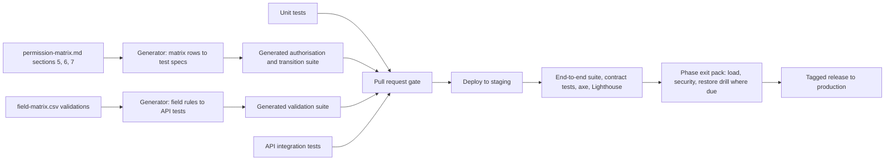

# AMPM Platform — Test Cases Mapped to Acceptance Criteria

**Status:** DRAFT v0.2, 25 October 2026. AMPM's decisions of 25 October applied where they change a test (§0a) and stamped on every assumption in §0. Not yet signed off.
**Companions:** [requirements-audit.md](requirements-audit.md) (Q numbers), [data-model.md](data-model.md) (A-1 to A-30), [permission-matrix.md](permission-matrix.md) (P-1 to P-11, §7 transitions, §8 automation, §9 audited actions), [field-matrix.md](field-matrix.md) (validations), [architecture.md](architecture.md) (T-1 to T-14, §6 enforcement, §12 delivery), [user-flows.md](user-flows.md) (Flow 1 to 12, U-1 to U-12), [wireframes.md](wireframes.md) (screen IDs, W-1 to W-15).
**Source of truth being extended:** SPEC §12 (fifteen acceptance test scenarios), §14 ("test cases mapped to acceptance criteria"), §10 (technical and non-functional requirements), §11 (phase exit criteria), §7 (statuses), §8 (automation), §9 (reports and exports).

The fifteen scenarios in SPEC §12 are acceptance criteria AC-01 to AC-15. SPEC §10, §7, §8 and §9 and the audit's findings imply further criteria the spec does not list as scenarios; they are AC-16 to AC-36 and each names its source. Every criterion has at least one test, every test cites the flow and screens it exercises, and the traceability matrix in §2 is the index.

---

## 0. Assumptions register

Verification-specific assumptions. Data-model (A), permission (P), technology (T), flow (U) and wireframe (W) assumptions are cited where they apply.

| ID | Audit ref | Assumption adopted in this draft | If AMPM decides otherwise |
|---|---|---|---|
| V-1 | Q2, A-2, T-3 | Payment tests run against the gateway's sandbox with test keys and simulated webhooks, plus the manual bank-transfer path. No real card or bank data is ever used. **AMPM (2026-10-25): Partly decided. Gateway sandbox depends on the provider choice.** | Offline-only payments deactivate the gateway tests; a different gateway swaps the sandbox. |
| V-2 | Q11, A-11, T-4 | Messaging tests use provider sandboxes. WhatsApp template delivery is stubbed until templates are approved; delivery-status webhooks are simulated. **AMPM (2026-10-25): Partly decided. Provider sandboxes depend on the provider choice.** | Dropping a channel removes its tests. |
| V-3 | Q13, A-13, U-9 | Authentication tests cover email and password, authenticator codes for staff, optional phone OTP for clients, and guest token links. There is no registration test because there is no registration. **AMPM (2026-10-25): Changed. OTP sign-in tests for clients and prospects.** | Phone-OTP-only for clients changes AC-17 only. |
| V-4 | Q1, T-11 | Offline tests (AC-33, AC-13.5, AC-14.5) run in Phase 4 using browser offline emulation in the end-to-end runner. **AMPM (2026-10-25): Changed. Offline tests move to the first release and run on native builds.** | Without offline support those tests are removed. |
| V-5 | Q15, A-15, T-12 | Load tests run at twice the sizing assumptions: 100 concurrent staff users, 1,500 guests responding within one hour, 500 hotels searchable, with the targets of T-12. **AMPM (2026-10-25): Changed. Load profiles rescaled to 200 hotels and 20 weddings; staff and guest numbers to be confirmed.** | Different volumes rescale the profiles; different targets rescale the thresholds. |
| V-6 | Q17, A-17 | Retention tests use accelerated clocks: retention periods are configuration and are set to minutes in the test environment. **AMPM (2026-10-25): Changed. Retention tests cover the approval workflow, not automatic deletion.** | Periods change the configuration, not the tests. |
| V-7 | Q8, A-8, P-5 | Identity-document tests use synthetic images and a syntactically valid but fictitious Aadhaar-format number to prove rejection. No real identity document ever enters a test environment. **AMPM (2026-10-25): Confirmed. Synthetic identity test data.** | None. |
| V-8 | Q4, A-4, P-3 | Finance-leak tests assert the absence of internal fields by comparing every client-facing response against the serialiser schema, not by spot checks. **AMPM (2026-10-25): Confirmed. Finance-leak tests across screens, exports, notifications and APIs.** | A transparent fee model keeps the tests; the internal fields still exist. |
| V-9 | Q7, A-7, U-5 | RSVP tests assume one token per household. A dormant test set for a single open wedding link is listed under AC-10 and activated only if AMPM chooses that model. **AMPM (2026-10-25): Changed. The per-side link tests activate; household-token tests become the alternative.** | Activate the dormant set. |
| V-10 | Q3, Q10, A-28, P-7 | Demo isolation tests assume demo data in the same database behind flags; the tests prove that no query path reaches non-demo rows. **AMPM (2026-10-25): Partly decided. Demo content changed; isolation tests stand.** | A separate demo database replaces these with an environment-separation check. |
| V-11 | Q10, A-10 | Phase exit packs assume the Phase 1 scope of A-10 (demo, full consultancy statuses, online payment, built-in CMS). **AMPM (2026-10-25): Changed. Exit packs follow the first-release scope.** | Items leaving Phase 1 move their tests to the later phase's pack. |
| V-12 | Q16, A-16 | GST invoice tests assume AMPM issues invoices from the platform. **AMPM (2026-10-25): Dropped. No GST invoices from the platform.** | If invoices come from an accounting system, AC-36.3 and AC-36.4 are dormant. |
| V-13 | Q14, T-13 | Backup and restore drills run quarterly in staging; the first drill is a Phase 5 exit gate. Recovery point and time are measured, not assumed. **AMPM (2026-10-25): Still open. Recovery targets to be confirmed.** | Tighter targets change the thresholds. |
| V-14 | Q5, P-9 | On-behalf decision tests require an evidence document and assert the audit badge. **AMPM (2026-10-25): Confirmed. On-behalf decision tests stand.** | Forbidding on-behalf decisions turns those tests into denial tests. |
| V-15 | Q17 | Test data is synthetic: fictitious names, phone numbers in reserved ranges, example-domain emails, generated images. Staging never holds real guest data (architecture §12). **AMPM (2026-10-25): Not addressed, stands. Not addressed; stands.** | None. |
| V-16 | SPEC §12 last scenario, architecture §4 row 20 | The authorisation suite is generated from permission-matrix.md §5 and §6, so a change in the matrix changes the tests without hand editing. **AMPM (2026-10-25): Not addressed, stands. Not addressed; stands.** | None. |

---

## 0a. Changes from AMPM's decisions (25 October 2026)

| Decision | Test changes |
|---|---|
| Q7 links per side or combined; no editing after submission | AC-10.11 to AC-10.13 are activated as the per-side tests and rewritten below; AC-10.3 (guest edits) becomes a denial test; AC-10.1 identifies the household on a side link |
| Q20 live chat | New criterion AC-37 below |
| Q6 department-based access | New criterion AC-38 below |
| Q3 renewal restores data | New test AC-02.11 below; AC-02.8 (trial) is dormant because the demo serves as the trial |
| Q10 only Eva's authorised personnel approve exceptions | AC-13.2 and AC-15.6: the Project Manager's authorisation attempt must return 403; only SA succeeds |
| Q13 mobile OTP for prospects and clients | New test AC-17.9 below; AC-17.2 becomes the OTP path for every client sign-in; AC-17.6 applies to staff only |
| Q1 native apps with offline use at launch | AC-33 and the offline tests AC-13.5 and AC-14.5 move to the first release and run on native builds (V-4 changed); two tests added, AC-33.5 and AC-33.6 |
| Q8, Q17 no automatic deletion | AC-15.8 and AC-27.3 become approval-workflow tests: the retention job proposes, nothing is deleted until SA approves |
| Q16 no GST invoices | AC-36.3 and AC-36.4 are dormant |
| Q4 milestone payments not online in the first release | Any test paying a milestone online (CP-25) is dormant; AC-28.1 covers subscription payments only |
| Q12 no website editing | No CMS tests remain active; AC-25.1 covers reference data only |
| Q15 about 200 hotels and 20 weddings | AC-34 profiles rescaled: 200 hotels, 40 concurrent staff, 20 weddings, guest numbers to confirm |
| AMPM's own acceptance checklist (20 items) | Mapped to tests in the table at the end of this section |

#### AC-02.11 Renewal restores access and preserves data
- **Type and priority.** End to end with the gateway sandbox, P1, Phase 1, automated.
- **Principal.** CR; SYS.
- **Steps.** Let a subscription expire with six saved hotels and two enquiries; purchase a new subscription; complete payment.
- **Expected.** A new `subscriptions` row active for one month from activation; the six saved hotels and both enquiries are reachable again with their history; nothing was deleted in between.
- **References.** Flow 1 revised; CP-11, CP-01; Q3.

#### AC-10.11 Side link: a guest identifies their household
- **Type and priority.** End to end, P1, Phase 3, automated.
- **Principal.** GU.
- **Steps.** Open the bride-side link; enter the household name and phone; proceed.
- **Expected.** An exact match opens the household's RSVP; a near match is held with "we will confirm your invitation" and a review item for the RSVP team; no household data is shown before a confirmed match; a groom-side household cannot be found through the bride-side link.
- **References.** Flow 7 revised; GR-01, GR-02; P-4 changed (Q7).

#### AC-10.12 Unmatched guests are held for review
- **Type and priority.** API integration, P1, Phase 3, automated.
- **Steps.** Submit a response from a name and phone not on the list.
- **Expected.** A pending household with `identification_status` review; nothing is counted until the RSVP team approves; the team is notified.
- **References.** TW-53, TW-57 (Q7).

#### AC-10.13 Submitted responses are locked; corrections go through the team
- **Type and priority.** End to end, P1, Phase 3, automated.
- **Principal.** GU; RG (a).
- **Steps.** Submit a response; reopen the link and attempt to change it; submit a correction request; RG applies the correction.
- **Expected.** The reopened link shows the submitted summary and no editable fields; the correction request creates a `guest_support_requests` row of type correction; RG's change writes the same attendance rows with `response_source` ampm_call and a new snapshot.
- **References.** GR-07, GR-09, TW-51 (Q7).

#### AC-17.9 Mobile OTP sign-in for prospects and clients
- **Type and priority.** End to end, P1, Phase 1, automated.
- **Principal.** DP; CR.
- **Steps.** Enter an authorised number; enter the code; enter a wrong code; enter an expired code; enter a number AMPM never invited.
- **Expected.** Session created on the correct code; wrong and expired codes refused with the attempt count; the uninvited number receives a neutral message and no session; codes are single use and expire in ten minutes.
- **References.** AUTH-06; P-6 changed (Q13).

#### AC-33.5 Local data is protected
- **Type and priority.** Security on native builds, P1, first release, automated.
- **Steps.** Inspect the app's local store on a device after use; sign out; inspect again.
- **Expected.** The store is encrypted at rest; only the user's role-scoped data is present; the store is wiped on sign-out.
- **References.** Architecture §0a (Q1).

#### AC-33.6 Offline state and pending changes are visible
- **Type and priority.** End to end on native builds, P1, first release, automated.
- **Steps.** Go offline; make three changes; observe the indicator; reconnect.
- **Expected.** The app shows an offline banner and the count of pending changes; after reconnect the count drains to zero and each change appears on the server with its original time; no change is lost.
- **References.** TW-73, TW-74, TW-76 (Q1).

### AC-37 Live chat alongside tracked requests (Q20)

#### AC-37.1 A client conversation reaches staff in real time
- **Type and priority.** End to end, P1, first release, automated.
- **Principal.** CR; SM.
- **Steps.** Open CP-42 and send a message; as SM watch TW-98.
- **Expected.** The conversation appears in the queue within two seconds; the reply reaches the client without a refresh; read receipts update; a push notification is sent when the client app is in the background.
- **References.** CP-42, TW-98; data-model §18a.

#### AC-37.2 A message becomes a tracked request
- **Type and priority.** API integration, P1, first release, automated.
- **Steps.** As SM turn a message into a change request.
- **Expected.** A `client_requests` row with the message as description and `messages.client_request_id` set; the request follows Flow 6; the conversation shows the link.
- **References.** TW-98, CP-36.

#### AC-37.3 Chat never carries an approval
- **Type and priority.** API integration, P1, first release, automated.
- **Steps.** Attempt to approve a proposal or set a budget figure from a chat endpoint.
- **Expected.** No such capability exists; approvals come only through the approval routes.
- **References.** Permission-matrix §0a.

#### AC-37.4 Conversations are isolated
- **Type and priority.** Generated authorisation suite, P1, first release, automated.
- **Principal.** CR of account A; DP.
- **Steps.** Request account B's conversation and message ids.
- **Expected.** 404; a demo prospect's conversation is visible to Sales only.
- **References.** Architecture §6.

#### AC-37.5 Unanswered conversations surface
- **Type and priority.** Job test, P2, first release, automated.
- **Steps.** Leave a conversation unassigned beyond the configured minutes.
- **Expected.** Highlighted on TW-98 and TW-01; the department lead notified.
- **References.** TW-98.

### AC-38 Department-based access (Q6)

#### AC-38.1 A department sees only its own sections
- **Type and priority.** Generated authorisation suite, P1, first release, automated.
- **Principal.** HT; RG (a); VC; HL (a).
- **Steps.** As each, request guest records, vendor quotes, hotel rate cards and rooming for an assigned wedding.
- **Expected.** Each receives only the resources permission-matrix §5 grants its role; everything else is 404; the mobile navigation shows only those areas.
- **References.** Permission-matrix §5; W-2.

#### AC-38.2 Project membership bounds every department
- **Type and priority.** Generated authorisation suite, P1, first release, automated.
- **Principal.** RG (a) on wedding A.
- **Steps.** Request wedding B's guests.
- **Expected.** 404.
- **References.** Permission-matrix §1 layer 3.

#### AC-38.3 Cost visibility is limited to authorised users
- **Type and priority.** Schema assertion, P1, first release, automated.
- **Principal.** Every staff role.
- **Steps.** Fetch vendor quotes, hotel internal amounts and budget internal cost as each role.
- **Expected.** Only the roles AMPM confirms (to be finalised) receive the fields; all others receive responses without them.
- **References.** Permission-matrix §4; Q6 open point.

### AMPM's acceptance checklist mapped to tests

| AMPM's scenario (25 October 2026) | Tests |
|---|---|
| A prospect cannot access the full hotel database without AMPM-authorised access | AC-03.2, AC-03.3, AC-17.9 |
| A verified demo user sees only the permitted demo information | AC-03.2, AC-03.5, AC-03.8 |
| A client can purchase the Rs 50,000 hotel discovery subscription online | AC-02.1 |
| Successful payment activates the one-month subscription | AC-02.1, AC-02.5 |
| Expiry changes access without deleting saved hotels or enquiries | AC-02.7, AC-32.2 |
| Renewal restores active discovery access and preserves previous data | AC-02.11 |
| A hotel-discovery-only subscriber cannot access vendor selection | AC-02.2 |
| AMPM can activate wedding management after the client appoints the company | AC-06.1, AC-32.1 |
| Client screens and APIs never reveal internal costs, margins or private vendor rates | AC-05.2, AC-08.5, AC-12.3, AC-36.1 |
| Only authorised family representatives can access the client wedding portal | AC-06.2, AC-06.3, AC-06.5 |
| Guests cannot access another household's information or edit the master RSVP list | AC-10.6, AC-10.11, AC-10.13 |
| Department managers cannot access unrelated departments | AC-38.1, AC-38.2 |
| Essential operational information remains accessible offline | AC-33.1 |
| Offline updates synchronise when connectivity returns | AC-33.2, AC-33.3, AC-33.6 |
| An incomplete readiness check cannot be bypassed without an authorised exception | AC-13.1, AC-13.2 |
| Both tracked requests and live chat work as intended | AC-37.1 to AC-37.5, AC-10.13 |
| Approved changes create a new version and follow the approval workflow | AC-09.1, AC-09.2 |
| Wedding access becomes read-only after three months and archiving follows AMPM approval | AC-15.5, AC-15.7 |
| Archived data is retained according to AMPM's approved policy | AC-15.8, AC-27.3 |
| Public website editing is unavailable to AMPM staff in the current release | No CMS route exists; covered by the generated route inventory in AC-02.10 |

## 1. Conventions

### Test case format

Each test has an identifier `AC-nn.m` (criterion, then test), a title, and these lines: **Type and priority** (level, priority, phase, automated or manual), **Principal** (role codes from permission-matrix §2), **Preconditions**, **Steps**, **Expected**, **References** (flows, screens, companion sections, assumptions and Q numbers).

### Levels and tooling (architecture §4 row 20, §12)

| Level | Tool | Runs |
|---|---|---|
| Unit | Vitest | Every pull request |
| API integration | Supertest against a disposable PostgreSQL and Redis | Every pull request |
| Generated authorisation suite | Produced from the permission matrix CSV (V-16) | Every pull request; fails the build on drift |
| End to end | Playwright against staging, synthetic seed (§7) | Every merge to main; full pack before a phase exit |
| Contract | Adapter tests against provider sandboxes | Nightly and before release |
| Load and performance | k6 with the profiles in §6 | Before each phase exit from Phase 1 |
| Accessibility | axe-core in Playwright, plus manual screen-reader passes | Before Phase 1 exit (public, portal), Phase 3 exit (guest portal), Phase 5 |
| Security | Dependency and image scanning in CI; ZAP baseline nightly; manual penetration test in Phase 5 | As stated |
| Infrastructure | Terraform plan checks and compliance rules; restore drill | Every infrastructure change; quarterly drill |

### Priorities

**P1** blocks the phase exit and any release. **P2** must pass before the phase exit but may be waived for an interim release with a recorded reason. **P3** is tracked and fixed before launch.

### Principals used in tests

Role codes as in permission-matrix §2: SA, SM, HT, PM, CD, VC, RG, HL, FA for staff; CO, CA, CV for client users; GU for a guest token; DP for a demo prospect; SYS for jobs. "PM (a)" means a Project Manager who is a member of the project under test; "PM (other)" is a Project Manager who is not.

### Denial semantics (architecture §6)

A principal that may not see a record receives 404 with the same body as for a nonexistent record. A principal that may see a record but not perform an action receives 403. Validation failures return 400 naming the field. Status-transition violations return 409 with the guard message. Tests assert these codes exactly.

### Environments and data

All automated suites run against synthetic data from the seed in §7 (V-15). Jobs are triggered explicitly in tests rather than waited for. Clocks are injectable so expiry, reminder and retention behaviour can be tested without waiting (V-6).

---

## 2. Traceability matrix

| Criterion | Source | Tests | Flows | Screens | Phase |
|---|---|---|---|---|---|
| AC-01 Public enquiry saves source and owner; team tracks follow-up | SPEC §12 | AC-01.1 to AC-01.9 | 1 | PUB-06, PUB-09, TW-10, TW-11 | 1 |
| AC-02 Subscription activates hotel discovery without exposing wedding modules | SPEC §12 | AC-02.1 to AC-02.11 | 1, 12 | AUTH-02, CP-11, CP-01, TW-14, TW-80, TW-92 | 1 |
| AC-03 Demo account cannot access records outside demo scope | SPEC §12 | AC-03.1 to AC-03.8 | 1 | TW-11, DM-01, CP-01 to CP-07 | 1 |
| AC-04 Hotel search shows freshness; unverified availability never confirmed | SPEC §12 | AC-04.1 to AC-04.7 | 2 | CP-04, CP-05, TW-22, TW-23, TW-24 | 1 |
| AC-05 Negotiation and site visit recorded without exposing internal notes | SPEC §12 | AC-05.1 to AC-05.8 | 2 | TW-27, TW-28, CP-09, CP-10 | 1 |
| AC-06 Engaged client receives correct project and permissions | SPEC §12 | AC-06.1 to AC-06.7 | 3 | TW-31, TW-33, CP-20, CP-24 | 2 |
| AC-07 Multiple functions with independent vendors, schedules, budgets, approvals | SPEC §12 | AC-07.1 to AC-07.5 | 4, 5 | TW-34, TW-35, TW-36, TW-38 | 2 |
| AC-08 Vendor shortlist permits fewer than five, does not require ten | SPEC §12 | AC-08.1 to AC-08.5 | 4 | TW-38, CP-26 | 2 |
| AC-09 Approval refers to the exact version; revisions do not overwrite | SPEC §12 | AC-09.1 to AC-09.7 | 4, 5 | TW-39, TW-40, CP-27, CP-29, CP-34, CP-30 | 2 |
| AC-10 Self-service and assisted RSVP update the same database without duplicates | SPEC §12 | AC-10.1 to AC-10.13 | 7 | GR-01 to GR-09, TW-51, TW-53, TW-54 | 3 |
| AC-11 Attendance changes update totals and flag downstream impacts | SPEC §12 | AC-11.1 to AC-11.6 | 7, 8 | TW-52, TW-35, TW-55, TW-56, CP-33 | 3 |
| AC-12 Unauthorised users cannot reach restricted data by URL, API or file link | SPEC §12 | AC-12.1 to AC-12.10 | 11 | all | 1 |
| AC-13 Readiness cannot complete without checks or an authorised exception | SPEC §12 | AC-13.1 to AC-13.5 | 9 | TW-74, TW-64 | 4 |
| AC-14 Incidents assigned, escalated, closed with notes | SPEC §12 | AC-14.1 to AC-14.5 | 9 | TW-75, TW-76 | 4 |
| AC-15 Closure checks departures, lost and found, vendor completion, reconciliation | SPEC §12 | AC-15.1 to AC-15.8 | 10, 12 | TW-45, TW-55, TW-63, TW-84, CP-40, CP-41 | 4 |
| AC-16 Responsive and accessible interfaces | SPEC §10, T-12, W-3 | AC-16.1 to AC-16.4 | — | key screens | 1, 3, 5 |
| AC-17 Secure authentication | SPEC §10, A-13 | AC-17.1 to AC-17.9 | 11 | AUTH-01 to AUTH-05 | 1 |
| AC-18 Server-side validation on every protected request | SPEC §10, field matrix | AC-18.1 to AC-18.4 | — | all forms | 1 |
| AC-19 Encryption in transit and at rest | SPEC §10, T-2 | AC-19.1 to AC-19.3 | — | — | 1 |
| AC-20 Private file storage, expiring links, safe uploads | SPEC §10, architecture §6 | AC-20.1 to AC-20.5 | — | TW-44, CP-38, GR-05 | 1 |
| AC-21 Audit trail | SPEC §10, permission-matrix §9 | AC-21.1 to AC-21.4 | — | TW-96 | 1 |
| AC-22 Backups and tested restoration | SPEC §10, T-13 | AC-22.1 to AC-22.3 | — | — | 5 |
| AC-23 Search, filters, pagination, bulk operations | SPEC §10, W-11 | AC-23.1 to AC-23.4 | — | CP-04, TW-50, TW-60 | 1, 3 |
| AC-24 Media optimisation and controlled video delivery | SPEC §10, GP-20 | AC-24.1 to AC-24.4 | — | TW-22, CP-05 | 1 |
| AC-25 Configurable packages, categories, statuses and pricing | SPEC §10 | AC-25.1 to AC-25.4 | — | TW-92, TW-93, TW-95 | 1 |
| AC-26 Clear errors, duplicate-submission prevention, form recovery | SPEC §10 | AC-26.1 to AC-26.3 | — | PUB-06, CP-07, GR-06 | 1, 3 |
| AC-27 Retention, deletion and privacy | SPEC §10, GP-40, GP-44 | AC-27.1 to AC-27.5 | 10 | PUB-06, GR-01, TW-95 | 1, 3, 4 |
| AC-28 Integration boundaries | SPEC §10, architecture §10 | AC-28.1 to AC-28.5 | 1, 7 | — | 1, 3 |
| AC-29 Notifications and automation | SPEC §8, permission-matrix §8 | AC-29.1 to AC-29.9 | all | CP-39, TW-94 | 1 to 4 |
| AC-30 Reports and exports | SPEC §9, permission-matrix §5.16 | AC-30.1 to AC-30.4 | — | TW-83 | 2 to 5 |
| AC-31 Status transitions and guards | SPEC §7, permission-matrix §7 | AC-31.1 to AC-31.3 | all | — | 1 to 4 |
| AC-32 Entitlement resolution and downgrades | GP-1, permission-matrix §3 | AC-32.1 to AC-32.4 | 12 | CP-01, CP-20, CP-41 | 1, 2, 4 |
| AC-33 Offline behaviour on event day | GP-34, T-11 | AC-33.1 to AC-33.6 | 9 | TW-73, TW-74, TW-76 | first release |
| AC-34 Performance and capacity | T-12, A-15 | AC-34.1 to AC-34.5 | 2, 7 | CP-04, GR-03, TW-36 | 1 to 5 |
| AC-35 Imports | GP-22 | AC-35.1 to AC-35.4 | 7 | TW-25, TW-58, CP-31 | 1, 3 |
| AC-36 Finance integrity | A-4, GP-17, GP-18 | AC-36.1 to AC-36.6 | 3, 4, 10 | TW-36, TW-81, TW-84, CP-24, CP-25 | 2, 4 |
| AC-37 Live chat alongside tracked requests | Q20 | AC-37.1 to AC-37.5 | 6 | CP-42, TW-98 | first release |
| AC-38 Department-based access | Q6 | AC-38.1 to AC-38.3 | 11 | TW-01 | first release |

---

## 3. Phase exit packs (SPEC §11; scope per V-11)

| Phase | Exit criterion in the spec | Criteria whose P1 and P2 tests must pass | Also required |
|---|---|---|---|
| 1 Foundation | Lead-to-subscriber journey tested; private data protected | AC-01, AC-02, AC-03, AC-04, AC-05, AC-12, AC-17, AC-18, AC-19, AC-20, AC-21, AC-24, AC-25, AC-26, AC-32 (subscriber rows), AC-35.1 | AC-16 for public pages and the portal; AC-28 for payment, email, SMS and video; AC-34.1 search load |
| 2 Wedding planning | A sample wedding planned and approved end to end | AC-06, AC-07, AC-08, AC-09, AC-29 (planning rules), AC-30 (planning reports), AC-31, AC-36.1, AC-36.2, AC-36.5 | AC-23.3 vendor lists; AC-32 engaged rows |
| 3 Guest operations | Guest data flows into operational reports | AC-10, AC-11, AC-23, AC-27.2, AC-27.3, AC-28.3, AC-30 (guest reports), AC-35.2 to AC-35.4 | AC-16 for the guest portal; AC-34.2 RSVP burst |
| 4 Live execution | A simulated event managed through closure | AC-13, AC-14, AC-15, AC-29 (execution rules), AC-33, AC-36.3 to AC-36.6 | AC-32 closure rows; AC-27.4, AC-27.5 |
| 5 Stabilisation | Critical defects resolved; launch checklist signed | Every criterion's P1, P2 and P3; AC-22 restore drill; AC-34 full profile; AC-16 full audit; penetration test findings closed | Launch checklist in architecture §13 |

---

## 4. Acceptance criteria from SPEC §12

### AC-01 Public enquiry saves source and owner; team tracks follow-up

#### AC-01.1 Website enquiry creates a lead with source and consent
- **Type and priority.** End to end, P1, Phase 1, automated.
- **Principal.** Visitor; then SM.
- **Preconditions.** Lead source `website` active; privacy notice version 3 published; Sales user exists.
- **Steps.** 1. Submit PUB-06 with name, email, tentative dates, destination, guest estimate, requirements, marketing consent ticked. 2. Sign in as SM, open TW-10.
- **Expected.** A `leads` row with status `new`, `source_id` = website, `consent_marketing` true, `consent_at` set and the notice version recorded; Sales notified; the lead appears in the New column; PUB-09 shown to the visitor with no echoed data beyond the first name.
- **References.** Flow 1; PUB-06, PUB-09, TW-10; field-matrix leads; V-15 (Q17), A-12 (Q12).

#### AC-01.2 Demo request creates a demo task
- **Type and priority.** API integration, P2, Phase 1, automated.
- **Principal.** Visitor; SYS.
- **Steps.** Submit PUB-06 with "I would like a demo" ticked.
- **Expected.** `leads.requested_demo` true; a task for the lead owner (or the Sales queue when unassigned) titled for the demo; lead status still `new`.
- **References.** Flow 1; TW-11; U-1 (Q3, Q10).

#### AC-01.3 Email or phone is required, not both
- **Type and priority.** API integration, P1, Phase 1, automated.
- **Steps.** Submit with neither email nor phone; then with phone only; then with a malformed email.
- **Expected.** 400 naming the fields; 201; 400 naming email. Phone normalised to E.164 with +91 default.
- **References.** PUB-06; field-matrix leads (email, phone); AC-18.

#### AC-01.4 Manual lead from a call or Instagram records source and owner
- **Type and priority.** End to end, P1, Phase 1, automated.
- **Principal.** SM.
- **Steps.** On TW-10 create a lead with source `instagram`, assign owner, add an activity of type `consultation` and one of type `questionnaire` with answers.
- **Expected.** Lead saved with owner; activities on the timeline; `questionnaire_json` stored; funnel report counts the Instagram source.
- **References.** Flow 1; TW-10, TW-11; W-12 (CF-8).

#### AC-01.5 Follow-up reminder fires at the scheduled time
- **Type and priority.** Job test, P2, Phase 1, automated.
- **Principal.** SM; SYS.
- **Steps.** Set `next_follow_up_at` on an activity; advance the clock; run the reminder job.
- **Expected.** One notification to the owner with the lead link; running the job again sends nothing (idempotent).
- **References.** Flow 1; TW-11; permission-matrix §8; AC-29.

#### AC-01.6 Duplicate leads are flagged, never refused or auto-merged
- **Type and priority.** End to end, P2, Phase 1, automated.
- **Steps.** Submit two enquiries with the same phone; open the second in TW-11; merge choosing the first as survivor.
- **Expected.** Both rows exist with a duplicate flag; after merge the activities are attached to the survivor, the duplicate is closed with reason `merged`, and an audit event records the merge.
- **References.** Flow 1; TW-11; AC-21.

#### AC-01.7 Lead funnel report is correct
- **Type and priority.** API integration, P2, Phase 1, automated.
- **Principal.** SM, SA; HT must not run it.
- **Steps.** Seed leads across sources and statuses; run the funnel report; attempt as HT.
- **Expected.** Counts by source and status match the seed; HT receives 404 for the report route.
- **References.** TW-83; permission-matrix §5.16; AC-30.

#### AC-01.8 Converted lead becomes read-only and links the account
- **Type and priority.** API integration, P1, Phase 1, automated.
- **Principal.** SM.
- **Steps.** Convert a lead; try to edit its requirements afterwards.
- **Expected.** `client_accounts` row created with the lead reference; `converted_account_id` and `converted_at` set; status `converted`; edit returns 409; invitation sent to the primary contact.
- **References.** Flow 1; TW-11, AUTH-02; WHY §4.

#### AC-01.9 Enquiry form is rate limited and bot checked
- **Type and priority.** Security, P2, Phase 1, automated.
- **Steps.** Submit 30 enquiries from one address within a minute; submit without the bot-check token.
- **Expected.** Requests beyond the configured limit receive 429; submissions without a valid bot-check token receive 400; no leads created for either.
- **References.** PUB-06; architecture §11 abuse protection.

### AC-02 Subscription activates hotel discovery without exposing full wedding modules

#### AC-02.1 Online purchase activates only the purchased modules
- **Type and priority.** End to end with the gateway sandbox, P1, Phase 1, automated.
- **Principal.** CO on a subscriber-only account; SYS.
- **Preconditions.** Account activated through AUTH-02; plan "Discovery" active with modules `hotel_discovery` and `hotel_assistance`; sandbox keys configured (V-1).
- **Steps.** 1. On CP-11 choose the plan and accept terms. 2. Complete the sandbox checkout. 3. Deliver the signed `payment.captured` webhook. 4. Reload CP-01.
- **Expected.** `payments` row succeeded with `provider_ref`; `subscriptions` active with `starts_at` and `ends_at` from the plan term; entitlements equal the plan's modules; CP-01 shows search; My Wedding and Approvals are locked entries; client and Sales notified.
- **References.** Flow 1; CP-11, CP-01; permission-matrix §3; A-2, A-3, U-2 (Q2, Q3).

#### AC-02.2 Wedding endpoints are absent for a subscriber-only account
- **Type and priority.** Generated authorisation suite, P1, Phase 1, automated.
- **Principal.** CO on a subscriber-only account.
- **Steps.** Request project list, a guessed project id, budget, approvals and documents routes.
- **Expected.** Project list returns an empty collection; every record route returns 404 with the not-found body; no response contains any project field.
- **References.** CP-20 (not reachable); permission-matrix §3; architecture §6; V-16.

#### AC-02.3 Failed payment grants nothing
- **Type and priority.** API integration, P1, Phase 1, automated.
- **Steps.** Deliver a `payment.failed` webhook for the pending order.
- **Expected.** `payments` failed; subscription stays `pending_payment`; CP-01 shows the retry prompt; search routes return 404; client notified of the failure.
- **References.** Flow 1; CP-11; SPEC §8.

#### AC-02.4 Manual bank transfer activates through the same step
- **Type and priority.** End to end, P1, Phase 1, automated.
- **Principal.** FA.
- **Steps.** On TW-14 record a manual payment with method bank transfer, reference and evidence document.
- **Expected.** Payment succeeded with `recorded_by`; subscription active; identical entitlements to AC-02.1; audit event on the payment and the status change.
- **References.** Flow 1; TW-14, TW-80; A-2 (Q2).

#### AC-02.5 Duplicate webhook is processed once
- **Type and priority.** API integration, P1, Phase 1, automated.
- **Steps.** Deliver the same signed webhook three times.
- **Expected.** One `payments` row, one activation, one notification; the second and third deliveries return 200 without side effects.
- **References.** Architecture §9 (idempotency key `provider_ref`).

#### AC-02.6 Webhook with an invalid signature is rejected
- **Type and priority.** Security, P1, Phase 1, automated.
- **Steps.** Deliver a webhook with a tampered body or a wrong signature.
- **Expected.** 401; nothing written except a security log entry; no notification.
- **References.** Architecture §10 integration rules.

#### AC-02.7 Expiry removes subscription modules and nothing else
- **Type and priority.** Job test, P1, Phase 1, automated.
- **Principal.** SYS; CO.
- **Steps.** Advance the clock past `ends_at` minus the notice period and run the expiry job; then past `ends_at` and run it again.
- **Expected.** First run: status `expiring`, notices to client and Sales, CP-01 banner. Second run: status `expired`; search and hotel detail routes 404; saved hotel names still listed; existing enquiries readable; no row deleted anywhere.
- **References.** Flow 12; permission-matrix §3; GP-1; AC-32.

#### AC-02.8 Trial subscription needs no payment and expires (dormant: the demo serves as the trial, Q3)
- **Type and priority.** API integration, P2 if activated, Phase 1, automated.
- **Principal.** SM; SYS.
- **Steps.** Start a trial on a plan with `trial_days` 14; advance the clock 15 days; run the job.
- **Expected.** Status `trial` with `trial_ends_at`; entitlements per plan `access_level`; after expiry status `expired` and modules removed; no payment required at any point.
- **References.** A-3 (Q3); permission-matrix §3.

#### AC-02.9 Plan price and inclusions are configuration
- **Type and priority.** End to end, P1, Phase 1, automated.
- **Principal.** SA; visitor; CO.
- **Steps.** Change the plan price and add a module on TW-92; reload PUB-07 and CP-11; grep the codebase in CI for currency literals.
- **Expected.** Both pages show the new price and inclusion without a deployment; the CI check finds no hard-coded price or fee (AC-25.4).
- **References.** TW-92, PUB-07, CP-11; SPEC §10; AC-25.

#### AC-02.10 No self-registration route exists
- **Type and priority.** Security, P1, Phase 1, automated.
- **Steps.** Call every documented route that could create a user without an invitation; crawl the public site for sign-up links.
- **Expected.** No such route responds with anything but 404 or 405; the public site has no registration link; the only path to an account is an invitation (AUTH-02).
- **References.** WHY §4; AUTH-02; W-7.

### AC-03 Demo account cannot access records outside demo scope

#### AC-03.1 Demo grant creates an isolated demo account
- **Type and priority.** End to end, P1, Phase 1, automated.
- **Principal.** SM; DP.
- **Steps.** Grant a demo from TW-11; activate the invitation as the prospect.
- **Expected.** `client_accounts.is_demo` true; `users.user_type` demo; subscription on the demo plan with `trial_ends_at`; DM-01 banner with the expiry date; lead status `demo_accessed`.
- **References.** Flow 1; TW-11, DM-01; U-1, A-28 (Q3, Q10).

#### AC-03.2 Demo search returns only demo-visible hotels with masked rates
- **Type and priority.** API integration, P1, Phase 1, automated.
- **Principal.** DP.
- **Steps.** Search; open a demo-visible hotel; read its rates tab.
- **Expected.** Result set equals hotels with `demo_visible` true and status active; rate amounts replaced by "Available on subscription"; no `hotel_rate_items.amount` in the response body.
- **References.** CP-04, CP-05; A-28; V-10.

#### AC-03.3 Direct request for a non-demo hotel is not found
- **Type and priority.** Generated authorisation suite, P1, Phase 1, automated.
- **Principal.** DP.
- **Steps.** Request a real hotel by id, its media, and a saved-hotel creation for it.
- **Expected.** 404 for each; no `saved_hotels` row.
- **References.** Architecture §6; V-16.

#### AC-03.4 Demo assistance request becomes a Sales activity
- **Type and priority.** API integration, P1, Phase 1, automated.
- **Principal.** DP.
- **Steps.** Submit CP-07 for a demo hotel.
- **Expected.** No `hotel_enquiries` row; a `lead_activities` row of type demo on the originating lead with the request text; lead owner notified; the Hotel team queue is unchanged.
- **References.** P-7; TW-26 unaffected.

#### AC-03.5 Sample wedding is read-only and real projects are invisible
- **Type and priority.** Generated authorisation suite, P1, Phase 1, automated.
- **Principal.** DP.
- **Steps.** List projects; read the sample project; attempt to approve, comment, upload and edit; request a real project id.
- **Expected.** Only the demo project is listed; reads succeed; every write returns 403; the real project id returns 404.
- **References.** CP-20 in demo state; permission-matrix §6.

#### AC-03.6 Demo rows are invisible to operational staff
- **Type and priority.** API integration, P2, Phase 1, automated.
- **Principal.** HT, RG, FA, PM; SM.
- **Steps.** List enquiries, guests, payments and projects as each role; list leads as SM.
- **Expected.** No demo account, project or guest appears for HT, RG, FA or PM; SM sees the demo lead and its activities.
- **References.** P-7; A-28.

#### AC-03.7 Demo expiry and reset
- **Type and priority.** Job test, P1, Phase 1, automated.
- **Principal.** DP; SYS.
- **Steps.** Save two hotels as DP; advance the clock past `trial_ends_at`; run expiry; attempt sign-in; run the demo reset job.
- **Expected.** Sign-in refused with the Sales contact message; reset restores the seed (the two saved hotels are gone); nothing outside demo rows is touched (row counts of non-demo tables unchanged).
- **References.** DM-01, AUTH-01; permission-matrix §8.

#### AC-03.8 Demo users cannot export
- **Type and priority.** Generated authorisation suite, P2, Phase 1, automated.
- **Principal.** DP.
- **Steps.** Call every export route.
- **Expected.** 404 for each; no audit export event.
- **References.** Permission-matrix §6 Exports row.

### AC-04 Hotel search shows freshness of pricing; unverified availability is not shown as confirmed

#### AC-04.1 Verified and stale cards carry the right label and never say confirmed
- **Type and priority.** End to end, P1, Phase 1, automated.
- **Principal.** HT; SYS; CO.
- **Steps.** Verify a rate card on TW-23 dated today; set `hotel_verification_max_age_days` to 30; advance the clock 31 days; run the freshness job; open CP-05 as CO.
- **Expected.** Before the job: "Verified on <date> by AMPM". After: card status `stale`, label "Stale, last checked <date>", amounts still shown; the rendered page and the API response contain no occurrence of the word "confirmed" in rate context (asserted by text search).
- **References.** Flow 2; CP-05, TW-23, TW-24; SPEC §8, §12; A-9 (Q9).

#### AC-04.2 Unverified card shows rates on request
- **Type and priority.** API integration, P1, Phase 1, automated.
- **Steps.** Create a rate card without a verification row; open CP-05 as CO.
- **Expected.** Rates tab shows "Rates on request" and the assistance action; no amounts in the response.
- **References.** CP-05; TW-23 rules.

#### AC-04.3 Freshness job sets statuses and the denormalised date
- **Type and priority.** Job test, P1, Phase 1, automated.
- **Steps.** Seed verifications of different ages across field groups; run the job twice.
- **Expected.** Each verification older than the configured age is `stale` and its dependent cards `stale`; `hotels.last_verified_at` equals the newest verification; Hotel team notified once; second run changes nothing.
- **References.** Architecture §9; permission-matrix §8.

#### AC-04.4 A card cannot be verified without a verification record
- **Type and priority.** API integration, P1, Phase 1, automated.
- **Principal.** HT.
- **Steps.** Set a card to `verified` with no `verification_id`.
- **Expected.** 409 with the guard message; setting it after recording a verification succeeds and stores verifier, source and date.
- **References.** TW-23; field-matrix hotel_rate_cards.

#### AC-04.5 Search filters and exclusions are correct
- **Type and priority.** API integration, P1, Phase 1, automated.
- **Principal.** CO.
- **Steps.** Seed hotels with varied capacities, room counts, statuses and verification; filter by capacity at least 400, verified rates only, destination Jaipur.
- **Expected.** Exactly the hotels matching all filters; inactive hotels never returned; counts on destination cards match active hotels.
- **References.** CP-02, CP-04; W-11.

#### AC-04.6 Search latency at scale
- **Type and priority.** Performance, P2, Phase 1, automated (k6).
- **Steps.** Seed 500 hotels; run the §6 search profile.
- **Expected.** p95 under 400 ms for search and under 600 ms for hotel detail; no errors.
- **References.** T-12; V-5 (Q15); AC-34.1.

#### AC-04.7 Availability is labelled separately from rates
- **Type and priority.** End to end, P2, Phase 1, automated.
- **Steps.** Record an availability verification for a hotel; open CP-05.
- **Expected.** The availability field group shows its own date and the explanation that date-specific availability is answered inside an enquiry; no calendar is implied.
- **References.** GP-9; A-9.

### AC-05 AMPM records negotiation and site visit without exposing internal notes

#### AC-05.1 Internal-only events are absent from the client timeline
- **Type and priority.** API integration, P1, Phase 1, automated.
- **Principal.** HT; CO.
- **Steps.** Add a negotiation note with `internal_only` true and a hotel response with it false on TW-27; read CP-09 as CO.
- **Expected.** The client response contains the hotel response and not the negotiation note; the note's text does not appear anywhere in the response body.
- **References.** Flow 2; TW-27, CP-09; SPEC §12.

#### AC-05.2 Restricted enquiry fields never serialise to clients
- **Type and priority.** Schema assertion over every enquiry route, P1, Phase 1, automated.
- **Principal.** CO, CA, CV.
- **Steps.** Populate `notes_internal`, `outcome_internal`, `internal_total_amount`, `assigned_user_id`, `service_agreement_id` and a hotel contact; fetch every client route for the enquiry, visits and proposals.
- **Expected.** None of the field names or values appear in any response; the response validates against the client schema with additional properties forbidden.
- **References.** Permission-matrix §4; V-8 (Q4).

#### AC-05.3 Client-visible status changes notify the client
- **Type and priority.** API integration, P2, Phase 1, automated.
- **Steps.** Move the enquiry through `awaiting_hotel`, `response_received`, `visit_scheduled`, `proposal_received`.
- **Expected.** One notification per transition to the client by their preferred channel; the timeline shows each change.
- **References.** Flow 2; permission-matrix §8; AC-29.

#### AC-05.4 Preview as client equals the real client response
- **Type and priority.** API integration, P1, Phase 1, automated.
- **Principal.** HT; CO.
- **Steps.** Fetch the preview payload for the enquiry as HT and the real CP-09 payload as CO.
- **Expected.** Byte-identical bodies after removing timestamps.
- **References.** TW-27; architecture §6.

#### AC-05.5 Site visit scheduling and client feedback
- **Type and priority.** End to end, P2, Phase 1, automated.
- **Steps.** Schedule a visit on TW-27; complete it with `outcome_internal`; submit feedback on CP-09 as CO.
- **Expected.** Client sees date, status and their own feedback; `outcome_internal` absent; attendees reminded.
- **References.** TW-27, CP-09.

#### AC-05.6 Confirmed requires a done confirmed milestone and a signed contract
- **Type and priority.** API integration, P1, Phase 1, automated.
- **Principal.** HT.
- **Steps.** Attempt the transition to `confirmed` with no milestones; add a confirmed milestone marked done but no contract; add a signed contract.
- **Expected.** 409, 409, then success; the guard message names the missing item each time.
- **References.** Permission-matrix §7 hotel enquiry; SPEC §7 "enquiry is not a confirmed booking".

#### AC-05.7 Chargeable services wait for an active agreement
- **Type and priority.** API integration, P1, Phase 1, automated.
- **Principal.** HT; SM; CO.
- **Steps.** Submit an enquiry requesting negotiation; attempt the transition to `negotiating` before any agreement; create and send an agreement on TW-15; accept it on CP-09; retry.
- **Expected.** 409 until the agreement is `active`; success afterwards; the availability check steps are allowed throughout.
- **References.** Flow 2; U-3 (Q4); GP-5.

#### AC-05.8 Hotel contacts never reach any client response
- **Type and priority.** Schema assertion, P1, Phase 1, automated.
- **Steps.** Fetch every client hotel route.
- **Expected.** No `hotel_contacts` fields in any body; CP-05 address has no phone or email.
- **References.** Permission-matrix §4 RESTRICTED-CONTACT.

### AC-06 Engaged client receives correct project and permissions

#### AC-06.1 Project creation with minimal fields, code and back-fill
- **Type and priority.** End to end, P1, Phase 2, automated.
- **Principal.** PM; SYS.
- **Preconditions.** Account with two saved hotels, one enquiry and an active full-management agreement.
- **Steps.** Run TW-31 with only name, account, tentative dates and lead; finish.
- **Expected.** Project created with a code matching `AMPM-YYYY-NNN` and status `setup`; the saved hotels, enquiry and agreement carry the project id; readiness and closure checklists created from templates; client members and staff notified; nothing else was mandatory.
- **References.** Flow 3; TW-31; SPEC §5; U-6, GP-27 (Q10).

#### AC-06.2 Client roles and the finance flag shape the portal
- **Type and priority.** Generated authorisation suite plus end to end, P1, Phase 2, automated.
- **Principal.** CO; CA without `can_view_finance`; CV.
- **Steps.** Fetch CP-20 and CP-24 payloads as each.
- **Expected.** CO sees the budget card and lines; CA receives no budget fields and no budget route (404); CV receives no budget and no guest list route; none of the three payloads contain a placeholder describing the missing region.
- **References.** A-5, W-5 (Q5, Q4); permission-matrix §6.

#### AC-06.3 Membership scopes projects on the same account
- **Type and priority.** Generated authorisation suite, P1, Phase 2, automated.
- **Principal.** CO member of project A only.
- **Steps.** Request project B (same account) and its records by id.
- **Expected.** 404 for every route.
- **References.** Permission-matrix §1 layer 3; architecture §6.

#### AC-06.4 Staff without membership see no project data
- **Type and priority.** Generated authorisation suite, P1, Phase 2, automated.
- **Principal.** CD not a member; PM (other).
- **Steps.** List and fetch project A routes.
- **Expected.** Empty lists and 404 for records; SA, SM, HT and FA (all-record roles) can read per the matrix.
- **References.** Permission-matrix §2, §5.5.

#### AC-06.5 Removing a member ends access immediately
- **Type and priority.** API integration, P1, Phase 2, automated.
- **Principal.** PM (a); CV.
- **Steps.** With CV signed in, remove their membership on TW-33; CV requests CP-20.
- **Expected.** 404 on the next request; audit event on the membership change.
- **References.** Permission-matrix §9; architecture §6 sessions.

#### AC-06.6 On-behalf decision requires evidence and is badged
- **Type and priority.** API integration, P1, Phase 2, automated.
- **Principal.** PM (a); CO.
- **Steps.** Record a proposal approval on behalf without a document; then with an evidence document; read CP-27 as CO.
- **Expected.** 400 naming `evidence_document_id`; then success with `recorded_on_behalf_by`; the client view shows the "Recorded on behalf" badge; the audit event names the staff user.
- **References.** P-9; V-14 (Q5).

#### AC-06.7 Subscription expiry does not touch the workspace
- **Type and priority.** Job test, P1, Phase 2, automated.
- **Steps.** Expire the account's subscription while the project is active; fetch CP-20 and CP-04.
- **Expected.** CP-20 unchanged; CP-04 limited to project-linked hotels; no deletion.
- **References.** Flow 12; permission-matrix §3; AC-32.2.

### AC-07 Multiple functions have independent vendors, schedules, budgets and approvals

#### AC-07.1 Approving one function's proposal leaves the other untouched
- **Type and priority.** End to end, P1, Phase 2, automated.
- **Principal.** VC; CO.
- **Steps.** Create functions Sangeet and Reception; present a decor vendor to each with its own proposal; approve the Sangeet proposal as CO.
- **Expected.** Sangeet assignment `selected` and its budget line `approved`; Reception assignment and proposal unchanged; the approvals tracker lists one approved and one pending.
- **References.** Flow 4; TW-34, TW-38, TW-43, CP-27; SPEC §12.

#### AC-07.2 Budget totals per function and project
- **Type and priority.** API integration, P1, Phase 2, automated.
- **Steps.** Add lines to two functions and one project-level line; read TW-36 and CP-24 totals.
- **Expected.** Function subtotals and the project total match the sum of visible lines; internal totals present only for FA, SA and PM (a).
- **References.** TW-36, CP-24; AC-36.1.

#### AC-07.3 Programme and run-of-show belong to one function
- **Type and priority.** API integration, P2, Phase 2 and 4, automated.
- **Steps.** Create programme items and cue-sheet items on Sangeet; fetch Reception's tabs.
- **Expected.** Reception shows none of them; the client sees only `client_visible` programme items; run-of-show routes are absent for clients.
- **References.** TW-35, TW-73, CP-23.

#### AC-07.4 Cancelling a function keeps its records
- **Type and priority.** API integration, P2, Phase 2, automated.
- **Principal.** PM (a); CO.
- **Steps.** Cancel Reception; fetch CP-22.
- **Expected.** Function status `cancelled` with the date; its budget lines, assignments and attendance rows remain; the client list shows it struck through; readiness recalculation ignores it.
- **References.** TW-34, CP-22; data-model §1 soft delete.

#### AC-07.5 Venue kind validation
- **Type and priority.** API integration, P1, Phase 2, automated.
- **Steps.** Save a function with `venue_kind` hotel_venue and no `hotel_venue_id`; with external_venue and a hotel venue id; with tbd and nothing.
- **Expected.** 400, 400, 201 respectively, each error naming the field.
- **References.** Field-matrix functions; AM-2.

### AC-08 Vendor shortlist permits fewer than five options; it does not require exactly ten

#### AC-08.1 Two options present cleanly
- **Type and priority.** End to end, P1, Phase 2, automated.
- **Principal.** VC; CO.
- **Steps.** Present two photographers; open CP-26 as CO.
- **Expected.** Two cards, no warning or "incomplete" text in the client response; `presented_at` set on both.
- **References.** Flow 4; TW-38, CP-26; SPEC §12.

#### AC-08.2 Twelve options present cleanly
- **Type and priority.** API integration, P2, Phase 2, automated.
- **Steps.** Present twelve caterers.
- **Expected.** All twelve created; no limit applied; board paginates per W-11 if needed.
- **References.** TW-38; SPEC §1.2 "aiming for 5 to 10".

#### AC-08.3 Availability conflict warns but does not block
- **Type and priority.** API integration, P2, Phase 2, automated.
- **Steps.** Mark a vendor `booked` for the function date on TW-61; present them on TW-38.
- **Expected.** 201 with a warning field naming the conflict; the card shows the warning to staff only.
- **References.** GP-21; TW-38.

#### AC-08.4 Client decisions and staff-recorded decisions
- **Type and priority.** End to end, P1, Phase 2, automated.
- **Principal.** CO; VC.
- **Steps.** As CO mark one option interested, one shortlisted, one declined, one selected; as VC record a decision on behalf with evidence for a fifth.
- **Expected.** `client_decision` and `client_decision_by` set per option; `selected` moves the assignment status; the on-behalf decision carries the badge and audit; CA without `can_approve` receives 403 on decisions.
- **References.** SPEC §5 vendor decision; P-9; CP-26, TW-38.

#### AC-08.5 Vendor internals never reach the client
- **Type and priority.** Schema assertion, P1, Phase 2, automated.
- **Steps.** Populate contacts, rating, notes, bank reference and a raw quote; fetch every client vendor route.
- **Expected.** None of those fields in any body; portfolio media limited to client-visible assets with rights.
- **References.** Permission-matrix §4; V-8 (Q4, Q22).

### AC-09 Approval refers to exact design, menu or proposal version; revisions do not overwrite it

#### AC-09.1 A new version supersedes and the old one is immutable
- **Type and priority.** API integration, P1, Phase 2, automated.
- **Principal.** CD (a); CO.
- **Steps.** Share design version 1; create version 2; attempt to edit version 1's files and summary.
- **Expected.** Approval for version 1 becomes `superseded`; a new approval exists for version 2; edits to version 1 return 409; CP-29 shows version 1 read-only with a link to version 2.
- **References.** Flow 5; TW-40, CP-29; SPEC §12.

#### AC-09.2 Approval locks the version and the budget line
- **Type and priority.** End to end, P1, Phase 2, automated.
- **Principal.** CO; VC.
- **Steps.** Approve vendor proposal version 2 on CP-27.
- **Expected.** Approval `approved` with `version_number` 2; proposal `accepted`; files and amounts immutable (409 on edit); linked budget line status `approved` with `approved_amount` equal to the client amount and `approval_id` set; audit events on each.
- **References.** Flow 4; TW-39, TW-36, CP-27.

#### AC-09.3 Multiple approvers
- **Type and priority.** API integration, P1, Phase 2, automated.
- **Principal.** CO and CA with `can_approve`.
- **Steps.** Configure `required_decisions` 2 for proposals; CO approves; check status; CA approves; separately, on another proposal CO approves and CA requests revision.
- **Expected.** After the first decision the approval is still `submitted` with progress 1 of 2; after the second it is `approved`; in the second case the approval is `revision_requested` immediately after CA's decision regardless of CO's approval.
- **References.** AM-7; A-5 (Q5); data-model §11 notes.

#### AC-09.4 Decision permission
- **Type and priority.** Generated authorisation suite, P1, Phase 2, automated.
- **Principal.** CA without `can_approve`; CV; CO of another project.
- **Steps.** Post a decision on the approval.
- **Expected.** 403, 403 and 404 respectively.
- **References.** Permission-matrix §6; V-16.

#### AC-09.5 Pinned comments and internal comments
- **Type and priority.** API integration, P1, Phase 2, automated.
- **Principal.** CO; CD (a).
- **Steps.** CO adds a pinned comment; CD adds an internal comment and a client-visible reply; CO reloads.
- **Expected.** Pin coordinates stored in 0 to 1; the internal comment is absent from the client body and its text appears nowhere; the reply appears.
- **References.** CP-29, TW-40; A-20.

#### AC-09.6 Menu approval freezes the guaranteed headcount
- **Type and priority.** End to end, P2, Phase 3, automated.
- **Principal.** PM (a); CO; SYS.
- **Steps.** Compute headcounts; set guaranteed counts; approve the menu version; change two guests' attendance; recompute.
- **Expected.** `expected_count` changes; `guaranteed_count` does not; the difference appears on the TW-35 menu tab.
- **References.** Flow 5; TW-35, CP-34; data-model §14.

#### AC-09.7 Approving an invitation does not send it
- **Type and priority.** API integration, P1, Phase 2, automated.
- **Steps.** Approve invitation version 1.
- **Expected.** Invitation status `approved`; no recipients or tokens created; sending requires the explicit RG action in TW-41.
- **References.** Flow 5, Flow 7; TW-41, CP-30.

### AC-10 Self-service and AMPM-assisted RSVP update the same guest database without duplicates

#### AC-10.1 Token exchange and self-service submission
- **Type and priority.** End to end, P1, Phase 3, automated.
- **Principal.** GU.
- **Preconditions.** Household with four members invited to four functions; token issued by sending the invitation.
- **Steps.** Open the link; continue through GR-01 to GR-06; submit.
- **Expected.** A guest session bound to the household; one `guest_function_attendance` row per member per invited function (upsert on the unique pair); one `rsvp_responses` snapshot with the payload, consent version and `token_id`; GR-07 shows the summary; audit event written.
- **References.** Flow 7; GR-01 to GR-07; A-7, P-4 (Q7).

#### AC-10.2 Assisted entry writes the same rows
- **Type and priority.** End to end, P1, Phase 3, automated.
- **Principal.** RG (a).
- **Steps.** On TW-51 record a phone response for the same household changing one member to not attending.
- **Expected.** The same attendance rows updated (row count unchanged), `response_source` ampm_call, a new snapshot with `captured_by_user_id`; totals recomputed.
- **References.** Flow 7; TW-51, TW-53; SPEC §12.

#### AC-10.3 Guest edits do not duplicate
- **Type and priority.** API integration, P1, Phase 3, automated.
- **Principal.** GU.
- **Steps.** Reopen the link and change two answers; submit again.
- **Expected.** Attendance rows updated in place; two snapshots in `rsvp_responses`; no duplicate guests or attendance rows (unique constraint holds under concurrent submissions, see AC-10.8).
- **References.** GR-07; data-model §12.

#### AC-10.4 Accompanying members within the allowance
- **Type and priority.** API integration, P1, Phase 3, automated.
- **Principal.** GU.
- **Steps.** With `max_additional_guests` 1, add one member; attempt a second.
- **Expected.** First creates a guest with `source` self_added; second returns 403 server-side even if the control is hidden; the client never sees other households.
- **References.** GR-02; A-7.

#### AC-10.5 Expired or revoked token
- **Type and priority.** API integration, P1, Phase 3, automated.
- **Steps.** Expire a token by clock; revoke another on TW-54; open both links; submit the reissue form.
- **Expected.** GR-08 with the matching message and no household data; the reissue form creates an RG task; the new token works and the old one still fails.
- **References.** GR-08, TW-54; P-4.

#### AC-10.6 A token cannot reach another household
- **Type and priority.** Generated authorisation suite, P1, Phase 3, automated.
- **Principal.** GU of household A.
- **Steps.** Request household B's members, attendance and travel by id; post attendance for a guest in B.
- **Expected.** 404 for reads; 404 for the write; no row changed.
- **References.** P-4; architecture §6.

#### AC-10.7 Dietary required, allergies optional and sensitive
- **Type and priority.** API integration, P1, Phase 3, automated.
- **Principal.** GU; CV; RG (a).
- **Steps.** Submit with an attending member lacking a dietary preference; then with allergies text; fetch the guest as CV and in the RG export.
- **Expected.** 400 naming the member's dietary field; after success, `allergies_text` stored; absent from the CV response and from the export file; present for RG, HL, PM (a) and CO.
- **References.** GR-04; permission-matrix §4 SENSITIVE-GUEST; P-10.

#### AC-10.8 Concurrent submissions for one household
- **Type and priority.** API integration, P2, Phase 3, automated.
- **Steps.** Fire two submissions for the same household within 50 ms with different answers.
- **Expected.** Both snapshots stored; attendance rows reflect the later `submitted_at`; no constraint violation surfaces to the guest; no duplicate rows.
- **References.** Data-model §12; architecture §8.

#### AC-10.9 Identity document capture is conditional and safe
- **Type and priority.** End to end, P1, Phase 3, automated.
- **Principal.** GU; RG (a) with and without the grant; SA.
- **Steps.** With identity capture disabled, open GR-05; enable it on TW-33; reopen; upload a passport image with consent; attempt an upload labelled Aadhaar with a fictitious number; as RG without the grant open TW-51; as RG with the grant view the document; as SA view it.
- **Expected.** The identity block is absent when disabled and present when enabled; the passport upload stores a `documents` row in the restricted bucket, an `identity_documents` row with `masked_reference` of four characters and `retention_until` of checkout plus 30 days; the Aadhaar upload is refused with an explanation; RG without the grant receives no identity panel (404 on the route); RG with the grant and SA succeed and each read writes an audit event with `restricted_read`; the SA read triggers the alert.
- **References.** GR-05, TW-33, TW-51; A-8, P-5, V-7 (Q8); AC-21.

#### AC-10.10 Reminders respect cadence and opt-in
- **Type and priority.** Job test, P2, Phase 3, automated.
- **Principal.** SYS.
- **Steps.** Configure two reminders at 7 and 14 days; seed households with no response, one with WhatsApp opt-in and one without; advance the clock and run the job at days 7, 8 and 14.
- **Expected.** Day 7: one reminder per no-response household, WhatsApp for the opted-in household and email for the other; day 8: nothing; day 14: second reminder; responded households receive none; the call list on TW-53 lists households after the last reminder.
- **References.** Flow 7; TW-53; U-5, U-10 (Q7, Q11); V-2.

### AC-11 Attendance changes update totals and flag downstream planning impacts

#### AC-11.1 Totals and expected headcounts recalculate
- **Type and priority.** Job test, P1, Phase 3, automated.
- **Steps.** Change three guests from attending to not attending for Reception; run the recalculation event handler.
- **Expected.** Function totals on TW-32, TW-52 and CP-33 decrease by three; `menu_headcounts.expected_count` for the affected dietary categories decreases accordingly; `guaranteed_count` unchanged.
- **References.** Flow 7; TW-52, CP-33, TW-35; SPEC §8.

#### AC-11.2 A rooming change is flagged and hospitality notified
- **Type and priority.** Job test, P1, Phase 3, automated.
- **Steps.** A guest with a confirmed room allocation marks not attending.
- **Expected.** The allocation is flagged for review on TW-55; HL members of the project notified once.
- **References.** Flow 8; TW-55; permission-matrix §8.

#### AC-11.3 A transfer change is flagged
- **Type and priority.** Job test, P2, Phase 3, automated.
- **Steps.** A guest assigned to a transfer cancels their arrival segment.
- **Expected.** The transfer passenger row flagged; coordinator notified; manifest shows the change.
- **References.** TW-56.

#### AC-11.4 Changes after the deadline notify the RSVP team
- **Type and priority.** Job test, P2, Phase 3, automated.
- **Steps.** Set the RSVP deadline in the past; change attendance through a still-valid token.
- **Expected.** Change accepted; RG notified with the delta.
- **References.** Flow 7; U-5.

#### AC-11.5 Dashboards reflect the change promptly
- **Type and priority.** End to end, P2, Phase 3, automated.
- **Steps.** Submit a change; poll CP-33 and TW-32.
- **Expected.** Updated counts within the configured job latency (default 60 seconds).
- **References.** Architecture §9.

#### AC-11.6 Recalculation is idempotent
- **Type and priority.** Job test, P1, Phase 3, automated.
- **Steps.** Run the recalculation twice for the same event.
- **Expected.** Identical totals and headcounts; one set of notifications.
- **References.** Architecture §9.

### AC-12 Unauthorised users cannot access restricted data by changing URLs, API requests or file links

#### AC-12.1 Generated authorisation suite covers every resource, principal and action
- **Type and priority.** Generated, P1, Phase 1 onward, automated.
- **Steps.** Generate tests from the permission-matrix CSV: for each resource row and each principal column, perform create, read, update, delete, approve, share and export on seeded records inside and outside the principal's scope.
- **Expected.** Allowed cells return success; denied reads return 404; denied actions on visible records return 403; scope qualifiers (assigned, own) hold; the suite fails the build if a matrix row has no test.
- **References.** Permission-matrix §5, §6; V-16; architecture §4 row 20.

#### AC-12.2 Identifier tampering across accounts and projects
- **Type and priority.** Security, P1, Phase 1 onward, automated.
- **Principal.** CO of account A; GU of household A; PM (other).
- **Steps.** Request project, guest, document, proposal, invoice and enquiry ids belonging to others, including sequential and recently created ids.
- **Expected.** 404 for every one; identical response bodies to a random nonexistent id; no timing difference above the measurement threshold.
- **References.** SPEC §12; architecture §6.

#### AC-12.3 No restricted field in any client-facing response
- **Type and priority.** Schema assertion across all client routes, P1, Phase 1 onward, automated.
- **Steps.** Seed every restricted, sensitive, secret and bank field with sentinel values; crawl every CO, CA, CV, GU and DP route.
- **Expected.** No sentinel value and no restricted field name appears in any body; every response validates against its client schema with additional properties forbidden.
- **References.** Permission-matrix §4; V-8.

#### AC-12.4 Signed file links expire, bind to one file and can be revoked
- **Type and priority.** Security, P1, Phase 1, automated.
- **Steps.** Mint a download link; fetch it; advance the clock 16 minutes and fetch again; try the link's token against another document id; revoke a fresh link and fetch.
- **Expected.** 200, then 403, then 404, then 403; `download_count` increments once; restricted document reads write an audit event.
- **References.** CP-38, TW-44; architecture §6; data-model §16.

#### AC-12.5 Object storage is not directly reachable
- **Type and priority.** Infrastructure, P1, Phase 1, automated.
- **Steps.** Request a known object key directly from each bucket without a signature.
- **Expected.** Access denied for all three buckets; the restricted bucket is not behind the CDN at all.
- **References.** Architecture §3 storage; T-7 row 7.

#### AC-12.6 Exports are filtered by class and audited
- **Type and priority.** API integration, P1, Phase 2 onward, automated.
- **Principal.** RG (a), FA, PM (a), PM (other).
- **Steps.** Export the guest list, the budget and the manifests as each.
- **Expected.** RG's file has no sensitive or identity fields; FA's budget export includes internal cost; PM (a)'s export is limited to their projects and PM (other) receives 404; every export writes an audit event with filters and row count.
- **References.** Permission-matrix §5.16, §9; P-10.

#### AC-12.7 No self-escalation of roles
- **Type and priority.** Generated authorisation suite, P1, Phase 1, automated.
- **Principal.** PM; SA.
- **Steps.** PM attempts to add the Super Admin role to themselves; SA changes a role.
- **Expected.** 403; SA's change succeeds with an audit event and the affected user's sessions revoked.
- **References.** Permission-matrix §5.1, §9.

#### AC-12.8 Session and request protections
- **Type and priority.** Security, P1, Phase 1, automated.
- **Steps.** Replay a session cookie after sign-out; post a state-changing form without the CSRF token; exceed the sign-in rate limit; inspect cookie flags and response headers.
- **Expected.** 401; 403; 429 with lockout after the configured attempts; cookies HttpOnly, Secure, SameSite; content security policy without inline scripts; HSTS present.
- **References.** Architecture §11; AC-17.

#### AC-12.9 Demo isolation
- **Type and priority.** Covered by AC-03.3, AC-03.5, AC-03.6.

#### AC-12.10 Break-glass reads are audited and alerted
- **Type and priority.** API integration, P1, Phase 3, automated.
- **Principal.** SA.
- **Steps.** Read an identity document and an internal cost field outside Finance.
- **Expected.** Both succeed; each writes an audit event with `restricted_read`; the identity read raises the alert notification to the configured recipients.
- **References.** P-5; permission-matrix §9.

### AC-13 Production readiness cannot be completed without required checks or an authorised exception

#### AC-13.1 Open required item blocks go-live
- **Type and priority.** API integration, P1, Phase 4, automated.
- **Principal.** PM (a).
- **Steps.** Leave one required readiness item pending; attempt to set the function `live`.
- **Expected.** `readiness_status` is `in_progress`; the transition returns 409 naming the item; TW-74 shows the gate explanation.
- **References.** Flow 9; TW-74; SPEC §7, §12.

#### AC-13.2 Exception authority
- **Type and priority.** Generated authorisation suite plus API, P1, Phase 4, automated.
- **Principal.** HL (a); PM (a); SA.
- **Steps.** HL requests an exception; HL attempts to authorise it; PM (a) attempts to authorise it; SA (Eva's authorised personnel) authorises with a reason.
- **Expected.** HL's and PM's authorisation attempts return 403; SA's succeeds; the item is `exception` with `exception_authorised_by`, the reason, the time and the resulting status; readiness becomes `ready`; audit events written.
- **References.** P-8 changed (Q10); TW-74.

#### AC-13.3 Readiness derives automatically
- **Type and priority.** Job test, P1, Phase 4, automated.
- **Steps.** Complete every required item.
- **Expected.** `readiness_status` becomes `ready` without a manual step; marking one item blocked turns it `blocked`.
- **References.** A-26 (AM-3); data-model §8 notes.

#### AC-13.4 Production item status feeds the checklist
- **Type and priority.** API integration, P2, Phase 4, automated.
- **Steps.** Link a production item to a readiness item; set the production item `tested`.
- **Expected.** The checklist item becomes `done` with the production item as evidence.
- **References.** TW-64, TW-74.

#### AC-13.5 Readiness board works offline
- **Type and priority.** End to end with offline emulation, P2, Phase 4, automated (V-4).
- **Steps.** Load TW-74, go offline, complete an item, go online.
- **Expected.** The board stays readable; the completion queues with an indicator; it syncs and readiness recalculates; a conflicting server-side change wins for the status and is logged.
- **References.** T-11, W-10; AC-33.

### AC-14 Incidents can be assigned, escalated and closed with resolution notes

#### AC-14.1 Report and assign
- **Type and priority.** End to end, P1, Phase 4, automated.
- **Principal.** HL (a); PM (a).
- **Steps.** Report an incident with severity high from TW-76; PM assigns it.
- **Expected.** Status `open` then `assigned`; assignee notified; the incident appears on TW-76 with its timer; the client sees nothing.
- **References.** Flow 9; TW-75, TW-76.

#### AC-14.2 Critical incidents escalate automatically
- **Type and priority.** Job test, P1, Phase 4, automated.
- **Steps.** Report a critical incident; leave it unassigned; advance the clock past the configured minutes; run the escalation job.
- **Expected.** Status `escalated`; `escalated_to_user_id` per the configured chain; notifications to the chain and the project lead; a second run does not re-escalate.
- **References.** Permission-matrix §8; TW-95.

#### AC-14.3 Critical resolution requires notes
- **Type and priority.** API integration, P1, Phase 4, automated.
- **Steps.** Resolve a critical incident without notes; then with notes; close it.
- **Expected.** 400 naming `resolution_notes`; then `resolved` with `resolved_at`; `closed` by PM (a); audit on each transition.
- **References.** SPEC §7; permission-matrix §7 incident.

#### AC-14.4 Client visibility is off by default
- **Type and priority.** Schema assertion, P1, Phase 4, automated.
- **Steps.** Fetch client routes with an open incident; set `client_visible` true; fetch again.
- **Expected.** Nothing first; then title and status only, never description or notes.
- **References.** Permission-matrix §4; TW-75.

#### AC-14.5 Offline incident report
- **Type and priority.** End to end with offline emulation, P2, Phase 4, automated (V-4).
- **Steps.** Go offline on TW-76; report an incident; go online.
- **Expected.** The report queues and syncs with the original `reported_at`; escalation timing uses the server receipt time and is noted in the log.
- **References.** T-11; AC-33.

### AC-15 Closure checks departure, lost-and-found, vendor completion and financial reconciliation

#### AC-15.1 Departures item verifies against data
- **Type and priority.** API integration, P1, Phase 4, automated.
- **Principal.** PM (a); HL (a).
- **Steps.** Move the project to `closure`; attempt to complete the departures item with two staying guests not confirmed departed; confirm them on TW-55; retry.
- **Expected.** 409 naming the two guests; then success.
- **References.** Flow 10; TW-45, TW-55; data-model §17 notes.

#### AC-15.2 Lost and found item
- **Type and priority.** API integration, P2, Phase 4, automated.
- **Steps.** Log an item; attempt the closure item; mark it returned; retry.
- **Expected.** 409 then success.
- **References.** TW-45; data-model §13.

#### AC-15.3 Vendor completion item
- **Type and priority.** API integration, P1, Phase 4, automated.
- **Steps.** Leave one deliverable unaccepted; attempt the item; accept it; retry.
- **Expected.** 409 naming the vendor; acceptance sets `completion_confirmed_at`; then success.
- **References.** TW-63, TW-45; data-model §10 notes.

#### AC-15.4 Final accounts item
- **Type and priority.** End to end, P1, Phase 4, automated.
- **Principal.** PM (a); FA.
- **Steps.** Attempt the item with final accounts in draft; FA reconciles and approves on TW-84; retry.
- **Expected.** 409 then success; totals equal the sums of client invoices, inbound payments and cost entries; margin equals billed minus cost; margin absent from the client closing statement.
- **References.** TW-84; AC-36.5.

#### AC-15.5 Closing the project
- **Type and priority.** End to end, P1, Phase 4, automated.
- **Steps.** With the checklist complete and final accounts approved, close the project.
- **Expected.** Status `closed`, `closed_at` set, `client_access_until` equal to `closed_at` plus the configured window; feedback request sent; CP-41 banner shown; every record count unchanged (no deletion).
- **References.** Flow 10; TW-45, CP-41, CP-40; A-23, U-8 (Q23).

#### AC-15.6 Closure with an exception
- **Type and priority.** API integration, P2, Phase 4, automated.
- **Principal.** HL (a); PM (a).
- **Steps.** HL requests an exception on the lost-and-found item; PM authorises; close.
- **Expected.** Checklist `complete_with_exception`; project closes; the exception and authoriser are recorded.
- **References.** P-8; SPEC §7 closure.

#### AC-15.7 Access window ends and reopening is restricted
- **Type and priority.** Job test, P1, Phase 4, automated.
- **Principal.** SYS; CO; PM (a); SA.
- **Steps.** Advance the clock past `client_access_until`; run the retention job; sign in as CO; PM attempts to reopen; SA reopens.
- **Expected.** Client memberships `removed`; CO signs in and sees no projects with a contact route; PM receives 403; SA's reopen succeeds with an audit event.
- **References.** Flow 12; permission-matrix §7 wedding project; A-23.

#### AC-15.8 Retention after closure requires approval
- **Type and priority.** Job test with accelerated clock, P1, Phase 4, automated (V-6 changed by Q17).
- **Steps.** Configure retention periods in minutes; close the project; run the retention job past each threshold; as SA approve the identity-document proposal and reject the guest-data proposal.
- **Expected.** The job creates deletion proposals and deletes nothing; after approval the identity files are deleted and references nulled with audit events; the rejected proposal leaves guest data intact; nothing is ever deleted without an approval record.
- **References.** A-17 (Q17); permission-matrix §8; AC-27.

---

## 5. Criteria derived from SPEC §10, §7, §8, §9 and the audit

### AC-16 Responsive and accessible interfaces (SPEC §10; T-12; W-3)

#### AC-16.1 Key screens render at three widths
- **Type and priority.** End to end visual, P1, Phase 1 (public, portal) and 3 (guest), automated.
- **Steps.** Render PUB-01, PUB-06, CP-01, CP-05, CP-20, CP-24, CP-31, TW-01, TW-32, TW-36, GR-01, GR-03 at 1280, 1024 and 375 pixels wide.
- **Expected.** No horizontal scrolling; regions stack in the specified order; bottom tabs replace the rail below 768 pixels; tables become cards; touch targets at least 44 pixels.
- **References.** W-3 (Q1); wireframes §1 conventions.

#### AC-16.2 Automated accessibility checks
- **Type and priority.** Accessibility, P1, Phase 1 and 3, automated (axe-core).
- **Steps.** Run axe on every CP, GR and PUB screen in the seed.
- **Expected.** No WCAG 2.1 AA violations; status chips carry text; images have alternatives; colour contrast passes.
- **References.** T-12.

#### AC-16.3 Keyboard and screen-reader pass of the guest wizard
- **Type and priority.** Accessibility, P1, Phase 3, manual.
- **Steps.** Complete GR-01 to GR-07 with keyboard only, then with a screen reader on a phone.
- **Expected.** Every control reachable and labelled; progress announced; errors announced with the field name.
- **References.** W-6.

#### AC-16.4 Language switch
- **Type and priority.** End to end, P3, Phase 3, automated.
- **Steps.** Switch the guest portal to the second language.
- **Expected.** All wizard strings come from the translation layer; untranslated keys fall back to English and are reported.
- **References.** T-8 (Q16).

### AC-17 Secure authentication (SPEC §10; A-13; U-9)

#### AC-17.1 Staff must enrol an authenticator before first use
- **Type and priority.** End to end, P1, Phase 1, automated.
- **Steps.** Activate a staff invitation; attempt to reach TW-01 without enrolling.
- **Expected.** Redirected to AUTH-05 until enrolment; recovery codes shown once; sign-in then requires a code.
- **References.** AUTH-05; A-13 (Q13); V-3.

#### AC-17.2 Client optional OTP
- **Type and priority.** End to end, P2, Phase 1, automated.
- **Steps.** Enable OTP on a client profile; sign in.
- **Expected.** OTP delivered through the sandbox; wrong code refused; resend rate limited; "remember this device" skips OTP on that device only.
- **References.** AUTH-01; V-2.

#### AC-17.3 Lockout and generic errors
- **Type and priority.** Security, P1, Phase 1, automated.
- **Steps.** Fail sign-in with a valid email and a wrong password repeatedly; fail with an unknown email.
- **Expected.** Identical error text for both; lockout after the configured attempts with the contact route; lockout and unlock audited.
- **References.** AUTH-01, AUTH-04.

#### AC-17.4 Reset and invitation tokens are single use and time boxed
- **Type and priority.** Security, P1, Phase 1, automated.
- **Steps.** Use a reset link twice; use one after 61 minutes; use an invitation after 8 days.
- **Expected.** Second use refused; expired links refused with a request-new path; a reset revokes other sessions.
- **References.** AUTH-02, AUTH-03; field-matrix auth_tokens.

#### AC-17.5 Session timeouts and revocation
- **Type and priority.** Security, P1, Phase 1, automated.
- **Steps.** Idle a staff session 12 hours and a client session 30 days by clock; change a user's roles; disable a user.
- **Expected.** Expired sessions require sign-in; role change and disable end sessions at the next request.
- **References.** Architecture §6 sessions.

#### AC-17.6 Password storage
- **Type and priority.** Unit, P1, Phase 1, automated.
- **Steps.** Inspect stored hashes; attempt sign-in with a password differing by case.
- **Expected.** Argon2id parameters per configuration; no plaintext anywhere including logs; case-sensitive comparison.
- **References.** Architecture §11.

#### AC-17.7 Guest sessions are bound to the household and expire with the token
- **Type and priority.** Security, P1, Phase 3, automated.
- **Steps.** Exchange a token; revoke the token; continue using the session.
- **Expected.** Next request refused; session cookie scoped to the guest portal path.
- **References.** GR-01; P-4.

#### AC-17.8 New-device sign-in notice
- **Type and priority.** API integration, P3, Phase 1, automated.
- **Steps.** Sign in from a new device fingerprint.
- **Expected.** Notification to the user by their preferred channel.
- **References.** Flow 11.

### AC-18 Server-side validation on every protected request (SPEC §10; field matrix)

#### AC-18.1 Field-matrix validations are enforced by the API
- **Type and priority.** API integration generated from field-matrix.csv, P1, Phase 1 onward, automated.
- **Steps.** For every field with a validation rule in the field matrix, send a violating value and a valid value through the API.
- **Expected.** 400 naming the field for violations (dates out of order, negative amounts, invalid enumerations, bad currency codes, malformed GSTIN, over-length strings); success for valid values; the suite fails the build when a field has no test.
- **References.** Field-matrix §0; architecture §11 input handling.

#### AC-18.2 Required-at-stage rules
- **Type and priority.** API integration, P1, Phase 1 onward, automated.
- **Steps.** Create a project with only the mandatory fields; share a proposal without a client amount; close an enquiry without an outcome.
- **Expected.** 201; 409 naming the field required before sharing; 409 naming outcome.
- **References.** Field-matrix "Required" column; SPEC §5.

#### AC-18.3 Unknown fields and mass assignment
- **Type and priority.** Security, P1, Phase 1 onward, automated.
- **Steps.** Post a client-side update including `internal_cost`, `is_demo` and `status` on records where the principal may not set them.
- **Expected.** 400 for unknown fields on strict routes, or the fields silently ignored on tolerant routes, as documented per route; never applied.
- **References.** Architecture §11.

#### AC-18.4 Duplicate-key and uniqueness
- **Type and priority.** API integration, P1, Phase 1 onward, automated.
- **Steps.** Save the same hotel twice to an account; create two users with one email; create two attendance rows for one guest and function.
- **Expected.** 409 for each with a clear message; no duplicate rows.
- **References.** Data-model unique constraints.

### AC-19 Encryption in transit and at rest (SPEC §10; T-2)

#### AC-19.1 Transport
- **Type and priority.** Infrastructure, P1, Phase 1, automated.
- **Steps.** Scan the public endpoints.
- **Expected.** TLS 1.2 or higher only; HSTS; no mixed content; certificate renewal automated.
- **References.** Architecture §11 transport.

#### AC-19.2 At rest
- **Type and priority.** Infrastructure, P1, Phase 1, automated (Terraform compliance).
- **Steps.** Evaluate the infrastructure plan.
- **Expected.** Database, storage buckets, volumes and backups encrypted with the three customer-managed keys; the restricted bucket uses its own key; public access blocked on every bucket.
- **References.** T-2, T-7 row 19.

#### AC-19.3 Secrets handling
- **Type and priority.** Security, P1, Phase 1, automated.
- **Steps.** Scan the repository and container images; grep application logs after a full test run for provider keys and tokens.
- **Expected.** No secret in code or images; none in logs.
- **References.** Architecture §11 secrets.

### AC-20 Private file storage, expiring links, safe uploads (SPEC §10; architecture §6)

#### AC-20.1 Expiring links
- **Type and priority.** Covered by AC-12.4 and AC-12.5.

#### AC-20.2 Upload type and size limits
- **Type and priority.** API integration, P1, Phase 1, automated.
- **Steps.** Upload a renamed executable as a PDF; a 30 MB document; a 2.5 GB video.
- **Expected.** Content-type detection refuses the first; size limits refuse the second and third with the configured limits named.
- **References.** Field-matrix documents.size_bytes, mime_type.

#### AC-20.3 Antivirus scan
- **Type and priority.** Security, P1, Phase 1, automated.
- **Steps.** Upload the standard antivirus test file as a document.
- **Expected.** The file never becomes downloadable; the uploader is told; the event is logged.
- **References.** Architecture §11 files.

#### AC-20.4 Image metadata stripping
- **Type and priority.** Unit, P1, Phase 1, automated.
- **Steps.** Upload an image with location metadata.
- **Expected.** Stored derivatives contain no location or device metadata.
- **References.** Architecture §4 row 9.

#### AC-20.5 Access follows the owning record
- **Type and priority.** Generated authorisation suite, P1, Phase 2, automated.
- **Steps.** Attach a document to a vendor proposal; fetch it as CO before and after the proposal is shared; as CV; as a CO of another project.
- **Expected.** 404, then 200, 200 (read), 404.
- **References.** Data-model §1 visibility; architecture §6.

### AC-21 Audit trail (SPEC §10; permission-matrix §9)

#### AC-21.1 Every listed action writes an audit event
- **Type and priority.** API integration generated from permission-matrix §9, P1, Phase 1 onward, automated.
- **Steps.** Perform each listed action in a transaction and read `audit_events`.
- **Expected.** One event per action with actor, entity, before and after; secrets and restricted fields masked in the JSON; `project_id` set for project-scoped entities.
- **References.** Permission-matrix §9; data-model §3.

#### AC-21.2 Append-only
- **Type and priority.** Database, P1, Phase 1, automated.
- **Steps.** Attempt UPDATE and DELETE on `audit_events` with the application role.
- **Expected.** Denied at the database level; the retention job's deletions are themselves audited into the next partition.
- **References.** Data-model §1 audit.

#### AC-21.3 Audit viewer scope
- **Type and priority.** Generated authorisation suite, P1, Phase 1, automated.
- **Principal.** SA; FA; PM (a); PM (other).
- **Steps.** Query TW-96 for a project's events.
- **Expected.** SA all; FA finance entities only; PM (a) own project; PM (other) 404.
- **References.** Permission-matrix §5.1.

#### AC-21.4 Partitioning
- **Type and priority.** Database, P2, Phase 1, automated.
- **Steps.** Insert events across three months; list partitions.
- **Expected.** One partition per month; queries by month prune partitions.
- **References.** Architecture §8.

### AC-22 Backups and tested restoration (SPEC §10; T-13; V-13)

#### AC-22.1 Point-in-time restore drill
- **Type and priority.** Operations, P1, Phase 5 gate then quarterly, manual with a scripted checklist.
- **Steps.** Restore production to a timestamp into the staging environment; run the smoke suite against it.
- **Expected.** Restore completes within 4 hours; data within 15 minutes of the chosen point; smoke suite green; the drill record is filed.
- **References.** Architecture §12 backups.

#### AC-22.2 Object storage restore
- **Type and priority.** Operations, P2, quarterly, manual.
- **Steps.** Delete a sample of objects in staging; restore from versions and from the replica region.
- **Expected.** All objects restored with checksums matching.
- **References.** T-13.

#### AC-22.3 Backup failure alerts
- **Type and priority.** Operations, P1, Phase 5, automated.
- **Steps.** Simulate a failed snapshot copy.
- **Expected.** Alarm raised to the on-call channel within the configured delay.
- **References.** Architecture §12 monitoring.

### AC-23 Search, filters, pagination and bulk operations (SPEC §10; W-11)

#### AC-23.1 Pagination is server side and stable
- **Type and priority.** API integration, P1, Phase 1, automated.
- **Steps.** List 1,200 guests with a sort; walk every page; insert a guest mid-walk.
- **Expected.** 50 per page; no duplicates or gaps across pages (keyset pagination); total count correct.
- **References.** TW-50; W-11 (Q15).

#### AC-23.2 Filters combine correctly
- **Type and priority.** API integration, P1, Phase 3, automated.
- **Steps.** Filter guests by side, tier, function and attendance status together.
- **Expected.** Result equals the SQL intersection on the seed.
- **References.** TW-50, CP-31.

#### AC-23.3 Bulk operations
- **Type and priority.** API integration, P1, Phase 3, automated.
- **Steps.** Select 800 guests and set invited functions; select 200 vendors and set status inactive.
- **Expected.** Completed as one job with progress; one audit event per changed row; under 30 seconds for 800 rows.
- **References.** TW-50, TW-60; SPEC §10.

#### AC-23.4 Hotel search relevance
- **Type and priority.** API integration, P2, Phase 1, automated.
- **Steps.** Search "rambag" and "lake palace udaipur".
- **Expected.** Trigram matching returns the intended hotels first; inactive hotels excluded.
- **References.** Architecture §8 search.

### AC-24 Media optimisation and controlled video delivery (SPEC §10; GP-20)

#### AC-24.1 Image derivatives
- **Type and priority.** Job test, P1, Phase 1, automated.
- **Steps.** Upload a 12 MB hotel image.
- **Expected.** Thumbnail and web-size derivatives generated within the job timeout; original kept; CP-05 serves the derivative.
- **References.** Architecture §4 row 9; TW-22.

#### AC-24.2 Video is transcoded and signed
- **Type and priority.** Contract test against the video sandbox, P1, Phase 1, automated.
- **Steps.** Upload a video; wait for the ready callback; fetch playback as CO; fetch the asset URL without a signature.
- **Expected.** Playback works with a signed token that expires; the unsigned URL fails.
- **References.** T-7 row 8; AC-28.

#### AC-24.3 Rights gate visibility
- **Type and priority.** API integration, P1, Phase 1, automated.
- **Principal.** HT.
- **Steps.** Set a media asset with `rights_status` consent_required to client visibility; set consent_obtained with a consent document; retry.
- **Expected.** 409 then success; public showcase of the same asset follows the same rule on TW-97.
- **References.** GP-20 (Q9); data-model §16.

#### AC-24.4 Media never appears for principals outside its visibility
- **Type and priority.** Generated authorisation suite, P1, Phase 1, automated.
- **Steps.** Fetch hotel media as DP, CO and a visitor for assets at each visibility level.
- **Expected.** Exactly the assets at or below the principal's level.
- **References.** Permission-matrix §4.

### AC-25 Configurable packages, categories, statuses and pricing (SPEC §10)

#### AC-25.1 Reference data edits take effect without a deploy
- **Type and priority.** End to end, P1, Phase 1, automated.
- **Principal.** SA.
- **Steps.** Add a function type, rename a status label, add a budget category on TW-93; reload the relevant screens.
- **Expected.** The new values appear; existing records keep their stored status keys.
- **References.** TW-93; data-model §1 statuses.

#### AC-25.2 Thresholds drive automation
- **Type and priority.** Job test, P1, Phase 2, automated.
- **Steps.** Set the material-change threshold to 5 percent; change an approved line by 6 percent; then set 10 percent and change another by 6 percent.
- **Expected.** First change flagged material with impact tasks; second not flagged.
- **References.** A-25 (Q25); TW-95.

#### AC-25.3 Checklist templates
- **Type and priority.** API integration, P2, Phase 4, automated.
- **Steps.** Add a required item to the closure template; create a new project; open an existing project's checklist.
- **Expected.** New project's checklist has the item; existing checklists unchanged unless re-applied by SA.
- **References.** TW-93; data-model §17.

#### AC-25.4 No commercial literal in code
- **Type and priority.** Static check in CI, P1, Phase 1, automated.
- **Steps.** Scan the source for currency amounts and fee percentages outside test fixtures and the seed.
- **Expected.** None found; the check fails the build otherwise.
- **References.** SPEC §10; BIZ rule 8.

### AC-26 Clear errors, duplicate-submission prevention and form recovery (SPEC §10)

#### AC-26.1 Double submission creates one record
- **Type and priority.** End to end, P1, Phase 1 and 3, automated.
- **Steps.** Double-click submit on PUB-06, CP-07 and GR-06; replay the same request with the same idempotency key.
- **Expected.** One lead, one set of enquiries, one submission; the replay returns the original result.
- **References.** PUB-06, CP-07, GR-06; wireframes §1 conventions.

#### AC-26.2 Draft recovery after refresh
- **Type and priority.** End to end, P2, Phase 1 and 3, automated.
- **Steps.** Fill two steps of CP-07 and GR-03; refresh; return.
- **Expected.** Entered values restored; the draft is cleared after submission.
- **References.** T3 template autosave.

#### AC-26.3 Errors name the field and keep input
- **Type and priority.** End to end, P1, Phase 1, automated.
- **Steps.** Submit forms with invalid values.
- **Expected.** Inline messages next to the fields, focus moved to the first error, other values retained, the message announced to assistive technology.
- **References.** SPEC §10; AC-16.

### AC-27 Retention, deletion and privacy (SPEC §10; GP-40; GP-44; A-17)

#### AC-27.1 Consent is captured with its notice version
- **Type and priority.** API integration, P1, Phase 1 and 3, automated.
- **Steps.** Submit PUB-06; complete GR-01.
- **Expected.** `consent_at` and the notice version stored on the lead; the guest snapshot stores the version shown; changing the notice does not alter historical records.
- **References.** PUB-08; W-13 (Q17).

#### AC-27.2 Data principal export and erasure
- **Type and priority.** End to end, P1, Phase 3, manual steps scripted.
- **Principal.** SA.
- **Steps.** Export everything held about one guest; then erase the guest at the family's request.
- **Expected.** The export lists every table holding the guest's data; erasure anonymises personal fields, deletes identity files, keeps attendance counts, and writes audit events; the guest no longer appears in any list or export.
- **References.** Architecture §11 personal data; GP-40.

#### AC-27.3 Retention jobs delete only after the threshold
- **Type and priority.** Covered by AC-15.8 and extended to leads (closed 24 months) and demo resets.

#### AC-27.4 Breach runbook drill
- **Type and priority.** Operations, P2, Phase 5, manual.
- **Steps.** Walk the runbook for a simulated exposure of a guest export.
- **Expected.** Roles, timings and notification templates exist and were exercised; the drill is recorded.
- **References.** Architecture §11.

#### AC-27.5 Logs contain no personal data
- **Type and priority.** Security, P1, Phase 1, automated.
- **Steps.** Run the full end-to-end suite; scan application logs for the seed's names, phones, emails and tokens.
- **Expected.** None found.
- **References.** Architecture §11 logging.

### AC-28 Integration boundaries (SPEC §10; architecture §10)

#### AC-28.1 Payment adapter contract
- **Type and priority.** Contract test against the sandbox, P1, Phase 1, automated nightly.
- **Steps.** Create an order, simulate capture, failure and refund; verify webhook signatures; reconcile.
- **Expected.** Each mapped to the correct `payments` state; the daily reconciliation report matches sandbox settlements; card data never present in any request body from AMPM.
- **References.** T-3; V-1 (Q2).

#### AC-28.2 Email adapter
- **Type and priority.** Contract test, P1, Phase 1, automated.
- **Steps.** Send a template; simulate bounce and complaint webhooks.
- **Expected.** Delivery status recorded; bounced address suppressed; DKIM and SPF configured in staging.
- **References.** T-4.

#### AC-28.3 WhatsApp and SMS adapters
- **Type and priority.** Contract test, P1, Phase 1 (clients) and 3 (guests), automated.
- **Steps.** Send an approved template to an opted-in number; attempt a send to a number without opt-in; simulate a template rejection; send an OTP by SMS with the DLT template id.
- **Expected.** Sent; refused with fallback to email; fallback applied; OTP delivered with the registered template.
- **References.** T-4; U-10 (Q11); V-2.

#### AC-28.4 Provider outage degrades gracefully
- **Type and priority.** Fault injection, P1, Phase 1, automated.
- **Steps.** Make each sandbox unreachable during a send, a checkout and a video upload.
- **Expected.** Jobs retry with backoff and dead-letter after the limit; the user sees a clear message; no partial records; alarms raised.
- **References.** Architecture §9 retry column.

#### AC-28.5 Minimum data crossing
- **Type and priority.** Contract test, P1, Phase 1, automated.
- **Steps.** Capture outbound requests to every provider during the suite.
- **Expected.** Payloads contain only the fields listed in architecture §10; no restricted, sensitive or identity data to any provider.
- **References.** Architecture §10.

### AC-29 Notifications and automation (SPEC §8; permission-matrix §8)

#### AC-29.1 Approval request notifies the right people
- **Type and priority.** Job test, P1, Phase 2, automated.
- **Steps.** Share a proposal.
- **Expected.** Notifications to CO and approvers with `can_approve`, not to CV; and to the requesting staff member.
- **References.** Permission-matrix §8.

#### AC-29.2 Material change creates review tasks
- **Type and priority.** Job test, P1, Phase 2, automated.
- **Steps.** Accept a material change request affecting a budget line, a contract and a cue.
- **Expected.** `impact_flags_json` set; one review task per affected record to its owner.
- **References.** Flow 6; A-25; AC-25.2.

#### AC-29.3 Room and transfer changes notify logistics
- **Type and priority.** Covered by AC-11.2 and AC-11.3.

#### AC-29.4 Overdue surfacing
- **Type and priority.** Job test, P1, Phase 2, automated.
- **Steps.** Create overdue tasks, an unpaid milestone, an unconfirmed vendor and an incomplete readiness check; run the hourly job; open TW-01 and TW-32.
- **Expected.** Each appears in the right card for the right roles and nowhere for roles without permission.
- **References.** TW-01, TW-32; permission-matrix §8.

#### AC-29.5 Escalation
- **Type and priority.** Covered by AC-14.2.

#### AC-29.6 Notification log is complete
- **Type and priority.** API integration, P1, Phase 1, automated.
- **Steps.** Trigger notifications across channels with simulated delivery and failure callbacks.
- **Expected.** Every `notifications` row has recipient, channel, template, status, sent and delivered timestamps or the failure reason.
- **References.** SPEC §8 last rule.

#### AC-29.7 Preferences and opt-in are honoured
- **Type and priority.** Job test, P1, Phase 1, automated.
- **Steps.** Set a client's preference to email only; trigger an approval notification; set WhatsApp without opt-in.
- **Expected.** Email only; WhatsApp refused and email used.
- **References.** CP-39; U-10.

#### AC-29.8 Expiry notices and entitlement recomputation
- **Type and priority.** Covered by AC-02.7.

#### AC-29.9 Identity retention deletion audited
- **Type and priority.** Covered by AC-15.8.

### AC-30 Reports and exports (SPEC §9; permission-matrix §5.16)

#### AC-30.1 Every report in SPEC §9 exists and computes from the seed
- **Type and priority.** API integration, P1, Phase 2 to 5, automated.
- **Steps.** Run each report against the seed with known expected totals.
- **Expected.** Totals and counts match the seed exactly; filters apply.
- **References.** TW-83.

#### AC-30.2 Report permissions
- **Type and priority.** Generated authorisation suite, P1, automated.
- **Steps.** Run each report as every role.
- **Expected.** Exactly the roles in permission-matrix §5.16 succeed; others 404.
- **References.** V-16.

#### AC-30.3 Export class filtering
- **Type and priority.** Covered by AC-12.6.

#### AC-30.4 Rooming list export for hotels
- **Type and priority.** API integration, P1, Phase 3, automated.
- **Principal.** HL (a).
- **Steps.** Export the rooming list.
- **Expected.** Names, dates and room category only; no contact, dietary, identity or internal fields; audit event with row count.
- **References.** TW-55; permission-matrix §5.16.

### AC-31 Status transitions and guards (SPEC §7; permission-matrix §7)

#### AC-31.1 Generated transition tests
- **Type and priority.** Generated from permission-matrix §7, P1, Phase 1 onward, automated.
- **Steps.** For every object and transition row, attempt the transition as the listed principals and as one unlisted principal; attempt an unlisted transition.
- **Expected.** Listed principals succeed; unlisted principals receive 403; unlisted transitions receive 409 with the guard message; each success writes an audit event and the configured notifications.
- **References.** Permission-matrix §7, §9.

#### AC-31.2 Guards that depend on data
- **Type and priority.** Covered by AC-05.6, AC-13.1, AC-15.1 to AC-15.4, AC-36.2.

#### AC-31.3 Status labels are display only
- **Type and priority.** API integration, P2, Phase 1, automated.
- **Steps.** Rename a status label; query by status key.
- **Expected.** Keys unchanged; labels rendered from configuration.
- **References.** Data-model §1 statuses.

### AC-32 Entitlement resolution and downgrades (GP-1; permission-matrix §3)

#### AC-32.1 Each account state yields the documented module set
- **Type and priority.** Generated from permission-matrix §3, P1, Phase 1 onward, automated.
- **Steps.** Seed an account in each row of §3; compute entitlements; fetch the representative route for each module column.
- **Expected.** Exactly the documented access per cell.
- **References.** Permission-matrix §3; GP-1.

#### AC-32.2 Downgrade is read-only before removal
- **Type and priority.** API integration, P1, Phase 1, automated.
- **Steps.** Expire a subscription; read and attempt writes on saved hotels and enquiries.
- **Expected.** Reads of names and statuses succeed; writes 403; nothing deleted.
- **References.** Flow 12.

#### AC-32.3 Payment for one entitlement grants nothing else
- **Type and priority.** Covered by AC-02.1 and AC-02.2.

#### AC-32.4 Entitlement cache invalidates on change
- **Type and priority.** API integration, P1, Phase 1, automated.
- **Steps.** With a cached entitlement, activate a service agreement; fetch within one second.
- **Expected.** New module available immediately; the cache is invalidated on write, not only on expiry.
- **References.** Architecture §6 layer 4.

### AC-33 Offline behaviour on event day (GP-34; T-11; V-4)

#### AC-33.1 Read caches
- **Type and priority.** End to end with offline emulation, P1, Phase 4, automated.
- **Steps.** Open TW-73, TW-74, TW-76 and the arrivals list online; go offline; navigate between them.
- **Expected.** All readable from cache with the "offline since" indicator; no errors.
- **References.** T-11, W-10 (Q1).

#### AC-33.2 Queued mutations sync in order
- **Type and priority.** End to end with offline emulation, P1, Phase 4, automated.
- **Steps.** Offline: start a cue, end it, report an incident; go online.
- **Expected.** Three queued changes applied in order with their original timestamps; indicator returns to synced.
- **References.** Architecture §4 row 21.

#### AC-33.3 Conflict rules
- **Type and priority.** End to end with offline emulation, P1, Phase 4, automated.
- **Steps.** Offline device marks a cue done while another user online skips it; reconnect.
- **Expected.** The server status stands (skipped), the offline change is logged as a conflict visible to the project lead, notes merge last-writer-wins.
- **References.** T-11.

#### AC-33.4 Nothing client-visible is cached on staff devices beyond the project
- **Type and priority.** Security, P2, Phase 4, automated.
- **Steps.** Inspect the service-worker cache after use.
- **Expected.** Only the assigned project's execution data; cleared on sign-out.
- **References.** Architecture §11.

### AC-34 Performance and capacity (T-12; A-15; V-5)

#### AC-34.1 Hotel search and detail under load
- **Type and priority.** Performance, P2, Phase 1, automated (k6).
- **Steps.** Run the profile: 100 concurrent users searching and opening hotel detail across 500 hotels for 10 minutes.
- **Expected.** Search p95 under 400 ms; detail p95 under 600 ms; error rate under 0.1 percent.
- **References.** Flow 2; CP-04, CP-05; T-12, V-5 (Q15).

#### AC-34.2 RSVP burst
- **Type and priority.** Performance, P1, Phase 3, automated.
- **Steps.** Run the profile: 1,500 guest submissions within one hour, peak 10 per second, with the recalculation job running.
- **Expected.** Submission p95 under 800 ms; no duplicate rows; headcounts consistent within 60 seconds of the last submission.
- **References.** Flow 7; GR-03, GR-06; V-5 (Q15).

#### AC-34.3 Team workspace mixed load
- **Type and priority.** Performance, P2, Phase 2, automated.
- **Steps.** Run the profile: 100 concurrent staff across dashboards, budgets and guest lists for 40 projects.
- **Expected.** p95 under 400 ms for API calls; dashboards interactive under 3 seconds on a throttled 4G profile.
- **References.** TW-01, TW-32, TW-36, TW-50; T-12, A-15.

#### AC-34.4 Job throughput
- **Type and priority.** Performance, P2, Phase 3, automated.
- **Steps.** Queue 20,000 notifications at once against the provider sandboxes.
- **Expected.** Drained within 20 minutes; no job lost; dead-letter queue empty.
- **References.** Architecture §9; V-2.

#### AC-34.5 Database growth
- **Type and priority.** Capacity, P3, Phase 5, manual.
- **Steps.** Project storage from the seed multiplied to ten times A-15.
- **Expected.** Partition and index plan holds; storage forecast documented.
- **References.** Architecture §8; A-15 (Q15).

### AC-35 Imports (GP-22; A-9; A-7)

#### AC-35.1 Hotel import
- **Type and priority.** End to end, P1, Phase 1, automated.
- **Steps.** Upload the template with 50 hotels, rooms, venues and rates including two invalid rows.
- **Expected.** Validation report names the rows and fields; apply creates 48 hotels with unverified rate cards; audit events per row; the job record stores counts and the error report.
- **References.** TW-25.

#### AC-35.2 Guest import by the client
- **Type and priority.** End to end, P1, Phase 3, automated.
- **Principal.** CO.
- **Steps.** Upload 412 guests in 168 households with functions and dietary columns.
- **Expected.** Households and guests created with `source` import; duplicates by phone flagged for review, not merged; attendance rows created as no_response for invited functions.
- **References.** CP-31, TW-58.

#### AC-35.3 Guest import by the RSVP team
- **Type and priority.** API integration, P1, Phase 3, automated.
- **Steps.** Same file through TW-58 as RG (a); then as RG (other).
- **Expected.** Same result; RG (other) receives 404 for the project.
- **References.** TW-58.

#### AC-35.4 Import of sensitive columns is refused
- **Type and priority.** Security, P1, Phase 3, automated.
- **Steps.** Include identity numbers and allergies columns in a guest import.
- **Expected.** Identity columns refused with an explanation; allergies accepted only through the mapping step with the sensitive marker.
- **References.** A-8, P-5.

### AC-36 Finance integrity (A-4; GP-17; GP-18; V-8; V-12)

#### AC-36.1 Client and internal amounts never mix
- **Type and priority.** Schema assertion, P1, Phase 2, automated.
- **Steps.** Fetch every budget, proposal, contract, invoice and payment route as CO, CA with finance, CV, PM (a), VC, HT, FA.
- **Expected.** Internal cost, margin, received invoices, vendor contracts, raw quotes and outbound payments appear only for the roles in permission-matrix §4; client totals equal the sum of visible lines.
- **References.** A-4, P-3 (Q4).

#### AC-36.2 Approved amounts are locked
- **Type and priority.** API integration, P1, Phase 2, automated.
- **Steps.** Edit `approved_amount` directly as PM (a); as FA with an override.
- **Expected.** 409 for PM; FA override succeeds with an audit event marked override.
- **References.** Field-matrix budget_lines.approved_amount.

#### AC-36.3 Invoice arithmetic and GST fields (dormant: AMPM does not issue GST invoices from the platform, Q16)
- **Type and priority.** Unit and API integration, P1 if activated, Phase 2, automated (V-12 dropped).
- **Steps.** Issue a client invoice with three lines at different tax rates; issue one with an invalid GSTIN.
- **Expected.** Line totals, tax and total computed with decimal arithmetic to two places; number assigned sequentially per financial year; PDF generated; invalid GSTIN refused.
- **References.** TW-81; field-matrix invoices; A-16 (Q16).

#### AC-36.4 Invoice direction and client visibility (dormant with AC-36.3)
- **Type and priority.** Generated authorisation suite, P1 if activated, Phase 2, automated.
- **Steps.** Create an issued and a received invoice; fetch as CO.
- **Expected.** Only the issued invoice; `client_visible` cannot be true on a received invoice (409).
- **References.** GP-17.

#### AC-36.5 Final accounts totals
- **Type and priority.** Covered by AC-15.4.

#### AC-36.6 Refunds and payment direction
- **Type and priority.** API integration, P1, Phase 2, automated.
- **Steps.** Refund more than the original payment; refund an outbound payment as a client refund; record an outbound vendor payment and fetch as CO.
- **Expected.** 400; 400; the outbound payment is absent from the client response.
- **References.** Field-matrix payments; GP-17.

---

## 6. Non-functional test plan

| Area | Target (T-12 unless stated) | How measured | When |
|---|---|---|---|
| Availability | 99.5 percent monthly excluding announced maintenance | Synthetic checks every minute from two Indian locations | Continuous from Phase 1 |
| API latency | p95 under 400 ms | k6 profiles in AC-34 | Each phase exit |
| Page performance | Interactive under 3 seconds on throttled 4G | Lighthouse in CI on the AC-16.1 screens | Every merge |
| Accessibility | WCAG 2.1 AA on client and guest portals | axe-core plus manual passes (AC-16) | Phase 1, 3 and 5 |
| Security | No high or critical finding open | Dependency and image scans each pull request; ZAP nightly; penetration test in Phase 5 | As stated |
| Recovery | RPO 15 minutes, RTO 4 hours (T-13) | Restore drill (AC-22) | Phase 5, then quarterly |
| Capacity | Twice A-15 without degradation | AC-34 profiles | Each phase exit |

Load profiles use synthetic data at the volumes in V-5 and run against staging with provider sandboxes; production is never load tested.

---

## 7. Test data and fixtures

One synthetic seed (V-15) shared by every suite, versioned with the code:

| Fixture | Contents |
|---|---|
| Users | One staff user per role plus a second Project Manager not assigned to the sample wedding; client users CO, CA (with and without finance), CV; one demo prospect |
| Plans | Discovery (hotel discovery and assistance), Trial (14 days), Demo, Package (includes discovery) |
| Destinations and hotels | Three destinations; 500 hotels for load tests, of which 12 are curated for functional tests: verified, stale, unverified, inactive, demo-visible, public-showcase, with contacts, rate cards, media at every rights status |
| Accounts | Subscriber-only account with saved hotels and two enquiries at different statuses; engaged account with one project; expired subscriber; suspended account; demo account |
| Sample wedding | Code AMPM-2027-014, four functions, budget lines in every status, vendor options in every status, proposals with superseded versions, designs with pinned comments, menus with headcounts, invitations sent, 168 households and 412 guests with attendance in every status, room blocks and allocations, travel segments and transfers, tasks, incidents, readiness checklists in every state, a closure checklist |
| Vendors | Twelve vendors across categories with availability windows, quotes, contracts, deliverables, one blacklisted |
| Documents and media | Files at each visibility; an identity document for one guest in the restricted bucket; the antivirus test file; an image with location metadata; one video |
| Configuration | Verification age 30 days, material threshold 10 percent, escalation chain, reminder cadence 7 and 14 days, retention periods set to minutes for retention tests, access window 12 months, identity capture enabled on the sample wedding |

Fixtures are loaded by a single idempotent command; every suite starts from a clean load. No fixture contains real names, numbers, addresses or images.

---

## 8. Automation strategy

- **Two generated suites** keep the documents and the code honest: a change to the permission matrix or the field matrix without a matching code change fails the build, and a code change that widens access without a matrix change fails too (V-16).
- **Every acceptance criterion maps to automated tests** except the operational drills (AC-22, AC-27.4), the manual accessibility pass (AC-16.3) and the capacity projection (AC-34.5).
- **Flows are the end-to-end scripts.** Each flow in user-flows.md becomes one Playwright journey; the tests above are its assertions.
- **Release gating** follows architecture §12: pull request gate, automatic staging deploy, full pack before a tagged release, and no production deploy while any wedding is live (T-14).

---

## 9. Coverage summary and open questions

| Measure | Value |
|---|---|
| Acceptance criteria | 38 (15 from SPEC §12, 23 derived, two of them from AMPM's decisions of 25 October 2026) |
| Test cases | 220 identifiers, of which 11 are cross-references to tests under another criterion and 3 are dormant |
| Automated | All but four (AC-16.3, AC-22.1, AC-22.2, AC-27.4) and the AC-34.5 projection |
| Phase 1 exit pack | 15 criteria |
| Dormant tests awaiting a decision | AC-10.11 to AC-10.13 (open wedding link, V-9); AC-36.3 and AC-36.4 if invoices are not issued from the platform (V-12); AC-33 if offline is dropped (V-4) |

Open questions for the test review, each with its default:

1. **Gateway and messaging sandboxes** (V-1, V-2, Q2, Q11): which providers, so the contract tests target the right sandboxes.
2. **Open link or household tokens for RSVP** (V-9, Q7): decides whether AC-10.11 to AC-10.13 activate.
3. **Invoices from the platform** (V-12, Q16): decides AC-36.3 and AC-36.4.
4. **Offline on event day** (V-4, Q1): decides AC-33.
5. **Load profile volumes** (V-5, Q15): the AC-34 profiles scale with AMPM's numbers.
6. **Retention periods** (V-6, Q17): the thresholds in AC-15.8 and AC-27.
7. **Restore targets** (V-13, Q14): the thresholds in AC-22.1.
8. **Who signs the phase exit** (SPEC §11): the packs in §3 assume AMPM acceptance on staging before each tagged release.
