# AMPM Platform — User-Flow Diagrams

**Status:** DRAFT v0.2, 25 October 2026. AMPM's decisions of 25 October applied where they change a flow (§0a) and stamped on every assumption in §0. Not yet signed off.
**Companions:** [requirements-audit.md](requirements-audit.md) (Q numbers), [data-model.md](data-model.md) (A-1 to A-30), [permission-matrix.md](permission-matrix.md) (P-1 to P-11, status transitions in §7, automation in §8), [architecture.md](architecture.md) (T-1 to T-14), [wireframes.md](wireframes.md) (screen IDs such as CP-05 and TW-27).
**Source of truth being extended:** SPEC §14 ("user-flow diagrams for subscription, hotel assistance, wedding engagement, RSVP and execution"), SPEC §1.2 (business journey), §2 (screen flows), §7 (statuses), §8 (automation), §12 (acceptance scenarios); WHY §1 (five-stage customer journey) and §4 (access rules); the two Level-1 flowcharts, reconciled as the audit's §9 recommends.

Twelve flows: the five the spec names, plus the approval, change-request, logistics, closure and sign-in flows that connect them. Every flow lists the statuses it moves (permission-matrix §7), the notifications it fires (§8), its exceptions, and the screens it uses (wireframes.md).

---

## 0. Assumptions register

Flow-specific assumptions. Data-model (A), permission (P) and technology (T) assumptions are cited where they apply rather than repeated.

| ID | Audit ref | Assumption adopted in this draft | If AMPM decides otherwise |
|---|---|---|---|
| U-1 | Q3, Q10, A-28 | Demo access is granted by Sales from the lead record: Sales creates a demo account on the demo plan, the prospect receives an invitation, and the demo expires after the plan's trial days. There is no self-serve demo. **AMPM (2026-10-25): Confirmed. Confirmed, with OTP login to the demo and an optional 15 to 20 minute Zoom call before purchase.** | A self-serve time-boxed trial would add an automatic grant step on the public page; the no-self-registration rule (WHY §4) still requires Sales approval of the account. |
| U-2 | Q2, CF-5, A-2 | The public subscription page explains plans and collects a request. AMPM creates the account and invites the primary contact; the client chooses a plan and pays inside the portal after activation. Online checkout and offline bank transfer both end in the same activation step. **AMPM (2026-10-25): Confirmed. Confirmed; the client also completes basic wedding details before paying; payment online only.** | Anonymous checkout that creates the account automatically would contradict WHY §4 and is not drawn. |
| U-3 | Q4, GP-5 | An availability check is included in the hotel-discovery subscription. Negotiation, site visits, contract review and booking assistance are chargeable service types that require an accepted service agreement before work starts. **AMPM (2026-10-25): Partly decided. Availability checks on request confirmed as part of the subscription; fees for other hotel services not addressed.** | If all assistance is included, the agreement branch in flow 2 is skipped; if availability checks are chargeable too, the branch moves earlier. |
| U-4 | Q5, P-9 | Client decisions are made in the portal by the Client Owner or an Approver. When the family decides by phone, the Project Manager records the decision on their behalf with evidence; the flows show this as an explicit branch. **AMPM (2026-10-25): Confirmed. On-behalf decisions with a note or record.** | Forbidding on-behalf decisions removes that branch. |
| U-5 | Q7, A-7 | The guest list is uploaded by the Client Owner or entered by the RSVP team before invitations go out. Each family group receives one tokenised link. Groups that have not responded receive reminders at configured intervals, then a call from the RSVP team, whose assisted entry writes the same records. **AMPM (2026-10-25): Changed. Per-side or combined links; guests cannot edit after submitting; corrections through the RSVP team; reminders stand.** | A single open wedding link would insert a self-identification step at the start of flow 7. |
| U-6 | Q10, SPEC §1.2 | A wedding project is created when a service agreement for anything beyond hotel assistance (design, vendor coordination, full management) is accepted. Project creation back-fills the account's saved hotels, enquiries and agreements. **AMPM (2026-10-25): Confirmed. The agreement is recorded by AMPM and the project created by AMPM.** | AMPM may prefer to create the project earlier, at the first engagement conversation, in `setup` status. |
| U-7 | Q1, T-11 | The execution flow assumes staff phones with intermittent connectivity inside venues: run-of-show, checklists and arrival lists are readable offline, cue updates and incident reports queue and sync. **AMPM (2026-10-25): Confirmed. Offline operation is required, not optional.** | Without offline support those steps require connectivity. |
| U-8 | Q23, A-23 | Closure ends with a client feedback request, a read-only access window for the client, then archival. **AMPM (2026-10-25): Confirmed. Confirmed with three months and archiving on approval.** | Different window length is configuration. |
| U-9 | Q13, A-13 | Staff sign in with email, password and an authenticator code; clients with email and password plus optional phone OTP; guests never sign in and use their token link; demo prospects sign in like clients. **AMPM (2026-10-25): Changed. OTP sign-in for clients; staff method open.** | Phone-OTP-only for clients changes the client branch of flow 11. |
| U-10 | Q11, A-11 | Notifications go to each recipient's preferred channel. WhatsApp requires an opt-in captured on the enquiry form or in the RSVP portal; without it the platform uses email or SMS. **AMPM (2026-10-25): Not addressed, stands. Not addressed; stands.** | Dropping WhatsApp removes the opt-in step. |
| U-11 | Q25, A-25 | A change request is material when it exceeds configured thresholds; material acceptance raises impact flags and review tasks. **AMPM (2026-10-25): Partly decided. Thresholds to be defined.** | Thresholds are configuration. |
| U-12 | Q20, A-20 | Questions from clients are requests of type question, answered in a thread; there is no free-form chat. **AMPM (2026-10-25): Changed. Live chat is added alongside tracked requests.** | Real-time messaging would replace the question branch of flow 6. |

---

## 0a. Changes from AMPM's decisions (25 October 2026)

| Decision | Flow changes |
|---|---|
| Q2, Q3, Q13 demo after mobile OTP, optional Zoom call, basic wedding details before an online card or UPI payment, one month, renewal as a new purchase | Flow 1 is revised below; the original diagram is superseded |
| Q7 links per side or one combined link; guests identify themselves; no editing after submission; corrections through the RSVP team; representatives see summaries only | Flow 7 is revised below; the original diagram is superseded |
| Q20 live chat alongside tracked requests | Flow 6 gains a chat branch: a conversation is handled immediately, and a message can be turned into a tracked request that then follows Flow 6 unchanged |
| Q10 only Eva's authorised personnel approve exceptions | Flow 9: the exception step is authorised by the Super Admin role; the Project Manager requests it |
| Q13 mobile OTP for prospects and clients | Flow 11: the client branch becomes mobile number and OTP; no password; staff method to be finalised |
| Q23 three months of read-only access, archive on AMPM approval | Flow 12: the window is three months and archiving waits for a Super Admin's approval |
| Q9 indicative price ranges; availability on request from the selection | Flow 2: the client adds hotels to a selection and requests availability from there; prices show as ranges with a verified date |
| Q4 milestone payments not online in the first release | Flow 3: the first milestone is paid by bank transfer and recorded by Finance |
| Q8, Q17 no automatic deletion | Flow 10: retention jobs propose deletions for approval instead of deleting |

### Flow 1, revised — Enquiry to demo to subscription

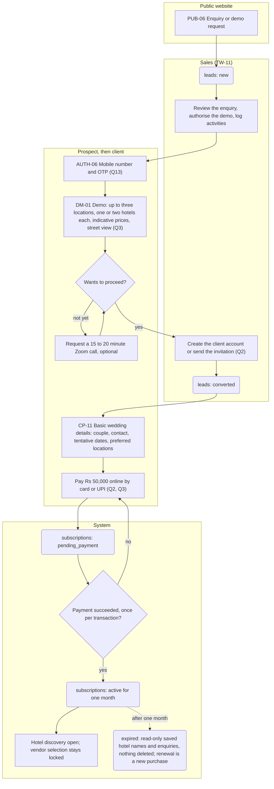

### Flow 7, revised — Invitations and RSVP with links per side

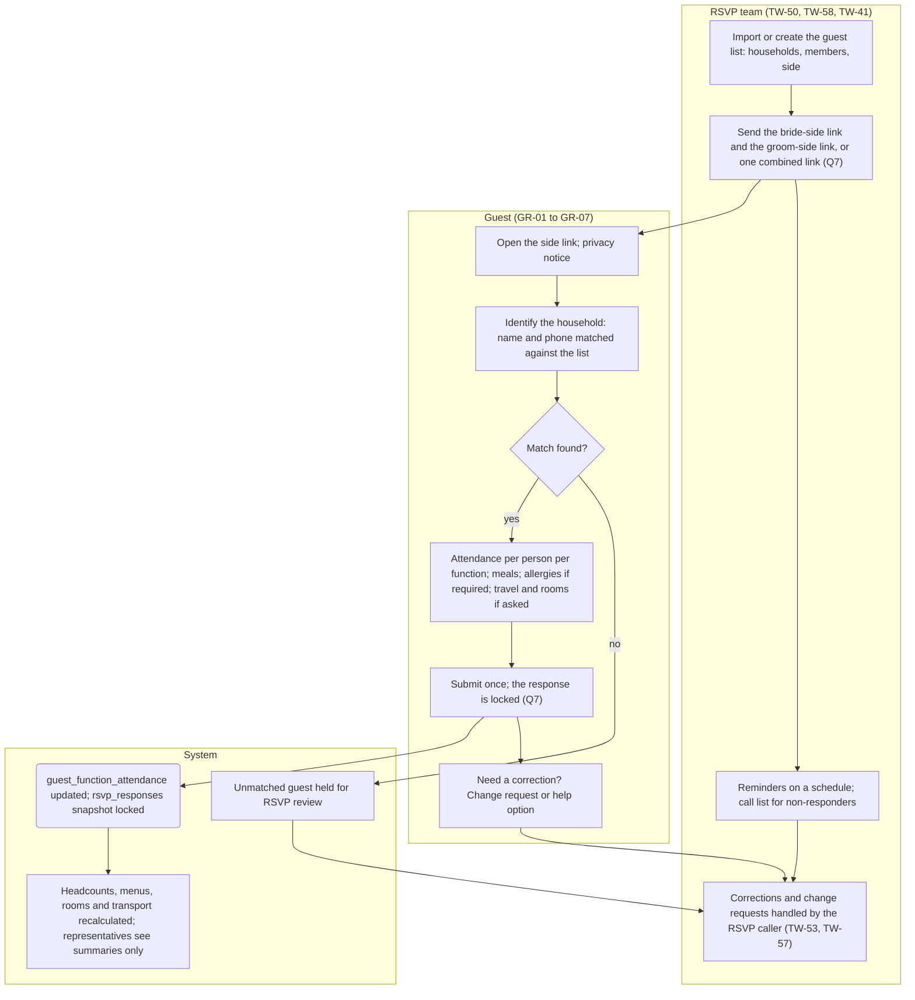

## 1. Conventions

- Rectangles are screens or actions, labelled with the screen ID from wireframes.md where one exists. Diamonds are decisions. Rounded boxes are status changes written as `table: status` and match permission-matrix.md §7. Swimlanes group steps by actor.
- "Notify" steps use the automation rules in permission-matrix.md §8 and the recipient's channel preference (U-10).
- Every flow ends in a state the data model can represent; nothing happens off-system except where a step says so (for example a phone call, which is then recorded).
- Parallelism (BIZ rule 3, SPEC §1.2) is shown in flow 3: once a project exists, flows 4 to 8 run concurrently and independently.

---

## 2. Flow 1 — Lead to demo to subscription (SPEC §14 "subscription") — superseded by the revised Flow 1 in §0a

Actors: public visitor or prospect, Sales (SM), the system. Entry: any public page, an Instagram or referral contact logged by Sales, or a phone call.

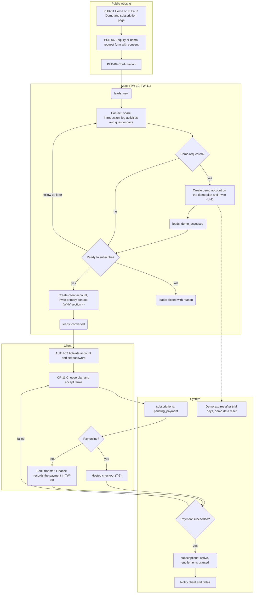

| Statuses moved | Notifications | Exceptions and edge cases | Screens |
|---|---|---|---|
| leads: new → contacted → introduction_shared → demo_offered → demo_accessed → converted or closed; subscriptions: pending_payment → active; client_accounts: prospect → active | Enquiry received (Sales); demo invitation (prospect); account invitation (client); payment confirmation (client, Sales); payment failed (client) | Duplicate lead (same email or phone) is merged by Sales, not auto-merged. A demo that expires without a decision returns the lead to follow_up. A payment that fails leaves the subscription pending_payment with no entitlement (SPEC §8). Trial subscriptions use status trial and skip the payment step until conversion. | PUB-01, PUB-06, PUB-07, PUB-09, TW-10, TW-11, TW-14, AUTH-02, CP-11, TW-80 |

Acceptance mapping: SPEC §12 "public enquiry saves source and owner", "subscription activates hotel discovery without exposing full wedding modules", "demo account cannot access records outside demo scope".

---

## 3. Flow 2 — Hotel discovery and assistance (SPEC §14 "hotel assistance")

Actors: subscriber (CO, CA, CV), Hotel team (HT), Sales (SM) for chargeable services, Finance (FA), the system. Entry: an active or trial subscription.

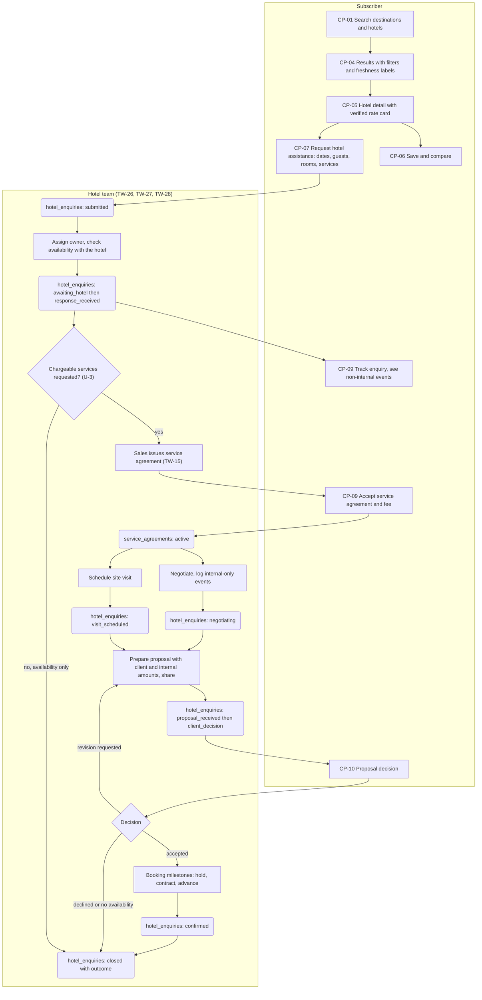

| Statuses moved | Notifications | Exceptions and edge cases | Screens |
|---|---|---|---|
| hotel_enquiries: draft → submitted → awaiting_hotel → response_received → negotiating → visit_scheduled → proposal_received → client_decision → confirmed → closed; service_agreements: draft → sent → accepted → active; hotel_proposals: draft → shared → accepted, revision_requested, declined, superseded; booking_milestones: pending → done | Enquiry submitted (HT queue); assignment (HT owner); response received, visit scheduled, proposal shared (client); agreement sent (client); decision (HT) | Stale rate cards show the stale label and the detail page never says "confirmed" (SPEC §12). Internal-only events, negotiation notes and internal amounts never appear in CP-09 or CP-10 (SPEC §12). An enquiry is never a booking: confirmed requires a done milestone of type confirmed and a signed contract (SPEC §7). A subscriber whose subscription expires mid-enquiry keeps read access to that enquiry (permission-matrix §3). Demo users' requests become Sales lead activities, not enquiries (P-7). | CP-01, CP-02, CP-03, CP-04, CP-05, CP-06, CP-07, CP-08, CP-09, CP-10, TW-26, TW-27, TW-28, TW-15 |

Acceptance mapping: SPEC §12 "hotel search shows freshness of pricing", "AMPM records negotiation and site visit without exposing internal notes".

---

## 4. Flow 3 — Wedding engagement and project creation (SPEC §14 "wedding engagement")

Actors: Sales (SM), Super Admin or Project Manager (PM), client, the system. Entry: a client decides to engage AMPM beyond hotel assistance.

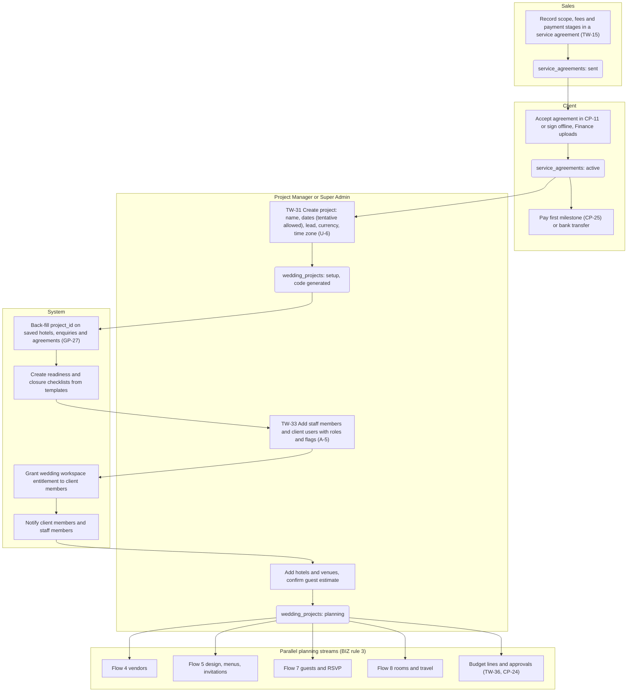

| Statuses moved | Notifications | Exceptions and edge cases | Screens |
|---|---|---|---|
| service_agreements: draft → sent → accepted → active; wedding_projects: setup → planning; payment_milestones: pending → invoiced → paid | Agreement sent and accepted; project created (client members, staff members); milestone invoiced and paid | A project can be created while the first milestone is unpaid; unpaid milestones appear on dashboards (SPEC §8) and the Project Manager decides whether to pause. Only name, account, dates and lead are mandatory (SPEC §5); everything else is captured when relevant (BIZ rule 2). A client with an existing hotel-discovery subscription keeps it; the workspace entitlement is additional (permission-matrix §3). | TW-15, CP-11, CP-25, TW-31, TW-33, TW-32, CP-20 |

Acceptance mapping: SPEC §12 "engaged client receives correct project and permissions".

---

## 5. Flow 4 — Vendor options, proposals and selection

Actors: Vendor Coordinator (VC), Project Manager (PM), client (CO, CA), Finance (FA). Entry: a function or category needs a vendor.

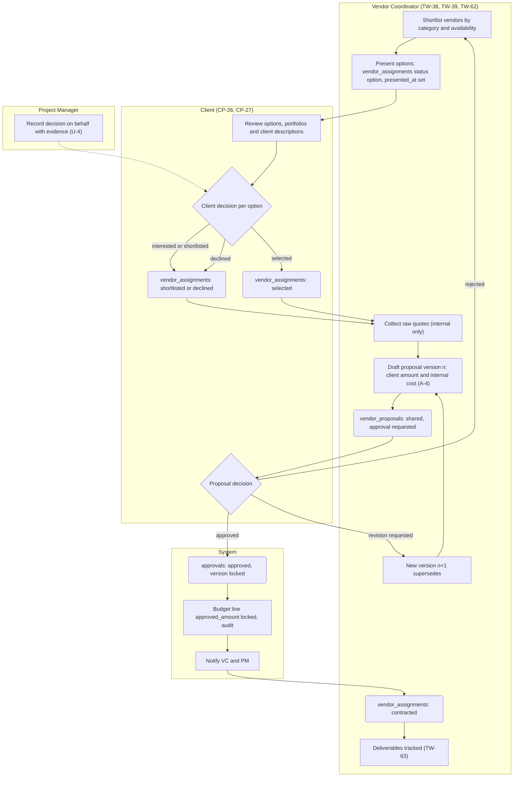

| Statuses moved | Notifications | Exceptions and edge cases | Screens |
|---|---|---|---|
| vendor_assignments: option → shortlisted → selected → contracted → delivering → completed, or declined, cancelled; vendor_proposals: draft → shared → accepted, revision_requested, declined, superseded; approvals: submitted → approved, revision_requested, rejected, superseded; budget_lines: proposed → approved → committed | Options presented (client); proposal shared (approvers); decision (VC, PM); contract signed (FA, PM) | Fewer than five options is allowed and more than ten is not blocked (SPEC §12). A revision never overwrites a shared version (SPEC §12). Vendor contacts, raw quotes, internal cost and ratings never reach the client (permission-matrix §4). Multiple approvers: the approval completes at required_decisions (AM-7). | TW-38, TW-39, TW-60, TW-61, TW-62, TW-63, CP-26, CP-27, CP-24 |

Acceptance mapping: SPEC §12 "vendor shortlist permits fewer than five options", "approval refers to exact proposal version".

---

## 6. Flow 5 — Versioned creative approvals: designs, menus, invitations

Actors: Creative (CD) or Project Manager (PM) as author, client approvers, Vendor Coordinator for menus. Entry: a design brief, a menu draft or an invitation draft.

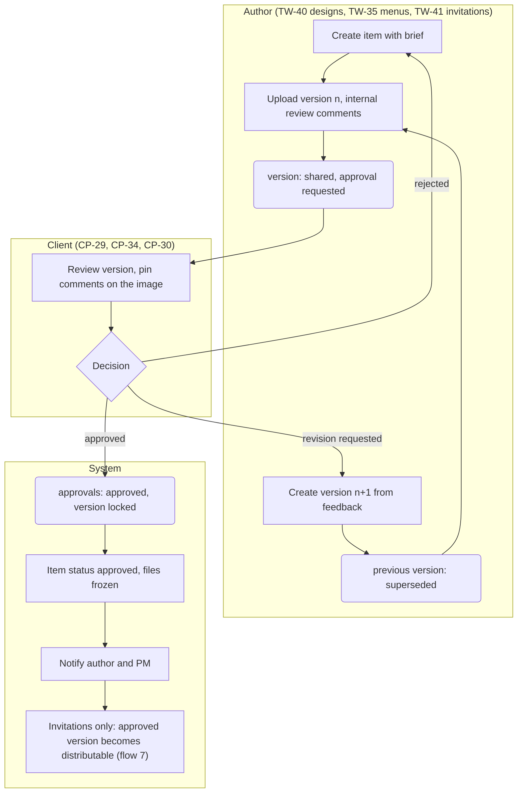

| Statuses moved | Notifications | Exceptions and edge cases | Screens |
|---|---|---|---|
| design_items: briefing → in_progress → review → approved; design_versions, menu_versions, invitation_versions: draft → shared → approved, revision_requested, superseded; approvals as in flow 4 | Version shared (approvers); comment added (author or client, per is_internal); decision (author, PM) | Internal comments are never shown to the client (A-20). Menu approval also freezes the guaranteed headcount sent to the caterer (data-model §14). Approving an invitation version does not send it; distribution is a separate, RSVP-team action (flow 7). | TW-40, TW-35, TW-41, CP-28, CP-29, CP-34, CP-30, CP-35 |

Acceptance mapping: SPEC §12 "approval refers to exact design or menu version; revisions do not overwrite it".

---

## 7. Flow 6 — Client requests: questions, change requests, support

Actors: client (CO, CA, CV), assigned staff, Project Manager (PM), the system. Entry: the client wants to ask, change or complain (U-12).

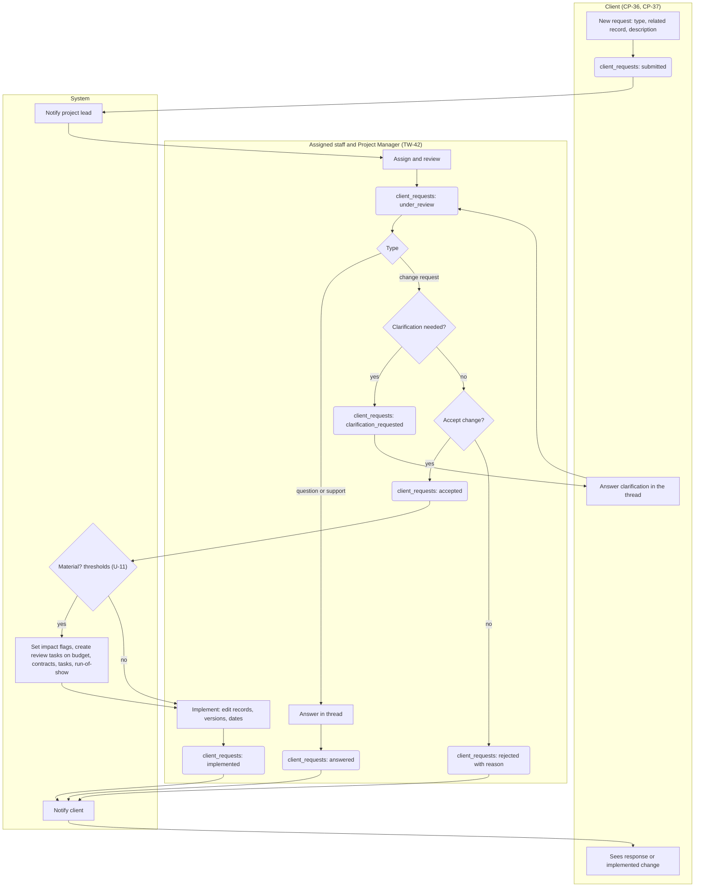

| Statuses moved | Notifications | Exceptions and edge cases | Screens |
|---|---|---|---|
| client_requests: submitted → under_review → clarification_requested → answered, accepted, rejected → implemented, or withdrawn | Request submitted (project lead); assigned (assignee); clarification (client); response (client); material flags (owners of affected records) | A Viewer may submit questions only (permission-matrix §6). Change requests that alter an approved version lead to a new version and a new approval (flow 5). Requests after project closure are support type only. The client can withdraw at any time before implementation. | CP-36, CP-37, TW-42, TW-32 |

---

## 8. Flow 7 — Invitations and RSVP (SPEC §14 "RSVP") — superseded by the revised Flow 7 in §0a

Actors: Client Owner (CO), RSVP team (RG), guests (GU), the system. Entry: an approved invitation version and a guest list.

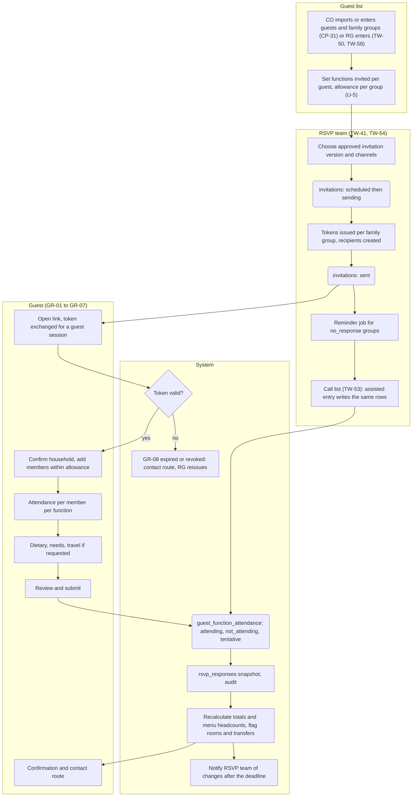

| Statuses moved | Notifications | Exceptions and edge cases | Screens |
|---|---|---|---|
| invitations: approved → scheduled → sending → sent → closed; invitation_recipients: pending → sent → delivered, opened, failed, bounced; rsvp_tokens: active → expired, revoked; guest_function_attendance: no_response → attending, not_attending, tentative; guests: draft → invited → confirmed | Invitation and reminders (guests by channel); delivery failures (RG); attendance changes after deadline (RG, HL); headcount changes (PM, VC for the caterer) | Self-service and assisted responses write the same rows, so no duplicates arise (SPEC §12). A guest can edit until the token expires; later changes go through the RSVP team. Identity documents are requested in GR-05 only when the project enables them (A-8). A group cannot see other groups or counts (P-4). Delivery failures create follow-up tasks. | CP-31, CP-32, CP-33, TW-41, TW-50, TW-52, TW-53, TW-54, TW-58, GR-01 to GR-09 |

Acceptance mapping: SPEC §12 "self-service and AMPM-assisted RSVP update the same guest database without duplicates", "attendance changes update totals and flag downstream planning impacts".

---

## 9. Flow 8 — Rooms, travel and transport

Actors: Hotel team (HT), Hospitality (HL), RSVP team (RG), guests. Entry: a hotel contract with a room block, and confirmed attendance.

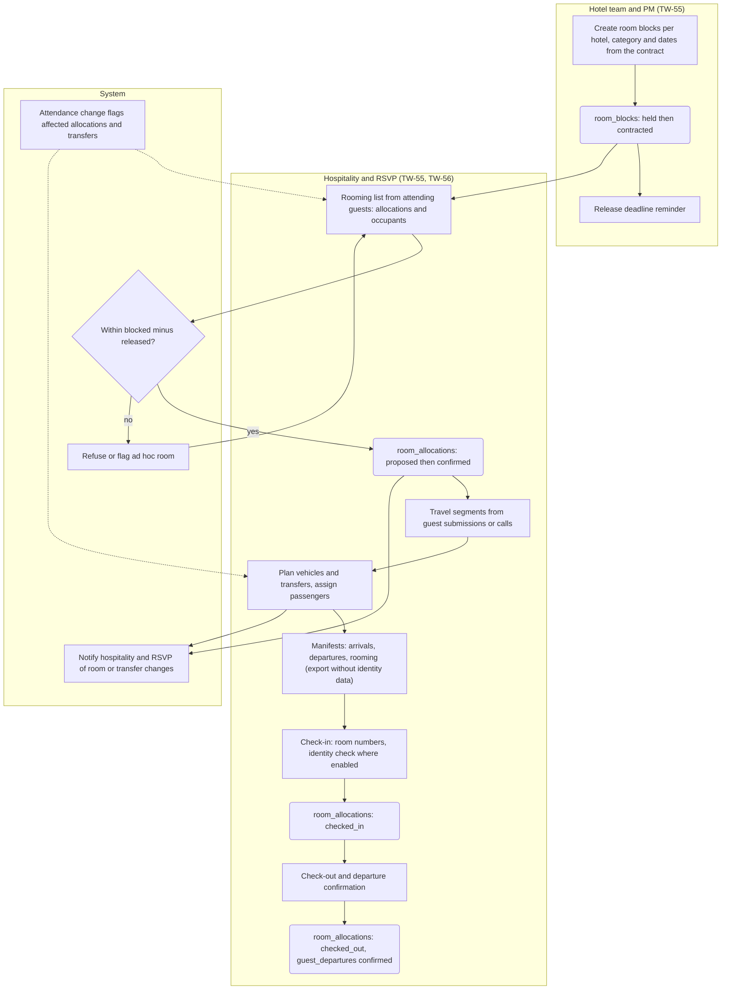

| Statuses moved | Notifications | Exceptions and edge cases | Screens |
|---|---|---|---|
| room_blocks: requested → held → contracted → partially_released → released → closed; room_allocations: requested → proposed → confirmed → checked_in → checked_out, or cancelled; travel_segments: planned → confirmed → arrived, delayed, cancelled; transfers: planned → assigned → en_route → completed | Allocation confirmed (guest, optional); room or transfer changes (HL, RG); release deadline (HT, PM); flight delays (HL) | Allocations without a block are allowed but flagged (data-model §13). Occupants never exceed the category occupancy. The hotel rooming list export carries names, dates and category only and is audited (permission-matrix §5.16). Identity documents are viewed at check-in only by staff with the explicit grant (P-5). | TW-55, TW-56, TW-57, GR-05, CP-32 |

---

## 10. Flow 9 — Live execution (SPEC §14 "execution")

Actors: Project Manager (PM), Hospitality (HL), Vendor Coordinator (VC), on-site staff, the system. Entry: a function in pre-production.

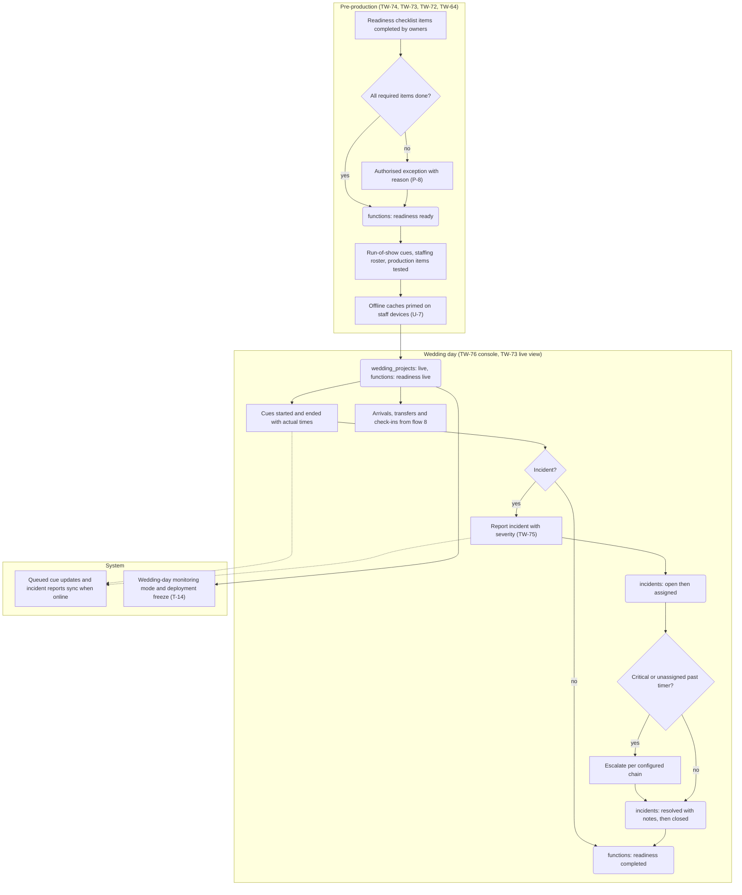

| Statuses moved | Notifications | Exceptions and edge cases | Screens |
|---|---|---|---|
| functions: readiness not_started → in_progress → blocked → ready → live → completed; wedding_projects: ready → live; run_of_show_items: pending → in_progress → done, skipped; incidents: open → assigned → in_progress → escalated → resolved → closed; staff_assignments: planned → confirmed → on_duty → off_duty | Readiness blocked (PM); exception authorised (SA); incident assigned and escalated (assignee, escalation chain); critical incident (project lead, SA) | A function cannot go live with a required item open unless an exception is recorded by an authorised user (SPEC §12). A critical incident cannot be resolved without resolution notes (SPEC §7). Offline conflicts: server wins on status transitions, notes merge last-writer-wins with a conflict log (T-11). Deploys are frozen while any project is live (T-14). | TW-72, TW-73, TW-74, TW-75, TW-76, TW-64, TW-35 |

Acceptance mapping: SPEC §12 "production readiness cannot be completed without required checks or an authorised exception", "incidents can be assigned, escalated and closed with resolution notes".

---

## 11. Flow 10 — Closure

Actors: Project Manager (PM), Hospitality (HL), Vendor Coordinator (VC), Finance (FA), client, the system. Entry: the last function is completed.

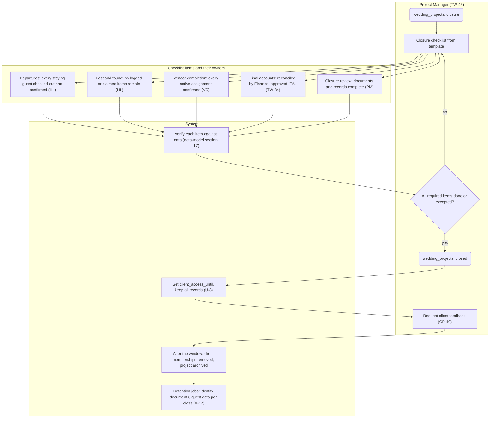

| Statuses moved | Notifications | Exceptions and edge cases | Screens |
|---|---|---|---|
| wedding_projects: live → closure → closed; checklists: in_progress → complete, complete_with_exception; project_final_accounts: draft → reconciled → approved → closed; project_members (client): active → removed after the window | Closure started (owners of items); final accounts approved (PM); project closed (client members, with the access window date); feedback request (client); access ending reminder (client) | Closing with an exception requires an authorised user and a reason (SPEC §7). Reopening a closed project is Super Admin only and audited (permission-matrix §7). Records are never deleted at closure (WHY §4); only retention jobs delete, per class. | TW-45, TW-84, TW-55, TW-63, CP-40, CP-41 |

Acceptance mapping: SPEC §12 "closure checks departure, lost-and-found, vendor completion and financial reconciliation".

---

## 12. Flow 11 — Sign-in, activation, recovery and guest access (cross-cutting)

Actors: staff, clients, demo prospects, guests. Entry: any protected screen (U-9).

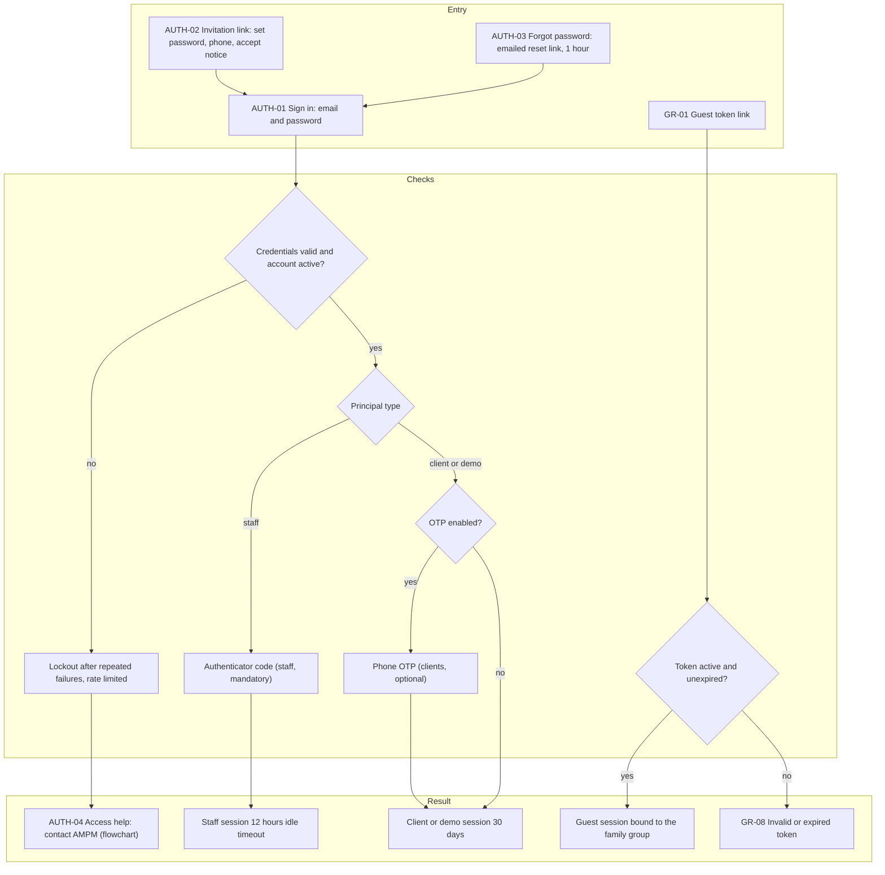

| Statuses moved | Notifications | Exceptions and edge cases | Screens |
|---|---|---|---|
| users: invited → active, locked; auth_tokens: used; rsvp_tokens: active → expired, revoked | Invitation, reset link, OTP code, new-device sign-in notice | No public self-registration anywhere (WHY §4). A disabled or removed membership ends the session at the next request. A demo account past its trial end is refused with an explanation and a Sales contact. Guests never see a password screen. | AUTH-01 to AUTH-05, GR-01, GR-08 |

---

## 13. Flow 12 — Entitlement changes: expiry, suspension, closure window

A table rather than a diagram, because the flow is driven by jobs (permission-matrix §8) and the states are in permission-matrix §3.

| Trigger | What the system does | What the client sees | Notifications |
|---|---|---|---|
| ends_at minus notice period | subscriptions: active → expiring | Banner in CP-01 and CP-11 with renewal action | Client, Sales |
| ends_at reached | subscriptions: expiring → expired; subscription modules removed; saved hotel names kept, profiles hidden | CP-01 shows saved hotel names and a renew prompt; CP-04 and CP-05 unavailable; existing enquiries readable | Client, Sales |
| Finance suspends for non-payment | subscriptions: → suspended | As expired, plus a payment prompt | Client, Sales, FA |
| Cancellation accepted | subscriptions: → cancelled | As expired; records kept | Client, Sales |
| Project closed | client_access_until set | Read-only banner (CP-41) with the date | Client members |
| Window ends | client memberships → removed; project archived | Sign-in succeeds, portal shows no projects and a contact route | Client members (reminder before) |
| Account suspended | client_accounts: → suspended | Sign-in refused with contact route | Primary contact, Sales |

Nothing in this table deletes data (WHY §4, GP-1).

---

## 14. Coverage of the specification's flows and the flowcharts

| Required by | Covered in |
|---|---|
| SPEC §14 subscription | Flow 1, Flow 12 |
| SPEC §14 hotel assistance | Flow 2 |
| SPEC §14 wedding engagement | Flow 3 |
| SPEC §14 RSVP | Flow 7 |
| SPEC §14 execution | Flow 9 |
| SPEC §1.2 journey steps 1 to 10 | Flows 1, 2, 3, 4, 7, 8, 9, 10 in order |
| SPEC §2.5 guest RSVP flow | Flow 7 guest lane |
| WHY §1 stages 1 to 5 | Flow 1 (stages 1 to 3), Flow 3 (stages 4 and 5) |
| TEAM-FLOW main path (qualified client → wedding record → planning → live → closure) | Flows 3, 4 to 8, 9, 10, with the subscription and consultancy branches the flowchart omitted (CF-4) in Flows 1 and 2 |
| PORTAL-FLOW (sign in → home → action → approval required? → AMPM reviews → updated) | Flows 11, 4, 5, 6 |

---

## 15. Open questions raised by the flows

1. **Where the subscription is purchased** (U-2, Q2): inside the portal after invitation, as drawn, or on the public site with account creation on payment, which WHY §4 forbids.
2. **Which hotel services are chargeable** (U-3, Q4): the agreement branch in Flow 2 moves depending on the answer.
3. **When a project is created** (U-6, Q10): on an accepted broader-services agreement, as drawn, or earlier.
4. **Reminder cadence and the RSVP deadline rule** (U-5, Q7): how many reminders, on which channels, and whether guests may edit after the deadline.
5. **Who may authorise readiness exceptions** (P-8, Q10).
6. **Feedback and access window** (U-8, Q23, Q24).
