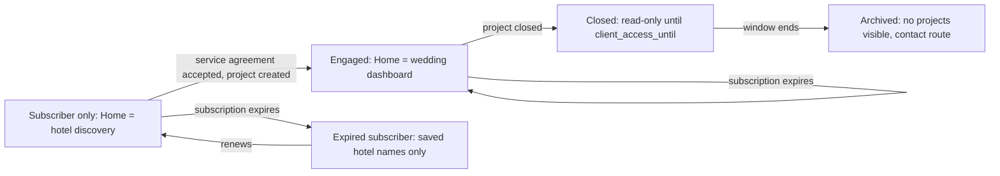

# AMPM Platform — Wireframe Specifications

**Status:** DRAFT v0.2, 25 October 2026. AMPM's decisions of 25 October applied where they change a screen (§0a) and stamped on every assumption in §0. BIZ §6 requires that "the exact screen structure should be reviewed and approved by AMPM before development begins"; this document is the proposal for that review.
**Companions:** [requirements-audit.md](requirements-audit.md) (Q numbers), [data-model.md](data-model.md) (tables, A-1 to A-30), [permission-matrix.md](permission-matrix.md) (role codes, visibility classes, P-1 to P-11), [field-matrix.md](field-matrix.md) (field-level rules), [user-flows.md](user-flows.md) (flows that connect the screens, U-1 to U-12), [architecture.md](architecture.md) (T-1 to T-14).
**Source of truth being extended:** SPEC §14 ("screen-by-screen wireframes for website, client portal, AMPM workspace and guest RSVP portal"), SPEC §2 (screen map and user flows), BIZ §6 (main screens required), BIZ §8 item 3 ("simple wireframes showing the proposed screens"), and the two Level-1 flowcharts, reconciled per the audit's §9.

This is a wireframe *specification*: for every screen it fixes purpose, audience, layout regions, content, actions, states and rules, and sketches the key screens in low fidelity. Visual design (colour, type, spacing, imagery) is explicitly outside it; SPEC's purpose statement leaves "final visual design" to AMPM.

---

## 0. Assumptions register

| ID | Audit ref | Assumption adopted in this draft | If AMPM decides otherwise |
|---|---|---|---|
| W-1 | CF-2, Q10 | The client portal has five navigation entries: Home, Hotels, My Wedding, Approvals, More. A subscriber-only account sees My Wedding and Approvals as locked entries with a one-line explanation; an engaged account sees them live. The client-portal flowchart's four tabs omitted Hotels, the Phase 1 product. **AMPM (2026-10-25): Partly decided. Hotels entry confirmed; vendor selection stays locked until appointment; the home page gains help and live chat; the initial structure is acceptable for the first release.** | Hiding the locked entries entirely is a one-line change; dropping Hotels is not possible while hotel discovery is the subscription product. |
| W-2 | CF-3, AM-6 | The team workspace uses a left rail with the nine areas of SPEC §2.4 on desktop and tablet, and the team flowchart's five bottom tabs (Home, Clients, Weddings, Tasks, More) on mobile, with Hotels, Guests, Vendors, Finance and Settings under More. The flowchart's "Database" is the Hotels area. A rail entry appears only if the user's roles grant any permission in that area. **AMPM (2026-10-25): Confirmed. Department managers on phones see only their own sections.** | A different grouping changes labels and order only. |
| W-3 | Q1, A-1, T-12 | Responsive web: three layouts at 1200 px and above (rail, content, optional side panel), 768 to 1199 px (collapsible rail, single content column), below 768 px (bottom tabs, stacked cards, full-width sheets). Touch targets 44 px minimum. WCAG 2.1 AA for the client and guest portals, AA intent for the team workspace. **AMPM (2026-10-26): Changed. Native apps for client and team with phone and tablet layouts; the client portals also in the browser; responsive web for the public site.** | Native apps would reuse the mobile layouts as their information architecture. |
| W-4 | Q12, A-12 | Public pages are rendered statically from the content tables; editors change copy and showcase items in TW-97, not in code. **AMPM (2026-10-25): Dropped. No website editor.** | A headless CMS changes the editor, not the pages. |
| W-5 | Q4, P-3 | Finance regions render only when the principal's response model contains the fields. A Viewer without `can_view_finance` sees no budget region and no placeholder for it. **AMPM (2026-10-25): Changed. No finance flag; the two representatives have equal rights; what finance the portal shows is to be confirmed.** | None structural. |
| W-6 | Q7, A-7, T-8 | The guest portal is a mobile-first single-column wizard with no sign-in, a language switch, and a consent notice on the first step. It never shows other households or counts. **AMPM (2026-10-25): Partly decided. Per-side links with self-identification; no editing after submission; wizard otherwise stands.** | A single open wedding link would add a "find your invitation" step before GR-02. |
| W-7 | Q13, A-13, U-9 | Sign-in screens follow A-13: email and password, authenticator code for staff, optional phone OTP for clients, invitation and reset links. There is no registration screen anywhere. **AMPM (2026-10-25): Changed. OTP sign-in screens for prospects and clients.** | Phone-OTP-only changes AUTH-01 only. |
| W-8 | Q20, A-20, U-12 | The client-portal flowchart's "Messages, questions" is delivered as Requests (CP-36, CP-37): typed requests with a threaded conversation, not chat. **AMPM (2026-10-25): Changed. Live chat screen added; tracked requests stay.** | Real-time chat would add a conversation screen. |
| W-9 | Q8, A-8, P-5 | Identity-document upload appears in GR-05 only when the project enables identity capture; staff see a masked reference and an audited "view document" action only with the explicit grant. **AMPM (2026-10-25): Partly decided. No automatic deletion; retention per policy.** | None structural. |
| W-10 | GP-34, T-11 | TW-73 (run-of-show live view), TW-74 (readiness) and TW-76 (event-day console) are offline-capable in Phase 4 and show a sync indicator. **AMPM (2026-10-25): Changed. Offline screens at launch and extended to tasks, department information and arrival lists.** | Without offline support the indicator is removed. |
| W-11 | Q15, A-15 | List screens paginate at 50 rows with server-side filters and sorting; guest and vendor lists have bulk actions (SPEC §10). **AMPM (2026-10-25): Not addressed, stands. Not addressed; stands.** | Page size is configuration. |
| W-12 | CF-8 | Flowchart vocabulary mapped: "Questionnaire" and "Consultation" are lead activity types on TW-11; "Countdown" appears on CP-20 only when the project has dates; "Feedback" is CP-40; "Archive" is the closed state CP-41 and TW-45; "Schedule, calendar" is TW-02. **AMPM (2026-10-25): Not addressed, stands. Not addressed; stands.** | None. |
| W-13 | Q17, A-17 | Consent copy on PUB-06 and GR-01 and the privacy notice (PUB-08) are configurable text approved by AMPM. **AMPM (2026-10-25): Confirmed. AMPM decides the wording.** | None. |
| W-14 | Q4 | Booking-milestone amounts on CP-09 are shown only where the client pays the hotel directly, mirroring the data model's note on `booking_milestones.amount`. **AMPM (2026-10-25): Still open. Not addressed.** | Hide or show all. |
| W-15 | Q2, Q3, U-2 | Plan selection and payment happen on CP-11 after activation; PUB-07 explains plans and collects a request only. **AMPM (2026-10-25): Confirmed. Purchase after activation, with the basic wedding details form first.** | Anonymous checkout contradicts WHY §4 and is not specified. |

---

## 0a. Changes from AMPM's decisions (25 October 2026)

| Decision | Screens affected |
|---|---|
| Q1 native iOS and Android apps | Every CP and TW screen is an app screen; the layouts and regions stand (W-3 changed). The public website and the guest pages stay on the web. Offline indicators extend to TW-70 tasks and the TW-56 arrival lists as well as TW-73, TW-74 and TW-76. |
| Q13 mobile number and OTP for prospects and clients | New AUTH-06 below. AUTH-01 (email, password, authenticator code) is for staff only; AUTH-02 activation ends in OTP sign-in; AUTH-03 password reset applies to staff only. |
| Q3 demo after OTP, up to three locations, one or two hotels each, indicative prices, street view, optional Zoom call | DM-01 gains the location and hotel limits from configuration, a street view panel on CP-05 in demo state, a "Request a Zoom call" action that creates a lead activity, and an expiry date. Prices show as indicative ranges, not masked. |
| Q2 basic wedding details before payment, card or UPI only | CP-11 gains a first step, "Your wedding": couple's names, contact, tentative dates, preferred locations; the bank-transfer path is removed from the client side. |
| Q5 two family representatives with equal rights | CP-21 shows the two representatives with their side; the "request access for a family member" action is removed; CP-35 approvals may be made by either representative; no finance flag on CP-20 or CP-24 (contents to confirm, Q4). |
| Q7 representatives see summaries, cannot edit the list; guests cannot edit after submission | CP-31, CP-32 and CP-33 become read-only summaries with an "Ask the RSVP team" action; add, import and edit are removed from the client side (import stays on TW-58). GR-01 becomes the side link with household identification; GR-02 no longer adds members unless the household has an allowance; GR-07 loses "Update your response" and gains "Request a correction" (GR-09, type correction). |
| Q20 live chat | New CP-42 and TW-98 below; the client home (CP-01 and CP-20) gains a chat entry. |
| Q4 milestone payments not online in the first release; client-facing finance to confirm | CP-25 loses "Pay online" and shows bank-transfer instructions; CP-24 marked "contents to confirm". |
| Q12 no website editing | TW-97 is dropped. |
| Q10 only Eva's authorised personnel approve exceptions | TW-74 and TW-45: "Authorise exception" is a Super Admin action; the Project Manager sees "Request exception". |
| Q9 indicative ranges, package ranges, menu grid, street view; availability from the selection | CP-05 Rates tab shows ranges with the verified date and a package range; a Menus tab shows the food grid; a street view panel on Overview; CP-06 is titled "My selection" and offers "Check availability" per hotel, which creates an enquiry. |
| Q8, Q17 no automatic deletion | TW-51 identity panel shows "retained until AMPM approves deletion"; TW-95 gains a "Retention proposals" tab where the Super Admin approves deletions proposed by the retention job. |
| Q23 three months, archive on approval | CP-41 names three months; TW-45 gains "Archive" as a Super Admin approval after the window. |

### AUTH-06 Mobile OTP sign-in (prospects and clients)
**Purpose.** Sign in with a mobile number and a one-time code, as AMPM decided for prospects, demo users and clients (Q13).
**Who.** DP, CR. **Entry.** App launch, invitation link, demo authorisation. **Template.** T3 single form.
**Regions.** Mobile number with country code (default +91); Send code; six-digit code entry with resend after a countdown; "Remember this device"; consent to the privacy notice on first sign-in; "Need help? Contact AMPM" (AUTH-04).
**Fields.** `users.phone`, `auth_tokens` purpose otp (10-minute expiry, single use), `users.user_type` demo or client.
**Actions.** Send code; verify; resend (rate limited).
**States.** Number not known to AMPM: a neutral message that AMPM will be in touch, and a lead activity if the number matches a lead; wrong code; expired code; too many attempts (lockout with contact route).
**Rules.** No registration: a number that AMPM has not invited or authorised for a demo never gets in. Codes go by SMS with WhatsApp fallback (T-6 changed).
**Phase and references.** 1 · P-6 changed, T-6 changed (Q13).

### CP-42 Live chat
**Purpose.** Immediate help from AMPM, distinct from tracked requests (Q20).
**Who.** CR; DP (routed to Sales). **Entry.** Chat entry on CP-01 and CP-20; "Need help" on any screen. **Template.** T7 conversation.
**Regions.** Conversation list (subject, status, last message, unread count); thread (messages, attachments, read receipts, typing indicator); composer; "Turn this into a request" on any message (creates a `client_requests` row and links it); "Close conversation".
**Fields.** `conversations`, `messages`, `documents` for attachments.
**Actions.** Send; attach a document with client visibility; turn into a request; close.
**States.** No staff online: the composer says replies come by the preferred channel and shows the expected time; closed conversation reopens with a new message.
**Rules.** A conversation never carries an approval or a budget figure; anything formal becomes a request. Conversations are scoped to the account and, where one exists, the wedding; another account's conversation is not found.
**Phase and references.** 1 · A-20 changed, data-model §18a (Q20).

### TW-98 Chat console
**Purpose.** Staff side of live chat (Q20).
**Who.** SA, SM, HT, PM (a), RG (a), HL (a); CD, VC and FA read. **Entry.** Home dashboard "Open conversations" card; notification. **Template.** T1 list with a T7 thread panel.
**Regions.** Queue (account, wedding, subject, waiting time, assignee, status); thread; composer with canned replies; assign; "Turn into a request" (choose type, pre-fills the message); close; the client's recent requests and enquiries in the side panel for context.
**Fields.** `conversations`, `messages`, `client_requests`.
**Actions.** Reply; assign; convert; close.
**States.** Unassigned conversation older than the configured minutes is highlighted and notified to the department lead.
**Rules.** Internal notes about a conversation go in `comments` with `is_internal`, never in the thread.
**Phase and references.** 1 · (Q20).

## 1. Conventions

### Screen identifiers

| Prefix | Experience | Phase |
|---|---|---|
| PUB | Public website | 1 |
| AUTH | Sign-in, activation, recovery (shared by clients, staff and demo) | 1 |
| DM | Demo mode | 1 |
| CP | Client portal: CP-01 to CP-11 hotel discovery (Phase 1), CP-20 to CP-41 engaged wedding (Phases 2 to 4) | 1 to 4 |
| TW | Team workspace, numbered by area: 0x Home, 1x Leads and Clients, 2x Hotels, 3x Weddings, 5x Guests, 6x Vendors, 7x Tasks and Operations, 8x Finance and Reports, 9x Settings | 1 to 4 |
| GR | Guest RSVP portal (GR, not GP, to avoid clashing with the audit's gap identifiers) | 3 |

### What every screen specification contains

**Purpose**, **Who** (role codes from permission-matrix §2), **Entry** (how the user arrives), **Template** (from §3), **Regions** (layout), **Fields** (tables and fields from the data model and field matrix), **Actions** (with the permission that enables each), **States** (empty, loading, error, forbidden, and screen-specific states), **Rules** (what must never appear), **Phase and references** (assumptions and Q numbers).

### Rules that apply to every screen

- **Forbidden equals absent.** A record the principal cannot see renders as "not found", never as "no permission" (architecture §6). Finance, restricted and sensitive regions are omitted, not greyed out (W-5).
- **Status chips** use the status lists in permission-matrix §7 and the configurable labels in `configurations`. Every chip has a text label, never colour alone.
- **Freshness label** on any hotel commercial value: "Verified on <date> by AMPM", "Stale, last checked <date>", or "Rates on request" (SPEC §8, §12). Stale and unverified values never use the word "confirmed".
- **Money** renders with the currency and two decimals; internal cost and margin appear only on screens that list the FA, SA, PM (a), VC or HT reader for that field (permission-matrix §4), always in a visually distinct "Internal" column or panel.
- **Versions** render as a vertical timeline; the shared and approved versions are read-only; "New version" is the only edit path after sharing (SPEC §12).
- **Approval panel** (shared component): record name and version, requester, required decisions, decisions so far, Approve, Request revision, Reject, each requiring a comment where the field matrix says so; an "Recorded on behalf" badge when applicable (P-9).
- **Comment thread** (shared component): chronological, with an "Internal" toggle for staff that defaults on for staff-to-staff threads; internal comments carry an "Internal" badge and never render for clients.
- **File card**: title, type, version, uploaded by, visibility badge (Internal, Client, Guest, Public); download produces a 15-minute signed link (architecture §6).
- **Loading, empty, error.** Lists show skeleton rows; empty states explain what creates the first row and offer the primary action if permitted; errors keep user input and name the field (SPEC §10 "clear errors, duplicate-submission prevention and safe form recovery"). Every form guards against double submission and recovers a draft after a refresh.
- **Audit visibility.** Record screens for staff show "Last changed by <name> on <date>" and, for SA and PM (a), a History link to the audit log (TW-96) filtered to that record.
- **Responsive behaviour** follows W-3: the same screen specification applies at every width; regions stack in the order listed, side panels move below the content, tables become cards below 768 px, and bottom tabs replace the rail.
- **Time.** All times are shown in the project's time zone with the zone named once per screen.

### Low-fidelity sketches

Sketches are text boxes in fixed-width blocks. They fix the arrangement of regions and the primary action, not sizes, colours or copy. A region in square brackets is a control; a region in angle brackets is a component defined above.

---

## 2. Information architecture and navigation

### Public website

Top navigation: Home, How it works, Destinations, Services, About, Contact. Persistent call to action: "Request a demo". Footer: privacy notice, terms, contact, Instagram. No sign-in link in the main navigation; a small "Client sign-in" link sits in the footer and header utility area so the website does not read as an app (WHY §1).

### Client portal (W-1)

| Entry | Subscriber-only account | Engaged account (project member) | Closed project (within access window) |
|---|---|---|---|
| Home | CP-01 subscriber home | CP-20 wedding dashboard (CP-01 reachable under Hotels) | CP-20 read-only with banner (CP-41) |
| Hotels | CP-02 to CP-10 | Same; full search only with an active subscription or package (permission-matrix §3) | Read-only |
| My Wedding | Locked entry with explanation | CP-21 to CP-34 | Read-only |
| Approvals | Locked entry | CP-35 | Read-only history |
| More | CP-11 subscription, CP-36 requests, CP-38 documents, CP-39 notifications, profile, sign out | Same plus CP-40 feedback after closure | Same, requests limited to support |



### Team workspace (W-2)

Desktop and tablet left rail, in SPEC §2.4 order: Home · Leads and Clients · Hotels · Weddings · Guests · Vendors · Tasks and Operations · Finance and Reports · Settings. A global search box (hotels, clients, projects, vendors, guests within assigned projects) and a notifications bell sit in the header. A project switcher appears in the header whenever the user is inside a wedding.

Mobile bottom tabs: Home · Clients · Weddings · Tasks · More (Hotels, Guests, Vendors, Finance, Settings).

### Guest portal (W-6)

No navigation. A seven-step wizard with a progress indicator (GR-01 to GR-07) and two utility links on every step: "Need help?" (GR-09) and the privacy notice.

### Demo mode

Demo users enter the client portal with a persistent "Demo" banner naming the expiry date and a "Talk to AMPM" action (DM-01). Navigation is W-1 with My Wedding pointing at the sample project.

---

## 3. Shared templates

| Template | Layout | Used by |
|---|---|---|
| T1 List and filter | Header with title, count and primary action; filter bar (saved filters, status chips, search); data table or card grid; pagination at 50 (W-11); bulk-action bar when rows are selected; side panel preview on desktop | Pipelines, hotel lists, guests, vendors, tasks, documents, reports |
| T2 Record detail with tabs | Header (name, status chip, key facts, primary actions, overflow menu); tab strip; tab content; right side panel for timeline, comments or related records on desktop (stacks below on mobile) | Lead, account, hotel, project, function, vendor, enquiry, family group |
| T3 Form or wizard | Single column, grouped sections, inline validation, sticky footer with Save or Next and Cancel; wizards show a step indicator; drafts autosave | Enquiry form, assistance request, project creation, imports, guest portal |
| T4 Board | Columns per status with cards; drag to transition only where the transition table allows; list toggle | Lead pipeline, tasks, vendor options, attendance board |
| T5 Approval detail | Record header with version timeline on the left; preview or line items centre; approval panel and comment thread on the right | Proposals, designs, menus, invitations, budget approvals |
| T6 Dashboard | Grid of cards: counters with links, lists of the next things to do, alerts; cards appear only when the role has the underlying permission | Team home, project dashboard, client dashboard |
| T7 Thread and timeline | Chronological events and comments with filters (all, internal, client-visible); composer at the bottom | Enquiry detail, request detail, incident |
| T8 Live console | Full-width, high-contrast, large touch targets, current-time indicator, sync status; minimal chrome | Run-of-show live view, event-day console, readiness board |

---

## 4. Public website screens

### PUB-01 Home
**Purpose.** Position AMPM, show the three service stages, convert visitors to enquiries or demo requests (SPEC §2.1).
**Who.** Anyone.
**Entry.** Direct, search, Instagram.
**Template.** Static page from `cms_pages` slug `home` (W-4).
**Regions.** Hero with positioning statement and two calls to action (Request a demo, Explore destinations); "How it works" strip with the three stages (discovery, hotel assistance, full management) each linking to PUB-02; selected work carousel from published `cms_showcase_items`; destinations grid from `destinations` with `public_visible`; testimonials (feedback rows with `consent_to_publish`, names withheld by default); enquiry call to action; footer.
**Fields.** `cms_pages.sections_json`, `cms_showcase_items`, `destinations` public fields, `media_assets` with `visibility = public`.
**Actions.** Request a demo (PUB-06 with demo preselected); Explore destinations (PUB-04); Client sign-in (AUTH-01).
**States.** No showcase items published: the carousel is omitted. No published destinations: the grid is omitted.
**Rules.** No hotel names, prices or private data (BIZ §2.A); only media with public rights (GP-20).
**Phase and references.** 1 · W-4, A-12 (Q12).

```text
+----------------------------------------------------------------------+
| AMPM   How it works  Destinations  Services  About  Contact  [Demo]  |
+----------------------------------------------------------------------+
|                                                                      |
|   Weddings, planned end to end.                 [Request a demo]     |
|   <positioning statement>                       [Explore destinations]|
|                                                                      |
+----------------------------------------------------------------------+
|  1 Discover hotels   |  2 Hotel assistance   |  3 Complete management |
|  <short copy>        |  <short copy>         |  <short copy>          |
+----------------------------------------------------------------------+
|  Selected work   < [showcase] [showcase] [showcase] >                 |
+----------------------------------------------------------------------+
|  Destinations  [Jaipur] [Udaipur] [Goa] [Jodhpur] ...                 |
+----------------------------------------------------------------------+
|  Footer: Privacy . Terms . Contact . Instagram . Client sign-in       |
+----------------------------------------------------------------------+
```

### PUB-02 How it works
**Purpose.** Explain hotel discovery, optional consultancy and complete management as separate stages (SPEC §2.1, the "critical rule").
**Who.** Anyone. **Entry.** Navigation, PUB-01 strip. **Template.** Static page.
**Regions.** Three numbered sections, each: what you get, what it costs (copy only, "see plans" linking to PUB-07), what AMPM does; a comparison table of the three stages; call to action.
**Fields.** `cms_pages` slug `how_it_works`.
**Actions.** See plans (PUB-07); Request a demo (PUB-06).
**States.** None beyond static.
**Rules.** No prices in code; fee copy comes from the CMS and is approved by AMPM (BIZ rule 8).
**Phase and references.** 1 · W-4.

### PUB-03 Services
**Purpose.** List hotel assistance, design, vendor coordination and full management (SPEC §2.1 Services).
**Who.** Anyone. **Template.** Static page.
**Regions.** One section per service with inclusions; "Which service is right for me" link to PUB-02; enquiry call to action.
**Fields.** `cms_pages` slug `services`; `service_types` names may be listed from configuration.
**Actions.** Enquire about a service (PUB-06 with the service preselected).
**Phase and references.** 1.

### PUB-04 Destinations and selected work
**Purpose.** Build confidence with approved public examples without exposing the private database (SPEC §2.1).
**Who.** Anyone. **Template.** T1 card grid (public variant, no filters beyond destination).
**Regions.** Destination cards (name, region, hero image, count of weddings hosted as copy); clicking opens a destination page with the showcase items tagged to it and the hotels flagged `public_showcase` shown as name and hero image only.
**Fields.** `destinations` with `public_visible`; `cms_showcase_items` published; `hotels` with `public_showcase`: name, destination, hero media only (permission-matrix §4 PUBLIC).
**Actions.** Explore this destination with AMPM (PUB-06 with destination preselected).
**States.** Destination without showcase items shows its description only.
**Rules.** No rates, rooms, venues, contacts or verification data; no hotel detail page on the public site.
**Phase and references.** 1 · GP-20.

### PUB-05 About
**Purpose.** Who AMPM is (BIZ §6 "About"). **Template.** Static page. **Fields.** `cms_pages` slug `about`. **Phase.** 1.

### PUB-06 Contact, enquiry and demo request
**Purpose.** Capture a lead with source, consent and context (SPEC §2.1 enquiry form, BIZ §6 "Contact and Request a Demo").
**Who.** Anyone. **Entry.** Every call to action; navigation Contact. **Template.** T3 form.
**Regions.** Intro copy; form; consent notice (W-13); submit; alternative contact details (phone, WhatsApp link, Instagram).
**Fields.** `leads`: name, email, phone, contact_preference, tentative_date_from and tentative_date_to (optional), destination_id or destination_text (optional), guest_estimate (optional), requirements, requested_demo (checkbox, preselected from the demo call to action), consent_marketing (checkbox, unchecked by default), source_id (hidden: website, plus campaign parameters if present).
**Actions.** Submit (creates the lead with status new, owner unassigned, notifies Sales); bot check (low-friction, vendor per architecture §11).
**States.** Validation errors inline; duplicate email or phone is accepted and flagged to Sales for merging, never refused to the visitor; submitted → PUB-09.
**Rules.** Email or phone required, not both (field matrix). No account is created here (WHY §4).
**Phase and references.** 1 · W-13 (Q17), A-12.

```text
+----------------------------------------------------------------------+
|  Tell us about your wedding                                           |
|                                                                       |
|  Name*            [__________________________]                        |
|  Email            [__________________________]  (email or phone)      |
|  Phone            [+91 ______________________]                        |
|  Preferred contact ( ) Phone ( ) WhatsApp ( ) Email                   |
|  Tentative dates  [dd/mm/yyyy] to [dd/mm/yyyy]   (optional)           |
|  Destination      [Select or type ___________]   (optional)           |
|  Guests (approx.) [____]                         (optional)           |
|  Tell us more     [                                               ]   |
|                                                                       |
|  [x] I would like a demo of the AMPM platform                         |
|  [ ] AMPM may contact me about services and offers   <consent text>   |
|  By submitting you agree to the privacy notice (link)                 |
|                                                [Send enquiry]         |
+----------------------------------------------------------------------+
```

### PUB-07 Demo and subscription
**Purpose.** Explain demo access, plan inclusions, fee, term and terms; collect a request (SPEC §2.1 "Demo / subscription"). Purchase itself happens in CP-11 after AMPM activates the account (W-15, U-2).
**Who.** Anyone. **Template.** Static page with plan cards.
**Regions.** "How access works" (request → AMPM activates → choose plan → pay); plan cards from active `plans` (name, inclusions from `plan_modules`, price, term, terms version link); demo card (what a demo includes, duration); request button; FAQ (cancellation and refund copy from CMS, Q3).
**Fields.** `plans` with `status = active` (PUBLIC per permission-matrix §4); `cms_pages` slug `subscription`.
**Actions.** Request access (PUB-06 with requested_demo or plan interest noted); Client sign-in.
**States.** No active plans: cards replaced by "Plans on request" copy.
**Rules.** Prices come from `plans`, never from code (SPEC §10). No checkout on this page (W-15).
**Phase and references.** 1 · A-3, U-2 (Q2, Q3).

### PUB-08 Privacy notice and terms
**Purpose.** Legal pages (SPEC §10 "privacy notice approved by AMPM"; GP-40).
**Template.** Static page. **Fields.** `cms_pages` slugs `privacy`, `terms`. **Rules.** Versioned; the version shown at consent time is recorded on `leads.consent_at` and guest consent. **Phase.** 1 · W-13 (Q17).

### PUB-09 Enquiry submitted
**Purpose.** Confirm receipt and set expectations. **Regions.** Thank-you copy, what happens next (AMPM contacts you within <configurable> hours), contact details, link back. **Rules.** Shows no data the visitor entered beyond their first name. **Phase.** 1.

---

## 5. Authentication screens (shared)

### AUTH-01 Sign in
**Purpose.** Authenticate staff, clients and demo users (A-13).
**Who.** Any user with an account. **Entry.** Portal and workspace URLs; "Client sign-in" link. **Template.** T3 single form, centred.
**Regions.** Email, password, Sign in; "Forgot password"; "Need access? Contact AMPM" (the flowchart's access-help branch, AUTH-04); after credentials: second step for the authenticator code (staff) or phone OTP (clients with OTP enabled); "Remember this device" for clients only.
**Fields.** `users.email`, password; `auth_tokens` for OTP.
**Actions.** Sign in; resend OTP (rate limited); contact AMPM.
**States.** Invalid credentials (generic message, no hint which part failed); locked after repeated failures (message with contact route); disabled account (contact route); demo expired (message with Sales contact); MFA not enrolled (staff → AUTH-05).
**Rules.** No registration link. No indication whether an email exists.
**Phase and references.** 1 · W-7, U-9 (Q13).

### AUTH-02 Account activation
**Purpose.** Turn an invitation into an active login (SPEC §2.2 "account activation").
**Who.** Invited client users, staff, demo prospects. **Entry.** Invitation link from flow 1 or 3. **Template.** T3 wizard.
**Regions.** Welcome naming the inviter and the account or project; set password (strength meter); phone number and OTP preference (clients); accept the privacy notice and terms (version recorded); done → AUTH-01 or straight into the portal.
**Fields.** `users.password_hash`, `users.phone`, `auth_tokens` purpose invite (7-day expiry).
**States.** Expired invitation (request a new one, notifies the inviter); already activated (go to sign-in).
**Rules.** Invitation tokens are single use.
**Phase and references.** 1 · W-7.

### AUTH-03 Password reset
**Purpose.** Self-service recovery. **Regions.** Request form (email) with a neutral confirmation regardless of whether the email exists; reset form from the emailed link (1-hour token); success. **Fields.** `auth_tokens` purpose password_reset. **Rules.** Resets revoke other sessions. **Phase.** 1.

### AUTH-04 Access help
**Purpose.** The flowchart's "Contact AMPM for access help". **Regions.** Short copy, AMPM phone and email, a minimal form (name, email, message) that creates a Sales task. **Rules.** Creates no account and reveals nothing about existing accounts. **Phase.** 1.

### AUTH-05 Authenticator enrolment (staff)
**Purpose.** Mandatory second factor for staff before first use (A-13). **Regions.** QR code and manual key, verification code entry, recovery codes shown once with a confirmation checkbox. **Rules.** Cannot be skipped; recovery codes are hashed. **Phase.** 1 · W-7.

---

## 6. Demo mode

### DM-01 Demo banner and landing
**Purpose.** Let an approved prospect explore with sample data and limited permissions (WHY stage 2, P-7).
**Who.** DP. **Entry.** Activation of a demo invitation (flow 1).
**Regions.** Persistent banner on every portal screen: "Demo account, expires on <date>, [Talk to AMPM]"; landing card explaining what is included (hotel discovery on a curated set of hotels, a sample wedding to explore, saving hotels) and what is not (real rates, real projects); then CP-01.
**Fields.** `client_accounts.is_demo`, `subscriptions.trial_ends_at`, `plans.is_demo`.
**Actions.** Talk to AMPM (creates a lead activity of type demo with the prospect's note, notifies the lead owner).
**States.** Expired: AUTH-01 refuses with a Sales contact.
**Rules.** Rate items render as "Available on subscription" (A-28). Any enquiry or request becomes a lead activity, not an enquiry (P-7). Nothing created by a demo user is visible to anyone but Sales. Demo data resets on schedule; the banner says so.
**Phase and references.** 1 · A-28, U-1, P-7 (Q3, Q10).

---

## 7. Client portal: hotel discovery (Phase 1)

### CP-01 Subscriber home
**Purpose.** The entry point for a subscriber: search, recent searches, saved hotels and enquiry status (SPEC §2.2 "Subscriber home").
**Who.** CO, CA, CV with the hotel-discovery entitlement; DP with the demo banner.
**Entry.** Sign-in for subscriber-only accounts; Hotels entry for engaged accounts.
**Template.** T6.
**Regions.** Search bar (destination or hotel name) with destination chips; recent searches; saved hotels (count and the four most recent cards, link to CP-06); enquiries in progress (status chips, link to CP-08); subscription card (plan, status, renewal date, expiring banner when applicable); "Planning your wedding with AMPM" card explaining the locked My Wedding and Approvals entries (W-1).
**Fields.** `saved_hotels`, `hotel_enquiries.status`, `subscriptions`, `plans`.
**Actions.** Search (CP-04); Browse destinations (CP-02); open saved hotel (CP-05); open enquiry (CP-09); Manage subscription (CP-11); Ask AMPM (CP-36 question type, available to subscribers too).
**States.** First visit: guided start with three steps (choose a destination, save hotels, request assistance). Expired or suspended: saved hotel names only, no cards, a renew prompt (permission-matrix §3). Demo: banner, curated hotels only.
**Rules.** Never shows counts about other clients or any internal field.
**Phase and references.** 1 · W-1, A-3, U-2 (Q3, Q10).

```text
+----------------------------------------------------------------------+
| AMPM  [Home] [Hotels] [My Wedding (locked)] [Approvals (locked)] [More] |
+----------------------------------------------------------------------+
|  Find your wedding hotel                                              |
|  [ Destination or hotel name __________________________ ] [Search]    |
|  Jaipur  Udaipur  Goa  Jodhpur  Kerala  ...                           |
+--------------------------------------+-------------------------------+
|  Saved hotels (6)          See all > |  Your subscription            |
|  [hotel] [hotel] [hotel] [hotel]     |  Discovery plan . Active      |
|                                      |  Renews 12 Mar 2027 [Manage]  |
+--------------------------------------+-------------------------------+
|  Enquiries in progress (2)                                 See all >  |
|  Rambagh Palace . 14-16 Feb 2027 . Awaiting hotel . AMPM: Priya       |
|  Taj Lake Palace . 14-16 Feb 2027 . Proposal shared . Decide >        |
+----------------------------------------------------------------------+
|  Planning your wedding with AMPM?  <one line>           [Ask AMPM]    |
+----------------------------------------------------------------------+
```

### CP-02 Destination list
**Purpose.** Browse destinations (SPEC §2.2 "Destination list").
**Who.** As CP-01. **Entry.** Hotels navigation, CP-01 chips. **Template.** T1 card grid.
**Regions.** Filter by region and country; cards (name, region, hero image, number of active hotels, best season copy); search.
**Fields.** `destinations` with `status = active`; counts of `hotels` with `status = active` (demo subset for DP).
**Actions.** Open destination (CP-03).
**States.** No destinations in a region: empty state with "Ask AMPM about other destinations" (CP-36).
**Phase and references.** 1.

### CP-03 Destination detail
**Purpose.** Introduce a destination and list its hotels (SPEC §2.2 "Destination detail").
**Who.** As CP-01. **Template.** T2 (two tabs: About, Hotels).
**Regions.** Header (name, region, hero); About (description, static map, season and travel copy); Hotels (cards as in CP-04 filtered to the destination); "Ask AMPM about this destination" (CP-07 with the destination preselected and no hotel).
**Fields.** `destinations`, `hotels` client fields, `media_assets` client visibility.
**Actions.** Open hotel (CP-05); Save; Request assistance.
**Phase and references.** 1.

### CP-04 Hotel search results
**Purpose.** Filterable hotel results with freshness labels (SPEC §2.2 "Hotel search/filter results", §12 freshness test).
**Who.** As CP-01. **Entry.** Search from CP-01 or CP-03. **Template.** T1 card grid with filter bar.
**Regions.** Filters: destination, star category, largest venue capacity at least the guest estimate, room count at least, indoor or outdoor venue, verified rates only, saved only; sort by recently verified or name; result cards (hero, name, destination, star category, venue capacity range, rooms, freshness label, Save, Compare checkbox); compare tray (up to four) at the bottom.
**Fields.** `hotels`, `hotel_room_categories.room_count`, `hotel_venues` capacities, `hotel_rate_cards.status`, `hotel_verifications` (label), `saved_hotels`.
**Actions.** Open (CP-05); Save or unsave; Compare selected (CP-06); Request assistance for selected (CP-07).
**States.** No results: suggestions to widen filters; all results stale: a notice that AMPM re-verifies on request.
**Rules.** Inactive hotels never appear. Demo users see only `demo_visible` hotels. The word "confirmed" is never used for rates.
**Phase and references.** 1 · A-9, W-11 (Q9, Q15).

### CP-05 Hotel detail
**Purpose.** Everything a subscriber may know about a hotel, with the verification date of every commercial fact (SPEC §2.2 "Hotel detail", BIZ Step 4).
**Who.** As CP-01; staff reach the same rendering through "Preview as client" on TW-22.
**Entry.** CP-04, CP-06, CP-09. **Template.** T2.
**Regions.** Header: name, destination, star category, overall freshness label, Save, Compare, Request assistance. Tabs: Overview (description, facilities, static map, address without contact details); Rooms (category, room count, max occupancy, size, facilities); Venues (name, type, indoor or outdoor, area, banquet, theatre and reception capacities, facilities); Rates (rate card name and validity, client-visible items with amount, unit and inclusions, per-card freshness label); Media (images and signed video playback); Weddings here (client-visible references: year, guest count, description).
**Fields.** `hotels` client fields, `hotel_room_categories`, `hotel_venues`, `hotel_rate_cards`, `hotel_rate_items` with `client_visible`, `hotel_verifications`, `media_assets` with client visibility and rights, `hotel_wedding_references` with `client_visible`.
**Actions.** Save (creates `saved_hotels`); Compare; Request assistance (CP-07 with this hotel preselected); Ask a question about this hotel (CP-36).
**States.** No verified rate card: Rates tab shows "Rates on request" and the Request assistance action. Stale card: amounts shown with the stale label and a note that AMPM will re-verify on request. Demo: amounts replaced by "Available on subscription" (A-28). Media without rights never appear.
**Rules.** No hotel contacts, internal rating, internal notes or source of rates (permission-matrix §4). Stale or unverified never reads as confirmed (SPEC §12).
**Phase and references.** 1 · A-9, A-28, W-5 (Q9, Q4).

```text
+----------------------------------------------------------------------+
| < Results   Rambagh Palace . Jaipur . 5 star                          |
|   Verified on 14 Oct 2026 by AMPM       [Save] [Compare] [Request assistance]
+----------------------------------------------------------------------+
| [Overview] [Rooms] [Venues] [Rates] [Media] [Weddings here]           |
+----------------------------------------------------------------------+
| Rates . Wedding season 2027 (1 Oct 2026 to 31 Mar 2027)               |
| Verified on 14 Oct 2026                                               |
|  Item                      Amount        Unit        Inclusions       |
|  Deluxe room               INR 24,000    per night   Breakfast        |
|  Luxury suite              INR 58,000    per night   Breakfast, ...   |
|  Lawn venue rental         INR 6,00,000  per event   Basic stage      |
|  Per plate, vegetarian     INR 4,500     per plate   Min 300 plates   |
|  Taxes                     18 %          percent     As applicable    |
|                                                                       |
|  These are indicative rates verified with the hotel. AMPM negotiates  |
|  final terms for you.                        [Request assistance]     |
+----------------------------------------------------------------------+
```

### CP-06 Saved hotels and compare
**Purpose.** The client's shortlist and a side-by-side comparison (SPEC §2.2 "Compare hotels and save favourites").
**Who.** As CP-01. **Template.** T1 list plus a compare table.
**Regions.** Saved list (card, note field, remove); compare table for up to four: destination, star category, rooms, largest venue capacity, indoor venue available, verified rate items the client may see (room rate, per-plate minimum), freshness; action row.
**Fields.** `saved_hotels` (with `note`), hotel fields as CP-05.
**Actions.** Remove; add note; Request assistance for selected (CP-07 multi-hotel); open hotel.
**States.** Empty: explain saving from results. Expired subscription: names only.
**Rules.** Unique per account and hotel; a project back-fills `project_id` later (GP-27).
**Phase and references.** 1 · GP-10.

### CP-07 Request hotel assistance
**Purpose.** Ask AMPM for availability checks, negotiation, site visits, contract review or booking help (SPEC §2.2 "Request hotel assistance", BIZ Step 5).
**Who.** CO, CA (create); CV read-only. DP: the request becomes a Sales lead activity (P-7).
**Entry.** CP-05, CP-04, CP-06, CP-03. **Template.** T3 wizard, four steps.
**Regions.** Step 1 Hotels (preselected, add from saved, or "no hotel yet, help me choose" with a destination). Step 2 Dates and size (date from and to, flexible flag, guest estimate, rooms required, functions summary free text). Step 3 Services (checkboxes from `service_types` in the hotel-assistance category, each labelled "Included in your plan" or "May be chargeable, AMPM will confirm" per U-3; contact preference; notes). Step 4 Review and submit.
**Fields.** `hotel_enquiries`: hotel_id (one enquiry per hotel), date_from, date_to, dates_flexible, guest_estimate, rooms_required, functions_summary, contact_preference, notes_client; requested services stored in the first `hotel_enquiry_events` row.
**Actions.** Submit (one enquiry per selected hotel, status submitted, notifies the Hotel team); Save draft.
**States.** Draft autosaved per step; validation inline; submitted → CP-09 of the first enquiry with a summary of the others.
**Rules.** Fees are never quoted here (BIZ rule 8, Q4). Chargeable services are confirmed by an agreement that appears later in CP-09 (flow 2).
**Phase and references.** 1 · U-3, A-9 (Q4, Q9).

```text
+----------------------------------------------------------------------+
|  Request hotel assistance        Step 3 of 4: What do you need?       |
+----------------------------------------------------------------------+
|  Hotels: Rambagh Palace, Taj Lake Palace          Dates: 14-16 Feb 27 |
|                                                                       |
|  [x] Check availability for my dates        Included in your plan     |
|  [ ] Negotiate rates and inclusions         May be chargeable         |
|  [ ] Arrange a site visit                   May be chargeable         |
|  [ ] Review the hotel contract              May be chargeable         |
|  [ ] Help with booking and payments         May be chargeable         |
|      AMPM will confirm any fee with you before starting.              |
|                                                                       |
|  How should we contact you?  ( ) Phone  (x) WhatsApp  ( ) Email       |
|  Anything else?  [                                                 ]  |
|                                                                       |
|  [Back]                                              [Review request] |
+----------------------------------------------------------------------+
```

### CP-08 Enquiry tracker
**Purpose.** All of the client's hotel enquiries and where each stands (SPEC §2.2 "Track ... status").
**Who.** CO, CA, CV. **Template.** T1 list.
**Regions.** Filters by status and hotel; rows: hotel, dates, status chip, last update, AMPM contact, next step for the client (for example "Decide on proposal").
**Fields.** `hotel_enquiries` client fields, assigned staff name only.
**Actions.** Open (CP-09); New request (CP-07).
**States.** Empty: explain requesting from a hotel page.
**Phase and references.** 1.

### CP-09 Enquiry detail
**Purpose.** The client's view of one enquiry: timeline, visits, agreement, proposals and booking milestones, with internal work excluded (SPEC §12 negotiation test).
**Who.** CO, CA, CV (CV read-only). **Template.** T2 with T7 timeline in the side panel.
**Regions.** Header (hotel, dates, status, AMPM contact, Withdraw). Tabs: Timeline (events not flagged internal-only, status changes, client notes with an "Add note" composer); Site visits (date, status, attendees, client feedback form after completion); Agreement (when Sales sent one: scope, fee, milestones, terms link, Accept with checkbox, or "Signed offline" status); Proposals (version list with shared date and status, open → CP-10); Booking (milestones: type, due date, status, amount only where W-14 applies, documents).
**Fields.** `hotel_enquiries` client fields, `hotel_enquiry_events` with `internal_only = false`, `site_visits` client fields, `service_agreements`, `hotel_proposals` client fields, `booking_milestones`.
**Actions.** Add note (`notes_client`); Accept agreement (CO, CA); Submit visit feedback; Withdraw enquiry (sets closed with outcome withdrawn).
**States.** Awaiting hotel: a plain-language explanation of what AMPM is doing. Closed: read-only with the outcome.
**Rules.** `notes_internal`, internal-only events, `outcome_internal`, `internal_total_amount` are absent from the response, not hidden (architecture §6).
**Phase and references.** 1 · U-3, W-14 (Q4).

### CP-10 Hotel proposal detail and decision
**Purpose.** Review a negotiated hotel offer and decide (SPEC §2.2 "proposal ... status", §12 version lock).
**Who.** CO, CA decide; CV read. **Template.** T5.
**Regions.** Version timeline (shared versions, the superseded ones read-only); line items flagged client-visible with quantities and totals; client total and validity; proposal document (signed download); approval panel (Accept, Request revision with comment, Decline with reason); comment thread (client-visible).
**Fields.** `hotel_proposals` client fields, `hotel_proposal_lines` with `client_visible`, `approvals`, `approval_decisions`, `comments`.
**Actions.** Accept (approval approved, proposal accepted, enquiry to client_decision then confirmed when milestones complete); Request revision; Decline.
**States.** Expired validity: decision disabled with "Ask AMPM to refresh". Superseded: banner linking to the current version.
**Rules.** Internal amounts absent. A decision recorded by staff shows the "Recorded on behalf" badge (P-9).
**Phase and references.** 1 · A-4, P-9 (Q4, Q5).

### CP-11 Subscription, plans and agreements
**Purpose.** Buy or renew the subscription, see payments, accept service agreements and pay milestones (W-15, U-2; SPEC §2.1 payment journey).
**Who.** CO; CA with `can_view_finance`; CV none. **Entry.** More menu; banners; agreement notifications. **Template.** T2.
**Regions.** Subscription tab: current plan, status chip, start and end dates, auto-renew (recurring plans only), plan cards for purchase or upgrade (from active `plans` with inclusions and price), checkout (hosted) or bank-transfer instructions with a reference, payment history (inbound, client-visible), subscription invoices. Agreements tab: each `service_agreements` row with scope, fee, structure, terms link, status, Accept (terms checkbox), signed document, milestones with Pay (CP-25) or bank-transfer reference.
**Fields.** `subscriptions`, `plans`, `plan_modules`, `payments` with `client_visible`, `invoices` issued to client, `service_agreements`, `payment_milestones`.
**Actions.** Choose plan → checkout; Renew; Request cancellation (creates a request of type support); Accept agreement; Pay milestone.
**States.** Pending payment (retry); expiring (renew prompt); expired (renew prompt, list of what returns on renewal); cancelled.
**Rules.** Prices and terms come from `plans` and `service_agreements`, never from code (SPEC §10). No purchase before AMPM has activated the account (WHY §4).
**Phase and references.** 1 · A-2, A-3, U-2 (Q2, Q3), W-5.

---

## 8. Client portal: engaged wedding (Phases 2 to 4)

### CP-20 Wedding dashboard
**Purpose.** One screen with dates, milestones, pending decisions, permitted budget summary and upcoming tasks (SPEC §2.3 "Wedding dashboard").
**Who.** CO, CA, CV (members of the project); DP for the sample project.
**Entry.** Sign-in for engaged accounts; My Wedding. **Template.** T6.
**Regions.** Header (project name, dates with tentative flag, destination, status, countdown when dates exist per W-12); Pending decisions (approvals awaiting this user, link CP-35); Next milestones (tasks flagged milestone, due dates); Upcoming functions (CP-22); Budget summary (estimate, approved, actual totals and outstanding milestones) only when `can_view_finance`; Recent updates (shared versions, responses, status changes); Your AMPM team (names, roles, preferred contact channel); Ask a question (CP-36).
**Fields.** `wedding_projects` client fields, `tasks` with `is_milestone` and `client_visible`, `approvals`, `budget_lines` client amounts, `payment_milestones`, `project_members` staff, `notifications`.
**Actions.** Open any card's target; Ask a question.
**States.** Setup status: a welcome card listing what AMPM is preparing. On hold: banner with the reason the client may see (copy from PM). Closed: CP-41 banner.
**Rules.** Finance card absent without the flag (W-5). Countdown only with dates (W-12). No readiness, internal cost, staff notes.
**Phase and references.** 2 · A-5, W-5, W-12 (Q5, Q4).

```text
+----------------------------------------------------------------------+
| AMPM  [Home] [Hotels] [My Wedding] [Approvals (3)] [More]            |
+----------------------------------------------------------------------+
|  Aarav & Meera . Jaipur . 14-16 Feb 2027 (tentative)      114 days   |
+--------------------------------------+-------------------------------+
|  Decisions waiting for you (3)       |  Budget (approved view)       |
|  . Decor proposal v2 . by 30 Oct     |  Estimate   INR 1,20,00,000   |
|  . Sangeet menu v1                   |  Approved   INR  86,50,000    |
|  . Invitation design v3              |  Billed     INR  25,00,000    |
|                      [See all]       |  Next milestone 15 Nov [Pay]  |
+--------------------------------------+-------------------------------+
|  Next milestones                     |  Upcoming functions           |
|  . Confirm guest list . 5 Nov        |  Mehendi . 14 Feb . Lawn      |
|  . Approve save-the-date . 12 Nov    |  Sangeet . 14 Feb . Ballroom  |
+--------------------------------------+-------------------------------+
|  Recent updates                      |  Your AMPM team               |
|  . Decor proposal v2 shared          |  Priya (Project lead) WhatsApp |
|  . 42 guests responded this week     |  Rohan (Design)               |
+--------------------------------------+-------------------------------+
|                                                   [Ask a question]   |
+----------------------------------------------------------------------+
```

### CP-21 Wedding overview and contacts
**Purpose.** The facts of the wedding and who is who (SPEC §2.3 "Wedding overview and authorised family/decision-maker contacts").
**Who.** CO (edit family contacts), CA, CV. **Template.** T2.
**Regions.** Facts (code, dates, tentative flag, destination, hotels with roles, venues, guest estimate); Family contacts (`account_contacts`: name, relation, phone, email, decision maker flag; CO adds and edits); Portal users (members with client roles; "Request access for a family member" creates a request for the project lead, A-5); AMPM team (staff members, roles, contact channels); Key documents (agreement, latest schedule).
**Fields.** `wedding_projects`, `project_hotels`, `external_venues` (no contacts), `account_contacts`, `project_members`, `documents` client visibility.
**Actions.** Add or edit family contact (CO); Request a change to dates or venue (CP-36 change request); Request access.
**Rules.** External venue contacts and staff notes absent.
**Phase and references.** 2 · A-5 (Q5), A-18 (Q18).

### CP-22 Functions list
**Purpose.** Every event in the wedding (SPEC §2.3 "Functions list").
**Who.** CO, CA, CV. **Template.** T1 cards ordered by date.
**Regions.** Cards: name, type, date, start and end time, venue, theme, dress code, guest estimate, quick links (programme, menu, designs, vendors).
**Fields.** `functions` client fields.
**Actions.** Open (CP-23). **States.** Function cancelled: shown struck through with the date it was cancelled.
**Rules.** Readiness status and internal notes absent.
**Phase and references.** 2.

### CP-23 Function workspace
**Purpose.** One function's shared plan (SPEC §2.3 "function workspaces").
**Who.** CO, CA, CV. **Template.** T2.
**Regions.** Tabs: Programme (client-visible programme items as a timeline with download to calendar); Venue (hotel venue or external venue facts, map); Design (design items for this function, CP-29); Vendors (presented options and selected vendors for this function, CP-26); Menu (CP-34); Guests (invited and attending counts for this function; CO and CA may open CP-33 filtered).
**Fields.** `function_programme_items` with `client_visible`, `hotel_venues` or `external_venues`, `design_items`, `vendor_assignments` presented, `menus`, `guest_function_attendance` counts.
**Actions.** Request a change (CP-36 with the function preselected).
**Rules.** Run-of-show, production items, artist fees and staffing are absent.
**Phase and references.** 2 · AM-2.

### CP-24 Budget
**Purpose.** The client-facing budget: estimate, approved and billed amounts, invoices, payments and milestones (SPEC §2.3 "Budget summary showing only approved client-facing fields").
**Who.** CO; CA and CV only with `can_view_finance`. **Template.** T2.
**Regions.** Summary (estimate, approved, actual, variance, paid, outstanding); Lines (category, function, title, estimate, approved, actual, status; only `client_visible` lines); Invoices (number, date, due, total, status; open CP-25); Payments (date, amount, method, status); Milestones (name, due, amount, status, Pay).
**Fields.** `budget_lines` client amounts, `invoices` issued to client, `payments` with `client_visible`, `payment_milestones`.
**Actions.** Pay milestone (CP-25); Download statement (signed PDF); Ask about a line (CP-36 question with the line preselected).
**States.** No approved lines yet: summary shows estimates only with a note.
**Rules.** Internal cost, margin, vendor quotes, vendor contracts and vendor invoices do not exist in this response (A-4, P-3).
**Phase and references.** 2 · A-4, P-3, W-5 (Q4).

```text
+----------------------------------------------------------------------+
|  Budget                                        Approved view . INR    |
|  Estimate 1,20,00,000 . Approved 86,50,000 . Billed 25,00,000         |
|  Paid 25,00,000 . Outstanding 0 . Next milestone 15 Nov 20,00,000     |
+----------------------------------------------------------------------+
| [Lines] [Invoices] [Payments] [Milestones]                            |
|  Category     Function   Item                Estimate  Approved  Status
|  Venue        All        Rambagh Palace       40,00,000 38,50,000 Approved
|  Decor        Sangeet    Stage and florals    12,00,000 11,00,000 Approved
|  Decor        Reception  Mandap and lighting  15,00,000     -     Proposed
|  Catering     Reception  Dinner, 450 plates   20,25,000 20,25,000 Approved
|  ...                                                                   |
|                                       [Download statement] [Ask]       |
+----------------------------------------------------------------------+
```

### CP-25 Invoice detail and payment
**Purpose.** Read a client invoice and pay it (A-2, GP-6).
**Who.** CO; CA with `can_view_finance`. **Template.** T2.
**Regions.** Invoice header (number, dates, status, totals with tax); lines (description, quantity, unit, tax, total); payment options (hosted checkout button when online payment is enabled; bank-transfer details with the invoice number as reference); payment history for this invoice; Download PDF.
**Fields.** `invoices` issued to client, `invoice_lines`, `payments`.
**Actions.** Pay online; Download; Ask about this invoice (CP-36).
**States.** Paid (receipt); overdue (notice); partially paid (balance).
**Rules.** Only invoices with `direction = issued_to_client` (GP-17).
**Phase and references.** 2 · A-2, A-16 (Q2, Q16).

### CP-26 Vendor options
**Purpose.** Review presented vendors by category and record decisions (SPEC §2.3 "Vendor options by category, portfolio, proposal and decision actions", BIZ Step 8).
**Who.** CO, CA decide; CV read. **Template.** T4 board per category (columns: Presented, Shortlisted, Selected, Declined) with a list toggle; filter by function.
**Regions.** Option cards: vendor name, category, client description, portfolio thumbnails (client-visible media), scope for this wedding, proposal status, decision buttons (Interested, Shortlist, Select, Decline).
**Fields.** `vendor_assignments` with `presented_at`, `vendors` client fields, `media_assets`, `vendor_proposals` status.
**Actions.** Decision (writes `client_decision`); Open proposal (CP-27); Ask about this vendor (CP-36).
**States.** Category with no options yet: "AMPM is shortlisting" with the expected date from the task if shared. Fewer than five options is normal and not labelled as incomplete (SPEC §12).
**Rules.** Vendor contact details, raw quotes, internal rating and notes absent (permission-matrix §4). A staff-recorded decision shows the on-behalf badge.
**Phase and references.** 2 · A-4, P-9, SPEC §5 vendor decision (Q4, Q5, Q22).

### CP-27 Vendor proposal detail
**Purpose.** Approve, revise or decline a vendor proposal version (SPEC §12 version lock).
**Who.** CO, CA decide; CV read. **Template.** T5.
**Regions.** Version timeline; title, client description, inclusions, client amount, validity; proposal document; approval panel; comment thread (client-visible); linked budget line summary after approval.
**Fields.** `vendor_proposals` client fields, `approvals`, `approval_decisions`, `comments` with `is_internal = false`, `documents`.
**Actions.** Approve; Request revision (comment required); Decline (reason required).
**States.** Superseded (banner to the current version); awaiting a second approver (progress "1 of 2 decisions").
**Rules.** `internal_cost` absent. Approved versions are read-only.
**Phase and references.** 2 · A-4, AM-7 (Q4, Q5).

### CP-28 Design studio
**Purpose.** All creative work shared with the client (SPEC §2.3 "Design studio with concepts, moodboards, renders").
**Who.** CO, CA, CV. **Template.** T1 card grid grouped by function and category.
**Regions.** Cards: title, category, function, current shared version thumbnail, status (in progress with AMPM, awaiting your decision, approved), last updated.
**Fields.** `design_items` with `client_visible`, `design_versions` with status shared or later, `media_assets`.
**Actions.** Open (CP-29). **States.** Nothing shared yet: explanation.
**Phase and references.** 2.

### CP-29 Design item detail
**Purpose.** Review a version with pinned comments and decide (SPEC §2.3 "comments, revisions and approvals").
**Who.** CO, CA decide and comment; CV read and comment. **Template.** T5 with a large preview.
**Regions.** Version timeline; preview with pin comments (click to add a pin and a comment); approval panel; thread (client-visible comments with pins listed).
**Fields.** `design_versions`, `media_assets`, `comments` with `annotation_json`, `approvals`.
**Actions.** Add pinned comment; Approve; Request revision; Reject.
**States.** Draft not yet shared: not reachable. Superseded: read-only with link.
**Rules.** Internal comments absent (A-20). Brief text absent (internal).
**Phase and references.** 2 · A-20.

### CP-30 Invitations and save-the-dates
**Purpose.** Approve invitation designs and watch distribution (SPEC §2.3 "Invitations/save-the-dates with version and distribution status").
**Who.** CO, CA approve; CV read. **Template.** T2 list with inline T5.
**Regions.** Per invitation: type, title, current version preview and message text, approval panel, distribution summary (scheduled date, sent, delivered, opened, failed counts by channel).
**Fields.** `invitations`, `invitation_versions`, `invitation_recipients` aggregated counts.
**Actions.** Approve version; Request revision; Ask to resend failures (CP-36 support).
**Rules.** Recipient-level delivery detail stays with the RSVP team (TW-41); the client sees counts.
**Phase and references.** 2 (design), 3 (distribution) · AM-12.

### CP-31 Guest list
**Purpose.** The family's guest list: households, members, invited functions and responses (SPEC §2.3 "RSVP progress and authorised guest views"; BIZ §2.B).
**Who.** CO edit and import; CA read; CV none (W-1 shows the entry only to CO and CA).
**Entry.** My Wedding. **Template.** T1 with expandable household rows and bulk actions.
**Regions.** Filters (side, tier, function, response status); rows per household (name, side, tier, members count, invited functions, response summary, contact); expand to members (name, age band, contact, dietary, attendance per function); actions bar (Add household, Add member, Import, Set invited functions for selected, Export without sensitive fields).
**Fields.** `family_groups`, `guests` standard fields and `dietary_preference`, `allergies_text` (CO only), `guest_function_attendance`.
**Actions.** Add or edit household and members (CO); Import spreadsheet (mapping wizard creating an `import_jobs` row); set `max_additional_guests` per household; Mark responses on behalf of a household (`response_source = client`); Remove (soft, keeps audit).
**States.** Empty: import or add, with a downloadable template. Invitations sent: edits to contact details notify the RSVP team (permission-matrix §11 question 5).
**Rules.** Internal notes, identity documents and RSVP tokens never appear. CV never reaches this screen.
**Phase and references.** 3 · A-7, GP-25 (Q7), W-11.

```text
+----------------------------------------------------------------------+
|  Guest list  412 guests in 168 households   [Add household] [Import] |
|  Side: [All v]  Tier: [All v]  Function: [All v]  Status: [All v]     |
+----------------------------------------------------------------------+
|  Household            Side   Tier    Members  Functions  Responses    |
|  v Mehta family       Bride  Family  4        M S C R    3 yes 1 no   |
|      Anil Mehta       adult  +91 98xxx  Veg      M S C R  yes yes yes yes
|      Sunita Mehta     adult  +91 98xxx  Jain     M S C R  yes yes yes yes
|      Riya Mehta       child  -          Veg      M S C R  yes yes yes no
|      Kabir Mehta      infant -          -        S R      yes yes      
|  > Kapoor family      Groom  Friends 2        S R        no response   |
|  > Sharma, Vikram     Bride  VIP     1        M S C R    yes           |
|  ...                                                  1-50 of 168 >    |
+----------------------------------------------------------------------+
|  Selected 0   [Set invited functions] [Export list]                    |
+----------------------------------------------------------------------+
```

### CP-32 Household and guest detail
**Purpose.** One household in full (SPEC §2.3 "authorised guest views").
**Who.** CO edit; CA read. **Template.** T2.
**Regions.** Members (name, age band, contact, dietary, allergies for CO, special requests); Attendance grid per function (editable by CO as on-behalf responses); Travel (segments the family submitted, read-only); Rooms (confirmed allocations, read-only); Requests (support requests from this household, read-only).
**Fields.** `guests`, `guest_function_attendance`, `travel_segments`, `room_allocations` with occupants, `guest_support_requests`.
**Actions.** Edit members (CO); Set attendance (CO); Ask AMPM about this household (CP-36).
**Rules.** Identity documents, internal notes and tokens absent.
**Phase and references.** 3 · A-7 (Q7).

### CP-33 RSVP progress
**Purpose.** Counts per function and side (SPEC §2.3 "RSVP progress").
**Who.** CO, CA full; CV counts only (permission-matrix §6). **Template.** T6.
**Regions.** Per function: invited, attending, not attending, tentative, no response; by side; trend over the last two weeks; "Ask AMPM to follow up" action.
**Fields.** `guest_function_attendance` aggregates.
**Actions.** Open guest list filtered (CO, CA); Ask AMPM to follow up (CP-36 support).
**Rules.** CV sees numbers only, never names.
**Phase and references.** 3.

### CP-34 Menus
**Purpose.** Review and approve menus per function (SPEC §2.3 "Menus and food-service approvals").
**Who.** CO, CA approve; CV read. **Template.** T5 per function.
**Regions.** Function selector; version timeline; items grouped by course with dietary tags and live-counter markers; expected guests for the function (total only); approval panel; thread.
**Fields.** `menus` with `client_visible`, `menu_versions` shared or later, `menu_items`, attendance totals.
**Actions.** Approve; Request revision; Ask about the menu.
**Rules.** Per-category headcounts and caterer guarantees are internal (data-model §14).
**Phase and references.** 3.

### CP-35 Approvals inbox
**Purpose.** Every decision waiting for the client in one place (PORTAL-FLOW "Approvals: decisions, changes").
**Who.** CO, CA. CV has no entry. **Template.** T1 with two tabs (Waiting, History).
**Regions.** Rows: what (type and record name), version, requested on, by whom, required decisions and progress, due hint; open → the record's detail (CP-10, CP-27, CP-29, CP-30, CP-34, CP-24 for budget lines, CP-37 for change requests). History: decided items with decision, decider, date and the on-behalf badge where applicable.
**Fields.** `approvals`, `approval_decisions`.
**Actions.** Open; filter by type.
**States.** Nothing waiting: "You are up to date".
**Phase and references.** 2 · A-5, P-9 (Q5).

### CP-36 Requests
**Purpose.** Questions, change requests and support in one typed, tracked place instead of chat (W-8, A-20, A-21).
**Who.** CO, CA (all types); CV (questions only). Subscriber-only accounts: questions and support.
**Entry.** More; "Ask" actions throughout. **Template.** T1 list plus a T3 new-request form.
**Regions.** New request: type (question, change request, support), what it is about (picker over records the client can see: function, budget line, proposal, design, guest household, enquiry, or none), title, description, attachments (documents with client visibility); list with status chips and last update.
**Fields.** `client_requests`, `documents`.
**Actions.** Submit; open (CP-37); withdraw.
**States.** Clarification requested: highlighted with the question to answer.
**Rules.** A change request to an approved item leads to a new version and a new approval, never an edit of the approved one (flow 6).
**Phase and references.** 2 · A-20, A-21, U-12 (Q20, Q21).

### CP-37 Request detail
**Purpose.** The thread and outcome of one request.
**Who.** As CP-36. **Template.** T7.
**Regions.** Header (type, title, status, related record link); thread (client messages and staff responses; staff internal comments never appear); outcome card (answer, or accepted with a client-facing impact summary, or rejected with reason); Withdraw.
**Fields.** `client_requests`, `comments` with `is_internal = false`.
**Actions.** Reply (while under review or clarification requested); Withdraw.
**Rules.** `impact_flags_json` and `budget_impact_amount` are summarised in plain language by staff, not exposed raw.
**Phase and references.** 2.

### CP-38 Documents and schedules
**Purpose.** Files shared with the client and downloadable schedules (SPEC §2.3 "Shared documents, schedules").
**Who.** CO, CA, CV. **Template.** T1 with file cards.
**Regions.** Filters (type, function); file cards (client visibility only) with version and signed download; Schedules section (programme per function as PDF and calendar file); Upload (CO, CA: signed agreement, guest list file, references).
**Fields.** `documents` with `visibility = client`, `function_programme_items`.
**Actions.** Download; Upload; Share link is never offered (links are minted per download).
**Rules.** Internal documents absent. Downloads expire in 15 minutes.
**Phase and references.** 2 · T-7 row 7.

### CP-39 Notifications and preferences
**Purpose.** In-app notification list and channel preferences, including the WhatsApp opt-in (U-10).
**Who.** Every client user. **Template.** T1 plus a preferences form.
**Regions.** Notifications (read and unread, grouped by day); Preferences per event type (approvals, updates, finance, RSVP) and channel (in-app, email, WhatsApp, SMS); WhatsApp opt-in consent with the notice text.
**Fields.** `notifications`, `notification_preferences`, `users.phone`.
**Actions.** Mark read; change preferences; opt in or out.
**Phase and references.** 1 · A-11 (Q11).

### CP-40 Feedback
**Purpose.** Post-wedding feedback (TEAM-FLOW closure "feedback", A-24).
**Who.** CO, CA, once per project after closure. **Template.** T3.
**Regions.** Rating (1 to 5), comments, consent to publish an excerpt.
**Fields.** `client_feedback`.
**Actions.** Submit (single submission).
**Phase and references.** 4 · A-24 (Q24).

### CP-41 Closed project state
**Purpose.** Make the read-only period explicit (A-23).
**Who.** All client members. **Template.** Banner and disabled actions on every wedding screen.
**Regions.** Banner: "This wedding closed on <date>. Your access continues until <client_access_until>. Download anything you want to keep before then." Requests limited to support type. Feedback link until submitted.
**Fields.** `wedding_projects.closed_at`, `client_access_until`.
**Rules.** No edits, decisions or uploads.
**Phase and references.** 4 · A-23, U-8 (Q23).

---

## 9. Team workspace

Area numbering follows SPEC §2.4. Unless a screen says otherwise, "Who" means the roles with any permission on the underlying resource in permission-matrix §5, and project-scoped roles see only assigned weddings.

### Home

### TW-01 Team dashboard
**Purpose.** Upcoming weddings, overdue tasks, pending approvals and alerts (SPEC §2.4 Home).
**Who.** All staff; each card appears only when the role has the underlying permission (T6 rule).
**Entry.** Sign-in. **Template.** T6.
**Regions.** My tasks due this week; Overdue tasks on my projects; Pending client approvals by project with age; Functions in the next 14 days; Weddings live today (link to TW-76); Alerts: new leads (SM), expiring subscriptions (SM), stale hotels and verification due (HT), enquiry queue (HT), unpaid milestones (FA), failed notifications (RG), open incidents (PM, HL), readiness blocked (PM); Recent activity on my projects.
**Fields.** `tasks`, `approvals`, `functions`, `wedding_projects`, `leads`, `subscriptions`, `hotel_verifications`, `hotel_enquiries`, `payment_milestones`, `notifications`, `incidents`, `checklists`.
**Actions.** Each card links to its list; quick actions: New lead (SM), New enquiry (HT), Report incident (any staff on a live project).
**States.** New staff member with no assignments: a card explaining that a Project Manager adds them to weddings.
**Phase and references.** 1 (cards arrive with their modules) · W-2.

```text
+----------------------------------------------------------------------+
| AMPM Team   Search ______________________   (bell 3)   Priya (PM)    |
+----------+-----------------------------------------------------------+
| Home     |  Good morning, Priya            Thu 23 Oct 2026            |
| Leads &  |  +------------------+ +------------------+ +--------------+|
| Clients  |  | My tasks due 5   | | Overdue 2        | | Approvals 4  ||
| Hotels   |  | . Confirm mandap | | . Vendor contract| | . Decor v2   ||
| Weddings |  | . Call caterer   | |   (Aarav&Meera)  | |   3 days     ||
| Guests   |  +------------------+ +------------------+ +--------------+|
| Vendors  |  Functions next 14 days          Alerts                    |
| Tasks &  |  . 1 Nov Sangeet . Kapoor         . 7 hotels need re-check  |
| Ops      |  . 2 Nov Reception . Kapoor       . 1 milestone unpaid      |
| Finance  |  Live today: none                 . 3 invitations failed    |
| Settings |  Recent activity ...                                        |
+----------+-----------------------------------------------------------+
```

### TW-02 Calendar
**Purpose.** Schedules in one calendar (TEAM-FLOW "Schedule, calendar"; GP-28).
**Who.** All staff for their projects. **Template.** Month and week views.
**Regions.** Functions, site visits, task due dates, milestones, staff shifts; filters by project and type; personal calendar feed link (ICS, signed URL).
**Fields.** `functions`, `site_visits`, `tasks`, `payment_milestones`, `staff_assignments`.
**Actions.** Open item; copy feed link.
**Phase and references.** 2 · W-12, architecture §10 calendar row.

### Leads and Clients

### TW-10 Lead pipeline
**Purpose.** The funnel from enquiry to conversion (SPEC §2.4 "Lead pipeline, follow-up history").
**Who.** SM, SA edit; HT, PM read. **Template.** T4 board by lead status with a T1 list toggle.
**Regions.** Columns per status (new, contacted, introduction shared, demo offered, demo accessed, follow up, converted, closed); cards (name, source, guest estimate, tentative dates, destination, owner, next follow-up, demo flag, age); filters (source, owner, destination, date range); New lead (manual entry for calls and Instagram); bulk assign owner.
**Fields.** `leads`, `lead_sources`, `users`.
**Actions.** Drag between columns where permission-matrix §7 allows; open (TW-11); assign.
**States.** Unassigned new leads highlighted; stale follow-ups flagged.
**Phase and references.** 1.

### TW-11 Lead detail
**Purpose.** Everything about one lead, including the flowchart's consultation and questionnaire (W-12).
**Who.** SM, SA edit; HT, PM read. **Template.** T2 with T7 side panel.
**Regions.** Header (name, status, owner, source, next follow-up, Convert, Grant demo, Close). Tabs: Overview (contact, preference, tentative dates, destination, guest estimate, requirements, consent flags with dates and notice version); Activities (timeline: call, email, WhatsApp, meeting, consultation, demo, questionnaire, note; Add activity with next follow-up); Questionnaire (structured form stored as `questionnaire_json`; template managed in TW-93); Demo (grant: creates the demo account, user and subscription on the demo plan, shows expiry and reset; revoke); Convert (creates `client_accounts`, invites the primary contact, links the lead); Close (reason).
**Fields.** `leads`, `lead_activities`, `client_accounts`, `subscriptions` (demo).
**Actions.** Add activity; Grant demo (U-1); Convert; Close; Merge duplicate (SM picks the survivor; audited).
**States.** Converted: read-only with a link to the account. Demo expired: badge.
**Rules.** No account is created without Convert (WHY §4).
**Phase and references.** 1 · U-1, W-12 (Q3, Q10).

```text
+----------------------------------------------------------------------+
| < Leads   Meera Sharma . Follow up . Owner: Rahul        [Grant demo] |
|           Instagram . 250 guests . Jaipur . Feb 2027     [Convert] [Close]
+--------------------------------------------+-------------------------+
| [Overview] [Activities] [Questionnaire] [Demo] [Convert]             |
|                                            |  Timeline               |
|  Contact   meera@example.com . +91 98xxx   |  22 Oct Call . Rahul    |
|  Prefers   WhatsApp                        |    "Wants 3 hotels..."  |
|  Dates     14-16 Feb 2027 (tentative)      |  20 Oct Demo accessed   |
|  Guests    250                             |  18 Oct Intro shared    |
|  Consent   Marketing yes . 18 Oct . v3     |  18 Oct New (website)   |
|  Needs     "Destination wedding, ..."      |  [+ Add activity]       |
|                                            |  Next follow-up 25 Oct  |
+--------------------------------------------+-------------------------+
```

### TW-12 Client accounts
**Purpose.** All client accounts (SPEC §2.4 "account/subscription and service engagement").
**Who.** SM, SA; FA (billing); PM, RG, HL on assigned projects' accounts; HT read. **Template.** T1.
**Regions.** Columns: name, status, demo badge, primary contact, subscription status, active agreements, projects, last activity; filters; New account (from a lead or manual).
**Fields.** `client_accounts`, `subscriptions`, `service_agreements`, `wedding_projects`.
**Actions.** Open (TW-13); New account.
**Phase and references.** 1.

### TW-13 Account detail
**Purpose.** The commercial and access hub for one client.
**Who.** As TW-12 with field classes applied. **Template.** T2.
**Regions.** Tabs: Overview (name, status, is_demo, family contacts with decision-maker flags; portal logins: invite, resend, reset, disable, per-project roles via TW-33); Subscriptions (list → TW-14); Agreements (list → TW-15); Payments (inbound ledger view); Invoices (issued to this client); Projects (→ TW-32); Hotels (saved hotels and enquiries); Billing (FA, SA, CO-entered billing name, address, GSTIN: RESTRICTED-BANK); Notes (RESTRICTED-NOTES).
**Fields.** `client_accounts`, `account_contacts`, `users`, `project_members`, `subscriptions`, `service_agreements`, `payments`, `invoices`, `wedding_projects`, `saved_hotels`, `hotel_enquiries`.
**Actions.** Invite portal user (AUTH-02); Suspend account (SA, SM, with reason; refuses sign-in); Create subscription (TW-14); Create agreement (TW-15); Create project (TW-31).
**Rules.** Billing and notes tabs render only for permitted roles (W-5).
**Phase and references.** 1 · A-5, P-3.

### TW-14 Subscription detail
**Purpose.** Manage one subscription through its statuses (SPEC §7).
**Who.** SM, SA; FA for status after payment; SYS. **Template.** T2.
**Regions.** Plan (from TW-92), status chip with allowed transitions, dates, activation source, payments; actions.
**Fields.** `subscriptions`, `plans`, `payments`.
**Actions.** Create (choose plan; status pending_payment; invite to pay); Record manual payment (FA: amount, method, reference, evidence; activates); Suspend and resume (SA, FA); Cancel with reason (SA, SM); Extend end date (SA, audited); Start trial (SM, on trial plans).
**States.** Each status with its explanation and what the client can see (permission-matrix §3).
**Rules.** Activation never happens without a succeeded payment row except trials (SPEC §8).
**Phase and references.** 1 · A-2, A-3 (Q2, Q3).

### TW-15 Service agreement editor
**Purpose.** Record scope, fees, terms and payment stages for any paid service (SPEC §1.2; GP-5; GP-6).
**Who.** SM, SA; HT for hotel-assistance services; PM (a) update. **Template.** T3 with a milestones table.
**Regions.** Account, project (optional), service type, linked hotel enquiry (hotel services), scope text, fee amount and structure, currency, terms version, milestones (name, due date, amount), signed document; status with actions.
**Fields.** `service_agreements`, `payment_milestones`, `documents`.
**Actions.** Send (client sees it in CP-11 or CP-09); Mark accepted offline (evidence upload); Activate; Complete; Cancel.
**States.** Sent and unanswered after N days: reminder suggestion.
**Rules.** Fee values are entered, never defaulted from code (BIZ rule 8).
**Phase and references.** 1 · U-3, U-6 (Q4, Q10).

### Hotels

### TW-20 Destinations
**Purpose.** Maintain the destination catalogue (SPEC §2.4 Hotels "Destinations").
**Who.** HT, SA edit; others read. **Template.** T1 with inline T3 editor.
**Regions.** Name, slug, region, state, country, description, status, public visibility, hero media, hotel count.
**Fields.** `destinations`, `media_assets`.
**Actions.** Add; edit; publish to the website (flag; audited).
**Phase and references.** 1.

### TW-21 Hotels list
**Purpose.** The private hotel database (SPEC §2.4 "hotel profiles"; BIZ §2.A: never public).
**Who.** HT, SA edit; all staff read. **Template.** T1.
**Regions.** Filters (destination, status, freshness: verified, stale, unverified; demo visible; public showcase; rate card status); columns (name, destination, star category, rooms, venues, last verified, rate card status, enquiries open); New hotel; Import (TW-25); bulk set demo visibility.
**Fields.** `hotels`, `hotel_verifications`, `hotel_rate_cards`, `hotel_enquiries` counts.
**Actions.** Open (TW-22); New; Import; bulk.
**Phase and references.** 1 · A-9, A-28, RK-1.

### TW-22 Hotel profile editor
**Purpose.** Maintain everything about a hotel, with verification per field group (SPEC §2.4 "rooms, venues, media, verification").
**Who.** HT, SA edit; PM, SM read; HL (a) read contacts. **Template.** T2.
**Regions.** Header (name, destination, status, freshness summary per field group with next due, Preview as client). Tabs: Profile (client fields; flags demo_visible and public_showcase; Internal panel with rating and notes, RESTRICTED-NOTES); Contacts (RESTRICTED-CONTACT table); Rooms (categories: name, room count, max occupancy, size, facilities); Venues (name, type, indoor, area, capacities, facilities); Rate cards (list with status and validity → TW-23); Verification (log; Record verification per field group with source and notes); Media (upload, caption, order, visibility, rights status, consent source project and document; video processing status); References (past weddings with consent document and client visibility); Enquiries (→ TW-27); Projects (weddings using this hotel).
**Fields.** `hotels`, `hotel_contacts`, `hotel_room_categories`, `hotel_venues`, `hotel_rate_cards`, `hotel_verifications`, `media_assets`, `hotel_wedding_references`, `hotel_enquiries`, `project_hotels`.
**Actions.** Save; Record verification; Preview as client (renders CP-05 through the client serialiser); Set demo visible; Request public showcase (SM approves on TW-97).
**States.** Field group stale: red label and a "Verify now" shortcut. Media without rights: cannot be set client or public (GP-20).
**Rules.** The preview is the only way to see what clients see; it uses the real client response model (architecture §6).
**Phase and references.** 1 · A-9, A-27, GP-20 (Q9).

```text
+----------------------------------------------------------------------+
| < Hotels   Rambagh Palace . Jaipur . Active        [Preview as client]|
|   Profile verified 14 Oct . Rooms verified 14 Oct . Rates STALE 2 Jul |
|   Media verified 1 Sep . Contacts verified 14 Oct      [Record verification]
+----------------------------------------------------------------------+
| [Profile] [Contacts] [Rooms] [Venues] [Rate cards] [Verification]     |
| [Media] [References] [Enquiries] [Projects]                           |
+------------------------------------------+---------------------------+
|  Rate cards                              |  Internal (HT, SA)        |
|  Wedding season 2027  1 Oct-31 Mar  STALE|  Rating  4 / 5            |
|  Summer 2026          1 Apr-30 Sep  Retired  Notes  "Sales contact   |
|  [+ New rate card]                       |  slow in Dec; insist on   |
|                                          |  written confirmation."   |
+------------------------------------------+---------------------------+
```

### TW-23 Rate card editor
**Purpose.** Indicative commercials with verification (GP-8, A-9).
**Who.** HT, SA. **Template.** T3 with an items table.
**Regions.** Name, validity, currency, status; items (type, room category or venue, amount, unit, minimum quantity, inclusions, client visible); source and internal notes (RESTRICTED); Mark verified (requires a verification row: verifier, source, date).
**Fields.** `hotel_rate_cards`, `hotel_rate_items`, `hotel_verifications`.
**Actions.** Save; Mark verified; Retire; Duplicate for the next season.
**Rules.** A card cannot be verified without a verification record; stale is set by the job, not by hand.
**Phase and references.** 1 · A-9 (Q9).

### TW-24 Verification queue
**Purpose.** What needs re-checking, by due date (SPEC §8 stale rule).
**Who.** HT, SA. **Template.** T1.
**Regions.** Rows per hotel and field group: last verified, by whom, due date, status; bulk "Record verification" for a hotel; filters by destination and field group.
**Fields.** `hotel_verifications`.
**Actions.** Record verification; open hotel.
**Phase and references.** 1.

### TW-25 Hotel import
**Purpose.** Load hotels, rooms, venues and rates from spreadsheets (GP-22, RK-1).
**Who.** HT, SA. **Template.** T3 wizard.
**Regions.** Download template; upload; map columns to fields; validation report (errors by row); apply; job status.
**Fields.** `import_jobs`, target hotel tables.
**Actions.** Validate; Apply; Download error report.
**Rules.** Imported rates are unverified until a verification row exists.
**Phase and references.** 1 · A-9 (Q9).

### TW-26 Enquiry queue
**Purpose.** All hotel assistance requests by status (SPEC §2.4 "enquiries, visits and negotiations").
**Who.** HT, SA edit; SM read; PM (a). **Template.** T4 board by enquiry status with a T1 list toggle.
**Regions.** Cards (account, hotel, dates, guests, rooms, services requested, owner, age, agreement status); filters (hotel, owner, account, dates, chargeable services); bulk assign.
**Fields.** `hotel_enquiries`, `hotel_enquiry_events` (first row for services), `service_agreements`.
**Actions.** Assign; open (TW-27); transition where §7 allows.
**States.** Unassigned submitted enquiries highlighted; chargeable services without an agreement flagged (U-3).
**Phase and references.** 1 · U-3.

### TW-27 Enquiry detail
**Purpose.** Run an enquiry end to end while keeping internal work internal (SPEC §12).
**Who.** HT, SA edit; PM (a); SM read; FA amounts. **Template.** T2 with T7 timeline.
**Regions.** Header (account, hotel, dates, status with transition control, owner, agreement link, Preview as client). Tabs: Timeline (events with an Internal badge and an internal-only toggle on the composer, defaulting on for negotiation notes; status changes); Request (the client's fields and services requested); Internal notes (RESTRICTED-NOTES); Site visits (schedule, attendees, internal outcome, client feedback); Proposals (versions → TW-28); Booking (milestones with due, done, amount, contract, document); Agreement (create or link TW-15 when chargeable services are requested); Budget (linked budget lines when a project exists).
**Fields.** `hotel_enquiries`, `hotel_enquiry_events`, `site_visits`, `hotel_proposals`, `booking_milestones`, `service_agreements`, `budget_lines`.
**Actions.** Add event (internal or client-visible); Schedule visit; New proposal; Add milestone; Transition status (guards: confirmed needs a done confirmed milestone and a signed contract); Close with outcome; Preview as client (CP-09).
**States.** Awaiting hotel beyond N days: nudge. Proposal shared and unanswered: reminder action.
**Rules.** The internal badge is unmistakable; the preview proves what the client sees.
**Phase and references.** 1 · U-3, A-4 (Q4).

```text
+----------------------------------------------------------------------+
| < Enquiries  Sharma . Rambagh Palace . 14-16 Feb 2027                 |
|   Negotiating v   Owner: Priya   Agreement: Negotiation (active)      |
|                                                  [Preview as client]  |
+------------------------------------------+---------------------------+
| [Timeline] [Request] [Internal notes] [Site visits] [Proposals]       |
| [Booking] [Agreement] [Budget]           |  Add event                |
|  22 Oct  INTERNAL  Negotiation note       |  [Internal only (x)]      |
|          "Hotel will drop lawn rental to  |  Type [negotiation v]     |
|           5.5L if 120 rooms confirmed"    |  [                      ] |
|  21 Oct  Client-visible  Hotel response   |  [Attach] [Add]           |
|          "Dates available, holding until  |                           |
|           31 Oct"                         |                           |
|  20 Oct  Client-visible  Sent to hotel    |                           |
|  19 Oct  Client-visible  Submitted        |                           |
+------------------------------------------+---------------------------+
```

### TW-28 Hotel proposal editor
**Purpose.** Prepare and share a negotiated offer with separate client and internal totals (A-4).
**Who.** HT, SA; PM (a) share; FA read. **Template.** T5 staff side.
**Regions.** Version timeline; line items (type, description, quantity, unit amount, total, client visible); client total (computed from visible lines); Internal panel (internal total, commission basis, margin; RESTRICTED-FINANCE); validity; document; approval status.
**Fields.** `hotel_proposals`, `hotel_proposal_lines`, `approvals`.
**Actions.** Save draft; Share (creates the approval, notifies approvers); New version (supersedes); Record decision on behalf with evidence (PM (a), SA); Withdraw.
**Rules.** Shared versions are immutable; the internal panel never appears in Preview as client.
**Phase and references.** 1 · A-4, P-9 (Q4, Q5).

### Weddings

### TW-30 Projects list
**Purpose.** All weddings the user may see (SPEC §2.4 Weddings).
**Who.** SA, SM, HT, FA all; PM, CD, VC, RG, HL assigned. **Template.** T1.
**Regions.** Columns (code, name, account, dates, destination, status, lead, pending approvals, overdue tasks, readiness summary); filters (status, lead, month, destination); New project (TW-31).
**Fields.** `wedding_projects`, `approvals`, `tasks`, `functions`.
**Actions.** Open (TW-32); New.
**Phase and references.** 2.

### TW-31 Create project wizard
**Purpose.** Create the wedding record with the minimum mandatory fields (SPEC §5, BIZ rule 2; U-6).
**Who.** SA, SM, PM. **Template.** T3 wizard, three steps.
**Regions.** Step 1 Basics (account, name, dates with tentative flag, destination optional, primary hotel optional from the account's enquiries, guest estimate optional, project lead, time zone and currency defaults, linked service agreement optional). Step 2 Members (staff with project roles; client users from account contacts with client role, finance and approval flags, invite). Step 3 Review (back-fill summary: saved hotels, enquiries and agreements that will link; checklists to be created; Create).
**Fields.** `wedding_projects`, `project_members`, `project_hotels`.
**Actions.** Create (code generated; status setup; back-fill; checklists; notifications).
**Rules.** Only name, account, dates and lead are mandatory (field matrix).
**Phase and references.** 2 · U-6, A-5, A-18 (Q5, Q10, Q18).

### TW-32 Project dashboard
**Purpose.** The single source of truth per wedding (SPEC §3 "Wedding project", §2.4 "Project dashboard").
**Who.** Project members and the all-record roles; cards per permission. **Template.** T6 with a project header used by every project screen.
**Regions.** Header (code, name, account, dates, destination, status with transition control and guard messages, lead, project switcher). Cards: Members; Functions timeline with readiness chips; Pending client approvals with age; Overdue tasks; Budget snapshot (client view totals; internal totals and margin for permitted roles in a separate panel); Open client requests; Guests (invited, attending, no response); Rooms (blocked, allocated); Alerts (unpaid milestones, unconfirmed vendors, failed invitations, readiness blocked, incidents open); Recent activity.
**Fields.** `wedding_projects`, `project_members`, `functions`, `approvals`, `tasks`, `budget_lines`, `client_requests`, `guest_function_attendance`, `room_blocks`, `room_allocations`, `payment_milestones`, `vendor_assignments`, `invitation_recipients`, `checklists`, `incidents`, `audit_events`.
**Actions.** Transition status (guards from permission-matrix §7); Put on hold with reason; Open any card.
**States.** Setup: a checklist of what to configure next. Live: the header turns into a live banner with a link to TW-76. Closure: progress of the closure checklist.
**Rules.** Internal finance panel only for FA, SA, PM (a).
**Phase and references.** 2 · W-5, P-3.

```text
+----------------------------------------------------------------------+
| < Weddings  AMPM-2027-014 . Aarav & Meera . Sharma account            |
|   Planning v . 14-16 Feb 2027 (tentative) . Jaipur . Lead: Priya      |
+----------------------------------------------------------------------+
|  Functions              Approvals (3)        Overdue tasks (2)        |
|  Mehendi  14 Feb  ready |  Decor v2  3 days   |  Vendor contract      |
|  Sangeet  14 Feb  in pr.|  Sangeet menu v1    |  Confirm mandap       |
|  Ceremony 15 Feb  not s.|  Invitation v3      |                       |
|  Reception 16 Feb not s.|                     |                       |
+-------------------------+---------------------+-----------------------+
|  Budget (client view)   |  Internal (FA, SA, PM)  |  Guests           |
|  Est 1,20,00,000        |  Cost est  68,00,000    |  412 invited      |
|  Approved 86,50,000     |  Margin    18,50,000    |  298 attending    |
|  Billed 25,00,000       |                         |  70 no response   |
+-------------------------+-------------------------+-------------------+
|  Alerts: 1 milestone unpaid . 3 invitations failed . 2 vendors unconfirmed
+----------------------------------------------------------------------+
```

### TW-33 Project settings and members
**Purpose.** Facts, membership, access and the identity-capture switch.
**Who.** SA; PM (a); SM for client users. **Template.** T2.
**Regions.** Facts (name, dates, tentative, destination, hotels with roles, external venues with contacts (RESTRICTED-CONTACT), guest estimate, time zone, currency, hold reason); Access window default from TW-95; Members (staff: project role; client users: client role, finance flag, approval flag, invite new); Access (client access window after closure); Guest data (identity capture enabled, purpose text shown to guests, travel information requested: yes, no, by tier); Danger zone (on hold, reopen by SA).
**Fields.** `wedding_projects`, `project_members`, `project_hotels`, `external_venues`, `configurations` scope project.
**Actions.** Save; Invite; Remove member (audited); Toggle identity capture (W-9).
**Phase and references.** 2 · A-5, A-8, A-18, A-23 (Q5, Q8, Q18, Q23).

### TW-34 Functions list and editor
**Purpose.** Create and order the wedding's events (SPEC §3 "Functions").
**Who.** PM (a), SA edit; CD, HL limited fields; others read. **Template.** T1 with inline T3.
**Regions.** Rows (name, type, date, times, venue kind and venue, guest estimate, status, readiness chip); editor (fields per field matrix; venue picker from project hotels' venues or external venues).
**Fields.** `functions`, `function_types`, `hotel_venues`, `external_venues`.
**Actions.** Add; edit; cancel with date; reorder by date.
**Rules.** Readiness is derived and read-only here.
**Phase and references.** 2 · A-26, AM-2.

### TW-35 Function workspace
**Purpose.** Everything about one function for staff (SPEC §2.4 "function workspaces").
**Who.** Project roles per tab permissions. **Template.** T2.
**Regions.** Tabs: Overview; Programme (client-visible items editor, publish); Run-of-show (→ TW-73); Vendors (assignments for this function → TW-38); Design (items → TW-40); Menu (menu, versions, items, headcount panel with expected and guaranteed counts, share and approval); Production (→ TW-64); Artists (→ TW-64); Readiness (checklist → TW-74); Guests (invited list and attendance counts); Staffing (shifts → TW-72); Incidents (→ TW-75).
**Fields.** As the linked screens plus `function_programme_items`, `menus`, `menu_versions`, `menu_items`, `menu_headcounts`.
**Actions.** Per tab.
**Phase and references.** 2 to 4.

### TW-36 Budget workbook
**Purpose.** Estimate, approvals, commitments, actuals, internal cost and variance in one grid (SPEC §3 "Budget/finance", §9 variance).
**Who.** PM (a), FA, SA edit; VC vendor lines; HT hotel lines; CD, HL read client columns. **Template.** T1 grid with grouped rows.
**Regions.** Summary bar (client totals; internal totals and margin only for permitted roles, in a visibly separate band); grid grouped by category and function: title, status, estimate, approved, actual (client columns), internal cost estimate, internal cost actual, margin (internal columns, present only for permitted roles), client visible toggle, approval, links (proposal, contract, invoices, cost entries); filters; Add line; Propose (request approval); Import lines from an accepted proposal; Variance view; Export (audited, class-filtered).
**Fields.** `budget_lines`, `budget_categories`, `approvals`, `vendor_proposals`, `hotel_proposals`, `contracts`, `invoices`, `cost_entries`.
**Actions.** As listed; open a line (TW-37); approved amounts are locked and change only through a change request (flow 6).
**States.** Material change beyond threshold on an approved line: warning and automatic change-request suggestion (A-25).
**Rules.** Internal columns are omitted from the response for roles without the finance class (W-5).
**Phase and references.** 2 · A-4, A-25, P-3 (Q4, Q25).

```text
+----------------------------------------------------------------------+
|  Budget . Aarav & Meera                  Client: Est 1,20,00,000      |
|  Approved 86,50,000 . Billed 25,00,000   | Internal: Cost 68,00,000  |
|                                          | Margin 18,50,000 (21 %)   |
+----------------------------------------------------------------------+
|  Category/Function  Item          Status    Estimate  Approved | Cost est | Vis
|  v Venue                                                                 |
|    All        Rambagh Palace     Approved  40,00,000 38,50,000 | 34,00,000 | x
|  v Decor                                                                 |
|    Sangeet    Stage and florals  Approved  12,00,000 11,00,000 |  8,20,000 | x
|    Reception  Mandap, lighting   Proposed  15,00,000     -     | 11,00,000 | x
|  v Catering                                                              |
|    Reception  Dinner 450 plates  Approved  20,25,000 20,25,000 | 17,10,000 | x
|  [+ Add line] [Propose selected] [Import from proposal] [Variance] [Export]
+----------------------------------------------------------------------+
```

### TW-37 Budget line detail
**Purpose.** One line and everything linked to it.
**Who.** As TW-36. **Template.** T2.
**Regions.** Fields; linked vendor assignment or hotel enquiry; proposals and versions; contract; invoices (issued and received); cost entries (FA, RESTRICTED-FINANCE); approval history; change requests; internal notes.
**Fields.** `budget_lines` and linked tables.
**Actions.** Edit per permission; Request approval; Add cost entry (FA, PM, VC, HT per matrix).
**Phase and references.** 2.

### TW-38 Vendor assignments for a project
**Purpose.** Present options, record decisions and track delivery per category (SPEC §3 "Vendors", BIZ Step 8).
**Who.** VC, PM (a), SA edit; CD, HL read; FA read. **Template.** T4 board per category and function (columns: option, shortlisted, selected, contracted, delivering, completed; declined and cancelled collapsed).
**Regions.** Present options (pick vendors from the master with an availability check for the function dates; sets presented_at); cards (vendor, function, scope, client decision chip, proposal status, contract status, deliverables progress); actions per card.
**Fields.** `vendor_assignments`, `vendors`, `vendor_availability`, `vendor_proposals`, `contracts`, `vendor_deliverables`.
**Actions.** Present; Record client decision on behalf with evidence (PM (a), SA); New proposal (TW-39); Contract (TW-63); Cancel with reason.
**States.** Vendor booked elsewhere on the date: warning on present.
**Rules.** Fewer than five options never blocks presenting (SPEC §12).
**Phase and references.** 2 · P-9 (Q5).

### TW-39 Vendor proposal editor
**Purpose.** Draft, share and version proposals with client and internal amounts (A-4).
**Who.** VC, PM (a), SA edit; FA read. **Template.** T5 staff side.
**Regions.** Title, client description, inclusions, client amount, currency, document; Internal panel (internal cost, margin, linked raw quotes; RESTRICTED-FINANCE); version timeline; approval status; thread with the internal toggle.
**Fields.** `vendor_proposals`, `vendor_quotes`, `approvals`, `comments`.
**Actions.** Share; New version; Record decision on behalf; Withdraw.
**Rules.** Shared versions immutable; Preview as client renders CP-27.
**Phase and references.** 2 · A-4, P-9 (Q4, Q5).

### TW-40 Design items and versions
**Purpose.** Creative work with versions, internal review and client approval (SPEC §3 "Creative/approvals").
**Who.** CD (a), PM (a), SA edit; VC, HL, RG read. **Template.** T1 list with a T5 detail.
**Regions.** List (category, function, title, brief, owner, status, client visible); detail: brief, version timeline, upload files per version, internal review thread (internal by default), Share version (creates approval), client comments with pins, approval history.
**Fields.** `design_items`, `design_versions`, `media_assets`, `comments`, `approvals`.
**Actions.** New item; Upload version; Share; New version from feedback; Archive.
**Rules.** Client sees only shared versions and client-visible items.
**Phase and references.** 2 · A-20.

### TW-41 Invitations editor and distribution
**Purpose.** Invitation versions and their sending (SPEC §3 "Invitations/RSVP").
**Who.** CD (a), PM (a) design; RG (a) distribution; SA. **Template.** T2.
**Regions.** Invitation (type, title, design item link, channels, versions with content media and message text, approval status). Distribution (RG): choose approved version, channels, schedule; recipients table (household, channel, status, sent, delivered, opened, provider reference, token status) with resend and revoke; counts; failures create follow-up tasks.
**Fields.** `invitations`, `invitation_versions`, `invitation_recipients`, `rsvp_tokens`.
**Actions.** Share version for approval; Schedule send; Send now; Resend failed; Revoke and reissue token.
**Rules.** Sending requires an approved version and opt-in for WhatsApp recipients (U-10); channel templates come from TW-94.
**Phase and references.** 2 and 3 · A-7, A-11, AM-12.

### TW-42 Client requests queue and detail
**Purpose.** Handle questions, change requests and support with impact tracking (A-20, A-21, A-25).
**Who.** PM (a), SA decide; assigned staff respond; others per matrix. **Template.** T1 with T7 detail.
**Regions.** Queue (type, project, title, requester, status, assignee, age, material flag); detail: thread (internal toggle), related record, status actions (under review, request clarification, answer, accept, reject with reason, implemented), budget impact amount, impact flags with the review tasks they created.
**Fields.** `client_requests`, `comments`, `tasks`.
**Actions.** Assign; respond; transition; create review tasks (automatic for material).
**Phase and references.** 2 · A-25 (Q25).

### TW-43 Approvals tracker
**Purpose.** Every approval in a project and its age (SPEC §9 "approval tracker").
**Who.** PM (a), SA; requesters see their own. **Template.** T1.
**Regions.** Rows (type, record, version, requested by and on, required decisions, decisions so far, status, age); filters; Remind; Record decision on behalf with evidence (PM (a), SA).
**Fields.** `approvals`, `approval_decisions`.
**Phase and references.** 2 · P-9.

### TW-44 Documents
**Purpose.** All files on a project with visibility control and access links (SPEC §4 documents).
**Who.** Per owning record; visibility changes per permission-matrix §5.14. **Template.** T1 with file cards.
**Regions.** Filters (owner type, document type, visibility); upload (owner picker, type, visibility); versions; access links (active, expiry, downloads, revoke).
**Fields.** `documents`, `document_access_links`.
**Actions.** Upload; Replace version; Set visibility (audited); Revoke link.
**Rules.** Identity documents never appear here (separate panel in TW-51 with the grant).
**Phase and references.** 1.

### TW-45 Closure checklist and final accounts
**Purpose.** Close a wedding with evidence (SPEC §7 closure, §12 closure test).
**Who.** PM (a), SA; FA for final accounts; HL and VC for their items. **Template.** T2.
**Regions.** Status (closure); checklist items (key, title, required, status, owner role, evidence, exception with authoriser) each with a live data check ("3 staying guests not yet confirmed departed", "1 vendor assignment without completion", "final accounts in draft"); Final accounts panel (→ TW-84); Close project (enabled only when complete or complete with exception and final accounts approved); client feedback request; access window date; archive state.
**Fields.** `checklists`, `checklist_items`, `guest_departures`, `lost_and_found_items`, `vendor_assignments`, `project_final_accounts`, `wedding_projects`.
**Actions.** Complete item; Request exception; Authorise exception (P-8); Close; Request feedback.
**Phase and references.** 4 · P-8, A-23, U-8 (Q10, Q23).

### Guests

### TW-50 Guest database
**Purpose.** Guests across assigned weddings for the RSVP team (SPEC §2.4 Guests "Guest database").
**Who.** RG (a), PM (a), HL (a); SA all. **Template.** T1 with bulk actions.
**Regions.** Filters (project, side, tier, function, attendance status, dietary, has travel, has room, source); columns (name, household, project, side, tier, contact, dietary, attendance summary); bulk (set invited functions, assign tier, export without sensitive fields); Add household; Import (TW-58).
**Fields.** `guests`, `family_groups`, `guest_function_attendance`.
**Actions.** Open (TW-51); bulk; export (audited).
**Rules.** Sensitive and identity fields never in the grid or export (P-10).
**Phase and references.** 3 · A-7, W-11.

### TW-51 Household and guest editor
**Purpose.** The full record of a household, with sensitive and identity panels gated separately (P-4, P-5).
**Who.** RG (a) edit; PM (a) read and edit standard fields; HL (a) read; SA. **Template.** T2.
**Regions.** Household (name, side, tier, primary guest, invited by, allowance, source, internal notes RESTRICTED-NOTES); Members (name, age band, contact, dietary, special requests, status, source); Sensitive panel (allergies, accessibility needs; SENSITIVE-GUEST; RG, HL, PM); Attendance grid per function (editable for assisted responses, source ampm_call); Travel (segments); Rooms (allocations); Requests; Identity documents panel (type, masked reference, purpose, retention date; "View document" only with the explicit grant and audited; upload by RG when the project enables capture; W-9); Tokens (status, expiry, last access, resend, revoke); History.
**Fields.** `family_groups`, `guests`, `guest_function_attendance`, `travel_segments`, `room_allocations`, `guest_support_requests`, `identity_documents`, `rsvp_tokens`, `rsvp_responses`.
**Actions.** Edit; Record assisted response (writes attendance and an `rsvp_responses` snapshot with captured_by); Add member; Resend or revoke token; Upload identity document (gated).
**Rules.** The identity panel is absent without the grant; viewing writes an audit event and alerts (P-5).
**Phase and references.** 3 · A-7, A-8, P-5 (Q7, Q8).

### TW-52 Attendance board
**Purpose.** Attendance per function at a glance with inline assisted changes (SPEC §12 duplicates test).
**Who.** RG (a), PM (a) edit; HL (a) read. **Template.** T4 per function (columns: no response, attending, not attending, tentative) with counts.
**Regions.** Function selector; cards per guest with household; drag or inline change (source ampm_call); recalculation notice when headcounts update.
**Fields.** `guest_function_attendance`.
**Phase and references.** 3.

### TW-53 RSVP call list
**Purpose.** Chase non-responders after reminders (U-5).
**Who.** RG (a). **Template.** T1 with a call panel.
**Regions.** Households with no response or tentative past the reminder cadence; call script; log call outcome (reached, voicemail, wrong number, responded) which opens the attendance grid of TW-51 for entry; next attempt date.
**Fields.** `family_groups`, `guest_function_attendance`, `rsvp_responses`, `tasks`.
**Phase and references.** 3.

### TW-54 Tokens and distribution status
**Purpose.** Per-household link status and delivery (A-7).
**Who.** RG (a), PM (a), SA. **Template.** T1.
**Regions.** Household, token status, expiry, last access, access count, delivery status per channel, resend, revoke and reissue, extend expiry; bulk resend failed.
**Fields.** `rsvp_tokens`, `invitation_recipients`.
**Phase and references.** 3 · P-4.

### TW-55 Rooming
**Purpose.** Room blocks, allocations, check-in and check-out (SPEC §3 "Rooms/logistics", GP-11).
**Who.** HT and PM (a) for blocks; HL (a), RG (a) for allocations; SA. **Template.** T2.
**Regions.** Tabs: Blocks (hotel, category, dates, blocked, released, deadline, status, internal rate (RESTRICTED-FINANCE), client rate, contract); Allocations (grid of rooms by category and date with occupants; drag guests from the attending list; capacity and block validation; ad hoc flag); Check-in (today's arrivals, set room number, identity check indicator with gated view, mark checked in); Check-out (mark checked out, confirm departure → `guest_departures`); Rooming list export (names, dates, category only; audited).
**Fields.** `room_blocks`, `room_allocations`, `room_allocation_occupants`, `guests`, `guest_departures`, `identity_documents` (gated).
**Actions.** As listed; every allocation change audited (SPEC §7).
**Phase and references.** 3 (blocks and allocations), 4 (check-in, check-out) · A-19 (Q19).

### TW-56 Travel and transport
**Purpose.** Arrivals, departures, vehicles, transfers and manifests (SPEC §3 "travel segment, transfer, vehicle").
**Who.** RG (a), HL (a) edit; PM (a) read; VC transport vendor read. **Template.** T2.
**Regions.** Tabs: Travel (segments: guest, direction, mode, carrier, reference, scheduled, actual, status, booked by, ticket; import from guest submissions); Vehicles (type, registration, seats, driver, driver phone RESTRICTED-CONTACT, status); Transfers (type, pickup, drop, scheduled, vehicle, passengers assigned from segments, status, coordinator; seat validation); Manifests (arrivals and departures by time window, per vehicle; export audited, no identity data).
**Fields.** `travel_segments`, `vehicles`, `transfers`, `transfer_passengers`.
**Actions.** Add, edit, assign, mark boarded or no-show, export.
**Phase and references.** 3.

### TW-57 Guest support requests
**Purpose.** Tickets from guests (SPEC §3 "request/ticket").
**Who.** RG (a), HL (a), PM (a), SA. **Template.** T1 with T7 detail.
**Regions.** Queue (type with sensitive types badged, guest, household, status, assignee, age); detail with thread, assign, resolve with text.
**Fields.** `guest_support_requests`, `comments`.
**Phase and references.** 3.

### TW-58 Guest import
**Purpose.** Load a family's spreadsheet into households and guests (GP-22).
**Who.** RG (a), PM (a), SA; the client uses the same wizard in CP-31. **Template.** T3 wizard.
**Regions.** Template download; upload; column mapping (household, names, side, tier, contacts, functions invited, dietary); validation (duplicates by phone or email within the project flagged, never auto-merged); apply; job status.
**Fields.** `import_jobs`, `family_groups`, `guests`, `guest_function_attendance`.
**Phase and references.** 3 · A-7.

### Vendors

### TW-60 Vendor master
**Purpose.** The vendor database (SPEC §2.4 Vendors "Vendor master").
**Who.** VC, SA edit; PM, CD, HL, FA, SM read client fields. **Template.** T1.
**Regions.** Columns (name, categories, base city, service area, status, rating (RESTRICTED-NOTES, VC and SA only), availability indicator for a chosen date, portfolio count, active assignments); filters; New vendor; bulk status.
**Fields.** `vendors`, `vendor_category_links`, `vendor_availability`, `media_assets`.
**Phase and references.** 2 · A-22.

### TW-61 Vendor profile editor
**Purpose.** Maintain a vendor with client-facing and internal parts separated.
**Who.** VC, SA edit; FA bank details; others read client fields. **Template.** T2.
**Regions.** Tabs: Profile (name, client description, website, Instagram, base city, service area, categories, status); Contacts (RESTRICTED-CONTACT); Internal (rating, notes; RESTRICTED-NOTES); Compliance (GSTIN; bank details document RESTRICTED-BANK); Availability (date ranges with status, verified date, source); Portfolio (media with rights); Assignments (across projects); Quotes (TW-62); Contracts (TW-63). Preview as client shows the option card.
**Fields.** `vendors`, `vendor_category_links`, `vendor_availability`, `media_assets`, `vendor_assignments`, `vendor_quotes`, `contracts`.
**Phase and references.** 2 · GP-21, P-3.

### TW-62 Vendor quotes
**Purpose.** Raw quotes received from vendors, internal only (A-4).
**Who.** VC, SA edit; FA, PM (a) read. **Template.** T1.
**Regions.** Project, vendor, assignment, version, amount, received, valid until, document, status, notes; link to the proposal built from it.
**Fields.** `vendor_quotes`.
**Rules.** RESTRICTED-FINANCE table; never previewed to clients.
**Phase and references.** 2 · P-3 (Q4).

### TW-63 Vendor contracts and deliverables
**Purpose.** Contracts, deliverables and completion per assignment (SPEC §3 "contract, assignment, scope").
**Who.** VC, PM (a), SA; FA amounts; HL marks delivered. **Template.** T2.
**Regions.** Contracts (party vendor, amount, dates, status, document, signed date); deliverables (title, function, due, status, accepted by and at); completion confirmation; linked received invoices and outbound payments.
**Fields.** `contracts`, `vendor_deliverables`, `vendor_assignments`, `invoices`, `payments`.
**Phase and references.** 2.

### TW-64 Artists and production
**Purpose.** Performers, riders and production items per function (SPEC §3 "artist booking, technical rider, production item").
**Who.** VC, PM (a), HL (a), SA. **Template.** T2 per function.
**Regions.** Artists (assignment, name, type, slot, status, rider document, hospitality and travel requirements, internal fee RESTRICTED-FINANCE); Production items (category, description, quantity, status, owner, readiness item link).
**Fields.** `artist_bookings`, `production_items`, `documents`.
**Phase and references.** 4 · A-4.

### Tasks and Operations

### TW-70 Tasks
**Purpose.** Accountability for everything (SPEC §3 "Tasks/risk").
**Who.** All staff for their tasks; PM (a) for project tasks. **Template.** T4 board and T1 list.
**Regions.** Scope switch (my tasks, project, all for SA); filters (owner, due, priority, status, function, milestone, client visible); cards; New task; dependencies; bulk reassign or re-date.
**Fields.** `tasks`, `task_dependencies`.
**Actions.** Create; transition (blocked needs a reason); complete; cancel.
**Phase and references.** 2.

### TW-71 Task detail
**Purpose.** One task with its links. **Template.** T2 with T7 thread. **Regions.** Fields, related record, dependencies (blocked by, blocks), comments (internal), history. **Phase.** 2.

### TW-72 Staffing roster
**Purpose.** Who is on site, when, in which role (GP-30).
**Who.** PM (a), HL (a), SA edit; staff see their own shifts. **Template.** T1 and week view.
**Regions.** Per function: user, on-site role, shift start and end, status; overlap warnings; Publish roster (notifies).
**Fields.** `staff_assignments`.
**Phase and references.** 4.

### TW-73 Run-of-show editor and live view
**Purpose.** The internal cue sheet and its execution (SPEC §3 "run-of-show", §2.4 "event-day status").
**Who.** PM (a), HL (a), SA edit; VC vendor cues; CD, RG read. **Template.** T1 grid (editor) and T8 (live view).
**Regions.** Editor: sequence, planned start and end, cue, description, owner, vendor assignment, status; reorder; import from the programme. Live view: now line, current and next cues, Start and End buttons writing actual times, Skip with reason, owner avatars, sync indicator and queued changes (W-10).
**Fields.** `run_of_show_items`.
**Actions.** Edit; Start; End; Skip; Export cue sheet.
**States.** Offline: cached cues readable, actions queued, banner with the count of queued updates.
**Rules.** Never client-visible.
**Phase and references.** 4 · T-11, U-7 (Q1).

```text
+----------------------------------------------------------------------+
|  Sangeet . 14 Feb . LIVE        Now 19:42        Sync: 2 queued (offline)
+----------------------------------------------------------------------+
|  19:30  Guests seated            Done 19:33           Priya           |
|  19:40  Welcome by family        In progress 19:41    Priya   [End]   |
|  19:55  Dance performance 1      Next                 DJ Arjun [Start]|
|  20:15  Artist set               Pending              VC: Soundwave   |
|  21:00  Dinner service opens     Pending              Hospitality     |
|  ...                                                                  |
|  [Report incident]                                   [Skip next]      |
+----------------------------------------------------------------------+
```

### TW-74 Readiness board
**Purpose.** Required checks per function and authorised exceptions (SPEC §7, §12).
**Who.** PM (a), HL (a), VC, CD per item; PM (a) and SA authorise exceptions (P-8). **Template.** T8 and T1.
**Regions.** Per function: checklist items (title, required, owner role, status, evidence, blocked flag, exception reason and authoriser); readiness status derived; Go-live gate explaining what blocks.
**Fields.** `checklists`, `checklist_items`, `functions.readiness_status`.
**Actions.** Complete item with evidence; Flag blocked; Request exception; Authorise exception.
**Phase and references.** 4 · P-8, A-26 (Q10).

### TW-75 Incidents
**Purpose.** Report, assign, escalate and resolve (SPEC §3 "incident, resolution").
**Who.** Any project staff report; PM (a), HL (a), SA manage. **Template.** T1 with T7 detail.
**Regions.** Log (title, description, severity, category, function); queue with timers; detail: assign, escalate, resolve (notes required when critical), close; updates thread; client-visible toggle (off by default).
**Fields.** `incidents`, `comments`.
**States.** Critical unassigned past the configured minutes: escalated automatically and highlighted.
**Phase and references.** 4.

### TW-76 Event-day console
**Purpose.** One screen for the wedding day (SPEC §2.4 "event-day status").
**Who.** PM (a), HL (a), SA; on-duty staff. **Template.** T8.
**Regions.** Today's functions with readiness and live status; current cues (from TW-73); arrivals and transfers in the next hour (from TW-56); open incidents by severity; staff on duty; quick actions (report incident, call lead); sync indicator.
**Fields.** `functions`, `run_of_show_items`, `travel_segments`, `transfers`, `incidents`, `staff_assignments`.
**Phase and references.** 4 · T-11, T-14.

```text
+----------------------------------------------------------------------+
|  Aarav & Meera . Sat 14 Feb . LIVE            Sync ok   [Report incident]
+------------------------------+---------------------------------------+
|  Functions                   |  Now and next                         |
|  Mehendi   Lawn   Completed  |  19:41 Welcome by family (in progress)|
|  Sangeet   Ballrm LIVE 19:42 |  19:55 Dance performance 1            |
|  Ceremony  Mandap Ready      |  Arrivals next hour: 12 guests, 2 cars|
+------------------------------+---------------------------------------+
|  Incidents (1 open)          |  On duty (6)                          |
|  HIGH  Generator fault, lawn |  Priya (lead) . Rohan (hospitality)   |
|        Assigned: Vikram 19:20|  Vikram (production) . ...            |
+------------------------------+---------------------------------------+
```

### Finance and Reports

### TW-80 Payments ledger
**Purpose.** Inbound and outbound money with reconciliation (SPEC §2.4 "Permitted payment records, reconciliation").
**Who.** FA, SA edit; SM, PM (a), VC, HT read per direction. **Template.** T1 with a reconciliation view.
**Regions.** Ledger (direction, counterparty, purpose, amount, method, provider reference, status, date, related record); Record manual payment (inbound or outbound, evidence); Refund (gateway, reason); Reconciliation (gateway settlements against the ledger: matched, unmatched, actions). Milestones due are listed in TW-82.
**Fields.** `payments`.
**Rules.** Outbound rows are RESTRICTED-FINANCE.
**Phase and references.** 1 · A-2, GP-17 (Q2).

### TW-81 Invoices
**Purpose.** Issue client invoices and record received ones (GP-17, GP-18).
**Who.** FA, SA; VC and HT record received invoices. **Template.** T1 with T3 editor.
**Regions.** Issued (create from milestones or budget lines; lines with HSN or SAC and tax; GST fields; Issue generates the PDF and number; mark paid through payments; credit note); Received (upload vendor or hotel invoice, link cost entries, approve for payment).
**Fields.** `invoices`, `invoice_lines`, `cost_entries`.
**Phase and references.** 2 · A-16 (Q16).

### TW-82 Milestones and dunning
**Purpose.** Payment stages across projects (GP-6).
**Who.** FA, SA; SM, PM (a) read. **Template.** T1.
**Regions.** All milestones by due date and status; reminder cadence; overdue list; waive with reason.
**Fields.** `payment_milestones`.
**Phase and references.** 2.

### TW-83 Reports hub
**Purpose.** The reports of SPEC §9 with permission-filtered exports.
**Who.** Per permission-matrix §5.16. **Template.** T1 of reports; each report is a T1 with filters, a table, counts and an Export action.
**Regions.** Lead source and conversion funnel; subscription status and payment history; hotel shortlist, enquiries, visits and milestones; wedding progress, deadlines and approvals; budget estimate, approved, payments, actual and variance (client view); internal cost and margin; vendor selection, contracts, deliverables and payments; RSVP progress and attendance; rooming and manifests; schedules, run-of-show and readiness; overdue tasks, incidents and closure.
**Rules.** Exports strip sensitive, identity, bank and secret classes always and finance classes unless permitted (P-10); every export is audited.
**Phase and references.** 2 to 5.

### TW-84 Final accounts
**Purpose.** Reconcile and approve a wedding's accounts before closure (SPEC §3 "final account").
**Who.** FA, SA; PM (a) read and compile. **Template.** T2.
**Regions.** Totals (client billed and paid; vendor and hotel cost and margin RESTRICTED-FINANCE); reconciliation checks (all vendor invoices received, all client invoices paid or written off, all cost entries linked); status transitions (reconciled, approved); closing statement PDF (client-facing totals only).
**Fields.** `project_final_accounts`, `invoices`, `payments`, `cost_entries`.
**Phase and references.** 4 · A-4.

### Settings

The Settings area holds TW-90 users and roles, TW-91 roles and permissions, TW-92 plans and packages, TW-93 reference data, TW-94 notification templates, TW-95 configuration, TW-96 audit log and TW-97 public content. Only Super Admin sees it in full (permission-matrix §5.1); Finance sees budget categories in TW-93 and Sales sees TW-97.

### TW-90 Users and roles
**Purpose.** Staff accounts and roles (SPEC §2.4 Settings "Users, roles").
**Who.** SA. **Template.** T1.
**Regions.** Staff (name, email, roles, authenticator status, status, last sign-in); Invite staff; assign roles; disable; reset authenticator. Client logins are managed in TW-13.
**Fields.** `users`, `user_roles`.
**Phase and references.** 1 · A-13.

### TW-91 Roles and permissions viewer
**Purpose.** See the effective matrix (permission-matrix.md as data). **Who.** SA edit non-system keys; others read. **Regions.** Role by permission key grid with scope; change log. **Phase.** 1.

### TW-92 Plans and packages
**Purpose.** Configurable commercial plans (SPEC §10). **Who.** SA. **Regions.** Plans (fields per field matrix), modules per plan, demo plan, terms version, retire. **Phase.** 1 · A-3 (Q3).

### TW-93 Reference data
**Purpose.** Lead sources, service types, function types, budget categories, vendor categories, checklist templates, questionnaire template, status display labels. **Who.** SA; FA for budget categories; VC for vendor categories. **Phase.** 1 onward.

### TW-94 Notification templates and channels
**Purpose.** Templates per event and channel, with provider template identifiers (WhatsApp approved template, SMS DLT template); channel enablement; test send. **Who.** SA. **Phase.** 1 · A-11 (Q11).

### TW-95 Configuration
**Purpose.** Thresholds and rules: verification age, material-change thresholds, escalation chain, reminder cadence, retention periods, client access window, demo reset schedule, upload limits, identity capture default. **Who.** SA. **Phase.** 1 · A-17, A-25.

### TW-96 Audit log
**Purpose.** Search the append-only history (SPEC §10). **Who.** SA all; FA finance entities; PM (a) own projects. **Regions.** Filters (actor, entity, action, project, date); row detail with before and after (secrets masked); export (SA). **Phase.** 1.

### TW-97 Public content (dropped by AMPM, Q12)
**Purpose.** Edit website pages and showcase items (A-12). AMPM decided on 25 October 2026 that staff will not edit website content through the app; this screen is not built and is kept for reference only. **Who.** SA, SM. **Regions.** Pages (sections per template, SEO fields, preview, publish); Showcase (media with rights check, destination, hotel, source project, publish); destination and hotel public flags. **Phase.** 1 · W-4, GP-20 (Q12).

---

## 10. Guest RSVP portal

A mobile-first wizard reached only through a tokenised link (A-7, P-4, W-6). No sign-in, no navigation, two utility links on every step (Need help → GR-09, Privacy notice → PUB-08), a language switch (T-8), and autosave per step. Every screen names the wedding and the responding household so a forwarded link is obviously someone else's.

### GR-01 Invitation landing
**Purpose.** Exchange the token for a guest session and set context (SPEC §2.5 step 1).
**Who.** GU. **Entry.** Link from an invitation, reminder or reissue. **Template.** T3 single step.
**Regions.** Wedding title and dates (project name, date range, destination); "This invitation is for the <household name> household"; the functions this household is invited to (names, dates); consent notice (what is collected, why, how long, who to contact; W-13) with Continue; language switch.
**Fields.** `rsvp_tokens` (exchange), `wedding_projects` client fields, `family_groups.name`, `functions` for invited members, consent recorded on `rsvp_responses.payload_json`.
**Actions.** Continue (records consent and notice version); Not you? (GR-08 variant explaining how to get the right link).
**States.** Expired, revoked or unknown token → GR-08. Already submitted → the wizard opens at GR-06 with "Update your response" until expiry.
**Rules.** Nothing is shown before the token is validated; no other household is ever named.
**Phase and references.** 3 · A-7, P-4, W-6, W-13 (Q7, Q17).

```text
+--------------------------------------+
|  Aarav & Meera                       |
|  14-16 February 2027 . Jaipur        |
|                                      |
|  Hello Mehta family                  |
|  You are invited to:                 |
|   . Mehendi      Sat 14 Feb, 11:00   |
|   . Sangeet      Sat 14 Feb, 19:00   |
|   . Ceremony     Sun 15 Feb, 10:00   |
|   . Reception    Mon 16 Feb, 19:30   |
|                                      |
|  We collect your attendance, meal    |
|  preference and travel details to    |
|  host you well. Details are kept     |
|  until <date> and shared only with   |
|  the AMPM hospitality team. <link>   |
|                                      |
|           [ Continue ]               |
|  Not you?   Need help?   EN / HI     |
+--------------------------------------+
```

### GR-02 Confirm your household
**Purpose.** Confirm who is responding and who is in the household (SPEC §2.5 steps 2 and 3).
**Who.** GU. **Template.** T3 step 2 of 6.
**Regions.** Responding person (pick a member; confirm phone and email; WhatsApp opt-in checkbox with notice, U-10); members list (name, age band) with "Edit my details" on the own row; Add a member (only while the household's allowance remains: name, age band, relation); note that members cannot be removed but can be marked not attending.
**Fields.** `guests` (own row contact fields, `source = self_added` for additions), `family_groups.max_additional_guests`, `users` none.
**Actions.** Continue; Add member.
**States.** Allowance exhausted: the add button is absent (not disabled) and a line says to contact the family.
**Rules.** Other households never appear; added members are capped server-side (A-7).
**Phase and references.** 3 · A-7 (Q7).

### GR-03 Attendance
**Purpose.** Attendance per member per invited function (SPEC §2.5 step 4).
**Who.** GU. **Template.** T3 step 3 of 6, grid.
**Regions.** Function cards (name, date and time, venue, dress code from client-visible programme) each with a row per invited member and three choices: Attending, Not attending, Maybe; "Same for everyone" shortcut per function; running count for the household.
**Fields.** `guest_function_attendance` (`status`, `response_source = self_service`), `functions` client fields, `function_programme_items` dress code.
**Actions.** Continue (requires an answer for every invited member and function, Maybe allowed).
**States.** A member not invited to a function has no row for it.
**Rules.** Tentative is stored as tentative, never as attending (data-model §12).
**Phase and references.** 3 · A-7.

```text
+--------------------------------------+
|  Step 3 of 6 . Who is coming?        |
+--------------------------------------+
|  Sangeet . Sat 14 Feb, 19:00         |
|  Rambagh Palace, Ballroom . Festive  |
|  Same for everyone: [Yes] [No] [Maybe]|
|   Anil Mehta     (Yes) ( No) (Maybe) |
|   Sunita Mehta   (Yes) ( No) (Maybe) |
|   Riya Mehta     (Yes) ( No) (Maybe) |
|   Kabir Mehta    (Yes) ( No) (Maybe) |
+--------------------------------------+
|  Ceremony . Sun 15 Feb, 10:00        |
|  ...                                 |
+--------------------------------------+
|  3 of 4 attending Sangeet            |
|  [Back]                  [Continue]  |
+--------------------------------------+
```

### GR-04 Meals and needs
**Purpose.** Dietary preference and optional needs per attending member (GP-24).
**Who.** GU. **Template.** T3 step 4 of 6.
**Regions.** Per member attending at least one function: dietary preference (veg, non-veg, Jain, vegan, eggetarian, other); allergies (optional, free text, labelled "shared only with the AMPM hospitality team"); accessibility needs (optional); special requests (optional).
**Fields.** `guests.dietary_preference`, `allergies_text` (SENSITIVE-GUEST), `accessibility_needs` (SENSITIVE-GUEST), `special_requests`.
**Actions.** Continue (dietary preference required for attending members; the rest optional, BIZ rule 7).
**Rules.** Sensitive fields are never shown back to anyone outside the permitted classes (permission-matrix §4).
**Phase and references.** 3 · GP-24 (Q7).

### GR-05 Travel and accommodation
**Purpose.** Collect travel and accommodation details when the wedding team asks for them (SPEC §2.5 step 5); identity document only when the project requires it (W-9).
**Who.** GU. **Template.** T3 step 5 of 6; the whole step is skipped when the project does not request travel information for this household (TW-33 setting).
**Regions.** Arrival (mode, carrier, reference, date and time, from; ticket upload optional); Departure (same); "Do you need a pickup?"; Accommodation (staying at the wedding hotel: yes, no, undecided; room sharing notes); Identity document block only when enabled: purpose text, accepted types (passport, voter ID, driving licence; Aadhaar not accepted), upload, consent checkbox with the retention statement (A-8).
**Fields.** `travel_segments` (`booked_by = guest`), `guest_support_requests` type travel for pickups, `identity_documents` (masked reference computed server-side), `documents` for tickets.
**Actions.** Continue; Skip for now (travel can be added later through the same link).
**States.** Identity block absent unless enabled; upload failures explain file type and size limits.
**Rules.** Aadhaar numbers are refused on upload (A-8, GP-41). Files go to the restricted bucket; the guest sees only "received" afterwards.
**Phase and references.** 3 · A-8, P-5, W-9 (Q7, Q8).

### GR-06 Review and submit
**Purpose.** Confirm everything before writing it (SPEC §2.5 step 6).
**Who.** GU. **Template.** T3 step 6 of 6.
**Regions.** Summary per step with Edit links; Submit (double-submission guard; the button disables and the request is idempotent per token and draft version).
**Fields.** Writes `guest_function_attendance`, `guests`, `travel_segments`, `rsvp_responses.payload_json` in one transaction (flow 7).
**Actions.** Submit.
**Rules.** Submission is atomic; a failure keeps the draft.
**Phase and references.** 3.

### GR-07 Confirmation
**Purpose.** Confirm the submission and give the contact route (SPEC §2.5 "system confirms submission and provides a contact route").
**Who.** GU. **Template.** Single page.
**Regions.** Thank-you with the household's attendance summary; "You can update your response until <expiry>" (same link); hospitality contact (phone, WhatsApp); add the invited functions to your calendar (ICS); Need help (GR-09).
**Fields.** `rsvp_tokens.expires_at`, project contact configuration, `functions`.
**Actions.** Update response (reopens the wizard); Add to calendar; Need help.
**Phase and references.** 3.

### GR-08 Link unavailable
**Purpose.** Explain an invalid, expired, revoked or closed link without revealing data (P-4).
**Who.** Anyone with a bad link. **Template.** Single page.
**Regions.** Message by state: expired ("Responses closed on <date>, contact the family or AMPM"), revoked ("This link was replaced"), unknown ("We could not find this invitation"); a small form (name, phone) that creates a task for the RSVP team to reissue; hospitality contact.
**Fields.** `tasks` for the RSVP team.
**Rules.** No wedding, household or guest data is shown for an invalid token beyond the project name for expired links.
**Phase and references.** 3 · P-4.

### GR-09 Support request
**Purpose.** Let a guest ask for help with travel, rooms, meals or access needs (SPEC §3 "request/ticket").
**Who.** GU (within a valid session). **Template.** T3 single form.
**Regions.** Type (travel, room, dietary, accessibility, general); description; the household's contact for a reply; Submit; confirmation with the expected response time.
**Fields.** `guest_support_requests`.
**Rules.** Dietary, accessibility and complaint types are treated as sensitive on the staff side (permission-matrix §4).
**Phase and references.** 3.

---

## 11. Coverage

### SPEC §2 screen map

| SPEC §2 item | Screens |
|---|---|
| §2.1 Home | PUB-01 |
| §2.1 How it works | PUB-02 |
| §2.1 Destinations / selected work | PUB-04 |
| §2.1 Services | PUB-03 |
| §2.1 Enquiry form | PUB-06, PUB-09 |
| §2.1 Demo / subscription | PUB-07, DM-01, CP-11 |
| §2.2 Sign in / account activation | AUTH-01, AUTH-02, AUTH-03, AUTH-04 |
| §2.2 Subscriber home | CP-01 |
| §2.2 Destination list and detail | CP-02, CP-03 |
| §2.2 Hotel search / filter results | CP-04 |
| §2.2 Hotel detail | CP-05 |
| §2.2 Compare hotels and save favourites | CP-06 |
| §2.2 Request hotel assistance | CP-07 |
| §2.2 Track enquiry, negotiation, site visit, proposal, booking status | CP-08, CP-09, CP-10 |
| §2.3 Wedding dashboard | CP-20 |
| §2.3 Wedding overview and contacts | CP-21 |
| §2.3 Functions list and workspaces | CP-22, CP-23 |
| §2.3 Budget summary | CP-24, CP-25 |
| §2.3 Vendor options, portfolio, proposal, decisions | CP-26, CP-27 |
| §2.3 Design studio | CP-28, CP-29 |
| §2.3 Invitations / save-the-dates | CP-30 |
| §2.3 RSVP progress and authorised guest views | CP-31, CP-32, CP-33 |
| §2.3 Menus and food-service approvals | CP-34 |
| §2.3 Shared documents, schedules, AMPM contacts, notifications | CP-38, CP-21, CP-39 |
| §2.4 Home | TW-01, TW-02 |
| §2.4 Leads / Clients | TW-10 to TW-15 |
| §2.4 Hotels | TW-20 to TW-28 |
| §2.4 Weddings | TW-30 to TW-45 |
| §2.4 Guests | TW-50 to TW-58 |
| §2.4 Vendors | TW-60 to TW-64 |
| §2.4 Tasks / Operations | TW-70 to TW-76 |
| §2.4 Finance / Reports | TW-80 to TW-84 |
| §2.4 Settings | TW-90 to TW-97 |
| §2.5 Guest opens link, sees context | GR-01 |
| §2.5 Confirms contact and family group | GR-02 |
| §2.5 Responds for self and family | GR-02, GR-03 |
| §2.5 Attendance per function | GR-03 |
| §2.5 Travel and accommodation if requested | GR-05 |
| §2.5 Submit, confirmation, contact route | GR-06, GR-07, GR-09 |
| §2.5 AMPM reviews and records call-assisted responses | TW-51, TW-52, TW-53 |

### BIZ §6 main screens

| BIZ §6 | Screens |
|---|---|
| Public: Home, About, Services, How It Works, selected work, Contact, Request a Demo | PUB-01, PUB-05, PUB-03, PUB-02, PUB-04, PUB-06, PUB-07 |
| Client: Dashboard, wedding overview, hotel options, functions, client-facing budget, vendor proposals, designs, approvals, documents, guest information | CP-20, CP-21, CP-04 to CP-06, CP-22, CP-24, CP-26, CP-28, CP-35, CP-38, CP-31 |
| Team: Dashboard, enquiries, clients, weddings, hotels, vendors, functions, budgets, guests, RSVP, tasks, documents, approvals, reports | TW-01, TW-26, TW-12, TW-30, TW-21, TW-60, TW-34, TW-36, TW-50, TW-52, TW-70, TW-44, TW-43, TW-83 |
| Guest: invitation details, attendance confirmation, guest details, travel and accommodation, confirmation message | GR-01, GR-03, GR-02, GR-05, GR-07 |

### Flowchart reconciliation (audit §9)

| Flowchart element | Resolution |
|---|---|
| PORTAL-FLOW tabs Home, My Wedding, Approvals, More | Kept, plus Hotels (W-1); Home differs by account state (§2) |
| PORTAL-FLOW "Countdown, updates" | CP-20 (countdown only with dates, W-12) |
| PORTAL-FLOW "Proposals and selections, budget/design approvals, change requests" | CP-35, CP-26, CP-27, CP-29, CP-36 |
| PORTAL-FLOW "Client-facing budget, invoices and payment status" | CP-24, CP-25 (finance flag, W-5) |
| PORTAL-FLOW "Contracts, shared files, messages, questions, AMPM support" | CP-38, CP-36, CP-37 (requests, not chat, W-8) |
| PORTAL-FLOW "Access verified? No → Contact AMPM for access help" | AUTH-01, AUTH-04 |
| TEAM-FLOW five tabs | Mobile navigation (W-2); desktop rail follows SPEC §2.4 |
| TEAM-FLOW "Enquiry / lead, Consultation, Questionnaire" | TW-10, TW-11 (activity types, W-12) |
| TEAM-FLOW "Qualified client → create wedding record, unique ID, approved scope" | TW-15, TW-31 |
| TEAM-FLOW "Wedding master, functions and plans, guest/hospitality" | TW-32, TW-34, TW-35, TW-50 to TW-57 |
| TEAM-FLOW "Assign owner, deadline and checklist, track completion" | TW-70, TW-71, TW-74 |
| TEAM-FLOW "Finance, vendors, documents, reports, database, settings" | TW-80 to TW-84, TW-60 to TW-64, TW-44, TW-83, TW-21 (database = hotels, W-12), TW-90 to TW-97 |
| TEAM-FLOW "Live wedding operations: production, show flow, readiness, incidents" | TW-64, TW-73, TW-74, TW-75, TW-76 |
| TEAM-FLOW "Post-wedding closure: final invoices, reconciliation, feedback, archive" | TW-81, TW-84, TW-45, CP-40, CP-41 |

### Acceptance scenarios (SPEC §12) and where they are exercised

| Scenario | Screens |
|---|---|
| Public enquiry saves source and owner; team tracks follow-up | PUB-06, TW-10, TW-11 |
| Subscription activates hotel discovery without exposing wedding modules | CP-11, CP-01 (locked entries), TW-14 |
| Demo account cannot access records outside demo scope | DM-01, CP-01 to CP-06 in demo state |
| Hotel search shows freshness; unverified availability never confirmed | CP-04, CP-05, TW-23, TW-24 |
| Negotiation and site visit recorded without exposing internal notes | TW-27 with Preview as client, CP-09 |
| Engaged client receives correct project and permissions | TW-31, TW-33, CP-20 |
| Multiple functions with independent vendors, schedules, budgets, approvals | TW-34, TW-35, TW-36, TW-38 |
| Fewer than five vendor options allowed | TW-38, CP-26 |
| Approval refers to the exact version; revisions do not overwrite | CP-10, CP-27, CP-29, CP-34, TW-39, TW-40, TW-43 |
| Self-service and assisted RSVP update the same database without duplicates | GR-03, TW-51, TW-52, TW-53 |
| Attendance changes update totals and flag downstream impacts | GR-06, TW-52, TW-35 menu tab, TW-55, TW-56 |
| Unauthorised users cannot reach restricted data by URL, API or file link | Every screen through architecture §6; TW-44 links; CP-38 downloads |
| Readiness cannot complete without checks or an authorised exception | TW-74 |
| Incidents assigned, escalated, closed with notes | TW-75, TW-76 |
| Closure checks departures, lost and found, vendor completion, reconciliation | TW-45, TW-55, TW-63, TW-84 |

---

## 12. Open questions for the screen review

Each has a default in this draft; the audit Q number shows where AMPM's answer is needed.

1. **Locked or hidden modules for subscriber-only accounts** (W-1, Q10). Locked with an explanation is the default.
2. **Mobile grouping of the team workspace** (W-2, CF-3). Hotels and Guests under More on phones is the default.
3. **Family members as portal users** (CP-21, Q5). The Client Owner requests; AMPM adds. AMPM may prefer self-invitation by the Owner.
4. **Readiness visibility to clients** (CP-22, CP-23). Hidden in this draft.
5. **Vendor contacts after selection** (CP-26, CP-27, Q4, Q22). Hidden throughout; a per-assignment share flag would change the option card.
6. **Guest-facing programme and calendar files** (GR-07, CP-23). Offered in this draft; AMPM may want programmes private until the week of the wedding.
7. **Demo content** (DM-01, A-28). Masked real hotels and one sample wedding is the default.
8. **Booking milestone amounts to the client** (CP-09, W-14, Q4).
9. **Identity capture default and purpose text** (TW-33, GR-05, Q8). Off by default.
10. **Counts for Viewers** (CP-33, Q7). Numbers only is the default.
11. **Finance home** (TW-01). Finance uses dashboard cards rather than a separate workspace; a dedicated Finance home can be added if the role grows.
